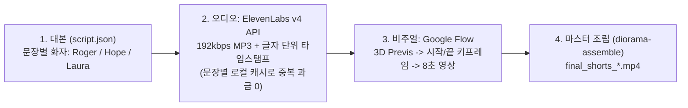

# 계획: `ElevenLabs v4 + Google Flow` 2대 엔진 단순화 & 3인 성우 Pilot #3 완성

## 목표 (일회성이 아닌 **파이프라인 영구 업그레이드** + Pilot #3 첫 실증)

> [!IMPORTANT]
> **이번 작업은 Pilot #3 하나만 수동으로 고치는 일회성 작업이 아닙니다.**
> 앞으로 만드는 **모든 신규 에피소드(`main.py dossier seed` → `prompt-gate` → `diorama-flow` → `diorama-assemble`)**가 자동으로 이 구조로 돌아가도록 **Gear 1~4 파이프라인 코어 모듈과 마스터 규칙(`AGENTS.md`, `SKILL.md`) 전체를 영구 업데이트**합니다. Pilot #3는 업그레이드된 파이프라인으로 뽑는 첫 번째 완성본입니다.

| 파이프라인 단계 | 영구 업그레이드되는 모듈 | 앞으로 모든 에피소드에 자동 적용되는 동작 |
|---|---|---|
| **SSOT 상수 & 캐스트** | [config.py](file:///home/canadaofbin/gdrive/Kyubin_Yun_Workspace/07_Youtube/pipeline/config.py), [production_constants.md](file:///home/canadaofbin/gdrive/Kyubin_Yun_Workspace/07_Youtube/.agents/rules/production_constants.md), `cast_registry.json` | • 기본 음성을 `elevenlabs_v4` (`Roger` 남성 메인)로 영구 고정<br>• 고정 3인 극단(`narrator`=`Roger`, `researcher`=`Hope`, `mini_cortex`=`Laura`) 전역 등록 |
| **Gear 1·2 대본 시딩** | [research_dossier.py](file:///home/canadaofbin/gdrive/Kyubin_Yun_Workspace/07_Youtube/pipeline/research_dossier.py) (`dossier seed`), [prompt_quality_v5.py](file:///home/canadaofbin/gdrive/Kyubin_Yun_Workspace/07_Youtube/pipeline/prompt_quality_v5.py) | • 신규 에피소드 생성(`dossier seed`) 시 자동으로 `voice_preset="elevenlabs_v4"` 및 `sentence_speakers` 3인 배정 템플릿 생성<br>• `prompt-gate`에서 3인 성우 비중(`해설자 >= 75%`, `최대 3성우`) 및 경량 프롬프트 단어 수 자동 검증 |
| **Gear 2·3 프롬프트 빌더** | [depiction_rules.py](file:///home/canadaofbin/gdrive/Kyubin_Yun_Workspace/07_Youtube/pipeline/depiction_rules.py) (`ExpressiveV8PromptComposer`), [flow_prompt_builder.py](file:///home/canadaofbin/gdrive/Kyubin_Yun_Workspace/07_Youtube/pipeline/flow_prompt_builder.py) | • Google Flow UI 설정(`8s`, `9:16`, `Frames`)과 중복되는 문구(`8s vertical video.`, `Bridges opening...`, `Settles smoothly...`)를 **모든 향후 에피소드 프롬프트에서 자동 제거(45% 경량화)** |
| **Gear 4 오디오 & 조립** | [elevenlabs_tts.py](file:///home/canadaofbin/gdrive/Kyubin_Yun_Workspace/07_Youtube/pipeline/elevenlabs_tts.py), [voice_fallback.py](file:///home/canadaofbin/gdrive/Kyubin_Yun_Workspace/07_Youtube/pipeline/voice_fallback.py), [diorama_assembler.py](file:///home/canadaofbin/gdrive/Kyubin_Yun_Workspace/07_Youtube/pipeline/diorama_assembler.py) | • `sentence_speakers` 배열을 읽어 문장마다 ElevenLabs `v4` 3인 보이스 자동 합성 + 화자별 `request_id` 톤 유지 + 영구 캐시<br>• 롱테이크 클립(`sentence_index..end_sentence_index`) 다중 문장 커버 조립 기본 지원 |
| **마스터 규칙 & 스킬** | [AGENTS.md](file:///home/canadaofbin/gdrive/Kyubin_Yun_Workspace/07_Youtube/.agents/AGENTS.md), [neuro_diorama_rules.md](file:///home/canadaofbin/gdrive/Kyubin_Yun_Workspace/07_Youtube/.agents/rules/neuro_diorama_rules.md), [youtube-script/SKILL.md](file:///home/canadaofbin/gdrive/Kyubin_Yun_Workspace/07_Youtube/.agents/skills/youtube-script/SKILL.md), [youtube-produce/SKILL.md](file:///home/canadaofbin/gdrive/Kyubin_Yun_Workspace/07_Youtube/.agents/skills/youtube-produce/SKILL.md) | • 이후 모든 세션과 서브에이전트가 **『ElevenLabs v4 + Google Flow 2대 엔진 + 3인 고정 극단 + 실화 스탬프 + 경량 프롬프트』** 규칙을 기본값으로 준수 |

---

## 단순화된 2대 엔진 파이프라인 구조



---

## 제안 변경 사항

### 1. 고정 캐릭터 3인 레지스트리 (전원 ElevenLabs `v4`)

#### [NEW] `BCI_Shorts_Channel/knowledge_base/reusable_packs/cast_registry.json`
```json
{
  "schema": "aab_cast_registry_v1",
  "max_voices_per_episode": 3,
  "cast": {
    "narrator": {
      "display_name": "Narrator (Roger)",
      "on_screen": false,
      "voice_preset": "elevenlabs_v4",
      "elevenlabs_voice_id": "CwhRBWXzGAHq8TQ4Fs17",
      "gender": "male",
      "share_target": "0.75-0.90"
    },
    "researcher": {
      "display_name": "Dr. Ada (Researcher)",
      "on_screen": true,
      "voice_preset": "el_researcher_v4",
      "elevenlabs_voice_id": "tnSpp4vdxKPjI9w0GnoV",
      "gender": "female",
      "max_lines": 2
    },
    "mini_cortex": {
      "display_name": "Mini-Cortex",
      "on_screen": true,
      "voice_preset": "el_minicortex_v4",
      "elevenlabs_voice_id": "FGY2WhTYpPnrIDTdsKH5",
      "gender": "female",
      "max_lines": 1
    }
  }
}
```

---

### 2. 기본 보이스를 `ElevenLabs v4`로 단일화

#### [MODIFY] [config.py](file:///home/canadaofbin/gdrive/Kyubin_Yun_Workspace/07_Youtube/pipeline/config.py) & [production_constants.md](file:///home/canadaofbin/gdrive/Kyubin_Yun_Workspace/07_Youtube/.agents/rules/production_constants.md)
- `DEFAULT_DIORAMA_VOICE_PRESET = "elevenlabs_v4"` 및 `EXPRESSIVE_V8_DEFAULT_VOICE_PRESET = "elevenlabs_v4"`로 변경하여 별도 옵션 없이도 항상 ElevenLabs `v4`가 기본 작동하도록 고정합니다.
- `DIORAMA_VOICE_PRESETS`의 `"elevenlabs_v4"` 기본 `elevenlabs_voice_id`를 **`Roger` (`CwhRBWXzGAHq8TQ4Fs17`)**로 설정하고, `"el_researcher_v4"`(`Hope`), `"el_minicortex_v4"`(`Laura`)를 등록합니다.

#### [MODIFY] [elevenlabs_tts.py](file:///home/canadaofbin/gdrive/Kyubin_Yun_Workspace/07_Youtube/pipeline/elevenlabs_tts.py) & [voice_fallback.py](file:///home/canadaofbin/gdrive/Kyubin_Yun_Workspace/07_Youtube/pipeline/voice_fallback.py)
- `synthesize_elevenlabs_v4_episode()`에 `speaker_voice_by_idx`를 추가하여 문장마다 지정된 ElevenLabs `voice_id`(`Roger` / `Hope` / `Laura`)로 직접 합성하고, 화자별로 `previous_request_ids` 문맥을 유지합니다.

---

### 3. Google Flow UI 설정 중복 문구 제거 (`Prompt Diet` — 프롬프트 45% 경량화)

> [!TIP]
> **정확히 짚어주신 포인트입니다!**
> 이미 Google Flow UI 설정창에서 **`Video · 9:16 (세로) · 8s · Frames (시작/끝 키프레임 2장 첨부)`**를 직접 클릭해 세팅하고 있으므로, 프롬프트 텍스트에 똑같은 말을 반복할 필요가 전혀 없습니다. 오히려 불필요한 수식어를 빼야 Veo 모델이 **실제 행동과 표정 연기**에 100% 집중합니다.

#### 제거되는 중복 보일러플레이트 3종 ([depiction_rules.py](file:///home/canadaofbin/gdrive/Kyubin_Yun_Workspace/07_Youtube/pipeline/depiction_rules.py) `ExpressiveV8PromptComposer`)
1. ~~`8s vertical video.`~~ → **제거** (Flow UI 설정창에서 이미 `8s`, `9:16` 선택됨)
2. ~~`Bridges opening eye level medium frame smoothly into closing high angle 3q frame.`~~ → **제거** (Flow UI에 이미 시작/끝 키프레임 이미지 2장이 첨부되어 자동 보간됨)
3. ~~`Settles smoothly for 8-frame dissolve.`~~ → **제거** (디졸브 전환은 `diorama_assembler.py` 편집기에서 처리함)

#### 프롬프트 경량화 전/후 비교 (`51단어 → 28단어`, **45% 단축**)
- **기존 (`51단어`)**:
  > ~~`8s vertical video.`~~ `3D dolly-zoom push-in warping background depth behind the subject.` ~~`Bridges opening eye level medium frame smoothly into closing high angle 3q frame.`~~ `Swings open the oak door and spreads two empty four-fingered matte-white palms above the bare table, and the seated figure's charcoal-black 2D ink eyebrows drop in startled disappointment. Tactile foley only, silent voice track.`
- **개선 후 (`28단어` — 순수 카메라 + 액션 + 오디오 락만 유지)**:
  > `3D dolly-zoom push-in warping background depth behind the subject. Swings open the oak door and spreads two empty four-fingered matte-white palms above the bare table, and the seated figure's charcoal-black 2D ink eyebrows drop in startled disappointment. Silent voice track.`

#### [MODIFY] [depiction_rules.py](file:///home/canadaofbin/gdrive/Kyubin_Yun_Workspace/07_Youtube/pipeline/depiction_rules.py) & [config.py](file:///home/canadaofbin/gdrive/Kyubin_Yun_Workspace/07_Youtube/pipeline/config.py)
- `ExpressiveV8PromptComposer.compose_clip_prompt(context_split=True)`에서 `lead_clause`(`8s vertical video.`), `bridge_clause`, `trans_clause`를 제거하고, `EXPRESSIVE_V8_CONTEXT_SPLIT_WORDS_RANGE = (18, 45)`로 경량화합니다.
- *(주의: 이미 생성된 Pilot #3의 18개 MP4 클립은 캐시 지문이 깨지지 않도록 기존 클립 파일을 그대로 보존해 즉시 조립에 사용합니다.)*

---

### 3-B. 실화 스탬프 데이터 그래프 오버레이 (`Data Stamp` — 파이프라인 영구 기능)

> [!IMPORTANT]
> **그래프는 Google Flow에 그려달라고 하지 않고, 조립 단계에서 코드로 직접 그립니다.**
> AI 영상 모델은 숫자와 글자를 자주 틀리게 그리고(예: `12`가 `21`로 바뀜), 채널 규칙(R56)상 AI 영상 속 텍스트는 금지입니다. 그래서 **논문 수치를 코드로 정확히 렌더링한 막대그래프**를 해당 문장이 나오는 순간 영상 위에 애니메이션으로 올립니다. 숫자 오류 가능성은 0입니다.

#### Pilot #3 적용 예시 (문장 13 · `Clip 12` 후반부)
- **데이터 출처**: Kidd, Palmeri & Aslin (2013), *Cognition* 126(1), DOI `10.1016/j.cognition.2012.08.004` — 아이 28명, 평균 대기 시간
- **화면 연출 (약 2.5초)**:
  ```text
  ┌─────────────────────────────┐
  │  약속이 깨진 방   ▇▇  3분      │   ← 회색 막대 먼저 등장
  │  약속을 지킨 방   ▇▇▇▇▇▇▇▇ 12분 │   ← 초록 막대가 쭉 늘어나며 숫자 카운트업 3→12
  │                    ×4 ↑       │   ← 마지막에 "×4" 배지 팝업
  │  Kidd et al., 2013 · n=28    │   ← 하단 작은 출처 표기
  └─────────────────────────────┘
  ```
- 화면 상단 `18%~48%` 영역에 배치합니다. 자막(`Y=63%`)과 상단 챕터 헤드라인을 피하는 위치입니다.
- 영상 내 표기는 영어(`Broken promise 3 min` / `Kept promise 12 min`)이며, 채널 시청자층(`en-US`)에 맞춥니다.

#### 파이프라인 영구 반영 (앞으로 모든 에피소드에서 사용 가능)
| 모듈 | 변경 |
|---|---|
| `script.json` 스키마 | 새 필드 `data_stamps: [{sentence_index, chart: "bar_compare", bars: [{label, value, unit}], multiplier_badge, source_citation, doi}]` |
| [NEW] `pipeline/data_stamp_overlay.py` | Pillow로 막대그래프 프레임을 렌더링(막대 성장 + 숫자 카운트업 + 배지 팝업, `30fps`)해 투명 PNG 시퀀스로 출력 → `ffmpeg overlay`로 해당 문장 타임스탬프에 합성. 채널 폰트 `AABCondensed-Black.ttf`와 채널 4색 팔레트 사용 |
| [diorama_assembler.py](file:///home/canadaofbin/gdrive/Kyubin_Yun_Workspace/07_Youtube/pipeline/diorama_assembler.py) | ElevenLabs 글자 단위 타임스탬프로 문장 13 시작 시점을 찾아 오버레이 자동 배치 |
| [prompt_quality_v5.py](file:///home/canadaofbin/gdrive/Kyubin_Yun_Workspace/07_Youtube/pipeline/prompt_quality_v5.py) (`prompt-gate`) | `data_stamps` 검증: 모든 숫자에 `doi` 필수, 그래프 수치가 대본 문장 속 숫자와 일치하는지 확인(예: 대본 "twelve" ↔ 그래프 `12`), 에피소드당 최대 2개 |
| [posthoc_semantic_qa.py](file:///home/canadaofbin/gdrive/Kyubin_Yun_Workspace/07_Youtube/pipeline/posthoc_semantic_qa.py) / CV 텍스트 게이트 | 오버레이 구간은 "의도된 그래픽"으로 허용 처리. AI가 만든 글자로 오탐하지 않게 합니다 |
| `research_dossier.py` (`dossier seed`) | 도시에의 `core_facts`에 수치 비교가 있으면 `data_stamps` 초안 자동 생성 |
| [neuro_diorama_rules.md](file:///home/canadaofbin/gdrive/Kyubin_Yun_Workspace/07_Youtube/.agents/rules/neuro_diorama_rules.md) | **R70 Data Stamp** 신설: 실화 스탬프 문장에는 DOI 근거가 있는 그래프 1개 권장, 숫자는 반드시 코드로 렌더링 |

> [!NOTE]
> 효과 측면: 쇼츠에서 "4배"를 귀로만 들으면 흘려듣기 쉽지만, 막대가 3에서 12로 늘어나는 장면은 **멈춰서 보게 만드는 순간(리텐션 훅)**이 되고, 캡처되어 댓글과 공유로 이어지기 쉽습니다. 실화 스탬프의 신뢰도도 함께 올라갑니다.

---

---

### 3-C. 나레이션 생성·시딩·검증 파이프라인 영구 업그레이드 (`2분 / 120초` 스토리텔링 체제)

> [!IMPORTANT]
> **앞으로 생성되는 모든 에피소드의 대본이 끊어 치는 전보식 문장이 아니라, '상황 배경 + 인과관계 + 실화 스탬프'가 명확한 스토리텔링으로 생성되도록 대본 파이프라인 전체를 업데이트합니다.**

#### 1) 새로운 6-Act 스토리텔링 대본 생성 공식 ([youtube-script/SKILL.md](file:///home/canadaofbin/gdrive/Kyubin_Yun_Workspace/07_Youtube/.agents/skills/youtube-script/SKILL.md) & [research_dossier.py](file:///home/canadaofbin/gdrive/Kyubin_Yun_Workspace/07_Youtube/pipeline/research_dossier.py))
- **Act 1 (상황 배경 & 사건 발단, `S01~S04`)**: 시청자를 실험실/사건 현장 한복판에 데려다 놓는 배경 설명(`"Imagine you are..."`) + **`researcher`(`Hope`)의 실제 실험 조건 직접 대사 1문장**
- **Act 2 (기존 통념 & 1차 실험 결과, `S05~S08`)**: 흔한 상식(예: "의지력 테스트")을 소개하고 1차 조건에서 나타난 극적인 행동 변화 묘사
- **Act 3 (`Mini-Cortex` 반전 질문 & 대조 실험 + 📊 실화 스탬프, `S09~S13`)**:
  - **`mini_cortex`(`Laura`)**가 핵심 허점을 찌르는 반전 질문(`"Hold on! What if...?"`)
  - 실제 대학/연구진의 대조군 실험 과정 설명 → **실화 스탬프 문장 + `Data Stamp` 비교 그래프 오버레이**
- **Act 4 (3D X-Ray 뇌 기전 풀이, `S14~S16`)**: 전문 용어를 일상 비유(`보상 중추 vs 전두엽 브레이크`)와 함께 친절하게 해설
- **Act 5 (내 일상과의 연결, `S17~S18`)**: 실험 결과가 왜 우리의 밤 야식·미루기·불안으로 이어지는지 공감 연결
- **Act 6 (실천 해법 & 여운, `S19~S20`)**: 오늘 당장 써먹을 수 있는 행동 해법 제시

#### 2) 대본 검증 게이트(`prompt-gate` / `episode-qa`) 영구 개편 ([config.py](file:///home/canadaofbin/gdrive/Kyubin_Yun_Workspace/07_Youtube/pipeline/config.py), [prompt_quality_v5.py](file:///home/canadaofbin/gdrive/Kyubin_Yun_Workspace/07_Youtube/pipeline/prompt_quality_v5.py), [dynamic_episode_qa.py](file:///home/canadaofbin/gdrive/Kyubin_Yun_Workspace/07_Youtube/pipeline/dynamic_episode_qa.py))
| 항목 | 기존 제한 (원인) | **업그레이드 후 (영구 반영)** |
|---|---|---|
| **최대 영상 길이** | `89.5초` (`SHORTS_EXPRESSIVE_V8_DURATION_MAX_SEC`) | **`120.0초 (2분)`** (충분한 스토리 호흡 보장) |
| **첫 문장(`S1`) 단어 제한** | `12단어` 이하 강제 (`EXPRESSIVE_V8_OPENING_ACTION_MAX_WORDS`) → 배경 설명 불가 | **`30단어` 이하** + `"Imagine you are..."` 상황 몰입형 오프닝 정식 허용 |
| **문장당 / 총 단어 수** | 문장당 `22단어`, 총 `160~240단어` | **문장당 `30단어`, 총 `160~420단어`** (자연스러운 인과관계 연결 허용) |
| **실제 대학·연구 언급** | `EXPRESSIVE_V8_FORBID_SPOKEN_CITATIONS = True`로 본문에서 대학명 언급 차단 | **`False`로 해제** → Act 3~5 실화 스탬프에서 `"University of Rochester"`, `"real 2012 study"` 등 실제 연구 배경 언급 허용 |
| **화자 역할(`sentence_speakers`)** | `"narrator"`, `"foil"` 2종만 허용 | **`"narrator"`(`Roger`), `"researcher"`(`Hope`), `"mini_cortex"`(`Laura`), `"foil"`** 정식 지원 |

---

### 3-D. Blender 3D Previs 자동 생성 파이프라인 직결 (`pipeline/previs_blender.py` + `pipeline/porcelain_anchor_pack.py`)

현재 3D 프리비즈 생성 구조와 이번 업그레이드로 추가할 **완전 자동화 단계**는 다음과 같습니다:

| 단계 | 현재 작동 방식 (`Pilot #3`) | 영구 파이프라인 업그레이드 (`자동화`) |
|---|---|---|
| **① 3D 좌표(`previs` 블록) 생성** | 별도 일회성 스크립트([build_pilot03_marshmallow_previs.py](file:///home/canadaofbin/.gemini/antigravity-cli/brain/b57c97a8-6324-4c31-a2bb-16b25e28dd55/scratch/build_pilot03_marshmallow_previs.py))에서 각 컷의 `camera_start`, `camera_end`, `actors`, `props`, `room_blocks` (x, y, z) 좌표를 작성해 `visual_plan.json`에 주입 | [previs_blender.py](file:///home/canadaofbin/gdrive/Kyubin_Yun_Workspace/07_Youtube/pipeline/previs_blender.py)에 **`auto_synthesize_plan_previs_specs(visual_plan)`** 함수 신설 → 각 클립의 `camera_move`(`dolly_zoom_vertigo`, `crane_swoop_dive`, `orbital_3d_arc_sweep` 등), `grammar`, `location_id`, 등장 캐릭터/소품 목록만 보고 **자동으로 3D 공간 좌표와 카메라 시작·끝 궤적을 계산** |
| **② 카메라 연속성 & 색상 배정** | `propagate_previs_camera_continuity()`가 같은 방 연속 컷의 `이전 끝 카메라 = 다음 시작 카메라`를 맞추고, `assign_previs_marker_colors()`가 겹치지 않는 안전 색상(`보라 #7B2CBF`, `올리브 #386641`, `황토 #8C5A2B`) 자동 배정 | 동일하게 자동 실행 |
| **③ Headless Blender 렌더링 & 프롬프트 주입** | `render_cut_previs_pair()`가 `/home/canadaofbin/opt/blender/blender -b -P`를 무인 실행해 컷당 `0.4초` 만에 `Sxx_start_previs.png` / `Sxx_end_previs.png`를 뽑고, `inject_previs_guides_into_reference_anchors()`가 키프레임에 연결 | `main.py porcelain-refs` 및 `diorama-episode` 실행 시 **별도 스크립트 없이 자동으로 `03_visuals/previs_guides/`에 전 컷 3D 프리비즈 PNG 생성 및 레퍼런스 앵커 주입** |

---

### 3-E. 3D Previs 정교화 방안 (현재 코드 분석 결과)

[`synthesize_default_previs_spec_for_clip()`](file:///home/canadaofbin/gdrive/Kyubin_Yun_Workspace/07_Youtube/pipeline/previs_blender.py#L369-L442) 분석 결과 확인된 한계와 개선안입니다.

| # | 현재 한계 (코드 근거) | 정교화 방안 | 기대 효과 |
|---|---|---|---|
| **E1. 카메라 프리셋** | 키워드 5종(`top_down`/`orbit`/`low_angle`/`portal`/`pullback`)만 매칭됨. Pilot #3에서 쓰는 `crane_swoop_dive`, `dolly_zoom_vertigo`, `pan_left/right`, `fpv_3d_flight`, `gentle_push_in`은 전부 **기본값(정면 push-in)으로 떨어짐** | `CAMERA_MOVE_PREVIS_PRESETS` 테이블 신설: 실제 쓰는 12종 무빙마다 시작/끝 `pos`·`look_at`·`fov` 정의 (예: `dolly_zoom` = 전진하면서 FOV 60→35, `crane_swoop` = 높이 3.2m→1.1m, `pan` = 위치 고정·`look_at`만 좌우 이동) | Flow가 받는 시작·끝 프레임이 **실제 무빙 이름과 일치** → 카메라 지시 위반 감소 |
| **E2. 장소(방) 구조** | 모든 컷이 동일한 `floor + back_wall + surface_block` 1종 방 | `location_registry.json` 신설: `location_id`별 고정 방 레이아웃 (놀이방 = 테이블+문+관찰창, 부엌 = 냉장고+카운터, 정원 = 테이블+하늘). 같은 `location_id`는 에피소드 내내 **동일 좌표 재사용** | 컷 간 공간 일관성 (문·창문 위치가 컷마다 바뀌는 문제 제거) |
| **E3. 캐릭터 체형·자세** | 모든 배우가 `height_m=1.72` 서 있는 자세, 최대 2명 | `cast_registry`에 체형 추가 (아이 `1.05m`, 어른 `1.72m`) + `pose` 필드 (`standing`/`seated`/`reaching`/`leaning`) → 앉은 자세는 하체 블록 접힘, `reaching`은 팔 블록 추가. 최대 인원 3명 | 4살 아이·연구원 키 차이와 "앉아서 손 뻗기" 같은 핵심 동작이 구도에 반영 |
| **E4. 소품 형태·위치** | 모든 소품이 `0.32×0.24×0.22` 같은 상자, 고정 위치, 최대 2개 | `prop_shape_library`: 접시=납작 원판, 마시멜로=작은 원기둥, 냉장고=큰 세로 박스, 마커 트레이=납작 박스. 위치는 `surface_block` 위 / 배우 손 위치(`attach_to: actor_hand`)에 자동 배치 | 소품 크기 비율이 맞아 Flow가 엉뚱한 크기로 그리는 문제 감소 |
| **E5. 화면 문법별 프레이밍** | `hands_closeup`, `pov_hands`, `xray_brain`, `cameo_world` 문법을 구분 안 함 | 문법별 규칙: `hands_closeup` = 카메라를 손·테이블 높이 0.4m 거리로, `pov_hands` = 배우 머리 위치에 카메라 + 팔 블록만 표시, `xray_brain` = 머리 구체 확대 + 뇌 영역 색상 구 표시 | 클로즈업/1인칭 컷의 구도가 정확해짐 |
| **E6. 중간 프레임** | 시작/끝 2장만 렌더 | 선택적으로 `Sxx_mid_previs.png` 추가 렌더 (궤적 확인용 + 3장 contact sheet). Flow에는 기존대로 2장만 전달 | 궤적이 꺾이는 무빙(`orbit`, `crane`) 검수 용이 |
| **E7. 구도 일치 QA** | 생성된 Flow 키프레임이 프리비즈를 따랐는지 검사 없음 | `previs_conformance_qa()`: 프리비즈 마스크 vs 키프레임의 인물 위치(YuNet/실루엣 bbox) IoU 비교, `IoU < 0.35`면 경고 + 재생성 후보 표시 | 구도가 틀어진 키프레임을 영상 생성 **전에** 걸러 Flow 크레딧 절약 |
| **E8. 렌더 품질** | Workbench 단색 플랫 셰이딩 | Workbench 유지 + **캐비티/외곽선(`show_cavity`, `show_object_outline`)** + 바닥 그림자만 추가 (`~0.5s/컷` 유지) | 깊이감이 살아나 원근 해석 정확도 향상, 속도 영향 거의 없음 |

**구현 우선순위**: `E1 → E2 → E3 → E5` (구도 정확도 직결, 1차) → `E4 → E8` (2차) → `E7 → E6` (QA, 3차).

**파일 변경**: [previs_blender.py](file:///home/canadaofbin/gdrive/Kyubin_Yun_Workspace/07_Youtube/pipeline/previs_blender.py) (프리셋/문법/포즈/소품 형태/QA), `knowledge_base/reusable_packs/location_registry.json` (신규), `cast_registry.json` (체형 필드 추가), `tests/test_previs_blender.py` (프리셋 12종·장소 재사용·포즈 단위 테스트).

---

### 4. 전면 개정한 Pilot #3 나레이션 & 18컷 경량화(`Prompt Diet`) 비주얼 프롬프트 명세

#### A. 전체 20문장 나레이션 (예상 러닝타임: `약 1분 45초` · 3인 성우 `Roger` / `Hope` / `Laura`)

| 문장 | 담당 클립 | 화자 (`ElevenLabs v4`) | 쉬운 스토리텔링 영문 대본 (`[v4 태그]` 포함) | 한국어 의미 (상황 배경 + 인과관계 완비) |
|---|---|---|---|---|
| **S01** | `Clip 01` | **Narrator (`Roger`)** | `[brisk, urgent voice] Imagine you are four years old inside a university playroom, and a friendly researcher promises to bring you a giant box of brand-new crayons — but walks back in completely empty-handed!` | 당신이 대학 놀이방에 앉아 있는 네 살배기 아이라고 상상해 보세요. 친절한 연구원이 새 크레용 세트를 가져오겠다고 약속하더니, 정작 빈손으로 돌아옵니다! |
| **S02** | `Clip 02` | **Narrator (`Roger`)** | `She admits she broke her promise, and leaves you with only two snapped, worn-out crayon stubs on the table.` | 그녀는 약속을 못 지켰다고 인정하며, 테이블 위에 부러진 몽당 크레용 두 개만 덩그러니 놓고 갑니다. |
| **S03** | `Clip 03` (앞) | **Narrator (`Roger`)** | `[measured, deliberate voice] Right after breaking that promise, she starts the famous Marshmallow Test and sets one sweet marshmallow right in front of you.` | 그렇게 약속을 어긴 바로 직후, 그녀는 유명한 '마시멜로 테스트'를 시작하며 달콤한 마시멜로 하나를 당신 코앞에 내려놓습니다. |
| **S04** | `Clip 03` (뒤) | **Researcher (`Hope`)** | **`"If you wait fifteen minutes without eating it, I promise I will bring you a second marshmallow."`** | **"15분 동안 안 먹고 기다리면, 두 번째 마시멜로를 꼭 가져다줄게."** *(연구원 직접 대사)* |
| **S05** | `Clip 05` | **Narrator (`Roger`)** | `For decades, psychology textbooks claimed this test measures pure willpower, blaming kids who eat early for having weak self-control.` | 수십 년 동안 심리학 교과서들은 이 테스트가 순수한 '의지력'을 측정한다며, 일찍 먹는 아이들은 자제력이 부족하다고 탓해 왔습니다. |
| **S06** | `Clip 06` | **Narrator (`Roger`)** | `[brisk, urgent voice] And sure enough, in the room where the adult had just lied about the crayons, the children reached out and snatched the marshmallow fast!` | 아니나 다를까, 어른이 방금 크레용 거짓말을 했던 이 방의 아이들은 곧바로 손을 뻗어 마시멜로를 낚아챘습니다! |
| **S07** | `Clip 07` | **Narrator (`Roger`)** | `[measured, deliberate voice] On average, those children lasted barely three minutes before eating it right on the spot.` | 이 아이들은 평균 고작 3분밖에 버티지 못하고 그 자리에서 마시멜로를 먹어버렸죠. |
| **S08** | `Clip 08` | **Narrator (`Roger`)** | `Observers watching from behind the glass shook their heads, assuming these kids simply had terrible impulse control.` | 유리창 너머로 지켜보던 관찰자들은 고개를 저으며, 아이들의 충동 조절 능력이 형편없다고 단정 지었습니다. |
| **S09** | `Clip 09` | **Mini-Cortex (`Laura`)** | **`[brisk, urgent voice] Hold on! What if the kids weren't bad at waiting — what if they just knew that adult couldn't be trusted?`** | **"잠깐만요! 만약 아이들이 참을성이 없는 게 아니라, 단지 저 어른의 말을 믿을 수 없다는 걸 간파한 거라면요?"** *(Mini-Cortex 반전 질문)* |
| **S10** | `Clip 10` | **Narrator (`Roger`)** | `To test that exact idea, scientists at the University of Rochester ran a second group where the researcher actually delivered the full tray of fresh markers she promised.` | 바로 그 가설을 검증하기 위해, 로체스터 대학교 연구진은 두 번째 그룹을 실험했습니다. 이번에는 연구원이 약속했던 새 마커 세트를 실제로 가져다주었죠. |
| **S11** | `Clip 11` | **Narrator (`Roger`)** | `As the children happily drew with the new markers, they learned one crucial fact: adults in this room keep their word.` | 아이들은 새 마커로 신나게 그림을 그리면서 결정적인 사실 하나를 배웠습니다. '이 방의 어른은 약속을 지킨다'는 믿음이죠. |
| **S12** | `Clip 12` (앞) | **Narrator (`Roger`)** | `Then, the researcher brought out the exact same single marshmallow plate and made the exact same fifteen-minute promise.` | 그다음, 연구원은 아까와 똑같은 마시멜로 한 개짜리 접시를 내놓고 똑같은 15분 약속을 했습니다. |
| **S13** | `Clip 12` (뒤) + **📊 그래프** | **Narrator (`Roger`)** | **`[measured, deliberate voice] In the real Rochester study, children who trusted the adult waited four times longer — jumping from three minutes to twelve full minutes!`** | **실제 로체스터 대학 연구 결과, 어른을 신뢰한 아이들은 대기 시간이 3분에서 무려 4배인 12분으로 껑충 뛰었습니다!** *(실화 스탬프 + `3분 vs 12분 (×4)` 막대그래프 팝업)* |
| **S14** | `Clip 14` | **Narrator (`Roger`)** | `[measured, deliberate voice] Eating early was never a failure of willpower — it was smart survival math inside an unreliable room.` | 일찍 먹어버린 건 의지력의 실패가 아니었습니다. 믿을 수 없는 환경에서 내린 아주 똑똑한 생존 계산이었던 겁니다. |
| **S15** | `Clip 15` | **Narrator (`Roger`)** | `Deep inside your brain, your reward center, called the nucleus accumbens, fires urgent red signals telling you to grab the sure thing right now.` | 우리 뇌 깊은 곳의 보상 중추인 '측좌핵'은 다급한 붉은 신호를 보내며, 눈앞의 확실한 보상을 지금 당장 챙기라고 외칩니다. |
| **S16** | `Clip 16` | **Narrator (`Roger`)** | `Meanwhile, your prefrontal cortex right behind your forehead only steps on the brakes when it truly believes the future reward is guaranteed.` | 반면 이마 바로 뒤의 '전두엽'은 미래의 보상이 진짜로 보장된다고 믿을 때만 브레이크를 밟아 충동을 멈추죠. |
| **S17** | `Clip 17` | **Narrator (`Roger`)** | `That is why, after a stressful day full of broken plans, your exhausted brain stops trusting tomorrow and opens the fridge at midnight.` | 스트레스와 틀어진 계획으로 지친 하루 끝에, 우리 뇌가 내일을 믿지 못하고 한밤중에 냉장고 문을 여는 이유도 바로 이 때문입니다. |
| **S18** | `Clip 18` | **Narrator (`Roger`)** | `When your hand reaches for that late-night snack, your brain isn't broken — it is just looking for one reward that won't let it down.` | 야식을 향해 손이 뻗어 나갈 때, 당신의 뇌가 고장 난 게 아닙니다. 그저 절대로 배신하지 않을 확실한 보상 하나를 찾고 있을 뿐이죠. |
| **S19** | `Clip 19` | **Narrator (`Roger`)** | `So if you want stronger self-control, stop shaming your willpower and start keeping tiny, realistic promises to yourself each morning.` | 그러니 자제력을 키우고 싶다면, 의지력을 자책하는 대신 매일 아침 나 자신과의 작고 현실적인 약속 하나를 지키는 것부터 시작해 보세요. |
| **S20** | `Clip 20` | **Narrator (`Roger`)** | `[measured, deliberate voice] Once your brain learns it can trust your word, patience comes naturally on its own.` | 내 뇌가 '내 말은 믿을 수 있다'는 걸 배우는 순간, 인내심은 저절로 따라오게 됩니다. |

---

#### B. 18개 비주얼 클립 경량화(`Prompt Diet`) Google Flow 프롬프트 명세 (`UI 중복 문구 3종 완전 제거`)

> [!NOTE]
> 아래 프롬프트들은 Google Flow 설정창에서 이미 선택하는 **`8s vertical video.`**, **`Bridges opening ... frame into closing ... frame.`**, **`Settles smoothly for ... dissolve.`** 문구를 모두 걷어내고 **순수 카메라 무빙 + 핵심 연기 동작 + 무음 보이스 락**만 남긴 **경량화(`Prompt Diet`) 버전**입니다.

| 클립 (`문장`) | 카메라 무빙 / 문법 | 시작 → 끝 키프레임 | 경량화된 Google Flow 비디오 프롬프트 (`Prompt Diet` 적용) |
|---|---|---|---|
| **Clip 01** (`S01`) | `dolly_zoom_vertigo` (`vinyl_world`) | `kf_01` → `kf_02` | `3D dolly-zoom push-in warping background depth behind the subject. Swings open the oak door and spreads two empty four-fingered matte-white palms above the bare table, and the seated figure's charcoal-black 2D ink eyebrows drop in startled disappointment. Silent voice track.` |
| **Clip 02** (`S02`) | `crane_swoop_dive` (`hands_closeup`) | `kf_02` → `kf_03` | `3D crane swoop diving from high angle into the prop action. Tight hand close-up: nudges two tiny snapped wax crayon stubs rolling across the oak tabletop with one four-fingered hand, and 2D charcoal-black ink mouth curves downward at the broken stubs. Silent voice track.` |
| **Clip 03** (`S03..S04`) | `orbital_3d_arc_sweep` (`vinyl_world`) | `kf_03` → `kf_04` | `3D orbital camera arc sweeping around the subject with parallax. Sets down a crisp white porcelain saucer holding one plump white marshmallow right on the center oak tabletop, and wide 2D charcoal-black ink eyes lock straight onto the plump marshmallow. Silent voice track.` |
| **Clip 05** (`S05`) | `pan_right` (`literal_analogy`) | `kf_05_start` → `kf_05_end` | `Continuous 3D camera pan rightward tracking Beat A into Beat B. Taps a stack of unmarked hardcover books and lifts a cracked white porcelain dumbbell prop, and smug arched 2D charcoal-black ink eyebrows frame a lecturing grin. Silent voice track.` |
| **Clip 06** (`S06`) | `fpv_3d_flight` (`hands_closeup`) | `kf_06` → `kf_07` | `Agile 3D forward tracking flight gliding straight toward the subject. Tight hand close-up: lunges forward across the oak table and snatches the plump white marshmallow off the saucer, and determined 2D ink brows narrow as four-fingered vinyl fingers close around the treat. Silent voice track.` |
| **Clip 07** (`S07`) | `gentle_push_in` (`vinyl_world`) | `kf_07_start` → `kf_07_end` | `Continuous 3D camera push-in gliding toward the subject reaction. Takes an immediate bite of the white marshmallow while the empty porcelain saucer gleams below, and 2D charcoal-black ink cheeks puff out in unapologetic satisfaction. Silent voice track.` |
| **Clip 08** (`S08`) | `pan_left` (`vinyl_world`) | `kf_08` → `kf_09` | `Continuous 3D camera pan leftward tracking Beat A into Beat B. Shake their smooth oval heads and tap wooden clipboards firmly against the console ledge, and furrowed 2D charcoal-black ink brows frown through the observation glass. Silent voice track.` |
| **Clip 09** (`S09`) | `whip_pan_occlusion` (`vinyl_world`) | `kf_09_start` → `kf_09_end` | `Brisk 3D whip-pan sweeping past a foreground edge onto the action. Turns briskly away from the skeptics and lifts a brimming wooden art-supply tray toward the bright door, and 2D charcoal-black ink eyes widen with sudden curiosity. Silent voice track.` |
| **Clip 10** (`S10`) | `orbital_3d_arc_sweep` (`cameo_world`) | `ref_cameo` + `cameo_opt3` | `3D orbital camera arc sweeping around the subject with parallax. Slides a full compartmentalized wooden tray of fresh colorful markers smoothly across the oak table while Mini-Cortex gleams on the shelf behind, and the seated figure's 2D charcoal-black ink eyes light up with delighted trust. Silent voice track.` |
| **Clip 11** (`S11`) | `gentle_push_in` (`hands_closeup`) | `kf_11` → `kf_12` | `Continuous 3D camera push-in gliding toward the subject reaction. Tight hand close-up: draws bold colorful spirals across white drawing paper using a fresh bright-blue marker, and relaxed 2D ink eyes curve warmly as trust settles in. Silent voice track.` |
| **Clip 12** (`S12..S13`) | `crane_swoop_dive` (`vinyl_world`) | `kf_12` → `kf_13` | `3D crane swoop diving from high angle into the prop action. Places the crisp white porcelain saucer with one plump marshmallow at center table and steps calmly toward the hallway, and the seated figure folds both matte-white hands neatly in their lap. Silent voice track.` |
| **Clip 14** (`S14`) | `fpv_3d_flight` (`literal_analogy`) | `kf_14_start` → `kf_14_end` | `Agile 3D forward tracking flight gliding straight toward the subject. Tips a gleaming brass two-pan balance scale on the garden table as the camera flies toward their forehead, and focused 2D charcoal-black ink eyes lock forward in crisp realization. Silent voice track.` |
| **Clip 15** (`S15`) | `portal_dive_flight` (`xray_brain`) | `kf_15` → `ref_xray_brain` | `3D forward camera flight diving smoothly into the close-up beat. Inside the crystal glass dome, a deep crimson-red pulse fires brightly in the deep central nucleus accumbens hub as golden forehead seam opens a crystal-clear glass dome over the 4-color 3D brain. Silent voice track.` |
| **Clip 16** (`S16`) | `orbital_3d_arc_sweep` (`xray_brain`) | `ref_xray_brain` → `ref_xray_brain_2` | `3D orbital camera arc sweeping around the subject with parallax. Warm amber-gold and electric cyan-blue light streams smoothly across the front prefrontal lobes calming the deep crimson glow inside the crystal-clear glass dome over the 4-color 3D brain. Silent voice track.` |
| **Clip 17** (`S17`) | `crane_swoop_dive` (`vinyl_world`) | `kf_17` → `kf_18` | `3D crane swoop diving from high angle into the prop action. Slumps shoulders beside a pile of unopened envelopes on the counter and pulls open the bright refrigerator door, and tired 2D charcoal-black ink eyes stare at a frosted cake plate on the middle shelf. Silent voice track.` |
| **Clip 18** (`S18`) | `pan_left` (`pov_hands`) | `kf_18_start` → `kf_18_end` | `Continuous 3D camera pan leftward tracking Beat A into Beat B. First-person POV: reaches a four-fingered matte-white hand swiftly toward the frosted snack plate inside the open refrigerator, and frazzled 2D ink brows soften in recognition as the hand pauses mid-air. Silent voice track.` |
| **Clip 19** (`S19`) | `fpv_3d_flight` (`hands_closeup`) | `kf_19` → `kf_20` | `Agile 3D forward tracking flight gliding straight toward the subject. Tight hand close-up: draws one crisp bold checkmark inside an unmarked linen notebook square with a brass pen, and determined 2D charcoal-black ink eyes brighten with calm self-trust. Silent voice track.` |
| **Clip 20** (`S20`) | `clean_pullback_reveal` (`vinyl_world`) | `kf_20_start` → `kf_20_end` | `Continuous 3D camera pullback revealing the wider spatial action. Closes the linen notebook crisply with both hands and lifts a warm white ceramic mug in golden morning sun, and confident 2D charcoal-black ink smile holds steady in crisp morning light. Silent voice track.` |

---

#### [MODIFY] `BCI_Shorts_Channel/projects/v8_pilot_03_marshmallow_trust_previs/02_script/script.json` & `03_visuals/visual_plan.json`
- 위 표대로 `script.json`과 `visual_plan.json`을 업데이트하고 [diorama_assembler.py](file:///home/canadaofbin/gdrive/Kyubin_Yun_Workspace/07_Youtube/pipeline/diorama_assembler.py)로 즉시 조립합니다.

---

## 검증 계획
1. `pytest tests/test_credit_safe_pipeline.py -v`로 ElevenLabs 3인 성우 라우팅 및 캐시 작동 확인
2. `main.py diorama-assemble --project v8_pilot_03_marshmallow_trust_previs --force`로 `192kbps` ElevenLabs 3인 보이스 + 18컷 영상 조립 및 최종 `final_shorts_v8_pilot_03_marshmallow_trust_previs.mp4` 추출
