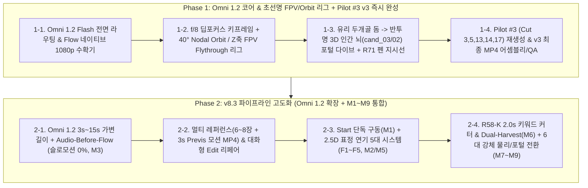

# [다음 에피소드(#4)부터 적용] ALL ABOUT BRAIN `v8.3` 통합 마스터 실행 계획서 (`Omni 1.2 Flash` + `FPV/Orbit` + `M1~M9`)

> [!NOTE]
> 본 통합 마스터 플랜은 **현재 제작 중인 Pilot #3 (`v8_pilot_03_marshmallow_trust_previs`) 완성 및 유튜브 업로드 직후, 다음 영상(Episode #4)부터 전면 적용**할 파이프라인 로드맵입니다.

## 팩트체크 보완 사항 (2026-11-10 05:46 UTC 검증 — 아래 본문보다 우선 적용)

| # | 본문 내용 | 검증 결과 (실측 근거) | 수정 방침 |
|---|---|---|---|
| C1 | "크레딧이 남아 있는데 `Veo 3.1 Lite`로 강등됨" | **틀림.** `BCI_Shorts_Channel/.cache/flow_credit_state.json`: 잔여 `16` 크레딧(클립당 `20` 미만), `exhausted: true`, **리셋 `2026-11-17 00:03 UTC`**. 실제로 크레딧이 소진된 상태였음 | 원인 진단에서 삭제. Episode #4가 11/17 이전이면 `0-credit` 경로가 **주력**이 되므로, 계획의 선명도 대책(Start 단독, 딥포커스, p15 블러 게이트)은 **`Veo 3.1 Lite`에서도 동작하도록** 설계 |
| C2 | Omni 1.2 "15초 · 1080p 업스케일 · 대화형 편집 · 6~10장 레퍼런스 · 30% 저렴" | **우리 Flow UI에서 미검증.** 출처는 웹 검색 요약(리다이렉트 URL)뿐. `config.py`에는 여전히 `4/6/8/10s`, 레퍼런스 첨부 시 `8s`, Omni 1.2 = **클립당 24크레딧**(Omni 1.1 = 20)로 기록되어 있어 "30% 저렴"과 **정면 충돌** | **Phase 0 신설**: 크레딧 리셋 후 읽기 전용 CDP 프로브로 설정창(길이 옵션, 다운로드 메뉴의 1080p 항목, Edit 버튼, 최대 ingredient 수, 실제 크레딧 표기)을 스크린샷으로 확인한 뒤에만 각 기능을 켬. 모든 기능은 **기능 플래그(기본 OFF)** 로 구현 |
| C3 | `FLOW_OMNI_EPISODE_CREDIT_CAP = 600` | 근거 없음. 클립당 24cr × 20컷 = 480cr. 월 할당량을 모름 | 고정값 대신 **실시간 잔액 기반 예산**: `min(잔액 − 안전마진 20, 컷수 × 단가)`. 잔액 부족 시 우선순위(뇌 포털 → FPV/Orbit → 훅 1~3컷) 순으로만 Omni 배정 |
| C4 | 카메라 비율 "FPV 55% + Orbit 25% + 고정 20%" | Pilot #3 블러 원인(고속 FPV + 이종 스케일 모핑)과 `M2`(캐릭터 컷은 완만한 카메라) 원칙에 **모순** | **Z축 전진 계열 55%** (그중 고속 FPV/포털 다이브는 **≤ 20%**, 나머지는 `gentle_push_in`) · **Orbit ≤ 25%** (단일 피사체·동일 스케일 컷만) · **고정 강체/바스트업 ≥ 20%** |
| C5 | 영상 길이 계약 | `config.py` 독스트링·`uploader.py` 감사 = **≤ 89.5s**, `AGENTS.md`/R68 = **≤ 120s**. 현재 v2는 119.5s → 감사에서 "legacy" 분류 | Episode #4 착수 전 **하나로 확정** 필요 (사용자 결정 항목) |
| C6 | 검증용 테스트 이름 | `test_start_frame_only_...` 등 **아직 존재하지 않음**. 또한 `test_credit_safe_pipeline.py`, `test_expressive_25d_v8.py`, `test_master_plan_regressions.py`, `test_neuro_diorama_v6.py`가 기존 hero cap / `orbital_3d_arc_sweep` / `object_portal_macro` 동작을 참조 | 신규 테스트 작성 + 위 4개 파일의 기대값을 함께 갱신하는 작업을 각 Phase에 명시 |
| C7 | 문서 SSOT 동기화 누락 | `config.py`는 "`production_constants.md`와 1:1"을 요구. `youtube-produce/SKILL.md`는 아직 "Omni 1.1" + "**임시 Flow 프로젝트 삭제**"로 되어 있어 방 보존 규칙과 충돌 | 각 Phase 마지막에 `production_constants.md`, `AGENTS.md` 규칙표(신규 R58-K, R68-A, R55-B 등록), `youtube-produce`/`youtube-script` SKILL.md 갱신 포함 |
| C8 | 0-credit 동시 탭 | 직전 실행이 `FLOW_ZERO_CREDIT_SAFE_PARALLEL_TABS = 2`인데도 **5개 샤드**를 열어 `unusual activity` 제한 **5회** 발생 | 0-credit 모드에서 샤드 수를 상수로 강제 제한하는 버그 수정을 Phase 1에 추가 |
| C9 | 롤백 | 없음 | 모든 신규 동작은 플래그로 감싸고, 실패 시 v8.2 동작으로 즉시 복귀 |

## Goal Description

지금까지 논의되고 아직 실행되지 않은 **3개의 미실행 계획**을 충돌 없이 하나의 실행 아키텍처(`Schema v8.3`)로 완전 통합합니다:

1. **[즉시 완성 — Pilot #3 `v3` 영상 수정 마무리]**:
   - 흐릿했던 3개 컷(`Cut 3, 5, 17`)을 모션 블러 없는 **초선명 `3D Nodal Orbit` & `FPV Flythrough` (`Omni 1.2 Flash` + 네이티브 `1080p`)** 로 재생성.
   - 캐릭터 머리 위 투명 유리 두개골 돔([media_1794277271409_ef9e912c.jpg](file:///home/canadaofbin/.gemini/antigravity-cli/brain/b57c97a8-6324-4c31-a2bb-16b25e28dd55/.user_uploaded/media_1794277271409_ef9e912c.jpg))에서 승인하신 **반투명 3D 인간 뇌 6종 팩([translucent_brain_reference_pack.md](./translucent_brain_reference_pack.md) `cand_03`, `cand_02`)** 으로 자연스럽게 파고드는 포털 전환 + **손글씨 만년필 지시선(`Nucleus Accumbens`, `Prefrontal Cortex`)** 합성 완성 (`Google Flow` 방 삭제 금지 영구 유지).
2. **[엔진 업그레이드 — `Gemini Omni 1.2 Flash` (`macaron_cookie`) 6대 신기능 전면 도입]**:
   - ① 크레딧 보유 시 전 컷 `Omni 1.2 Flash` 우선 구동(기존 8컷 제한 해제, 30% 단가 절감 반영), ② Flow 네이티브 `1080p` 업스케일 다운로드, ③ `3s~15s`(`1초` 단위) 가변 길이 렌더링, ④ 초선명 `FPV Flythrough` · `40° Nodal 3D Orbit` 카메라 리그, ⑤ 멀티 레퍼런스(`6~8장` + `3초` Blender Previs 모션 MP4), ⑥ 대화형 부분 편집(`Flow Edit Mode`) QA 자동 리페어.
3. **[차세대 연출·편집 통합 — 구 `next_episode_v8_2_master_plan` (`M1~M9`)]**:
   - 캐릭터 억지 모핑 제거(`Start Frame` 단독 구동 기본화 `M1`) + `Audio-Before-Flow` 슬로모션 0%(`M3`) + 2.5D 차콜 잉크 표정 연기 5대 고도화(`F1~F5`, `M5`) + `신비한 건축사전` 다큐멘터리 문법(`2.0s` 키워드 타격 커터 & `1-Clip Dual-Harvest` `M6`, 6대 강체 디오라마 물리 `M7`, 포털·상태 스왑 전환 `M8`, 인씬 오타 0% 프로그래매틱 수치·그래프·지시선 `M9`).



---

## User Review Required

> [!IMPORTANT]
> **통합 시 조율된 3대 핵심 설계 원칙**
> 1. **실행 순서 (`Pilot #3 v3 영상 완성 최우선`)**: 기다리고 계신 **Pilot #3 (`마시멜로 테스트`) 수정 완성본(`v3`)** 을 **Phase 1**에서 가장 먼저 렌더링·검수 완료한 뒤, 이어서 **Phase 2 (`M1~M9` 차기 에피소드용 문법 확장)** 코드까지 원스톱으로 구축합니다.
> 2. **카메라 무빙 조화 (`FPV Flythrough + 3D Orbit` 주력화)**: 기존 `M8` 초안의 수평 패닝 억제 규칙을 사용자의 연출 방향에 맞춰 **`Z축 FPV 공간 관통(Flythrough) & 포털 다이브 55%` + `피사체 중심 40° Nodal 3D Orbit 25%` + `삼각대 고정 강체 물리/바스트업 표정 연기 20%`** 로 확정합니다.
> 3. **`Start Frame` 단독 vs `Start + End` 보간 기준 명확화**:
>    - **일반 캐릭터 연기·바스트업·단일 룸 오빗/FPV 컷**: `Start Frame` 1장 단독 고정(`end_reference_image = None`) + `Omni 1.2` 카메라 제어로 중간 프레임 모핑 블러를 100% 차단합니다.
>    - **포털·도면 변환 컷(`유리 두개골 돔 캐릭터 → 반투명 3D 뇌`, `90° 직부감 → 지상 관통`, `2D 논문 도면 → 3D 융기`)**: 기하학적으로 정렬된 `Start + End` 2장 보간(`Omni 1.2 Flash` `8s~12s`)을 사용합니다.

---

## Open Questions

> [!TIP]
> 별도 수정 사항이 없으시면 **Proceed** 버튼(또는 **"진행해"**)만 눌러주시면 됩니다. 기본 설정은 아래와 같이 가장 완성도 높은 옵션으로 바로 실행됩니다:
> - **Pilot #3 `Cut 13` 뇌 진입**: 첨부하신 **유리 두개골 돔 캐릭터([media_1794277271409_ef9e912c.jpg](file:///home/canadaofbin/.gemini/antigravity-cli/brain/b57c97a8-6324-4c31-a2bb-16b25e28dd55/.user_uploaded/media_1794277271409_ef9e912c.jpg)) → 반투명 3D 인간 뇌(`cand_03`) `Omni 1.2 Flash` 네이티브 포털 다이브 전환** + 만년필 지시선(`Nucleus Accumbens` / `Prefrontal Cortex`)
> - **Pilot #3 `Cut 3, 5, 17`**: `Cut 3, 17`은 초선명 **`3D Nodal Orbit`**, `Cut 5`는 테이블 공간을 가로지르는 **`FPV Flythrough`** (`Omni 1.2 Flash` + 네이티브 `1080p` 다운로드)

---

## Proposed Changes

### Component 1: `Omni 1.2 Flash` 풀스펙 엔진 · 네이티브 `1080p` 수확 · 대화형 편집 리페어

#### [MODIFY] [config.py](file:///home/canadaofbin/gdrive/Kyubin_Yun_Workspace/07_Youtube/pipeline/config.py)
- `FLOW_VIDEO_MODEL_PROFILES["Omni 1.2 Flash"]` 확장:
  - `durations`: `3s ~ 15s` (`1초` 단위), `max_sec = 15`, `max_sec_with_ingredient = 15`, `max_ingredients = 8`, `supports_native_1080p_upscale = True`, `supports_conversational_edit = True`.
- 크레딧 보유 시 전 컷 `Omni 1.2 Flash` 우선 구동(`FLOW_OMNI_EPISODE_CREDIT_CAP = 600`, `FLOW_OMNI_PREFER_NATIVE_1080P_DOWNLOAD = True`, `FLOW_AUTO_CLEANUP_ON_SUCCESS = False` 영구 고정).
- `M1~M9` 상수 추가:
  - `EXPRESSIVE_V8_DAISY_CHAIN_END_FRAME_DEFAULT = False` (`Start Frame` 단독 기본화)
  - `EXPRESSIVE_V8_VISUAL_GRAMMARS`에 `expressive_reaction_closeup` (`F2` 바스트업 표정) 및 6대 강체 디오라마 물리 문법(`axial_portal_dive`, `xray_peel_micro`, `ghost_twin_offset`, `lid_lift_reveal`, `locked_exploded_vs_shatter`, `blueprint_3d_extrusion`) 등록.

#### [MODIFY] [flow_live_single_worker.py](file:///home/canadaofbin/gdrive/Kyubin_Yun_Workspace/07_Youtube/pipeline/flow_live_single_worker.py) & [flow_ingredients.py](file:///home/canadaofbin/gdrive/Kyubin_Yun_Workspace/07_Youtube/pipeline/flow_ingredients.py)
- `ensure_manual_video_916_mode`가 클립별 목표 시간(`4s ~ 15s`)을 동적 선택하도록 업그레이드.
- `Omni 1.2 Flash` `Ingredients` 모드에서 `캐릭터 시트 + 공간 마스터 + 핵심 소품 + 반투명 3D 뇌(cand_01..06)` 다중 레퍼런스(`최대 6~8장`) 및 `3s` Previs 모션 MP4 첨부 지원.

#### [MODIFY] [flow_diorama_sharded_worker.py](file:///home/canadaofbin/gdrive/Kyubin_Yun_Workspace/07_Youtube/pipeline/flow_diorama_sharded_worker.py)
- **네이티브 `1080p` 업스케일 다운로드 (`_download_newest_ready_tile`)**:
  - 캔버스 `720p` 프리뷰만 가져오던 방식을 개선해, QA 통과 타일의 `More -> Download -> Upscaled (1080p)`를 우선 실행하여 진짜 `1080x1920` 원본 해상도를 확보합니다(미지원 티어/타임아웃 시 `720p` + Lanczos 적응형 언샵 폴백).
- **중간 구간 모션블러 스파이크 게이트 (`inspect_diorama_clip_cv`)**:
  - 프레임별 중앙 ROI Laplacian 선명도의 하위 15% 분위수(`p15_center_laplacian`)를 검사해 중간 프레임이 흐려지는 클립을 자동 걸러냅니다.
- **대화형 영상 편집 리페어 (`refine_clip_via_flow_conversational_edit`)**:
  - 훌륭한 `FPV/Orbit` 카메라 무빙이 나왔으나 배경 미세 글자(`plaque_run`) 등 지엽적 결함만 있을 때, 재생성 대신 Flow 대화형 편집으로 카메라 궤적을 보존한 채 1턴 교정합니다.

---

### Component 2: 초선명 `FPV Flythrough` · `40° Nodal 3D Orbit` 카메라 리그 & 3D Previs 모션 패스

#### [MODIFY] [previs_blender.py](file:///home/canadaofbin/gdrive/Kyubin_Yun_Workspace/07_Youtube/pipeline/previs_blender.py)
- `CAMERA_MOVE_PREVIS_PRESETS` 정밀 교정:
  - `orbital_3d_arc_sweep`: 얼굴 스미어를 유발하던 `Δx = 3.10m` 과속 횡이동을 **`40° Nodal Gaze-Lock Orbit` (`[-0.92, -2.15, 1.34] -> [+0.88, -2.15, 1.30]`, `look_at` 피사체 정중앙 고정)** 으로 보정해 피사체는 면도날처럼 선명하고 전·배경만 입체 회전하게 설계.
  - `fpv_3d_flight` / `axial_portal_dive`: 전경 개구부(문틀·조명·소품 사이)를 Z축 직선으로 관통하는 광각(`56° -> 46°`) FPV 드론 궤적으로 정밀화.
- `render_previs_motion_guide_mp4()`: Blender/CPU Workbench에서 `3.0s @ 30fps` 카메라 궤적 가이드 MP4를 자동 생성해 `Omni 1.2` 모션 레퍼런스로 공급.

#### [MODIFY] [porcelain_anchor_pack.py](file:///home/canadaofbin/gdrive/Kyubin_Yun_Workspace/07_Youtube/pipeline/porcelain_anchor_pack.py)
- 배경 아웃포커싱 보케를 유발하던 `object_portal_macro` 순환 배정을 폐기하고 **전 구간 `f/8` 딥포커스 프로브 렌즈(`eye_level_medium`, `fpv_aperture_wide`, `three_quarter_orbit_left`, `three_quarter_orbit_right`)** 로 교체.
- 반투명 3D 인간 뇌 레퍼런스 6종(`BCI_Shorts_Channel/reference_style_anchors/translucent_brain_v8_refs/cand_01..06`) 자동 역할 매핑 고정(마네킹 두상 뇌 완전 퇴출).
- 일반 캐릭터 컷은 `Start Frame` 단독(`end_reference_image = None`), 포털/도면 융기 컷만 정합된 `Start + End` 보간 바인딩(`M1`).

---

### Component 3: 2.5D 차콜 잉크 표정 연기(`M1~M5`) & `신비한 건축사전` 다큐 문법(`M6~M9`)

#### [NEW] [expression_acting_lexicon.json](file:///home/canadaofbin/gdrive/Kyubin_Yun_Workspace/07_Youtube/BCI_Shorts_Channel/assets/expression_acting_lexicon.json)
- `F3` 12종 마이크로 감정 연기 사전(`double_blink_shock`, `asymmetric_skeptical_brow`, `pupil_dart_temptation`, `calm_focused_nod`, `pinpoint_alarm_sweat` 등) + **`F1` State A(시작 표정) → State B(변화 표정)** + **`F4` 시선 이동(Saccade) & 고개 미세 각도(`10° head tilt / chin tuck`)** 매핑 테이블 정의.

#### [MODIFY] [depiction_rules.py](file:///home/canadaofbin/gdrive/Kyubin_Yun_Workspace/07_Youtube/pipeline/depiction_rules.py) & [flow_prompt_builder.py](file:///home/canadaofbin/gdrive/Kyubin_Yun_Workspace/07_Youtube/pipeline/flow_prompt_builder.py)
- **`F2` 바스트업 표정 문법 (`expressive_reaction_closeup`)** 및 **`F5` 화자 연동 립싱크 규칙 (`Speaker-Synced Mouth Rule`)**:
  - 현장 화자(`Hope` 연구원, `Laura` 미니 코텍스) 대사 구간 → `animated 2D ink mouth speaking crisply`
  - 내레이터(`Roger`) 해설 구간 → `closed reactive 2D ink mouth`
- **`M7` (`R68-A`) 6대 강체 디오라마 물리 프롬프트 컴포저 추가**:
  1. `axial_portal_dive` (`90°` 직부감 → 개구부 일직선 FPV 관통)
  2. `xray_peel_micro` (단면 박리 → 심부 뇌/시냅스 다이브)
  3. `ghost_twin_offset` (본체 옆 반투명 황금 유령 분신 슬라이딩 분리)
  4. `lid_lift_reveal` (가벽·천장 수직 상승 리빌)
  5. `locked_exploded_vs_shatter` (삼각대 고정 무중력 정렬 부유 vs 균열 파쇄 대비)
  6. `blueprint_3d_extrusion` (실제 DOI 논문 도면 위 백색 3D 와이어프레임 뇌 수직 융기)
- **`M2` 역할 분리 & 카메라 벡터 밸런스 검증기 (`validate_expressive_v8_prompts`)**:
  - 전신 캐릭터 팬터마임 과다 방지, `FPV/포털 Z축 비행(55%) + 3D Orbit(25%) + 고정 강체/바스트업(20%)` 조화 및 고속 셔터 무블러(`tack-sharp deep focus`) 토큰 검증.

#### [MODIFY] [diorama_assembler.py](file:///home/canadaofbin/gdrive/Kyubin_Yun_Workspace/07_Youtube/pipeline/diorama_assembler.py) & [cli.py](file:///home/canadaofbin/gdrive/Kyubin_Yun_Workspace/07_Youtube/pipeline/cli.py)
- **`M3` `Audio-Before-Flow` 시계 잠금**: Flow 클립 생성 전 ElevenLabs 3인 성우 타임스탬프를 선행 확정해 `Omni 1.2` 생성 길이(`4s~15s`)에 반영하고, 어셈블러에서 **`pts_ratio > 1.0` 슬로모션 늘림을 원천 금지(`0%`)**.
- **`M6` (`R58-K`) `2.0s` 키워드 타격 서브-문장 커터 & `1-Clip Dual-Harvest`**:
  - 숫자·반전어·핵심 뇌 부위 명사 타임스탬프에 칼컷을 스냅하는 서브-문장 분할 모드(`keyword_beat_edl=True`) 및 1개 클립에서 초반(`0.3~2.1s`)·후반(`5.4~7.4s`) 알짜 구간을 교차 수확하는 `A₁ → B → A₂` 듀얼 하베스트 지원.
- **`M8` & `M9` 전환·오버레이 고도화**:
  - `T4` 어두운 개구부 포털 매칭, `T2` 동일 앵글 상태 스왑(`hist_corr >= 0.90`), `T1` 상하 스택 비교 와이프 지원 + `R70 v2` 손그림 크레용 그래프 · `R71` 해부학 만년필 지시선 · 프로그래매틱 공간 대형 숫자 스탬프 결합.

---

### Component 4: Pilot #3 (`v8_pilot_03_marshmallow_trust_previs`) `v3` 즉시 완성

#### [MODIFY] [visual_plan.json](file:///home/canadaofbin/gdrive/Kyubin_Yun_Workspace/07_Youtube/BCI_Shorts_Channel/projects/v8_pilot_03_marshmallow_trust_previs/03_visuals/visual_plan.json)
- 크레딧 상태 캐시 리셋 후 `AAB_v8_pilot_03_marshmallow_trust_previs` 정식 Flow 방에서 `Omni 1.2 Flash` + 네이티브 `1080p`로 5개 컷 재생성:
  - **`Cut 3` (`"one sweet"`)**: `kf_04` 딥포커스 `Start` 단독 + **초선명 `40° Nodal 3D Orbit`**
  - **`Cut 5`**: `kf_06` 딥포커스 `Start` 단독 + 테이블 공간을 가로지르는 **초선명 `FPV Flythrough`**
  - **`Cut 13`**: 유리 두개골 돔 캐릭터([media_1794277271409_ef9e912c.jpg](file:///home/canadaofbin/.gemini/antigravity-cli/brain/b57c97a8-6324-4c31-a2bb-16b25e28dd55/.user_uploaded/media_1794277271409_ef9e912c.jpg)) `Start` → 반투명 3D 인간 뇌(`cand_03`) `End` **FPV 포털 다이브** + 만년필 지시선 **`Nucleus Accumbens / (Reward Center)`**
  - **`Cut 14`**: 측면 반투명 3D 인간 뇌(`cand_02`) `Start` 단독 + 시안-블루 전전두엽 점등 & 만년필 지시선 **`Prefrontal Cortex / (Impulse Brake)`**
  - **`Cut 17`**: `kf_20` 딥포커스 `Start` 단독 + 체크마크 노트로 도는 **초선명 `40° Nodal 3D Orbit`**
- 최종 어셈블리 결과를 `/home/canadaofbin/gdrive/Kyubin_Yun_Workspace/07_Youtube/final_shorts_v8_pilot_03_marshmallow_trust_previs_v3.mp4`로 출력.

---

## Verification Plan

### Automated Tests
1. 통합 단위 테스트 스위트 실행 (`Omni 1.2` + `FPV/Orbit` + `M1~M9` 신규 테스트 포함):
   ```bash
   /home/canadaofbin/hermes-venv/bin/python -X utf8 -m pytest \
     tests/test_expressive_25d_v8.py \
     tests/test_shorts90s_cdp_lease_and_flow_workspace.py \
     tests/test_pipeline_hardening_audit.py \
     tests/test_credit_safe_pipeline.py \
     tests/test_source_to_prompt_r52.py -q
   ```
2. Pilot #3 `v3` 전수 QA 게이트 검증:
   ```bash
   /home/canadaofbin/hermes-venv/bin/python -X utf8 main.py prompt-gate --dir BCI_Shorts_Channel/projects/v8_pilot_03_marshmallow_trust_previs
   /home/canadaofbin/hermes-venv/bin/python -X utf8 main.py ref-qa --project v8_pilot_03_marshmallow_trust_previs
   /home/canadaofbin/hermes-venv/bin/python -X utf8 main.py diorama-assemble --project v8_pilot_03_marshmallow_trust_previs
   /home/canadaofbin/hermes-venv/bin/python -X utf8 main.py posthoc-qa --project v8_pilot_03_marshmallow_trust_previs
   /home/canadaofbin/hermes-venv/bin/python -X utf8 main.py episode-qa --project v8_pilot_03_marshmallow_trust_previs
   /home/canadaofbin/hermes-venv/bin/python -X utf8 main.py prosody-qa --project v8_pilot_03_marshmallow_trust_previs
   /home/canadaofbin/hermes-venv/bin/python -X utf8 main.py autopsy --project v8_pilot_03_marshmallow_trust_previs
   ```

### Manual Verification
1. `final_shorts_v8_pilot_03_marshmallow_trust_previs_v3.mp4` 시각 검수(`walkthrough.md`에 전후 비교 슬라이드 수록):
   - `Cut 3 ("one sweet")`, `Cut 5`, `Cut 17`의 **FPV Flythrough / 3D Orbit** 중간 프레임 선명도(`p15 Laplacian` 수치 및 블러 제거 전후 이미지 비교)
   - `Cut 13 ~ 14` **유리 두개골 돔 캐릭터 → 반투명 3D 인간 뇌 포털 진입** 및 **만년필 지시선(`Nucleus Accumbens`, `Prefrontal Cortex`)** 연결 확인
   - Google Flow 워크스페이스 내 `AAB_v8_pilot_03_marshmallow_trust_previs` 프로젝트 방 영구 보존 확인
