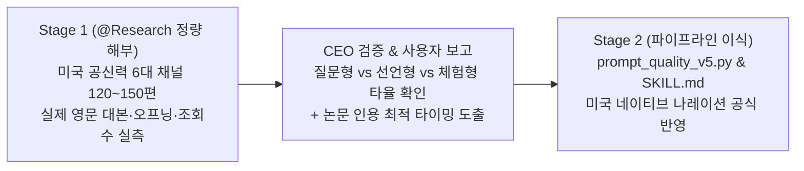

# 미국 공신력 대형 뇌과학·심리학 채널 나레이션 해부(`@Research`) 및 대본 고도화 계획

## Goal Description

현재 우리 `v8` 파이프라인([`pipeline/prompt_quality_v5.py`](file:///home/canadaofbin/gdrive/Kyubin_Yun_Workspace/07_Youtube/pipeline/prompt_quality_v5.py#L667-L699))은 `EXPRESSIVE_V8_DEFAULT_OPENING_MODE = "case_stamp"`를 기본 강제하여, **거의 모든 영상의 첫 문장(`S01`)이 `"In nineteen ninety-eight at University College London..."`, `"In nineteen ninety-six at Virginia..."`처럼 연도 낭독 + 선언문으로 천편일률적으로 시작**하고 질문형(`?`) 오프닝은 사실상 막혀 있습니다.

반면 우리 타겟 시청자는 **미국(`en-US`) 네이티브 대중**입니다. *"미국에서 실제로 수백만~수천만 조회수와 학술적 신뢰성을 동시에 확보한 대형 뇌과학·심리학 채널들은 첫 문장을 질문(`?`)으로 여는가, 2인칭 즉시 체험 테스트로 여는가, 역설적 통념 파괴로 여는가? 그리고 논문·대학 권위(Citation)는 몇 초 지점에 꺼내는가?"*를 감으로 추측하지 않고 **`@Research` 채팅방(`ffbdfca1-9c07-48b3-9b1e-3e3045d67c0c`)을 통해 `120~150편` 실제 영문 대본·타임스탬프·조회수로 정량 검증**한 뒤 우리 대본 규칙에 반영하기 위한 2단계 실행 계획입니다.

---

## User Review Required

> [!IMPORTANT]
> **`@Research`에 배정할 미국 공신력 대형 벤치마크 대상 6대 채널 선정안**:
> 가십성 클릭베이트 공장형 채널을 제외하고, **박사(PhD)·전문의(MD)·실제 해부학 연구소·피어리뷰 에듀케이션 기반의 높은 신뢰도**와 **미국 내 압도적 조회수**를 모두 갖춘 6개 채널입니다.
> 1. **`@Vsauce`** (`~2,300만` 구독, Michael Stevens) — 인지·뇌·지각·심리 역설 분야 **미국 쇼츠 절대 강자(편당 `1,000만~8,000만 뷰`)**. 첫 문장 질문/기행 비율과 연쇄 호기심 나레이션 호흡의 교과서.
> 2. **`@Veritasium`** (`~1,700만` 구독, Derek Muller PhD) — 행동심리·인지착각·분리뇌·카너먼 실험 등 **미국 과학 다큐 스토리텔링 1위**(쇼츠 `500만~3,000만 뷰` + 롱폼 동시 비교 가능).
> 3. **`@InstituteOfHumanAnatomy`** (`~700만` 구독, 실제 인체 해부학 연구소) — 뇌·신경계·통증·수면 메커니즘을 짧은 쇼츠(`300만~2,500만 뷰`)에서 대중 언어로 풀어내는 의학·해부학 나레이션 표본.
> 4. **`@hubermanlab`** (`~650만` 구독, Dr. Andrew Huberman, 스탠퍼드대 신경생물학 교수) — 미국 최고 권위 뇌과학 채널. 학술 신뢰도를 잃지 않으면서 쇼츠/클립 첫 3초에 시청자를 잡는 문장 구조.
> 5. **`@HealthyGamerGG`** (`~300만` 구독, Dr. Alok Kanojia MD, 하버드 의대 정신과 출신) — 도파민·습관·불면·불안·의지력 주제를 2인칭 공감 화법으로 풀어 미국 18~35세 층을 장악한 심리학 쇼츠·롱폼 강자.
> 6. **`@TEDEd` & `@SciShowPsych`** (학자 감수 피어리뷰 스크립트 채널) — 정통 질문형(`"Have you ever...?"` / `"Why do we...?"`) vs 상황 진입형 오프닝의 실제 조회수 성과 대조군.

## Open Questions

> [!NOTE]
> 1. 위 6개 미국 채널 구성 그대로 `@Research`에 분석을 지시하면 될까요? (추가로 보고 싶은 미국 채널 — 예: `@kurzgesagt`, `@Vox`, `@BigThink` 등 — 이 있으시면 말씀해 주세요.)
> 2. 분석 비중은 현재 주력인 **미국 쇼츠(`45~110초`) 나레이션 `70%` + 향후 확장 대비 롱폼 초반 60초 & 본문 설득 구조 `30%`** 비율로 진행할 계획입니다.

---

## Proposed Changes

### Stage 1. `@Research` (`ffbdfca1-9c07-48b3-9b1e-3e3045d67c0c`) 정량 해부 프로토콜 실행
승인 즉시 `@Research`에 아래 **7대 핵심 질문**을 실측 데이터(`yt-dlp` 메타데이터 + `.en.json3` 영문 자막 전수 파싱, 총 `120~150편`)로 규명하도록 지시합니다 (프로덕션 코드 무수정, 읽기 전용 분석):

1. **[핵심 1] 진짜 처음에 '질문(`?`)'으로 시작하는가? (`Opening Sentence Taxonomy & View Multiplier`)**
   - 6개 채널 상위 히트 쇼츠·롱폼의 **첫 문장(`0.0~3.5초`)**을 아래 5대 유형으로 전수 분류하고 **유형별 점유율(`%`)과 평균/중앙값 조회수 배율**을 실측 비교:
     * **Type Q (`Direct Question ?`)**: 단순 질문(`"Have you ever wondered...?"`) vs **역설 질문(`"Why is it impossible to tickle yourself?"`)** — 둘 사이의 성과 차이까지 분리 계측!
     * **Type T (`2nd-Person Instant Test / Command`)**: 시청자에게 즉시 시키는 문장(*"Try to swallow three times in a row right now."*, *"Look closely at these two lines."*)
     * **Type P (`Counter-Intuitive Paradox / Myth Flip Statement`)**: 상식을 깨는 단정문(*"Trying harder to fall asleep is the exact reason you stay awake."*)
     * **Type S (`Bizarre Story / Experiment Action` — 연도 유무 비교!)**: *"In 1998 at UCL..."*(연도 선행) vs *"Neuroscientists built a robot just to tickle people..."*(사건 선행 후 연도·대학 후행) — **첫 문장에 연도(Year)를 넣었을 때 조회수가 오르는지 떨어지는지 정량 검증!**
     * **Type F (`Shocking Bodily/Brain Fact`)**: *"Right now, half of your brain wants to ignore the other half."*
2. **[핵심 2] 대학교·논문·학자 권위(`Credibility Stamp`)는 몇 초 지점에 등장하는가?**
   - 신뢰성 있는 미국 채널들이 `Harvard`, `UCL`, `Stanford`, 연구자 이름을 **`0초(S1)`에 바로 던지는지**, 아니면 **`0~5초`에 일상 역설/질문으로 먼저 낚은 뒤 `6~15초(S2~S4)`에 `"To find out why, neuroscientists at UCL..."` 형태로 증거 스탬프를 찍는지** 타임스탬프 분포 실측.
   - *(중요: 만약 `S2(3~6초)`에 대학이 등장하는 비율이 더 높다면, 우리가 방금 승인한 `R72`에서도 `Cut 1(0~2.2s): 2인칭 일상 역설 장면 → Cut 2~3(2.2~6.5s): "To test this, at UCL..."과 동시에 실제 UCL 드론 외관 → 실험실 절개 다이브!`로 맞물리게 할 수 있음!)*
3. **[핵심 3] 전체 나레이션 뼈대 (`Arc & Pacing Blueprint`)**
   - `60~90초` 쇼츠 기준 시간대별 역할 배분(`Hook → Setup/Experiment → "But here's the catch" Twist → Brain Mechanism & Analogy → Mic-Drop Payoff`), 문장당 평균 단어 수, 어휘 난이도(초·중등 평이 어휘 비중), 분당 발화 속도(`WPM`) 및 의도적 침묵(`Pause`) 길이 계측.
4. **[핵심 4] 미국 네이티브 전환구(`Native Transition Lexicon`) vs AI 클리셰 대조**
   - `@Veritasium`, `@Vsauce`, `@HealthyGamerGG`가 실제로 화제를 뒤집을 때 쓰는 자연스러운 구어체 브리지 표현 사전 구축.
5. **[핵심 5] 어려운 신경해부학 용어의 도입 공식 (`Plain-First vs Term-First`)**
   - `"amygdala"`를 먼저 말하고 풀어서 설명하는지, `"your brain's panic switch — the amygdala"`처럼 **쉬운 일상 기능어를 먼저 말한 뒤 학술 용어를 덧붙이는지** 실측.
6. **[핵심 6] 결말(`Final 5 Seconds`) 공식**:
   - 마지막 문장을 질문으로 끝내는지, 여운 있는 반전 명제(`Declarative Twist`)로 끊는지, 첫 문장과 이어지는 **무한 루프 문장(`Seamless Loop Tail -> Head`)**을 쓰는지 비율 및 조회수 비교.
7. **산출물**: `@Research` 보고서 아티팩트(`us_neuro_psychology_narration_report.md`) 작성 및 아카이브 동기화 후 `@YouTube_CEO`에 보고.

---

### Stage 2. 실측 결과 확인 후 파이프라인 대본 규칙 업데이트 (예고)
Stage 1 리서치 보고서가 도착하면, 검증된 미국 대형 채널 성공 공식을 바탕으로 아래 파일들의 업데이트 안을 확정해 `@Operator`에게 전달합니다 (`Ep #8+`부터 즉시 적용, 현재 진행 중인 `@Operator`의 `R72 + Ep #7` 작업은 방해 없이 병행 완주):

#### [MODIFY] [config.py](file:///home/canadaofbin/gdrive/Kyubin_Yun_Workspace/07_Youtube/pipeline/config.py) & [prompt_quality_v5.py](file:///home/canadaofbin/gdrive/Kyubin_Yun_Workspace/07_Youtube/pipeline/prompt_quality_v5.py)
- 획일적 `"In [Year] at [University]..."` 단일 강제를 해제하고, Stage 1에서 조회수 타율이 입증된 **미국 상위 나레이션 오프닝 모드들(예: `paradox_question`, `sensory_test`, `myth_flip_claim`, `action_then_campus_stamp`)**과 **최적 대학/논문 인용 위치(`S1` vs `S2~S3`)**, **전문용어 `Plain-First` 규칙**, **네이티브 결말/루프 규칙**을 정식 검증 게이트로 구현.

#### [MODIFY] [content_quality_rules.md](file:///home/canadaofbin/gdrive/Kyubin_Yun_Workspace/07_Youtube/.agents/rules/content_quality_rules.md), [neuro_diorama_rules.md](file:///home/canadaofbin/gdrive/Kyubin_Yun_Workspace/07_Youtube/.agents/rules/neuro_diorama_rules.md), [SKILL.md](file:///home/canadaofbin/gdrive/Kyubin_Yun_Workspace/07_Youtube/.agents/skills/youtube-script/SKILL.md)
- 미국 6대 채널 실측 예시 문장 뱅크 및 6-Act 구어체 나레이션 작성 가이드라인 동기화.

---

## Verification Plan

### Automated Verification
- Stage 1(`@Research`): 6개 채널 최소 `120편+` 실측 JSON 요약 통계 검증 (단순 인상 비평 금지 — 오프닝 유형별 정확한 표본 수 `n`, 비율 `%`, 평균·중앙값 조회수, 실제 원문 타임스탬프 인용 필수).
- Stage 2(`@Operator`, 리서치 완료 후): 신규 나레이션 게이트 단위 테스트(`pytest`) `100%` 통과 및 `main.py prompt-gate` 검증.

### Manual Verification
- Stage 1 완료 직후 `us_neuro_psychology_narration_report.md`를 사용자께 브리핑하여 **"미국 대형 뇌과학·심리학 채널들이 실제로 첫 문장과 본문을 어떻게 구성하는지"** 명확히 확인한 뒤 Stage 2 대본 규칙 개편을 진행합니다.
