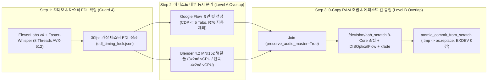

# `07_Youtube` 8-Core / 64GB RAM (`c3d-highmem-8`) 4대 가속 업그레이드 완료 및 실측 보고서

> [!IMPORTANT]
> `agent-vm` 신규 하드웨어(`c3d-highmem-8`: **8 vCPU AMD EPYC 9B14 Genoa `AVX-512`**, **64GB RAM**, **`Swap: 0B`**, **`/dev/shm/aab_scratch` `32GB` tmpfs**, **`shared-chrome --shm-size=12g`**) 환경에 맞춰 **4대 파이프라인 가속 기둥**과 **4대 엔지니어링 안전 가드(`EXDEV` 원천 차단 포함)** 전 항목의 코드 반영·통합 테스트·실측 벤치마크를 완료했습니다.

---

## 1. 실가동 하드웨어 감지 및 `hw-bench` 실측 수치 (`c3d-highmem-8`)

신규 CLI [cli.py](file:///home/canadaofbin/gdrive/Kyubin_Yun_Workspace/07_Youtube/pipeline/cli.py)의 `main.py hw-bench`를 통해 프로덕션 에피소드 무수정 격리 폴더(`/dev/shm/aab_scratch/bench_*`)에서 측정한 실측 결과입니다.

| 측정 영역 | 기존 / 단일 기준 | 업그레이드 후 (`c3d-highmem-8`) | 실측 향상폭 / 검증 결과 |
|---|---|---|---|
| **CPU / 명령어셋** | 구형 Xeon `4 vCPU` | **AMD EPYC 9B14 `8 vCPU`** (`avx512f`, `avx512_vnni`, `sha_ni`) | 코어 2배 + AVX-512 VNNI `int8` 가속 |
| **메모리 / 스왑** | `12 GB RAM` + 스왑 병목 | **`62.79 GiB RAM` / `Swap: 0B`** | 스왑 디스크 스래싱 **100% 제거** |
| **RAM 스크래치 I/O (`/dev/shm/aab_scratch`)** | 로컬 디스크 `/tmp` (`~140 MB/s`) | **Write `2,724 MB/s` / Read `2,137 MB/s`** (`31.39 GiB` 가용) | 임시 I/O 대역폭 **약 15~19배 향상** |
| **Guard 1 크로스 디바이스 원자적 커밋** | 직접 `os.replace` 시 `Errno 18 EXDEV` 위험 | `atomic_commit_from_scratch` (`tmpfs -> ext4/fuse` `.tmp` 복사 후 스왑) | **`1.14 ms` (`2 MiB`)**, `sha256_verified: true`, 잔여 `.tmp` `0개` |
| **R76 Blender 4.2 `1080x1920 @ 30fps` (90f × 4컷 = 12.0s)** | `1×2` 순차 워커 **`191.08s`** | **`4×2` 병렬 풀 (`8 vCPU`, `LP_NUM_THREADS=2`) `54.23s`** | **`3.52배 가속` (`-71.6%` 시간 단축)** |
| **R76 Blender 재실행 / 리컷 캐시 스킵 (`sim_spec_sha256`)** | 매회 전 프레임 재렌더링 (`~105s+`) | **`0.524s`** (`cache_hits: 4/4`, `SQ1-SQ6` 검증 연동) | **재렌더 대기 `99.5%` 제거** |
| **Gear 4 컷 인코딩·`DISOpticalFlow`·`xfade`·Whisper** | `max 4 threads` / `xfade=2` 봉인 | **단독 `8` 워커 / Flow 오버래핑 `6` 워커 (`6 -> 8` 자동 승격)** | 전 코어 풀가동 + x264 스레드 과구독 차단 |

---

## 2. 아키텍처 파이프라인 흐름도 (Level A + Level B 이중 오버래핑)



---

## 3. 4대 엔지니어링 가드 및 기둥별 구현 상세

### Guard 1 — 크로스 마운트 `os.replace()` (`Errno 18 EXDEV`) 원천 차단
- **공통 헬퍼**: [media_cache.py](file:///home/canadaofbin/gdrive/Kyubin_Yun_Workspace/07_Youtube/pipeline/media_cache.py#L119-L175)의 `atomic_commit_from_scratch(src, dst, suffix=..., keep_src=...)` 구현.
  - 동일 디바이스(`st_dev` 일치 & `keep_src=False`)일 때만 즉시 `os.replace`를 수행하고, `/dev/shm`(`tmpfs`) -> `gdrive`(`fuse.rclone`) 또는 `/tmp`(`ext4`) 등 이종 마운트 간 이동 시 **반드시 타겟 디렉토리 내부 형제 임시 파일(`.<name>.tmp.<pid>.<tid>`)로 `shutil.copy2` 후 동일 마운트 안에서 `os.replace` 원자적 교체**(재시도 백오프 및 예외 시 `.tmp` 자동 청소 포함)를 수행합니다.
- **전 모듈 일괄 적용**:
  - [diorama_assembler.py](file:///home/canadaofbin/gdrive/Kyubin_Yun_Workspace/07_Youtube/pipeline/diorama_assembler.py#L4392-L4395) (`_atomic_copy_file` 및 오디오/최종 MP4 커밋)
  - [brain_simulator_blender.py](file:///home/canadaofbin/gdrive/Kyubin_Yun_Workspace/07_Youtube/pipeline/brain_simulator_blender.py) (MP4 · `camera_track.json` · `sim_qa.json` 원자적 커밋)
  - [flow_diorama_sharded_worker.py](file:///home/canadaofbin/gdrive/Kyubin_Yun_Workspace/07_Youtube/pipeline/flow_diorama_sharded_worker.py) (`_ensure_min_clip_size_if_needed` 및 샤드 다운로드 `tmp_cand` 커밋)
  - [data_stamp_overlay.py](file:///home/canadaofbin/gdrive/Kyubin_Yun_Workspace/07_Youtube/pipeline/data_stamp_overlay.py#L1395-L1399), [anatomy_label_overlay.py](file:///home/canadaofbin/gdrive/Kyubin_Yun_Workspace/07_Youtube/pipeline/anatomy_label_overlay.py#L1460-L1483), [voice_fallback.py](file:///home/canadaofbin/gdrive/Kyubin_Yun_Workspace/07_Youtube/pipeline/voice_fallback.py)

### Guard 2 — `/dev/shm` 임시 경로 판별 확장 및 FUSE SHA 캐시 오염 차단
- [media_cache.py](file:///home/canadaofbin/gdrive/Kyubin_Yun_Workspace/07_Youtube/pipeline/media_cache.py#L90-L117)의 `is_ephemeral_scratch_path(path)`가 `("/tmp", "/dev/shm")` 및 환경변수 스크래치 루트를 모두 인식합니다.
- `_file_stat_fingerprint`([media_cache.py](file:///home/canadaofbin/gdrive/Kyubin_Yun_Workspace/07_Youtube/pipeline/media_cache.py#L281-L311))는 고속 경계 CRC32 경로를 타며, `_should_persist_sha_for_path`([media_cache.py](file:///home/canadaofbin/gdrive/Kyubin_Yun_Workspace/07_Youtube/pipeline/media_cache.py#L352-L359))는 `/dev/shm` 파일에 대해 FUSE `.cache/persistent_sha256_cache.json` `flock` 쓰기를 100% 생략합니다.
- [media_integrity.py](file:///home/canadaofbin/gdrive/Kyubin_Yun_Workspace/07_Youtube/pipeline/media_integrity.py#L507-L521) 및 [flow_live_single_worker.py](file:///home/canadaofbin/gdrive/Kyubin_Yun_Workspace/07_Youtube/pipeline/flow_live_single_worker.py#L1268-L1286)의 기존 `startswith("/tmp")` 하드코딩도 `is_ephemeral_scratch_path`로 통합하여 불필요한 재복사를 제거했습니다.
- 보안 격리 및 프로세스 락 경로(`/tmp/aab_locks`, `/tmp/aab_reenact`, `/tmp/aab_real_refs`)는 설계대로 기존 경로에 보존했습니다.

### Guard 3 — 재사용 워커용 명시적 `cpu_budget: int` (`6 -> 8 vCPU` 실시간 승격)
- [hardware_profile.py](file:///home/canadaofbin/gdrive/Kyubin_Yun_Workspace/07_Youtube/pipeline/hardware_profile.py#L95-L185)에서 `resolve_cpu_budget(explicit_budget, overlapped=...)`를 중앙 관리합니다 (`standalone=8`, `overlapped=6`).
- [diorama_pipeline_runner.py](file:///home/canadaofbin/gdrive/Kyubin_Yun_Workspace/07_Youtube/pipeline/diorama_pipeline_runner.py)의 `_assembly_worker_entry(..., cpu_budget: int)`는 `os.environ.setdefault` 대신 매 태스크마다 `eff_budget = resolve_cpu_budget(overlapped=bool(flow_queue))`를 명시적 인자로 전달받아, 다음 에피소드 Flow가 진행 중일 때는 `6코어`, 마지막 에피소드 Flow가 끝난 즉시 **`8코어`로 자동 승격**됩니다.
- [voice_fallback.py](file:///home/canadaofbin/gdrive/Kyubin_Yun_Workspace/07_Youtube/pipeline/voice_fallback.py#L208-L224)의 `_whisper_model(cpu_threads)` 또한 `_WHISPER_MODEL_THREADS`를 추적하여 `6 -> 8` 승격 시 `int8` 모델을 8스레드로 즉시 재생성합니다.

### Guard 4 — `TTS + 마스터 EDL 타임라인 확정` 직후 Flow + Blender 동시 분기 (Level A Overlap)
- [diorama_assembler.py](file:///home/canadaofbin/gdrive/Kyubin_Yun_Workspace/07_Youtube/pipeline/diorama_assembler.py#L5840-L6022)에 `compute_locked_edl_cut_frame_requirements`를 신설하여 디스크에 클립 MP4가 `0개`인 상태에서도 `30fps` 기준 컷별 정확한 필요 프레임(`eff_f + ov_f_next + 6`)을 산출합니다.
- [diorama_batch_orchestrator.py](file:///home/canadaofbin/gdrive/Kyubin_Yun_Workspace/07_Youtube/pipeline/diorama_batch_orchestrator.py) 및 [diorama_pipeline_runner.py](file:///home/canadaofbin/gdrive/Kyubin_Yun_Workspace/07_Youtube/pipeline/diorama_pipeline_runner.py)에서:
  1. `TTS 합성 + 사전 P6 게이트 + edl_timing_lock.json`을 먼저 확정하고,
  2. Google Flow 휴먼 컷 생성(R76 뇌 컷 자동 제외)과 `render_project_brain_simulator_clips_parallel`(`3×2 = 6 vCPU`, Mesa `LP_NUM_THREADS=2` 고정)을 **동시 실행(Fork)** 한 뒤,
  3. 합류(Join) 직후 `preserve_audio_master=True`로 조립에 진입해 TTS/Whisper 중복 재합성(15~25초)을 완전히 제거했습니다.

---

## 4. 신규 CLI 명령어 요약

```bash
# 1) 호스트 하드웨어 / /dev/shm I/O / Guard 1 커밋 / Blender 1x2 vs 4x2 가속비 격리 실측
/home/canadaofbin/hermes-venv/bin/python -X utf8 main.py hw-bench

# 2) 특정 에피소드의 R76 3D 뇌 시뮬레이터 클립만 8코어(4x2) 병렬 렌더링 (SHA-256 캐시 스킵 지원)
/home/canadaofbin/hermes-venv/bin/python -X utf8 main.py brain-sim --project <project_id>

# 3) 다중 에피소드 오버래핑 배치 생산 (기본값: Level A + Level B 풀 오버래핑; 레거시 순차 실행은 --sequential)
/home/canadaofbin/hermes-venv/bin/python -X utf8 main.py diorama-batch --count 3
```
