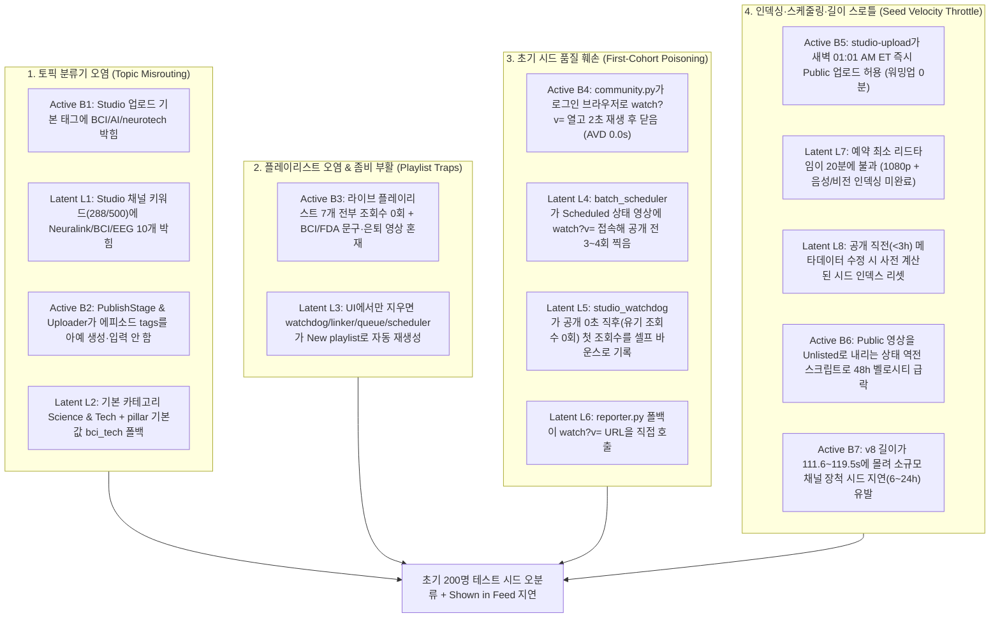

# YouTube 시드 배정 정상화 · 플레이리스트 전량 영구 폐기 · 잠복(Latent) 버그 선제 차단 계획 (`Rule R75`)

> [!IMPORTANT]
> **실시간 포렌식 감사 결론**: 현재 `@AllAboutBrainOfficial`의 초기 200명 테스트 시드 오분류 및 배정 지연은 단순한 1회성 UI 설정 실수가 아니라, **① Studio 라이브 채널/업로드 기본값 + 코드베이스의 태그 누락이 결합된 '3중 BCI 태그 오염'**, **② 조회수 `0`회짜리 BCI/FDA 키워드 플레이리스트 `7`개와 이를 몰래 다시 찍어내는 코드베이스 자동 생성 훅 `6`곳**, **③ 로그인된 크리에이터 브라우저가 공개 직전·직후 `watch?v=`를 열어 `AVD 0.0s` 이탈 조회수를 첫 시드보다 먼저 찍는 구조적 버그**, **④ 워밍업 없는 새벽 즉시 공개·장척(`115~120s`)·공개 상태 번복을 허용하는 파이프라인 허점**이 동시에 작동한 결과입니다.

본 계획 승인(`Proceed`) 즉시 `@Operator`를 통해 **YouTube Studio 라이브 정화 + 플레이리스트 7개 전량 삭제 + 코드베이스 원천 차단 및 잠복 버그 10종 게이트(`Rule R75`)**를 일괄 집행합니다. (현재 `Ep #7`은 Gear 1~4까지만 진행하고 Gear 5 업로드는 본 계획 반영 완료 전까지 안전 보류 조치해 두었습니다.)

---

## 1. 전수 적발된 현행(Active) + 잠복(Latent) 버그 매트릭스

| 구분 | ID | 결함 위치 (Live Studio / Codebase) | 실제 현상 및 잠복 위험 | 조치 방향 |
|---|---|---|---|---|
| **Active** | **B1** | Studio `Settings -> Upload defaults -> Basic info -> Tags` | 라이브 확인 결과 `["BCI", "neuroscience", "brain science", "neural interface", "AI", "neurotech", "brain", "Shorts"]` (`77/500`)가 고정되어 모든 신작에 자동 주입됨 | 기본 태그 **`0/500` 완전 공란 초기화** + `studio-settings` 실행 시 항상 빈 상태 강제 검증 |
| **Latent** | **L1** | Studio `Settings -> Channel -> Basic info -> Keywords` & [uploader.py](file:///home/canadaofbin/gdrive/Kyubin_Yun_Workspace/07_Youtube/pipeline/studio/uploader.py#L877-L901) | 라이브 확인 결과 채널 키워드(`288/500`)에 `BCI`, `neural interface`, `AI`, `brain computer interface`, `EEG`, `neuroprosthetics`, `mind reading AI`, `Neuralink`가 박혀 채널 전체를 하드웨어 풀로 고정함 | 하드웨어 칩 전량 삭제 → 대중 심리·인간 행동·뇌과학 호기심 키워드로 전면 교체 및 자동 동기화 |
| **Active** | **B2** | [`PublishStage.run`](file:///home/canadaofbin/gdrive/Kyubin_Yun_Workspace/07_Youtube/pipeline/publish.py#L1185-L1212), [diorama_batch_orchestrator.py](file:///home/canadaofbin/gdrive/Kyubin_Yun_Workspace/07_Youtube/pipeline/diorama_batch_orchestrator.py#L635-L699), [`StudioUploader`](file:///home/canadaofbin/gdrive/Kyubin_Yun_Workspace/07_Youtube/pipeline/studio/uploader.py#L670-L694) | `v8_ep04~06`의 `metadata.json`에 `"tags"` 키 자체가 누락(`None`)되었고, [uploader.py](file:///home/canadaofbin/gdrive/Kyubin_Yun_Workspace/07_Youtube/pipeline/studio/uploader.py#L1710-L1722)도 Studio `#tags-container`를 전혀 건드리지 않아 오염된 기본 태그가 그대로 남음 + `#shorts` 신호 부재 | 에피소드별 맞춤 심리/뇌과학 `tags`(`8~12`개, `shorts` 포함, 하드웨어 금칙어 게이트) 생성 및 Studio 업로드 시 기존 칩 클리어 후 정확히 주입 + DOM 역검증 |
| **Active** | **B3** | Studio `/content/playlists` 라이브 플레이리스트 `7`개 | **7개 플레이리스트 전부 조회수 `0`회**, 설명란에 `"Neuralink"`, `"FDA clinical trials"`, `"Neural cryptography"` 등 하드웨어 문구와 은퇴/일부공개 영상 유령 엔트리(`33`개) 혼재 | **Studio 내 7개 플레이리스트 전량 영구 삭제(`rowCount == 0` 검증)** |
| **Latent** | **L3** | [short_linker.py](file:///home/canadaofbin/gdrive/Kyubin_Yun_Workspace/07_Youtube/pipeline/studio/short_linker.py#L1260-L1388), [studio_watchdog.py](file:///home/canadaofbin/gdrive/Kyubin_Yun_Workspace/07_Youtube/pipeline/studio/studio_watchdog.py#L378), [queue_manager.py](file:///home/canadaofbin/gdrive/Kyubin_Yun_Workspace/07_Youtube/pipeline/studio/queue_manager.py#L677-L740), [cli.py](file:///home/canadaofbin/gdrive/Kyubin_Yun_Workspace/07_Youtube/pipeline/cli.py#L451-L546), [reporter.py](file:///home/canadaofbin/gdrive/Kyubin_Yun_Workspace/07_Youtube/pipeline/studio/reporter.py#L861-L900) | Studio UI에서만 플레이리스트를 지우면 `studio-watchdog`, `studio-queue`, `studio-link` 실행 시 `New playlist` 버튼을 눌러 **자동으로 플레이리스트를 다시 생성**함. 일일 리포트도 미배정 경고를 띄움 | 플레이리스트 생성·배정 함수 **영구 폐기(Hard-Ban)**, CLI/워치독/큐 기본값 전면 제거, 리포트 플레이리스트 감점 로직 삭제 |
| **Active** | **B4** | [`CommunityManager._async_post_and_pin`](file:///home/canadaofbin/gdrive/Kyubin_Yun_Workspace/07_Youtube/pipeline/studio/community.py#L1119-L1160) | 로그인된 크리에이터 브라우저로 `youtube.com/watch?v=<id>`를 열고 `sleep(2.0)` 대기 후 `v.pause()`를 호출해 **2초 미만 이탈 셀프 조회(`AVD 0.0s`)** 발생 | ① 비공개/예약 영상 실행 원천 차단, ② 유기 조회수 시드 버퍼(`>=100 views` 또는 공개 후 `>=12h`) 도입, ③ `Page.addScriptToEvaluateOnNewDocument`로 `0.000s` 프레임 재생 원천 차단 |
| **Latent** | **L4 / L5 / L6** | [studio_batch_100_scheduler.py](file:///home/canadaofbin/gdrive/Kyubin_Yun_Workspace/07_Youtube/pipeline/studio_batch_100_scheduler.py#L254-L260), [studio_watchdog.py](file:///home/canadaofbin/gdrive/Kyubin_Yun_Workspace/07_Youtube/pipeline/studio/studio_watchdog.py#L341-L358), [reporter.py](file:///home/canadaofbin/gdrive/Kyubin_Yun_Workspace/07_Youtube/pipeline/studio/reporter.py#L337-L366) | 예약 직후(`Scheduled`) 또는 공개 `0`초 직후(`0` organic views)에 `watch?v=`를 자동 방문하여 모든 영상의 첫 조회수가 크리에이터 이탈 뷰로 오염됨 (`ut1wde0d19o` 예약 중 3회 기록 원인) | 예약 영상 핀 호출 삭제, 워치독 공개 직후 즉시 핀 금지(시드 버퍼 경과 후 실행), `reporter.py`의 `watch?v=` 폴백 비활성화 |
| **Active + Latent** | **B5 / L7 / L8** | [uploader.py](file:///home/canadaofbin/gdrive/Kyubin_Yun_Workspace/07_Youtube/pipeline/studio/uploader.py#L544-L669), [sanitize_scheduled_metadata.py](file:///home/canadaofbin/gdrive/Kyubin_Yun_Workspace/07_Youtube/pipeline/studio/sanitize_scheduled_metadata.py#L258), [short_linker.py](file:///home/canadaofbin/gdrive/Kyubin_Yun_Workspace/07_Youtube/pipeline/studio/short_linker.py#L745) | `--visibility public` 즉시 공개 허용(`01:01 AM ET` 참사), 예약 최소 여유시간 `20분`에 불과, 공개 직전 `<3h` 메타데이터 수정으로 인덱싱 초기화 가능 | 즉시 `Public` 업로드 기본 차단(`scheduled` 전용 + 최소 **`>= 3.0h` 인덱싱 워밍업** + `12:00/19:30 ET` 프라임 슬롯 강제), 공개 전 `3h` ~ 공개 후 `24h` 메타데이터 동결(`Seed Freeze Window`) |
| **Latent** | **L2 / B6** | [studio/config.py](file:///home/canadaofbin/gdrive/Kyubin_Yun_Workspace/07_Youtube/pipeline/studio/config.py#L195-L215), [uploader.py](file:///home/canadaofbin/gdrive/Kyubin_Yun_Workspace/07_Youtube/pipeline/studio/uploader.py#L568), [unschedule_retired_shorts.py](file:///home/canadaofbin/gdrive/Kyubin_Yun_Workspace/07_Youtube/pipeline/studio/unschedule_retired_shorts.py#L1-L120) | `pillar` 누락 시 무조건 `"bci_tech"`로 폴백, 기본 카테고리가 `Science & Technology`(하드웨어 편중), `Public -> Unlisted` 강등 허용으로 채널 48h 신뢰도 급락 | 기본 카테고리 `Education` 전환(미국 대형 심리/뇌과학 채널 표준), 기본 pillar 폴백 `"brain_mysteries"`, **`Public -> Unlisted/Private` 역전 영구 금지 게이트** (이미 Unlisted인 과거 3편은 재번복 없이 현 상태 유지) |
| **Active** | **B7** | [pipeline/config.py](file:///home/canadaofbin/gdrive/Kyubin_Yun_Workspace/07_Youtube/pipeline/config.py#L1535-L1544) | `v8` 목표 길이가 `(62.0, 118.0)`으로 넓어 최근 4편이 전부 `111.6s~119.5s` 장척 구간에 안착 → 소규모 채널에서 초기 피드 시드 오픈이 `6~24h` 지연됨 | 신작(`Ep #7+`) 목표 스위트스팟을 **`62.0–86.0s` (`<= 88.0s` Fast-Seed 구간)**으로 재조정 (기제작 `v8_pilot_01..v8_ep06`는 grandfather 처리) |

---

## 2. 단계별 상세 수정 계획 (6 Phases)

### Phase 1 — YouTube 플레이리스트 7개 전량 영구 삭제 및 자동 생성 코드 원천 폐기

> [!CAUTION]
> **UI 단독 삭제 함정 차단**: YouTube Studio 화면에서만 플레이리스트 7개를 삭제하면, 다음번 `studio-watchdog`나 `studio-queue` 실행 시 [`StudioShortLinker._assign_pillar_playlist_on_edit_page`](file:///home/canadaofbin/gdrive/Kyubin_Yun_Workspace/07_Youtube/pipeline/studio/short_linker.py#L1260-L1388)가 `New playlist` 버튼을 눌러 다시 생성합니다. **반드시 코드베이스 차단과 Studio 영구 삭제를 한 세트로 집행**합니다.

1. **삭제 대상 라이브 플레이리스트 전수 목록 (`7`개 전량 영구 삭제, 현재 조회수 전원 `0`회)**:
   - `PLdVmLC3K7dmw` — `Brain Basics & Biophysics | Action Potentials & Neural Circuits` (`5` videos, `0` views)
   - `PLN2i7Lujhi8o` — `Brain Health & Optimization | Sleep, Glymphatic Flush & Dopamine` (`8` videos, `0` views)
   - `PLQXDT6yxpDUs` — `Brain Mysteries & Paradoxes | Consciousness & Perception` (`8` videos, `0` views)
   - `PLFIUNiVpBYXs` — `Brain History & Evolution | How Humanity Found the Mind` (`3` videos, `0` views)
   - `PLKksDVOhsrZs` — `BCI Ethics & Future of Mind | Cognitive Privacy & Neurorights` (`5` videos, `0` views)
   - `PLT4Q_0if7p14` — `BCI Tech Explained | Neural Interfaces & Mind Decoding` (`3` videos, `0` views)
   - `PLNC9nLt0H3S0` — `Brain News | Breakthroughs, Clinical Trials & Neuro-Tech` (`1` video, `0` views)
2. **Studio CDP 일괄 삭제 도구 구현 및 실행 ([uploader.py](file:///home/canadaofbin/gdrive/Kyubin_Yun_Workspace/07_Youtube/pipeline/studio/uploader.py) & [cli.py](file:///home/canadaofbin/gdrive/Kyubin_Yun_Workspace/07_Youtube/pipeline/cli.py))**:
   - `StudioUploader.purge_all_channel_playlists()` 및 `main.py studio-settings --purge-playlists` 구현: 격리된 단일 탭에서 `/content/playlists`의 각 행 옵션 메뉴(`Delete playlist` -> 확인 다이얼로그 승인)를 순회 실행한 뒤, 재조회하여 **`playlist_row_count == 0`**임을 영수증(`reports/studio_playlist_purge_receipt.json`)으로 검증합니다.
3. **코드베이스 내 플레이리스트 생성·할당·권고 로직 전면 제거**:
   - [studio/config.py](file:///home/canadaofbin/gdrive/Kyubin_Yun_Workspace/07_Youtube/pipeline/studio/config.py): `STUDIO_PLAYLISTS_ENABLED = False` 상수 잠금(`PILLAR_PLAYLIST_SPECS` 자동 생성 참조 비활성화).
   - [short_linker.py](file:///home/canadaofbin/gdrive/Kyubin_Yun_Workspace/07_Youtube/pipeline/studio/short_linker.py#L1260-L1795): `_assign_pillar_playlist_on_edit_page` 하드 비활성화(즉시 no-op 반환, `New playlist` 클릭 코드 제거), `link_single_video` 및 `run`의 `assign_playlist` / `assign_playlists` 기본값을 **`False`**로 고정(`R35-B`는 오직 공개 영상 간 `Related video` 단방향 연결만 수행).
   - [studio_watchdog.py](file:///home/canadaofbin/gdrive/Kyubin_Yun_Workspace/07_Youtube/pipeline/studio/studio_watchdog.py#L378), [queue_manager.py](file:///home/canadaofbin/gdrive/Kyubin_Yun_Workspace/07_Youtube/pipeline/studio/queue_manager.py#L677-L740), [studio_batch_100_scheduler.py](file:///home/canadaofbin/gdrive/Kyubin_Yun_Workspace/07_Youtube/pipeline/studio_batch_100_scheduler.py#L169-L237), [cli.py](file:///home/canadaofbin/gdrive/Kyubin_Yun_Workspace/07_Youtube/pipeline/cli.py#L290-L548): 모든 `assign_playlist(s)` 기본값을 `False`로 전환하고 플레이리스트 생성 경로 차단.
   - [reporter.py](file:///home/canadaofbin/gdrive/Kyubin_Yun_Workspace/07_Youtube/pipeline/studio/reporter.py#L861-L900): 플레이리스트 미배정을 `⚠️ 미배정` 결함으로 잡거나 `studio-link --assign-playlists`를 권고하던 진단 문구 전면 제거.
   - [youtube_studio_operations.md](file:///home/canadaofbin/gdrive/Kyubin_Yun_Workspace/07_Youtube/.agents/rules/youtube_studio_operations.md), [SKILL.md](file:///home/canadaofbin/gdrive/Kyubin_Yun_Workspace/07_Youtube/.agents/skills/youtube-studio/SKILL.md), [AGENTS.md](file:///home/canadaofbin/gdrive/Kyubin_Yun_Workspace/07_Youtube/.agents/AGENTS.md), [test_short_linker.py](file:///home/canadaofbin/gdrive/Kyubin_Yun_Workspace/07_Youtube/tests/test_short_linker.py#L470-L505) 동기화.

---

### Phase 2 — 3중 BCI 태그·채널 키워드 오염 정화 및 예약 영상(`Ep #5`, `Ep #6`) 선제 치료

1. **오염원 ① 정화 — Studio `Settings -> Channel -> Basic info -> Keywords` 교체**:
   - **제거할 오염 칩**: `BCI`, `neural interface`, `AI`, `brain computer interface`, `neurotechnology`, `EEG`, `neural engineering`, `neuroprosthetics`, `mind reading AI`, `Neuralink`.
   - **새로 고정할 대중 심리·뇌과학 채널 키워드 (`CHANNEL_CLEAN_KEYWORDS`)**:
     `["psychology", "neuroscience", "human behavior", "brain science", "everyday psychology", "cognitive psychology", "brain facts", "habits", "self control", "memory", "sleep science", "emotions", "decision making", "social psychology", "All About Brain"]`
2. **오염원 ② 정화 — Studio `Settings -> Upload defaults` 완전 초기화**:
   - `Upload defaults -> Basic info -> Tags`: 기존 `["BCI", ..., "neurotech", ...]` 전량 삭제 → **`0/500` 완전 공란**으로 저장 (향후 어떤 영상에도 Studio가 몰래 기본 태그를 덧씌우지 못하게 원천 봉쇄).
   - `Upload defaults -> Advanced settings -> Category` 및 [`DEFAULT_VIDEO_CATEGORY`](file:///home/canadaofbin/gdrive/Kyubin_Yun_Workspace/07_Youtube/pipeline/studio/config.py): 하드웨어/IT 기기 풀로 치우친 `Science & Technology` 대신, `@TEDEd`·`@SciShowPsych`·`@HealthyGamerGG` 등 미국 대중 심리·뇌과학 채널의 표준 풀인 **`Education`**으로 일원화.
   - [`StudioUploader._async_configure_studio_localization`](file:///home/canadaofbin/gdrive/Kyubin_Yun_Workspace/07_Youtube/pipeline/studio/uploader.py#L877-L945)을 업그레이드하여 `main.py studio-settings` 실행 시 채널 키워드 + 업로드 기본 태그(`[]` 빈 상태) + 기본 카테고리(`Education`) + `en-US` 언어 잠금을 한 번에 검증·적용합니다.
3. **오염원 ③ 수정 — 에피소드 맞춤 `tags` 생성 + Studio 업로더 태그 주입 구현 + `#shorts` 정렬**:
   - [`PublishStage.run`](file:///home/canadaofbin/gdrive/Kyubin_Yun_Workspace/07_Youtube/pipeline/publish.py#L1185-L1215) 및 [diorama_batch_orchestrator.py](file:///home/canadaofbin/gdrive/Kyubin_Yun_Workspace/07_Youtube/pipeline/diorama_batch_orchestrator.py#L635-L700)에 결정론적 `build_clean_episode_tags(pillar, script_doc, dossier_doc)` 추가:
     - 에피소드의 실제 심리 현상·뇌 부위·일상 도메인에서 추출한 `8~12`개 클린 태그(`"psychology"`, `"neuroscience"`, `"human behavior"`, `"brain science"`, 에피소드 주제어 4~6개, `"shorts"`)를 `metadata["tags"]`에 기록합니다.
     - **하드웨어 오염 차단 게이트 (`BANNED_OFF_TOPIC_TECH_TAGS`)**: `pillar != "bci_tech"`인 모든 에피소드에서 `{"bci", "neural interface", "ai", "neurotech", "neuralink", "brain chip", "eeg", "mind reading ai", "neuroprosthetics"}`가 단 1개라도 포함되면 `publish` 및 `studio-upload` 사전 게이트에서 즉시 `ValueError`로 차단합니다.
     - 본문 설명란(`description`) 마지막 줄 또는 해시태그 슬롯에 과도한 태그 스팸 없이 단일 `#shorts` 라우팅 신호를 깔끔하게 복원합니다(`R68_DESCRIPTION_HASHTAG_MAX` 및 관련 테스트 동기화).
   - [`StudioUploader.prepare_upload_payload`](file:///home/canadaofbin/gdrive/Kyubin_Yun_Workspace/07_Youtube/pipeline/studio/uploader.py#L670-L694) 및 [`_async_upload_direct_cdp_inner`](file:///home/canadaofbin/gdrive/Kyubin_Yun_Workspace/07_Youtube/pipeline/studio/uploader.py#L1705-L1730) 수정:
     - `Show more` 확장 시 `#tags-container` 내부의 기존 `ytcp-chip`들을 전량 clear한 뒤, `metadata["tags"]`를 정확히 입력하고 저장 직전 DOM 칩 목록을 다시 읽어 오염 칩 `0`개임을 검증합니다.
4. **기예약 대기 중인 에피소드 선제 태그 치료 (`Ep #5`, `Ep #6`) vs 활성 시드 보호 (`Ep #4`)**:
   - **`Ep #5` (`ut1wde0d19o`, 스탠퍼드 간지럼 로봇 패러독스 — 공개까지 약 20시간 남음)** 및 **`Ep #6` (`sjMteEvcjD0`, 베일러 수면 To-Do 리스트 — 공개까지 약 44시간 남음)**: 공개 `3시간` 전 동결 구간 밖이므로 **즉시 `/video/<id>/edit`에서 오염된 `BCI/AI/neurotech` 태그를 제거하고 에피소드 맞춤 심리·수면 태그 + `Education` 카테고리로 교체 저장**하여 첫 시드부터 정상 심리/호기심 풀을 타게 만듭니다.
   - **`Ep #4` (`7W8zIOMKPrQ`, 공개 후 약 3.5시간 경과)**: 현재 첫 24시간 시드 탐색 윈도우 한복판이므로 메타데이터 재저장 시 진행 중인 인덱싱이 리셋될 수 있어 **24시간 경과 전까지 절대 건드리지 않고 보존**합니다. (`soUNqH7UyKw`는 이미 공개 후 24시간이 지났고 시드가 종료된 상태이므로 안전하게 오염 태그 정리 가능.)

---

### Phase 3 — 크리에이터 셀프 조회(`AVD = 0.0s`) 원천 차단 아키텍처

> [!WARNING]
> 구독자 55명 채널에서 유기 조회수가 `0`회일 때 로그인된 크리에이터 계정이 `watch?v=`를 열어 1.5~2.0초 만에 닫으면, YouTube 초기 품질 추정기에 `AVD = 0.0s / 이탈률 100%` 신호가 가장 먼저 입력됩니다. 또한 예약(`Scheduled`) 상태에서 `watch?v=`를 열던 잠복 버그도 즉시 제거해야 합니다.

1. **비공개·예약 영상 브라우저 접근 원천 차단 ([community.py](file:///home/canadaofbin/gdrive/Kyubin_Yun_Workspace/07_Youtube/pipeline/studio/community.py), [studio_batch_100_scheduler.py](file:///home/canadaofbin/gdrive/Kyubin_Yun_Workspace/07_Youtube/pipeline/studio_batch_100_scheduler.py#L254-L260))**:
   - [studio_batch_100_scheduler.py](file:///home/canadaofbin/gdrive/Kyubin_Yun_Workspace/07_Youtube/pipeline/studio_batch_100_scheduler.py#L254-L260)에서 예약 업로드 직후 `post_and_pin_comment`를 호출하던 코드를 즉시 삭제합니다.
   - [`CommunityManager.post_and_pin_comment`](file:///home/canadaofbin/gdrive/Kyubin_Yun_Workspace/07_Youtube/pipeline/studio/community.py#L1050-L1130) 진입부에서 Studio `/content/shorts` 상태 또는 로컬 영수증을 먼저 확인해 `visibility != "PUBLIC"`이면 `watch?v=` 탭을 절대 열지 않고 즉시 거부합니다.
2. **공개 직후 유기 시드 보호 버퍼 (`Seed Protection Buffer`) 도입 ([studio_watchdog.py](file:///home/canadaofbin/gdrive/Kyubin_Yun_Workspace/07_Youtube/pipeline/studio/studio_watchdog.py#L142-L147), [community.py](file:///home/canadaofbin/gdrive/Kyubin_Yun_Workspace/07_Youtube/pipeline/studio/community.py))**:
   - `R68/R73`부터는 핵심 질문과 출처 맥락이 이미 나레이션과 설명란에 완결되어 있으므로, 공개 `0`초 직후 유기 조회수가 `0`회일 때 무리하게 `watch?v=`에 접속할 이유가 없습니다.
   - `MIN_ORGANIC_VIEWS_BEFORE_PIN = 100` (또는 공개 후 최소 `12.0`시간 경과) 조건을 만족하기 전에는 `studio-watchdog`가 `watch?v=` 고정댓글 탭을 열지 않고 대기(`DEFERRED_SEED_PROTECT`)하도록 변경합니다(`--force-immediate-pin` 수동 플래그 예외만 허용).
3. **`0.000s` 미디어 재생 원천 봉쇄 (`Pre-Document Autoplay Kill-Switch`)**:
   - 설령 시드 버퍼 경과 후 `watch?v=` 페이지에 접속하더라도 `sleep(2.0)` 뒤에 `v.pause()`를 부르던 기존 방식을 폐기하고, 페이지 네비게이션 **이전**에 CDP `Page.addScriptToEvaluateOnNewDocument`로 `HTMLMediaElement.prototype.play = () => Promise.resolve()` 오버라이드를 주입하여 **단 `0.001`초의 미디어 재생 세션/시청 핑도 발생하지 않게** 잠급니다.
4. **리포터 `watch?v=` 폴백 제거 ([reporter.py](file:///home/canadaofbin/gdrive/Kyubin_Yun_Workspace/07_Youtube/pipeline/studio/reporter.py#L337-L366))**:
   - `_fetch_watch_page_fallback`이 공개/예약 영상의 `youtube.com/watch?v=` URL을 찌르지 않도록 기본 비활성화하고 Studio 내부 Analytics/Content DOM만 사용하도록 고정합니다.

---

### Phase 4 — 스케줄링 워밍업 · 상태 단방향 잠금 · `< 88s` 고속 시드 길이 규격 (`Rule R75`)

1. **즉시 `Public` 업로드 금지 및 최소 `3.0시간` 인덱싱 워밍업 강제 ([uploader.py](file:///home/canadaofbin/gdrive/Kyubin_Yun_Workspace/07_Youtube/pipeline/studio/uploader.py#L544-L669))**:
   - `studio-upload`에서 `visibility="public"`을 기본 금지(`--allow-instant-public` 명시 없이는 `ValueError` 발생)하여 새벽 `01:01 AM ET` 무예약 즉발 공개 사고를 영구 차단합니다.
   - 예약 슬롯 계산기(`prepare_upload_payload`)의 최소 리드타임을 기존 `20분` → **`180분(3.0시간)`**으로 상향하여, YouTube 서버가 1080p HD 트랜스코딩·음성 스크립트 추출·비전 프레임 분류를 100% 끝낸 상태에서 미국 프라임 슬롯(`12:00 PM ET` 또는 `07:30 PM ET`)에 피드에 진입하도록 보장합니다.
2. **공개 전 `3h` ~ 공개 후 `24h` 시드 동결 윈도우 (`Seed Freeze Window`)**:
   - [short_linker.py](file:///home/canadaofbin/gdrive/Kyubin_Yun_Workspace/07_Youtube/pipeline/studio/short_linker.py#L745) 및 [sanitize_scheduled_metadata.py](file:///home/canadaofbin/gdrive/Kyubin_Yun_Workspace/07_Youtube/pipeline/studio/sanitize_scheduled_metadata.py#L258)에 `PRE_RELEASE_FREEZE_HOURS = 3.0` + `POST_RELEASE_FREEZE_HOURS = 24.0` 양방향 보호 잠금을 적용해, 공개 임박 시점이나 초기 24시간 시드 탐색 도중 메타데이터 재저장으로 인덱스가 리셋되는 잠복 버그를 막습니다.
3. **공개 상태 단방향 불변 게이트 (`Visibility Monotonicity Lock`)**:
   - `Private/Unlisted -> Scheduled -> Public` 단방향 전이만 허용하고, **이미 `Public`인 영상을 자동화 스크립트가 `Unlisted`나 `Private`로 강등하는 행위를 하드 차단**합니다([unschedule_retired_shorts.py](file:///home/canadaofbin/gdrive/Kyubin_Yun_Workspace/07_Youtube/pipeline/studio/unschedule_retired_shorts.py)는 오직 `Scheduled` 대기열 조정에만 사용 가능하도록 제한).
   - 이미 `Unlisted`로 전환된 과거 3편(`t8Z_Q8oB9MY`, `ZbjKX8CBt8A`, `JJkBqo-hTS8`)은 다시 건드리면 2차 상태 진동이 발생하므로 그대로 `Unlisted`에 동결 보존하고, 일관된 일일 프라임 슬롯 발행으로 48시간 채널 벨로시티를 회복합니다.
4. **기본 Pillar 폴백 교정 ([uploader.py](file:///home/canadaofbin/gdrive/Kyubin_Yun_Workspace/07_Youtube/pipeline/studio/uploader.py#L568), [queue_manager.py](file:///home/canadaofbin/gdrive/Kyubin_Yun_Workspace/07_Youtube/pipeline/studio/queue_manager.py#L204))**:
   - `manifest.get("pillar", "bci_tech")` 하드코딩 폴백을 전수 제거하고 `"brain_mysteries"`(또는 명시적 필수 검증)로 변경합니다.
5. **신작(`Ep #7+`) 고속 시드 길이 스위트스팟 재조정 (`62.0–86.0s`, `<= 88.0s`)**:
   - [pipeline/config.py](file:///home/canadaofbin/gdrive/Kyubin_Yun_Workspace/07_Youtube/pipeline/config.py#L1535-L1544)에서 신작 `v8` 목표 길이 범위를 **`(62.0, 86.0)`** (`<= 88.0s`, `155~225` words, `24~32` fast cuts)으로 조정하여 `90~120s` 장척 구간의 초기 시드 지연(`6~24h`)을 피하고 고속 피드 회전율 구간에 안착시킵니다.
   - 이미 렌더링 완료된 `v8_pilot_01..03` 및 `v8_ep04..06`(`111.6~119.5s`)는 `PRE_R75_DURATION_GRANDFATHER_PROJECTS`로 등록해 기존 QA 호환성을 100% 유지합니다.

---

### Phase 5 — 회귀 테스트 스위트(`Rule R75`) 구축 및 전체 검증

- 신규 테스트 파일 `tests/test_studio_seed_hygiene_and_playlist_ban.py` 작성 및 기존 [test_short_linker.py](file:///home/canadaofbin/gdrive/Kyubin_Yun_Workspace/07_Youtube/tests/test_short_linker.py), [test_expressive_25d_v8.py](file:///home/canadaofbin/gdrive/Kyubin_Yun_Workspace/07_Youtube/tests/test_expressive_25d_v8.py) 업데이트:
  1. `STUDIO_PLAYLISTS_ENABLED is False` 및 `short_linker` / `watchdog` / `queue_manager` 호출 시 플레이리스트 생성·할당 시도가 0회인지 검증.
  2. 비-BCI 에피소드 태그에 `BCI`, `AI`, `neural interface`, `neurotech`, `Neuralink` 등이 섞일 경우 즉시 실패하는지 검증 + `PublishStage`가 비어 있지 않은 클린 심리/뇌과학 `tags` 리스트를 생성하는지 검증.
  3. `studio-upload`에서 `visibility="public"` 호출 시 차단되는지, 그리고 `< 3.0h` 이내 슬롯이 다음 유효 프라임 슬롯(`12:00 ET` / `19:30 ET`)으로 자동 이월되는지 검증.
  4. `community.py`가 `Scheduled`/`Unlisted` 영상을 거부하고, 유기 조회수 `< 100`(및 `< 12h`) 구간에서 `DEFERRED_SEED_PROTECT`를 반환하는지 검증.
  5. `Public -> Unlisted` 역전 차단 및 `Ep #7+` `< 88.0s` 목표 길이 게이트 검증.
- 전체 `pytest -v` 실행으로 기존 `429`개 테스트 + 신규 `R75` 테스트 **100% 통과(`Exit Code 0`)** 확인.

---

### Phase 6 — 정화 완료된 파이프라인으로 라이브 집행 및 `Ep #7` 스케줄링

1. `main.py studio-settings --purge-playlists` 실행:
   - **라이브 플레이리스트 `7`개 전량 영구 삭제 (`0`개 잔존 확인)**
   - **채널 키워드 정화 (BCI/하드웨어 제거 → 대중 심리/뇌과학 적용)**
   - **업로드 기본 태그 `0/500` 완전 공란 초기화 + 기본 카테고리 `Education` 적용**
2. 예약 대기 중인 **`Ep #5` (`ut1wde0d19o`, 11/12 19:30 ET)** 및 **`Ep #6` (`sjMteEvcjD0`, 11/13 19:30 ET)**의 오염된 라이브 태그(`BCI`, `neural interface`, `AI`, `neurotech`) 제거 및 에피소드 전용 클린 태그 + `#shorts` 반영 후 DOM 역검증(`Ep #4` `7W8zIOMKPrQ`는 24h 시드 보호를 위해 미접촉 유지).
3. `@Operator`가 제작 중인 **`Ep #7` (`v8_ep07_harvard_reversible_choice_paradox`, `< 88s` 규격)**을 정화된 새 업로더로 **`2026-11-14 19:30 ET` 프라임 슬롯**에 플레이리스트 `0`개·클린 태그·셀프 조회 `0`회 상태로 깨끗하게 예약 배치.
