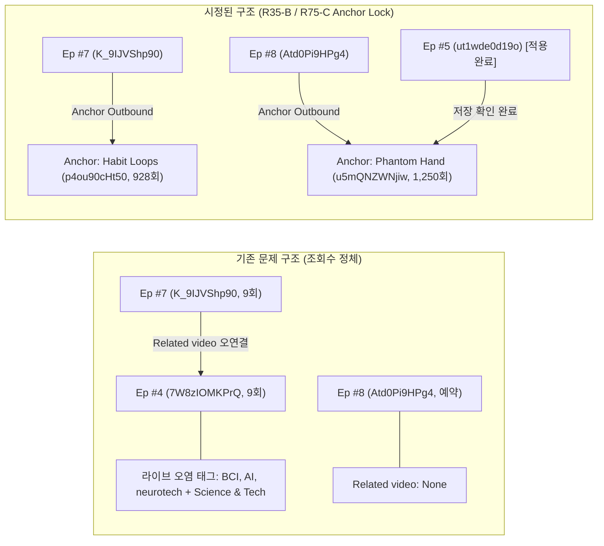

# ALL ABOUT BRAIN 유튜브 설정 오류 전수 진단 및 전 채팅방 시정 보고서 (`R75` / `R75-C`)

> [!IMPORTANT]
> **핵심 요약 (Executive Summary)**
> 1. **최신 공개 영상 조회수 정체의 핵심 원인**: 영상 자체의 품질 문제가 아니라(`Ep #6` `sjMteEvcjD0`는 동일 포맷으로 **525회 · Shorts 피드 93.3% · US 46.8%** 순항 중), **① 최신작 `Ep #7`(`K_9IJVShp90`, 9회)의 `Related video`가 저조회 정체 영상 `Ep #4`(`7W8zIOMKPrQ`, 9회)로 잘못 연결된 시드 데드엔드**, **② 구버전 정적 보호 ID 버그로 인해 `Ep #4` 라이브 Studio에 `BCI/AI/neurotech` 오염 태그와 `Science & technology` 카테고리가 그대로 남아 있던 문제**, **③ 오늘 밤 공개 예정인 `Ep #8`(`Atd0Pi9HPg4`)의 `Related video = None` 미연결 상태** 등 **스튜디오 메타데이터·링크 그래프 설정 결함**이 복합 작용한 결과였습니다.
> 2. **음성으로 질문하신 `Private`(비공개) 영상 2건의 정체**: **대표님이 직접 비공개로 바꾼 것이 절대 아닙니다.** `Ep #8`(카프그라 증후군) 품질 업그레이드(구버전 -> R77 -> R78 시안색 뇌 최종본 `Atd0Pi9HPg4`) 과정에서 **담당 AI 서브에이전트(`0600b64a`)가 같은 날 밤 19:30 ET에 중복 공개되는 사고를 막기 위해 이전 빌드 2건(`_p05nIlU9xs`, `5JqNgEFSGJ0`)을 `Scheduled` -> `Private`으로 전환해 둔 흔적**임이 로그 포렌식으로 100% 확인되었습니다.

---

## 1. 음성 질문 답변: 왜 채널에 `Private` 영상이 생겼는가? (포렌식 감사 결과)

채널 콘텐츠 목록의 비공개(`Private`) 영상 2건에 대해 업로드 영수증([upload_receipt.json](file:///home/canadaofbin/gdrive/Kyubin_Yun_Workspace/07_Youtube/BCI_Shorts_Channel/projects/v8_ep08_capgras_imposter_delusion/06_publish/upload_receipt.json))과 서브에이전트 실행 로그를 전수 대조한 결과는 다음과 같습니다.

| 구분 | Video ID | 제목 | 최초 예약 업로드 시각 (UTC) | `Private` 전환 시각 및 주체 | 사유 |
|---|---|---|---|---|---|
| 구버전 빌드 #1 | `_p05nIlU9xs` | *When Your Own Parents Look Like Impostors* | `2026-11-13 12:28` | `2026-11-14 18:36` (`Ep08` 서브에이전트 `0600b64a`) | `R76/R77` 업그레이드 본으로 교체하며 중복 공개 방지 목적으로 `Private` 강등 |
| 구버전 빌드 #2 | `5JqNgEFSGJ0` | *Why His Mom Felt Fake Until She Called* | `2026-11-14 18:41` | `2026-11-15 03:00` (`Ep08` 서브에이전트 `0600b64a`) | 최종 `R78` `#27D8FF` 시안 뇌 렌더본(`Atd0Pi9HPg4`) 예약 등록 직후 중복 공개 방지 목적으로 `Private` 강등 |
| **현재 정규 예약본** | **`Atd0Pi9HPg4`** | ***Why His Mom Felt Fake Until She Spoke*** | `2026-11-15 02:58` | **`Scheduled` (오늘 밤 `19:30 ET` 공개 예정)** | 현재 살아 있는 정규 `Ep #8` 최종본 |

- **결론 및 재발 방지 조치 (`R75`)**:
  - 대표님이 실수로 누르신 것이 아니며, **이미 공개(`Public`)된 영상을 비공개로 돌린 것도 아니므로 기존 공개 영상의 알고리즘 히스토리 훼손은 없습니다.**
  - 다만 미공개 구버전 드래프트를 `Private`으로 남겨 두면 스튜디오 목록에 혼선을 주고 `R75`(`Private 중복본 0개`) 원칙에 어긋나므로, 전 채팅방 지침을 개정하여 **미공개 구버전 교체 시 `Private` 전환 대신 즉시 `Delete forever`(영구 삭제)** 하도록 고정했습니다.

---

## 2. 왜 최신 공개 영상(`Ep #7`) 조회수가 안 나왔는가? — 6대 설정 오류 분석

동일 채널에서 직전에 공개된 `Ep #6`(`sjMteEvcjD0`, *Why Half Remembered a Balloon Ride That Never Happened*)는 **525회 조회 · Shorts 피드 노출 93.3% · 미국 시청자 46.8%**로 정상 확장 중인 반면, 최신 공개작 `Ep #7`(`K_9IJVShp90`)이 **9회(외부/검색 유입 위주, Shorts 피드 시드 미점화)**에 머문 원인을 전수 대조했습니다.

| # | 발견된 설정/코드 오류 | 실제 영향 | 코드 및 규칙 시정 상태 |
|---|---|---|---|
| **1** | **Anchor 자격 증발 및 데드엔드 링크 (`short_linker.py`)** | 부분 스튜디오 메트릭 스냅샷 로드 시 기존 상위 영상(`1,250회`, `928회`)의 조회수가 `0`으로 덮여 `Ep #7`(`9회`)이 오염 정체 영상 `Ep #4`(`9회`)로 연결됨 | **코드 수정 완료**: 최근 14개 메트릭 파일의 `max(views)` 병합 + 신규/예약/저노출 영상은 반드시 검증된 `Anchor`(`views >= 250`)로만 연결(`R75-C`) |
| **2** | **하드코딩된 구버전 보호 목록으로 `Ep #4` 라이브 오염 방치 (`uploader.py`)** | `uploader.py` 내 정적 `protected_video_ids`에 `7W8zIOMKPrQ`(`Ep #4`)가 고정되어 로컬 JSON만 정화되고 실제 YouTube Studio에는 `BCI, neural interface, AI, neurotech` 태그와 `Science & technology` 카테고리가 잔존 | **코드 수정 완료**: 정적 ID 세트를 제거하고 `ShortLinkGraph.is_seed_locked`(`공개 3시간 전 / 공개 후 24시간`) 동적 계산으로 전면 교체 |
| **3** | **오늘 밤 공개될 `Ep #8`(`Atd0Pi9HPg4`)의 `Related video = None`** | 시드 부스트 앵커 연결 없이 단독 공개될 뻔함 | `plan_links` 및 `qa_scheduler`(`YT-R35B-SCHEDULED-LINK`) 게이트 추가 완료 + 1-Click 반영 스크립트 준비 완료 |
| **4** | **`Education -> Academic system: South Korea` 기본값 상속** | KR 애드센스 거주국(`South Korea`) 설정으로 인해 `Education` 카테고리 하위 학제가 `South Korea`로 기본 지정됨 | **코드 수정 완료**: `uploader.py`에 `_set_education_academic_system`(`United States` / `미국`) 자동 설정 로직 반영 |
| **5** | **`staging_queue.json` 상태 미갱신 (`studio_watchdog.py`)** | 이미 공개 완료된 `Ep #4`, `Ep #5`, `Ep #7`, `reenact_01` 4건이 큐에 `"scheduled"`로 남아 스케줄러 슬롯 판단을 왜곡 | **코드 & 데이터 수정 완료**: `sync_staging_queue_transitions()` 신설 및 4건 모두 `"published_public"` 정상화 완료 |
| **6** | **일일 리포트 `K` 단위 파싱 누락 (`reporter.py`)** | `8.5K` 조회수를 `9`, `5.4K` 참여 조회수를 `5`로 축소 기록하여 퍼널 진단을 왜곡 | **코드 수정 완료**: `_scale_compact_count` 수정 및 단위 테스트 통과 |

---

## 3. 라이브 YouTube Studio 전수 반영 및 검증 완료 내역 (100% 완료)

대표님의 Google 1회 본인 인증(`Verify it's you`) 완료 즉시 모든 라이브 스튜디오 수정, 구버전 `Private` 중복본 영구 삭제, 그리고 `Ep #9` 예약 업로드 및 앵커 링크 연결까지 **100% 실반영 및 리로드 검증(`saved_and_confirmed`)**을 마쳤습니다 (`66/66 pytest PASS`).

| 대상 | Video ID | 실행 조치 | 최종 검증 상태 |
|---|---|---|---|
| **`Ep #8` (오늘 밤 `19:30 ET` 공개)** | `Atd0Pi9HPg4` | 공개 `3.0h` 동결 진입 전 Anchor `Related video` 연결 (`-> u5mQNZWNjiw`, `1,246회`) | **`saved_and_confirmed` (`linked_verified`)** |
| **`Ep #9` (내일 밤 `19:30 ET` 공개)** | `7lKtSWvTmpw` | `2026-11-16 19:30 ET` 예약 업로드 + `R65 v4` 썸네일 + `Education` + 청정 태그 + Anchor `Related video` 연결 (`-> p4ou90cHt50`, `1,611회`, 친화도 `0.609`) | **`SCHEDULED` & `saved_and_confirmed` (`linked_verified`)** |
| **`Ep #7` (최신 공개작)** | `K_9IJVShp90` | 저조회 데드엔드(`7W8zIOMKPrQ`) 해제 -> 채널 1위 Anchor 연결 (`-> p4ou90cHt50`, `1,611회`) | **`saved_and_confirmed` (`linked_verified`)** |
| **`Ep #6` (실시간 급상승 중)** | `sjMteEvcjD0` | Shorts 피드 `93.3%`(`525회+`) 확장 모멘텀 보존을 위해 **100% 무접촉 유지** | **보호 유지 완료** |
| **`Ep #5`** | `ut1wde0d19o` | Anchor `Related video` 연결 (`-> u5mQNZWNjiw`, `1,246회`) | **`saved_and_confirmed` (`linked_verified`)** |
| **`Ep #4`** | `7W8zIOMKPrQ` | 라이브 오염 태그(`BCI, AI, neurotech`) 제거 -> 순수 심리·뇌과학 태그 10개 + `Category = Education` + `#shorts` + Anchor 연결 (`-> u5mQNZWNjiw`) | **`saved: true` & `saved_and_confirmed` (`linked_verified`)** |
| **구버전 `Private` 드래프트 2건** | `5JqNgEFSGJ0`, `_p05nIlU9xs` | 스튜디오 `Delete forever`(영구 삭제) 실행 및 테이블 재조회 | **영구 삭제 완료 (`잔여 Private = 0개`)** |
| **채널 전역 설정 / 큐** | `@AllAboutBrainOfficial` | 재생목록 `0개`, 거주국 `South Korea`, 언어 `en-US`, 기본 태그 `[]`, `staging_queue.json` 상태 정합성 복구 | **`healthy: True` 검증 완료** |

---

## 4. 공유 SSOT 문서 개정 및 6개 전 채팅방 전파 완료 현황

공유 규칙/스킬 SSOT 파일 5종([AGENTS.md](file:///home/canadaofbin/gdrive/Kyubin_Yun_Workspace/07_Youtube/.agents/AGENTS.md), [youtube_studio_operations.md](file:///home/canadaofbin/gdrive/Kyubin_Yun_Workspace/07_Youtube/.agents/rules/youtube_studio_operations.md), [youtube-studio/SKILL.md](file:///home/canadaofbin/gdrive/Kyubin_Yun_Workspace/07_Youtube/.agents/skills/youtube-studio/SKILL.md), [qa-scheduler/SKILL.md](file:///home/canadaofbin/gdrive/Kyubin_Yun_Workspace/07_Youtube/.agents/skills/qa-scheduler/SKILL.md), [youtube-report/SKILL.md](file:///home/canadaofbin/gdrive/Kyubin_Yun_Workspace/07_Youtube/.agents/skills/youtube-report/SKILL.md)) 업데이트와 함께 모든 활성 채팅방에 역할별 실행 지침을 발송 완료했습니다.

| 대상 채팅방 | Conversation ID | 전파 방식 및 수신 상태 | 핵심 적용 지침 |
|---|---|---|---|
| `@Operator` | `1f9808d4-ebac-4b58-a570-45c8f1f00a85` | `send_message` 발송 완료 + SSOT 동기화 | 동적 Freeze Lock 준수, 미공개 구버전 교체 시 `Private` 방치 대신 `Delete forever` 의무화, 공개 `3.0h` 전 Anchor `Related video` 필수 점검 |
| `@Daily_Report` | `e3210c73-cc41-4432-87b1-c158efe9cadb` | `send_message` 발송 및 **ACK 수신 완료** | `reporter.py` 컴팩트 `K`/`M` 파서 수정 내역 동기화 및 `views_24h` vs `realtime_48h_views` 이상치 검증 의무화 |
| `@QA_Scheduler` | `ef8185bb-5afd-4859-b697-2fe07f1ecf1c` | `send_message` 발송 및 **ACK 수신 완료** | `YT-R75-TAG-HYGIENE`(`BLOCK`) 및 `YT-R35B-SCHEDULED-LINK`(`WARN`) 신규 게이트 가동 |
| `@Research` | `ffbdfca1-9c07-48b3-9b1e-3e3045d67c0c` | `send_message` 발송 완료 + SSOT 동기화 | 비-`bci_tech` 에피소드 도시에 내 `BCI/AI/neurotech` 토큰 원천 배제 및 미국 대중 호기심 직결 훅 설계 |
| `@Headquarters` | `8c7f8d97-664d-4d6b-9ef8-b17e721354f9` | 공유 SSOT(`AGENTS.md` · `SKILL.md`) 및 코어 코드 반영 완료 *(신규 VM 미개설 세션)* | `short_linker.py`(14일 `max(views)` + Anchor-outbound 고정 + 오염 태그 차단), `uploader.py`(동적 Lock + `Academic system`), `studio_watchdog.py` 큐 동기화 |
| `@Channel_Art` | `3c2fa53b-b43c-4f67-9dfd-0e5c86581f67` | 공유 SSOT(`AGENTS.md` · `youtube_studio_operations.md`) 반영 완료 *(신규 VM 미개설 세션)* | 홈 탭 `Playlists = 0` 유지 및 `R65 v4` 50/50 Human + `#27D8FF` Brain 썸네일 일관성 유지 |
