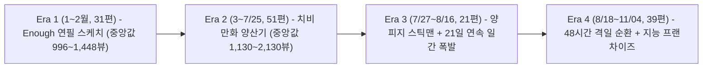

# `@PsychToonsHQ` (PsychToons) 성공 공식 심층 분석 보고서

> [!IMPORTANT]
> `@PsychToonsHQ`는 **쇼츠(`/shorts` 탭)를 단 1편도 운영하지 않고**, 오직 `16:9` 가로형 14~16분 롱폼 심리학 에세이 단일 포맷만으로 개설 298일 만에 **구독자 220,000명 · 누적 조회수 27,549,222회**를 달성한 정지화 스토리텔링 채널입니다.

- **분석 대상**: https://www.youtube.com/@PsychToonsHQ/videos (`PsychToons`, 채널 ID: `UC7ogBsKt4AoJBu8bObb0QiA`)
- **데이터 기준일**: `2026-11-05`
- **조사 및 검증 범위**:
  - 공개 영상 **142편 전수(100%)** 메타데이터·발행 타임스탬프·좋아요/댓글·설명란 전수 검증
  - 시대별 **18편 커스텀 썸네일 및 인비디오(`25% / 50% / 75%`) 프레임** 실측 교차 대조
  - 핵심 대표작 **8편 전문 VTT 스크립트** 파싱, `#057`(`CkP_8bkjf1E`) 전 프레임(`26,520f`) 컷 전환율·오디오 스펙·`Most Replayed` 100구간 히트맵 실측
  - 자체 디지털 상품(`Gumroad`) 실판매 페이지 JSON 구조체 및 소급 백필(Backfill) 이력 검증

---

## 1. 채널 핵심 스펙 및 성장 지표 요약

| 항목 | 검증 수치 및 팩트 | 전략적 해석 |
|---|---|---|
| **포맷 구성** | **롱폼 142편 / 쇼츠 0편** (`1920×1080`, `30fps`, `Education` 100%) | 세로형 유입 없이 순수 브라우즈(홈 화면)·추천 알고리즘만으로 스케일업 |
| **구독자 / 누적 조회수** | **220,000명** / **27,549,222회** | **1,000뷰당 구독 전환 `7.99명`(`0.80%`)** — 일반 롱폼 대비 최상위권 결속력 |
| **후반기 폭발 집중도** | 최근 98일(`7/30~11/04`, `57편`) **24,778,809회 (`89.94%`)** | 초기 199일(`85편`, `10.06%`) 시행착오 후 후반기 수직 도약 |
| **업로드 주기 & 시각** | `7/27~8/16` **21일 연속 일간(24h)** → `8/18~현재` **전 요일 순환 48시간(`47.0~49.2h`)** | **미국 서부 `08:00~10:07 AM PT`(동부 `11:00 AM~01:07 PM ET`)** 북미 오전 골든타임 고정 |
| **3중 수익화 구조** | ① 14~18분(`8분+`) 교육 롱폼 미드롤 AdSense<br>② 자체 PDF 매뉴얼 직판 ([Work With Your Mind](https://psychtoons.gumroad.com/l/workwithyourmind), 정가 `\$24.99` / 코드 `PSYCHTOONS` 적용 시 `\$19.99`)<br>③ 스폰서십 창구 (`psychtoons@proton.me`) | 채널 누적 2,000만 뷰 돌파 후인 `10/05~10/09` 휴지기에 PDF 매뉴얼 런칭 + 후반기 상위 12개(`>= 495,749뷰`) 에버그린 히트작 설명란에 소급 삽입 |

---

## 2. 채널의 4단계 진화사: 무엇이 실패했고 무엇이 폭발을 만들었는가?

단일 요소(리브랜딩이나 영상 길이 연장)가 단독으로 채널을 터뜨린 것이 아니라, **4단계 순차 실험**을 거쳐 시각 엔진과 주제 프레이밍이 맞물린 순간 폭발이 일어났습니다.



### 단계별 변인 분리 검증
1. **Era 1 (`2026-01-11 ~ 02월 말`, `#142~#112`) — `"Enough"` 연필 스케치기**:
   - 7~9분 분량, 흰 바탕 연필 드로잉, 학술 인용 부재, 추상적 설교 오프닝(`"I know what you've been told..."`). 월간 조회수 중앙값 `996~1,448회`로 정체되었습니다.
2. **Era 2 (`2026-03 ~ 07-25`, `#111~#061`) — 치비(Chibi) 만화 & 단일 히트 함정(False Positive)**:
   - `3/09` 업로드작 `#107 Psychology of People Who Go Quiet When They’re Hurt`가 예외적으로 **`2,377,974회`**를 기록했으나, 이후 동일 화풍으로 `"Psychology of People Who [수동적 성향]"` 40여 편을 양산하자 5월 중앙값 **`1,130회`**로 추락했습니다.
   - **중요 반증**: `5/25`(`#085`) `"psychtoons"` 브랜드 도입, `6/21`(`#076`) **14~16분 장편화**, `7/24`(`#062`) **흰 배경 적·흑 타이포 썸네일 단독 도입**만으로는 조회수가 `839~2,146회`에 머물렀습니다.
3. **Era 3 (`2026-07-27 ~ 08-16`, `#060~#040`) — 스틱맨 시각 엔진 교체 + 21일 일간 스프린트**:
   - **`7/27`(`#060`)**: 치비 만화를 폐기하고 **양피지/파스텔 수채 지평선 위의 동화풍 스틱맨 + 손글씨 표지판 인비디오 엔진**과 **실명 학술 실험 도입부**를 최초 가동하자 `#060`(`2.9K`) → `#059`(`18.9K`) → `#058`(`99.3K`)로 즉각 계단식 상승이 발생했습니다.
   - **`7/30`(`#057`, `CkP_8bkjf1E`)**: 수동적 위로를 버리고 **능동적 뇌 재조건화(`Psychology of Discipline` + `DO IT ANYWAY`)**를 결합하며 **`4,725,042회`** 폭발, 이후 21일 연속 일간 업로드로 알고리즘 대세감을 굳혔습니다.
4. **Era 4 (`2026-08-18 ~ 11-04`, `#039~#001`) — 48시간 격일 정착 & 프랜차이즈화**:
   - `8/18`부터 전 요일 순환 48시간 주기로 안정화하며 `Intelligence`(`343만`), `Verbal Intelligence`(`192만`), `Mechanical Intelligence`(`146만`) 등 구체적 역량 시리즈를 확장했습니다.

````carousel

<!-- slide -->

````

### 월별 정량 지표 추이 (142편 전수)
| 연월 | 업로드 수 | 월간 합산 조회수 | 중앙값 | 평균 조회수 | 평균 길이 | 설명란 학술인용 비율 | 설명란 Gumroad 링크 |
|---|---:|---:|---:|---:|---:|---:|---:|
| `2026-01` | 18편 | 29,536 | 996 | 1,641 | 8.7분 | 5.6% (1/18) | 0/18 |
| `2026-02` | 13편 | 24,668 | 1,448 | 1,898 | 8.6분 | 15.4% (2/13) | 0/13 |
| `2026-03` | 10편 | 2,417,013 | 3,970 | 241,701 | 7.8분 | 20.0% (2/10) | 0/10 |
| `2026-04` | 10편 | 109,137 | 4,832 | 10,914 | 8.7분 | 20.0% (2/10) | 0/10 |
| `2026-05` | 8편 | 8,736 | 1,130 | 1,092 | 9.0분 | 0.0% (0/8) | 0/8 |
| `2026-06` | 10편 | 31,318 | 2,130 | 3,132 | 11.0분 | 30.0% (3/10) | 0/10 |
| `2026-07` | 18편 | 4,921,548 | 1,823 | 273,419 | 13.9분 | 44.4% (8/18) | 1/18 *(사후 백필)* |
| **`2026-08`** | **23편** | **12,339,451** | **92,209** | **536,498** | **14.5분** | **82.6% (19/23)** | 6/23 *(사후 백필)* |
| **`2026-09`** | **15편** | **4,605,345** | **72,294** | **307,023** | **15.4분** | **100.0% (15/15)** | 4/15 *(사후 백필)* |
| **`2026-10`** | **15편** | **3,036,804** | **67,339** | **202,454** | **15.6분** | **100.0% (15/15)** | **13/15** *(`10/09` 이후 100%)* |
| `2026-11` *(~11/4)* | 2편 | 25,666 | 12,833 | 12,833 | 15.7분 | 100.0% (2/2) | **2/2 (100%)** |

---

## 3. 동일 소재 '쌍둥이 A/B 비교'로 입증된 1,652~6,105배 격차 원리

동일 채널 내에서 **완전히 같은 주제**를 다뤘음에도 패키징·화풍·대본 구조 교체만으로 수천 배의 성과 차이가 발생했습니다.


| 비교군 | 초기 실패작 (Era 1~2) | 후기 메가히트작 (Era 3~4) | 조회수 배율 | 결정적 차이점 |
|---|---|---|---:|---|
| **쌍둥이 A**<br>*(규율·노력 조건화)* | `#137` (`1/18`) *How to Trick Your Brain Into Craving Hard Work* — **`774회`** | `#057` (`7/30`) *Psychology of Discipline (And How to Trick Your Brain Into Craving It)* — **`4,725,042회`** | **`6,105배`** | 흔한 `How to` 설교 + 논문 `0건` → 학술 권위 타이틀 + 아침 알람 40초 마이크로 씬 + 학술 연구 `7건` |
| **쌍둥이 B**<br>*(다중 관심사)* | `#136` (`1/19`) *You Have Too Many Interests? Good, Your Future is Officially AI-Proof* — **`658회`** | `#040` (`8/16`) *Psychology of Polymaths: Why Having Multiple Interests Is an Unfair Advantage* — **`3,393,077회`** | **`5,157배`** | 막연한 AI 공포 소구 → 시청자를 **'Polymath(박학다식가)'**라는 고지위 정체성으로 격상 + `TOO MANY INTERESTS?` 직관적 6팔 비주얼 |
| **쌍둥이 C**<br>*(고지능·학습)* | `#105` (`3/14`) *Psychology of People With Extremely High IQ* — **`2,076회`** | `#033` (`8/30`) *Psychology of Intelligence: Learn Anything So Fast It's Almost Unfair* — **`3,429,761회`** | **`1,652배`** | 소수 영재의 배타적 습관 나열(`10 HABITS...`) → **누구나 훈련 가능한 인지 학습 법칙(`LEARN ANYTHING`)**으로 대중성 확장 |

---

## 4. 제목(Title) 및 주제(Topic Pillar) 정량 성공 공식 (`n=55`)

업로드 72시간 미만의 최신 2편(`#001`, `#002`)을 제외한 후반기 안정화 코호트 `55편`(`#057~#003`) 전수 분석 결과입니다.

### 4.1 제목 구문(Syntax) 타율 비교
| 제목 구문 패턴 | 편수 | 평균 조회수 | 중앙값 | 최고 조회수 | 핵심 진단 |
|---|---:|---:|---:|---:|---|
| **`Psychology of [역량] (And How To / Why...)`** | 10편 | **786,616** | **91,840** | **4,725,042** | 학술 정의 + 실전 해법 결합으로 **최고 평균·중앙값 기록** |
| **`Psychology of [역량]: [효익 / 방법]`** | 24편 | **571,285** | **81,648** | **3,429,761** | 채널의 가장 안정적인 주력 표준 문법 |
| **`Why [현상]... (Psychology Explains)`** | 2편 | 483,140 | 483,140 | 956,206 | 고독 정당화(`#050` `95.6만`) 성공 vs 과거 소재 재탕(`#053` `1.0만`) 양극화 |
| **`The Psychology of [단독 개념]`** | 2편 | 361,728 | 361,728 | 676,954 | 대중 베스트셀러 밈(`#016 Not Giving A F*ck` `67.7만`) 차용 시 유효 |
| **`[N] / The [N] Signs·Habits·Problems...`** | 7편 | 130,342 | **46,011** | 405,174 | **숫자형 리스티클 기피 뚜렷** (`10 Strategies` 포함 `n=8` 시 중앙값 `40,293`) |
| **기타 서술/명령형 (`Psychology of` 미포함)** | 8편 | 67,562 | **30,536** | 257,214 | 브랜드 시그니처(`Psychology of`) 이탈 시 권위 및 클릭 유인 급감 |
| **`If You [행동], You...` (조건부 진단형)** | 2편 | 16,764 | **16,764** | 23,388 | 흔한 팝심리 클리셰로 인식되어 최하위 성과 |

### 4.2 진짜 파워 키워드 vs 실패하는 약장수 과장어(Guru Hype)
> [!TIP]
> 지적인 성인 시청자층은 **학술적으로 납득 가능한 기능적 효익(`Unfair`, `Learn/Fix Anything`)**에는 열광하지만, **비현실적인 약장수 과장어(`Feels Illegal`, `Instantly`, `Smarter Than 99%`)**에는 클릭을 거부합니다.

- **검증된 승수 키워드**:
  - `Unfair` (`n=2`): 평균 **`3,411,419회`** (`#033 Almost Unfair` 343만, `#040 Unfair Advantage` 339만)
  - `Anything` (`n=3`): 평균 **`1,656,069회`**, 중앙값 **`1,458,867회`** (`Learn Anything` 343만, `Fix Anything` 146만)
  - 타인 경외 반응 동사 **초회차 사용**: `Scares People`(`143만`), `Makes People Nervous`(`81.3만` — 단, 2회차 재탕 `#021`은 `9.1만`으로 `-89%` 급락), `Makes You Dangerous`(`70.2만`)
- **실패한 과장어(Guru Hype)**:
  - `Feels Illegal` (`n=2`): 평균 **`74,318회`** (`#034` `5.6만`, `#013` `9.2만` — 단 한 번도 10만 뷰 돌파 실패)
  - `Instantly` (`n=2`): 평균 **`48,564회`** (`#004` `1.68만`, `#010` `8.03만`)
  - `Smarter Than 99%`(`#006` `6.2만`), `Luckiest Human Alive`(`#005` `2.18만`)

### 4.3 5대 주제 필러 포트폴리오: 홈런 엔진(Mean) vs 국밥 엔진(Median)
| 순위 | 주제 필러 | 편수 | 합산 조회수 | **평균 조회수 (고점력)** | **중앙값 (저점 방어력)** | 40만 뷰 돌파율 | 포트폴리오 역할 |
|---|---|---:|---:|---:|---:|---:|---|
| **1위** | **인지 숙달 & 세분화 지능** (`Intelligence / Polymaths / Verbal / Mechanical`) | 11편 | **1,081만** | **`982,627`** *(1위)* | `80,280` *(3위)* | 36.4% | **홈런 엔진**: 구체적 일상 재능을 지능으로 명명할 때 150~340만 뷰 폭발 |
| **2위** | **행동 통제·도파민·수면** (`Discipline / Addiction / Rest / Sleep`) | 8편 | **677만** | **`845,954`** *(2위)* | **`174,796`** *(1위!)* | 37.5% | **최강 국밥(Floor) 엔진**: 보편적 생리·습관 고통 해결로 가장 높은 중앙값 방어 |
| **3위** | **정서 방어력·평정심·자존감** (`Resilience / Composure / Self-Worth`) | 10편 | **384만** | `384,460` | **`96,484`** *(2위)* | **`40.0%`** *(1위!)* | **안정 타율 엔진**: 멘탈 방어력 주제로 중박 이상 적중률 최상위 |
| **4위** | **사회적 권력·매력·다크 심리학** (`Charisma / Dark Triad / Liars`) | 10편 | 156만 | 155,504 | 50,205 | 20.0% | `Charisma`(77만) 외 `Liars`(1.7만)·`Dark Triad`(1.9만) 등 다크 심리학 참패 |
| **5위** | **정체성·고독·삶의 의미** (`Walk Alone / Shadow / Meaning`) | 16편 | 178만 | 111,061 | 48,432 | 6.2% | `#050 Walk Alone`(95.6만) 외 추상적 철학·위로 소재는 확장성 한계 명확 |

---

## 5. 썸네일 시각 법칙 및 '자기복제 피로(Template Cannibalization)'

````carousel

<!-- slide -->

````

1. **표준 시각 문법**:
   - 배경 풍경을 100% 제거한 순백(`#FFFFFF`) 또는 순흑(`#000000`) 단색 평면 + 상단 2~4단어 볼드 고딕 카피(`DO IT ANYWAY`, `LEARN ANYTHING`, `TOO MANY INTERESTS?`, `FIX ANYTHING`, `BULLETPROOF MINDSET`).
   - 적색 포인트 유무 자체보다(상위 메가히트 3편이 100% 흑색 텍스트) **0.3초 만에 이해되는 생활 사물 메타포(고장 난 세탁기 수리, 6개의 팔, 슬롯머신·햄버거 전선이 꽂힌 뇌)**가 클릭률을 좌우합니다.
2. **치명적 실패 공식 — 히트 썸네일 구도의 3~4차 자기복제**:
   - **스웨터+빛나는 뇌 구도**: `#057 DO IT ANYWAY`(`472만`) → `#034 DISCIPLINE 취소선`(**`5.6만`, -98.8%**) → `#019 ARTICULATE`(측면 변주 `192만`) → `#013 CHANGE OVERNIGHT`(**`9.2만`, -98.0%**).
   - **총알 방어 구도**: `#043 BULLETPROOF MINDSET`(`143만`) → `#024 BULLETPROOF MIND`(**`3.5만`, -97.6%**).
   - **독서하는 뇌 인간 구도**: `#033 LEARN ANYTHING`(`343만`) → `#006 DISGUSTINGLY SMARTER`(**`6.2만`, -98.2%**).

---

## 6. 인비디오 편집·오디오·스크립트 리텐션 아키텍처

### 6.1 "모션 0% 정지화 슬라이드를 `2.94초`마다 하드컷 교체"
- `#057`(`884초`, `26,520프레임`) 실측 결과 총 **`301회` 하드컷 전환(평균 `2.94초`/컷 — 초반 60초 `2.73초`, 본문 `2.95초`)**이 발생하며, 컷 내부 카메라 줌/패닝 모션은 **`0.00%`**입니다.
- **무자막(Zero Burned-in Subtitles) + 다이어제틱 손글씨 표지판**: 하단 자막을 없애는 대신 그림 속 칠판·팻말·하늘에 손글씨 키워드(`FORTY SECONDS`, `FEWER`, `TOMORROW`, `3 OUT OF 4`)를 심어 시각 피로 없이 개념을 각인합니다.

````carousel

<!-- slide -->

````

### 6.2 오디오 마스터링 규격
- 전체 음량 RMS **`-14.3 dBFS`**(YouTube `-14 LUFS` 표준 정합), 기본 주파수(`F0`) 중앙값 **`129.6~132.2 Hz`** 중저음 남성 내레이션.
- 무음 구간 평균 **`0.18초`(최대 `0.45초`)** 타이트 컷 편집, 분량 **`2,369~2,943단어` (`173.6~187.6 WPM`)**.

### 6.3 4단계 대본 척추 및 `Most Replayed` 피크 설계
1. **[`0%~8%` (`00:00~01:15`)] 일상 패배 '마이크로 씬' 콜드오픈**:
   - 추상적 서론 없이 시간·장소·행동을 즉시 묘사합니다 (예: 아침 알람 후 40초의 타협, 밤 11시 본업과 무관한 5개의 브라우저 탭, 40%에서 꺼지는 노트북 배터리).
2. **[`8%~55%/75%`] '가짜 측정 도구 파괴' + 학술 실험 해부**:
   - 해결책을 성급히 주지 않고, 먼저 시청자가 믿어온 잘못된 통념(의지력 신화, 밑줄 치며 반복 읽기, 단일 전공 주의)을 학술 논문(`Hofmann 2012`, `Karpicke & Roediger 2008`, `McCaffrey 2012` 등)으로 해체합니다.
3. **[`55%~88%`] 번호형 재설계 프로토콜 + '반(反)구루적 한계 명시' (`Most Replayed` 집중 구간)**:
   - 중반 이후(주로 8분 미드롤 통과 시점)에 `3~5가지 실전 원칙`을 개방합니다. `#057`의 `Most Replayed` 상위 1~10위 구간 전부가 **`08:24~10:01`(`57%~67%`)** 프로토콜 시작 직후에 밀집되어 있습니다.
   - *"솔직히 Wharton(2014) 연구에서도 이 효과는 몇 주 뒤 약해졌습니다. 첫 한 달 문턱 넘는 용도로만 쓰세요"*처럼 **기법의 한계와 부작용을 투명하게 밝히는 지적 정직함**이 역설적으로 강력한 신뢰를 만듭니다.
4. **[`88%~100%`] 수치심 해방 + 객관식 댓글 유도(`95~97%`) + 1:1 DM 공유 트리거(`98%`)**:
   - 남들에게 오해받던 특성을 지능으로 격상시켜주는 주제 + 객관식 자기유형 질문이 결합될 때 댓글 밀도가 폭발합니다 (`#056 Black Sheep` 만 뷰당 `72.9개`, `#009 Mechanical Intelligence` `19.2개/만 뷰·2,800개`, `#040 Polymaths` `18.9개/만 뷰·6,400개`).
   - 종료 직전(`98%`) *"주변에서 늘 고장을 고쳐주지만 그것이 지능이라는 말을 한 번도 못 들어본 단 한 사람에게 이 영상을 보내주세요"*처럼 **특정 지인 1명을 떠올리게 하는 1:1 공유 명분**을 부여합니다.

---

## 7. 벤치마킹 시 즉시 적용할 5대 핵심 공식 요약

> [!NOTE]
> 최근 10월 하순 이후 썸네일 자기복제와 약한 소재(`Luck`, `Liars`, `JOMO`) 선택으로 월평균 조회수가 `8월 53.6만 → 10월 20.2만`으로 둔화된 상태이므로, 벤치마킹 시 아래 5가지 순수 성공 요인만 선별 채택해야 합니다.

1. **저비용·고밀도 롱폼 비주얼**: 카메라 모션 없는 일관된 미니멀 일러스트(스틱맨/포슬린 등) + 무자막 다이어제틱 표지판 + **`2.8~3.0초` 하드컷 전환**만으로 15분 리텐션 유지가 가능합니다.
2. **고지위 역량 명명법(Identity Elevation)**: 흔한 생활 특성(산만함, 손재주, 말주변)을 `Polymath`, `Mechanical Intelligence`, `Verbal Intelligence` 같은 학술적 상위 개념으로 격상하고 `Unfair`·`Learn/Fix Anything` 효익을 결합하되, 숫자형 리스티클과 약장수 과장어는 배제합니다.
3. **1에피소드 1고유 사물 메타포 썸네일**: 단색 배경 + 2~4단어 고딕 카피 체계를 쓰되, 추상적 뇌 그림을 반복 재탕하지 말고 에피소드마다 세탁기·6팔·슬롯머신 같은 구체적 생활 사물 은유를 새로 설계합니다.
4. **선(先) 통념 해체 → 후(後) 프로토콜 + 한계 명시 대본**: 전반부 50% 이상을 '왜 기존 상식이 틀렸는가'에 할애한 뒤 후반부에 번호형 프로토콜을 배치하여 후반 리텐션 피크(`Most Replayed`)와 8분+ 미드롤 수익을 동시에 확보합니다.
5. **1:1 지인 지목 공유 & 사후 에버그린 수익화**: 엔딩에 '이 특성을 가진 주변의 단 한 사람' 공유 트리거를 심고, 50만 뷰급 에버그린 히트작이 누적된 뒤 핵심 프로토콜 요약본 상품을 설명란 최상단에 소급 연결합니다.
