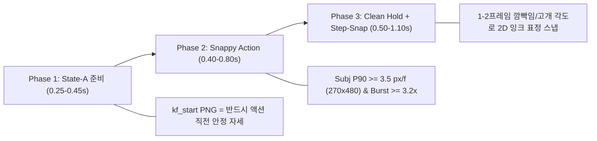

# 2.5D 일반 캐릭터 모션 & 표정 표준 사전 (`expressive_25d_v8`)

- **SSOT JSON 규격**: [ricks_clips_character_motion_lexicon.json](file:///home/canadaofbin/gdrive/Kyubin_Yun_Workspace/07_Youtube/.agents/research/ricks_clips_character_motion_lexicon.json)
- **프로덕션 마크다운 사양서**: [ricks_clips_character_motion_lexicon.md](file:///home/canadaofbin/gdrive/Kyubin_Yun_Workspace/07_Youtube/.agents/research/ricks_clips_character_motion_lexicon.md)
- **연동 룰셋**: [neuro_diorama_rules.md](file:///home/canadaofbin/gdrive/Kyubin_Yun_Workspace/07_Youtube/.agents/rules/neuro_diorama_rules.md) (`R68`, `R78-M/H/V`), [cast_depiction_rules.md](file:///home/canadaofbin/gdrive/Kyubin_Yun_Workspace/07_Youtube/.agents/rules/cast_depiction_rules.md), [scene_depiction_rules.md](file:///home/canadaofbin/gdrive/Kyubin_Yun_Workspace/07_Youtube/.agents/rules/scene_depiction_rules.md), [camera_choreography_rules.md](file:///home/canadaofbin/gdrive/Kyubin_Yun_Workspace/07_Youtube/.agents/rules/camera_choreography_rules.md)
- **기준 레퍼런스**: `https://www.youtube.com/shorts/QlDPMzGmYac` (*This Shape Saved Roller Coasters*, `@RicksClips3000` — **`11,125,390` 조회수**, `63.16s`, `1080x1920 @ 30fps`)

> [!IMPORTANT]
> **핵심 진단 요약 (`QlDPMzGmYac` 1,112만 뷰 vs 기존 `Ep #8` 결함 대조)**: `@RicksClips3000`의 생동감은 부드럽게 둥둥 떠다니는 슬로모션이 아니라 **`State-A` 정지 준비 (`0.25~0.45s`) -> `Snappy Action` 탄도 물리 임펄스 (`0.4~0.8s`, `Subj P90 4.99~7.66 px/f @ 270x480`, `Burst 4.65x~10.73x`) -> `Clean Hold` 제동 정지 + `1~2`프레임 눈깜빡임 `2D Step-Snap` 표정 전환 (`0.5~1.1s`)**의 **3단계 스냅 리듬**에서 나옵니다.

---

## 0. 3단계 모션 물리 법칙 & 프롬프트 조립 가드레일

| 지표 | `QlDPMzGmYac` (`11.12M` 벤치마크) | 기존 `Ep #8` 문제 구간 (`v2`) | `Ep #9+` 프로덕션 게이트 기준 |
|---|---|---|---|
| **`Subj P90` (`270x480` 감사 격자)** | **`4.99 – 7.66 px/f`** (평균 `5.95`) | `0.62 – 1.83 px/f` (평균 `0.95`) | **`>= 3.50 px/f`** (권장 `4.8 – 7.8`) |
| **`Subj P90` (`1080x1920` 원본 환산 `x4`)** | **`19.96 – 30.64 px/f`** | `2.48 – 7.32 px/f` | **`>= 14.0 px/f`** (권장 `19.2 – 31.2`) |
| **피크/중앙값 `Burst Ratio`** | **`4.65x – 10.73x`** (평균 `6.42x`) | `1.20x – 2.55x` (등속 부유) | **`>= 3.20x`** (임펄스 가속 + 클린 정지) |
| **히어로 캐릭터 세로 비중 (`%` of `1920px`)** | **`45.3% – 79.2%`** | `14% – 92%` (스케일 붕괴) | **`45.0% – 80.0%`** (`T2` 기본 `48–64%`) |
| **아이레벨 수평선 (`EyeY %` 상단 기준)** | **`35.1% – 56.8%`** | `18% – 78%` (`90°` 수직 부감 혼입) | **`35.0% – 57.0%`** (`-6° .. +8°` 피치 고정) |
| **물리 액션 비트 주기 (`sec / beat`)** | **`0.51s – 1.60s`** (히어로 평균 `1.48s`) | `5.07s – 5.27s` (마네킹 정지) | **`1.15s – 1.95s / beat`** (단일 포즈 `<= 2.20s`) |

1. **`Start-Frame State-A` 절대 원칙 (`Start-Frame Climax Trap` 원천 차단)**:
   - 시작 키프레임(`kf_XX_start.png`)에는 결과 자세(`State-B`)를 절대 미리 그리지 않습니다. 의자 네 다리가 바닥에 수평으로 닿아 있는 상태(`A06`), 액자를 두 손에 들고 빈 이젤 옆에 서 있는 상태(`A01`), 지갑이 닫힌 상태(`A07`), 닫힌 방문 손잡이를 잡은 상태(`A09`)로 시작해야 Veo/Flow가 `State-A -> State-B` 물리 궤적을 폭발적으로 생성합니다.
2. **프롬프트 앞단 `First-28-Words` 주어+동사 전진 배치 (절단 방지)**:
   - `[1. 샷 스케일 + 아이레벨 각도 (4~6단어)] + [2. 명시적 캐릭터 주어 + 복장 + 12~22단어 Snappy Action 절] + [3. 2D 차콜 잉크 표정 절] + [4. 공간 소품·조명]` 순서를 강제하여 단어 수 상한(`hi_w`) 트리밍이 작동해도 동사가 절대 잘리지 않게 보호합니다.

---

## 1. `State-A -> Snappy Action -> Clean Hold` 20종 물리 액션 패턴 사전 (`A01..A20`)

모든 Google Flow 영어 동사구는 **`17~19`단어**(`12~22w` 규격 통과), 명시적 주어 포함, 금지 토큰(`camera`, `lens`, `rig`, `slowly`, `morph`, `eyes shift` 등) **0건** 검증을 완료했습니다.

### 1.1 임상 · 실험실 · 신경과학 검사 (`A01–A05`)
| ID | 액션 패턴 | `State-A` (시작 프레임) | `Snappy Action` (`0.4~0.8s`) | `Clean Hold` (`State-B`) | Google Flow 즉시 삽입 영어 동사구 (`17–19w`) |
|---|---|---|---|---|---|
| `A01` | 액자·장비 들어 이젤에 탁 세팅 | 빈 테이블 이젤 옆에서 액자를 가슴 높이에 두 손으로 들고 직립 | 두 손으로 액자를 경쾌하게 들어 이젤 받침대에 반듯하게 안착 | 반 걸음 물러서며 놓인 액자 옆에 열린 손바닥 유지 | `the doctor lifts the framed photo with both hands, sets it crisply onto the easel, and steps back` |
| `A02` | 손가락 생체센서 클립 '착' 장착 | 환자가 손바닥을 펴고 검사대에 올린 상태, 의료진이 클립을 5cm 위에 대기 | 의료진이 센서 클립을 벌려 환자 검지 끝에 '착' 물림 | 의료진이 양손을 깔끔히 거두고 환자는 손가락 수평 유지 | `the clinician snaps the small sensor clip onto the patient's resting index fingertip and pulls both hands back` |
| `A03` | 실험 콘솔 레버 단호하게 내리기 | 연구원이 수직으로 선 황동 레버 바로 위에 오른손을 올린 대기 자세 | 레버 손잡이를 쥐고 아래쪽 고정 슬롯까지 단번에 당겨 내림 | 내려간 레버 위에 손을 단단히 얹은 채 정지 | `the researcher grips the upright control lever, pulls it briskly down into place, and holds the handle steady` |
| `A04` | 차트 넘겨 평탄 그래프 손가락 짚기 | 왼팔에 클립보드를 받치고 오른손 엄지를 첫 장 아래에 건 상태 | 첫 장을 경쾌하게 위로 넘긴 뒤 검지로 평탄한 그래프 선을 탁 짚음 | 그래프 선 위에 검지를 고정한 채 환자 쪽으로 고개 각도 유지 | `the researcher flips the clipboard page briskly upward, taps the flat chart line firmly, and holds finger there` |
| `A05` | 덮개 상자 번쩍 들어 자극물 공개 | 테이블 위 불투명 나무 덮개 양쪽 손잡이를 두 손으로 쥔 상태 | 두 손으로 덮개를 수직으로 번쩍 들어 옆에 깔끔히 내려놓음 | 드러난 실험 소품을 향해 두 인물이 상체를 살짝 기울여 응시 | `the experimenter lifts the wooden cover straight off the table with both hands and sets it cleanly aside` |

### 1.2 일상 실내 · 생활 이상 징후 (`A06–A10`)
| ID | 액션 패턴 | `State-A` (시작 프레임) | `Snappy Action` (`0.4~0.8s`) | `Clean Hold` (`State-B`) | Google Flow 즉시 삽입 영어 동사구 (`17–19w`) |
|---|---|---|---|---|---|
| `A06` | 식탁 짚고 의자 확 밀며 경악 후퇴 | 의자 네 다리가 바닥에 완전히 닿은 채 양손을 식탁 끝에 얹고 착석 | 식탁 끝을 힘껏 밀어 나무 의자를 바닥 뒤로 확 미끄러뜨림 | 뒤로 밀린 의자에서 양 무릎을 꽉 쥐고 어깨를 굳힌 채 정지 | `the young man pushes off the table edge, slides his chair briskly backward, and grips both knees tightly` |
| `A07` | 지갑·사진첩 양손으로 확 펼치기 | 가슴 위 바스트 샷에서 닫힌 가죽 폴더를 두 손으로 쥔 상태 | 손목 스냅으로 가죽 폴더를 정면을 향해 활짝 펼쳐 보임 | 펼친 폴더를 가슴 높이에 흔들림 없이 고정 | `the young man flips the leather folder wide open with both hands at chest height and holds it steady` |
| `A08` | 울리는 수화기 낚아채 귀에 밀착 | 탁상 전화기 수화기에서 5cm 떨어진 곳에 오른손을 뻗은 직전 자세 | 수화기를 재빠르게 낚아채 귀 옆에 바싹 가져다 댐 | 수화기를 귀에 밀착한 채 안도하듯 고개를 따뜻하게 끄덕임 | `the young man snatches the telephone handset off its cradle, presses it to his ear, and nods warmly` |
| `A09` | 방문 당겨 열고 문턱 넘어 멈추기 | 닫힌 나무 방문 앞에서 오른손으로 황동 손잡이를 잡은 상태 | 방문을 경쾌하게 당겨 열며 문턱 안으로 한 걸음 성큼 진입 | 열린 문틀 안쪽에 반듯하게 멈춰 서서 문 가장자리에 손 유지 | `the mother pulls the wooden door briskly open, steps across the threshold, and pauses inside the doorway` |
| `A10` | 마시려던 머그컵 테이블에 딱 내려놓기 | 도자기 머그컵을 입과 테이블 중간 높이에 들고 있는 상태 | 머그컵을 수직으로 단호하게 내려 테이블 위에 '딱' 안착 | 손잡이에서 손을 떼고 상체를 살짝 뒤로 물리며 정면 응시 | `the man lowers his ceramic mug briskly onto the tabletop, releases the handle, and leans slightly back` |

### 1.3 대인 대화 · 갈등 · 인지 부조화 (`A11–A15`)
| ID | 액션 패턴 | `State-A` (시작 프레임) | `Snappy Action` (`0.4~0.8s`) | `Clean Hold` (`State-B`) | Google Flow 즉시 삽입 영어 동사구 (`17–19w`) |
|---|---|---|---|---|---|
| `A11` | 반보 물러서며 단호하게 팔짱 끼기 | 상대와 마주 서서 양 팔뚝을 자연스럽게 열어 둔 상태 | 반 걸음 뒤로 경쾌하게 물러서며 가슴 앞에 양팔을 단단히 교차 | 턱을 살짝 당긴 팔짱 실루엣을 흔들림 없이 유지 | `the young man takes a crisp half-step back, folds both arms tightly across his chest, and holds still` |
| `A12` | 팔 뻗어 정면 지목 + 상대방 움찔 후퇴 | 두 인물이 아이레벨에서 1m 간격으로 마주 선 평형 상태 | 아들이 한 팔을 뻗어 정면을 가리키고 어머니가 반 걸음 물러섬 | 아들은 뻗은 팔을 유지하고 어머니는 한 손을 가슴에 얹고 정지 | `the son raises one arm pointing straight ahead while his mother steps back pressing a hand to her chest` |
| `A13` | 양손 머리 옆에 얹으며 고개 `12°` 갸웃 | 의자에 앉아 양손을 허벅지 위에 편안히 내려놓은 상태 | 양손을 빠르게 들어 매끄러운 흰 머리 양옆에 가볍게 얹음 | 고개를 옆으로 `12°` 갸웃 기울인 혼란 실루엣 고정 | `the patient raises both hands to the sides of his head, tilts twelve degrees, and holds the pose` |
| `A14` | 상체 숙여 정밀 관찰 후 번쩍 펴기 | 테이블 소품 옆에 서서 양손을 허리 높이에 둔 직립 상태 | 상체를 앞으로 경쾌하게 숙여 사진을 들여다본 뒤 곧게 허리를 폄 | 어깨를 펴고 턱을 수평으로 유지한 당당한 정지 자세 | `the man leans briskly forward to inspect the photo closely, then straightens upright and holds his chin level` |
| `A15` | 포옹 접근 대 양손 제지 정지 (2인 대비) | 어머니가 두 팔을 벌리며 다가오고 아들이 마주 선 상태 | 아들이 가슴 높이로 양 손바닥을 들어 올려 60cm 앞에서 제지 | 어머니가 팔을 내리며 두 사람 사이 팽팽한 간격 유지 | `the mother steps forward with open arms until her son raises both palms up, halting her in place` |

### 1.4 시각 은유 · 물리 법칙 데모 (`A16–A20`)
| ID | 액션 패턴 | `State-A` (시작 프레임) | `Snappy Action` (`0.4~0.8s`) | `Clean Hold` (`State-B`) | Google Flow 즉시 삽입 영어 동사구 (`17–19w`) |
|---|---|---|---|---|---|
| `A16` | 양손 마른 나뭇가지 '똑' 부러뜨리기 | 미디엄 샷에서 마른 나뭇가지를 양 주먹으로 수평 파지 | 양 손목을 안쪽으로 강하게 비틀어 나뭇가지를 두 동강으로 절단 | 부러진 두 조각을 가슴 높이에 벌려 든 채 선명한 실루엣 정지 | `the figure grips a dry wooden twig in both fists, snaps it cleanly in half, and holds both pieces` |
| `A17` | 나무 해머 치켜들었다 단번에 타격 | 나무 해머를 양손으로 쥐고 오른쪽 어깨 위로 치켜든 준비 자세 | 작업대 블록 위로 해머를 단번에 경쾌하게 내리찍음 | 타격 지점 블록 위에 해머 헤드를 단단히 밀착 고정 | `the figure swings the raised wooden mallet briskly down onto the block and holds it planted on impact` |
| `A18` | 보드 곡선 긋고 정점 '탁' 짚기 | 이젤 보드 하단 모서리 근처에 나무 포인터를 쥔 상태 | 포인터로 보드 위 아치 곡선을 쓸어 올린 뒤 꼭짓점을 탁 짚음 | 포인터 끝을 꼭짓점에 고정한 채 상체만 정면으로 회전 | `the speaker sweeps a wooden pointer up the board diagram, taps the peak firmly, and turns toward front` |
| `A19` | 양손 두 카드 중 선택 카드 높이 들기 | 양손에 서로 다른 무광 카드 두 장을 어깨 높이로 수평 파지 | 왼손 카드를 허리로 내리는 동시에 오른손 카드를 머리 옆 높이 거수 | 높이 든 오른손 카드를 고정하며 고개를 한 번 경쾌하게 끄덕임 | `the participant lowers the left card briskly while raising the right card high beside his head and nods` |
| `A20` | 시험 좌석 훌쩍 올라타 안전바 파지 | 시험 좌석 옆에 서서 양손으로 팔걸이를 잡은 대기 자세 | 좌석 안으로 경쾌하게 올라타 반듯하게 앉으며 전면 바를 양손 파지 | 전면 안전바를 단단히 쥔 채 정면을 응시하며 정지 | `the subject steps briskly into the seat, settles squarely down, and grips the front bar with both hands` |

---

## 2. 번짐 없는 `2D Ink Step-Snap Expression` 사전 (`12`종 `E01..E12`)

### 2.1 `30fps` 프레임 단위 메커니즘 증명 (`f184..f195`, `6.13s~6.50s` 지갑 씬)

> [!WARNING]
> **왜 `Ep #8 C04`에서 검은 눈 잉크가 녹아내렸는가? (`"eyes shift"` 버그 원인 규명)**:
> 위 `f184..f195` 실측 스트립에서 보듯, `@RicksClips3000`의 2D 검은 눈은 흰 얼굴 위에서 **단 `1px`도 옆으로 미끄러지거나 서서히 변형(morph)되지 않습니다.** `f188~f189`(`0.067s`) 동안 눈을 일자(`— —`)로 감았다가 뜨는 `f190~f191`(`0.033s`, **단 1프레임**) 사이에 활짝 웃던 입이 짧은 일자(`-`)로 **만화 컷처럼 즉시 치환(Step-Snap)** 됩니다. 프롬프트에 `"eyes shift"`, `"pupils dart"`, `"eyes slowly widen"`, `"eyebrows morph"` 같은 액체성 연속 동사를 쓰면 Veo/Flow가 흰 바이닐 피부 위로 차콜 잉크 픽셀을 번지게 만듭니다.

### 2.2 12종 `2D Ink Step-Snap` 표정 카탈로그 (`E01..E12`)
| ID | 표정 아키타입 | 눈썹 기하 (`Brow`) | 눈 기하 (`Eye` — 액체 동공 제로) | 입 기하 (`Mouth`) | 고개 각도 | Google Flow 표정 구문 (`13–18w`) |
|---|---|---|---|---|---|---|
| `E01` | 순수·기대 활짝 미소 | 높은 둥근 아치 | 속이 꽉 찬 검은 세로 타원 | 흰 치아 밴드가 보이는 D자 미소 | `0°` | `bold 2D charcoal ink arched brows over solid oval eyes and a wide cheerful grin` |
| `E02` | 반눈 일자입 허탈 스냅 | 낮게 깔린 수평 일자 | 윗꺼풀이 평평한 반눈 (`┬ ┬`) | 짧은 수평 일자 대시 (`-`) | `-4°` | `2D charcoal ink flat brows over half-lidded eyes and a straight deadpan line mouth` |
| `E03` | 원형 링 경악·충격 | 정수리 쪽 급격 상승 아치 | 검은 원형 링 + 핀닷 중심 (`◎ ◎`) | 작고 둥근 빈 타원 (`o`) | `+10°` | `high lifted 2D ink brows over wide circular ring eyes and a small shocked oval mouth` |
| `E04` | V자 눈썹 불신·경계 | 가파른 안쪽 경사 V자 | 좁고 윗선이 평평한 단색 눈 | 짧고 단단히 다문 입선 | `-8°` | `inward-angled 2D charcoal ink brows over narrow flat-topped eyes and a tight pressed mouth` |
| `E05` | 꺽쇠(`> <`) 전력 타격·집중 | 안쪽으로 모인 압축 눈썹 | 굵은 꺽쇠 스퀸트 (`> <`, 동공 없음) | 각진 직사각형 악문 입 | `-6°` | `tight chevron-squint 2D charcoal ink eyes with pressed brows and a braced clenched grin` |
| `E06` | 비대칭 외눈썹 `14°` 갸웃 | 한쪽 아치 상승 + 한쪽 수평 | 깔끔한 단색 세로 타원 | 약간 비뚤어진 짧은 선 | `+14°` 갸웃 | `one raised 2D ink brow and one flat brow over solid oval eyes with a puzzled head tilt` |
| `E07` | 한쪽 입꼬리 자신만만 스머크 | 날카로운 V자 각도 | 반쯤 감긴 단색 눈 | 한쪽 끝만 올라간 비대칭 스머크 | `+8°` 회전 | `sharp angled 2D ink brows over half-lidded eyes and a crisp one-sided smirk` |
| `E08` | 초승달(`^ ^`) 파안대소 | 높고 탄력 있는 아치 | 위로 휜 초승달 아크 (`^ ^`, 동공 없음) | 크게 벌린 D자 웃음 입 | `+14°` 젖힘 | `upward-curved happy arc 2D ink eyes and an open laughing mouth as head tilts back` |
| `E09` | 안도·따뜻한 음성 재회 | 부드럽게 이완된 곡선 | 아래 눈꺼풀이 살짝 올라간 따뜻한 타원 | 깔끔한 U자 미소 곡선 | `+5°` 끄덕 | `relaxed 2D charcoal ink brows over warm oval eyes and a clean gentle upward smile` |
| `E10` | 팔자(`/ \`) 걱정·긴장 정지 | 안쪽 끝이 들린 `/ \` 눈썹 | 세로로 긴 선명한 타원 | 짧게 꾹 다문 수평 입선 | `0°` | `upward-slanted worried 2D ink brows over tall oval eyes and a tight nervous mouth` |
| `E11` | 외눈 찡그림(`< o`) 정밀 관찰 | 한쪽 낮음 + 한쪽 아치 | 한쪽 꺽쇠(`<`) + 한쪽 단색 타원(`o`) | 작게 오므린 집중 입꼬리 | `-10°` 숙임 | `one chevron-squinted 2D ink eye and one open oval eye under focused angled brows` |
| `E12` | 눈 번쩍 + `10°` 유레카 깨달음 | 높고 대칭적인 아치 | 크고 선명한 둥근 타원 단색 눈 | 경쾌하게 열린 반미소 곡선 | `+10°` 들림 | `high arched 2D charcoal ink brows over bright round-oval eyes with a crisp upward chin lift` |

---

## 3. 카메라 & 캐릭터 화면 비율 황금률 (정량 수치)

> [!TIP]
> **`Ep #9+` 휴먼 컷 표준 배분**: 전체 캐릭터 연기 컷의 **`55~65%`를 `T2` 미디엄 소품 워크호스(`CharH 48~64%`)**로 고정하고, 감정 반전 포인트에 **`T1` 바스트 리액션 클로즈업(`65~80%`, `15~25%`)**, 문턱 진입·2인 대치에만 **`T3` 풀바디 접지 샷(`38~48%`, `15~25%`)**을 배치합니다.

| 샷 티어 | 에피소드 비중 | 캐릭터 세로 비율 (`1920px` 대비) | 흰 머리 구체 지름 (`1920px` 대비) | 아이레벨 `EyeY` (상단 기준) | 권장 컷 길이 | 핵심 용도 |
|---|---|---|---|---|---|---|
| **`T1` Bust Reaction Close-Up** | `15–25%` | **`65% – 80%`** (`1248–1536px`) | `24% – 33%` | `34% – 42%` | `1.6s – 2.8s` | `2D Step-Snap` 표정 반전 극대화 + 가슴 높이 소품 (`A07` 지갑/폴더, `A08` 수화기) |
| **`T2` Medium Prop Workhorse (`기본`)** | **`55–65%`** | **`48% – 64%`** (`920–1228px`) | `13% – 20%` | `38% – 54%` | `2.6s – 4.2s` | 임상·실내 2비트 소품 액션 (`A01` 액자, `A02` 센서, `A04` 차트, `A06` 의자, `A16` 나뭇가지) |
| **`T3` Grounded Full-Body** | `15–25%` | **`38% – 48%`** (`730–920px`) | `11% – 14%` | `40% – 57%` | `2.5s – 3.8s` | 방문 진입(`A09`), 2인 대치(`A12`, `A15`), 좌석 탑승(`A20`) — 바닥 접지 그림자 필수 |

### 하드 카메라·페이싱 게이트 요약
1. **아이레벨 수평선 & 피치 락**: `EyeY` **`35.0% ~ 57.0%`**, 카메라 피치 **`-6° ~ +8°`** 준수. 실내 휴먼 컷에서 `90°` 수직 부감 다이브 및 `dolly_zoom_vertigo` / `"warping background depth"` 전면 금지.
2. **2인 샷 상대 스케일 락**: 성인 2인이 함께 잡히는 컷(`A12`, `A15`)에서 두 캐릭터의 머리 구체 지름 비율은 **`0.85x ~ 1.15x`** 이내로 고정 (`Ep #8 C10` 거인 대 유아 왜곡 원천 차단).
3. **액션 비트 주기 & 포즈 상한**: 평균 **`1.15s ~ 1.95s / beat`** (`QlDPMzGmYac` 히어로 평균 `1.48s/beat`), 단일 정지 포즈 유지 상한 **`<= 2.20s`** 강제 (`3.5s+` 컷은 반드시 `2`비트 연쇄 구성).
