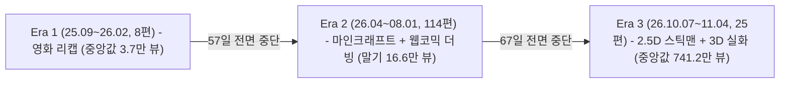

# `@RicksClips3000` (Ricks Clips) 쇼츠 성공 공식 심층 분석 보고서

> [!IMPORTANT]
> `@RicksClips3000`은 과거 마인크래프트 배경 웹코믹 더빙 채널이 수명을 다하자 **67일간 업로드를 전면 중단**한 뒤, 2026년 10월 7일 **‘2.5D 스틱맨 + 3D 시네마틱 반직관 실화 스토리텔링’**으로 복귀해 **단 28일(25편) 만에 208,481,310뷰(중앙값 7,411,582뷰, 일평균 +1,050만 뷰)**를 터뜨린 초고효율 쇼츠 채널입니다.

- **분석 대상**: https://www.youtube.com/@RicksClips3000/shorts (`Ricks Clips`, 채널 ID: `UC_VeFWlNnRIg558hAeIpJ4w`, 미국)
- **데이터 기준일**: `2026-11-05`
- **조사 및 검증 범위**:
  - 공개 영상 **147편 전수(100% Shorts, 롱폼 0편)** 시계열 카탈로그 및 Era 3 **25편 전수 정밀 메타데이터**
  - 핵심 표본 **14편(메가 히트작 10편 + 100만 뷰 미만 부진작 4편 전수)** 비주얼 콘택트 시트 및 초반 4초 훅 프레임 교차 검증
  - 표본 **10편 단어 단위 타임스탬프 대본(`faster-whisper`)**, 성우 기본주파수(`F0`)·음색 유사도·라우드니스(`LUFS`), 베스트 댓글 포렌식

---

## 1. 채널 거시 지표 및 ‘연쇄 피벗(Serial Pivot)’ 진화사

| 항목 | 검증 수치 및 팩트 | 전략적 의미 |
|---|---|---|
| **구독자 / 누적 조회수** | **142,000명** / **379,707,450회** (`147편`, 쇼츠 100%) | **구독자 1인당 `2,674뷰`**(구독 전환율 `0.037%`) — 99.9% 비구독자 콜드 피드 장악 구조 |
| **최근 11일 가속도** | `10/25~11/05`: 구독자 **`+4.1만 명` (`+40.6%`)**, 조회수 **`+115,525,064회`** | 현재 **일평균 `+1,050.2만 뷰/일`** 속도로 수직 상승 중 |
| **Era 3 타율 (`25편`)** | **100만+ 돌파 `84.0%` (`21/25`)**, **500만+ 돌파 `68.0%` (`17/25`)** | 25편 합산 **`208,481,310뷰`** (평균 `833.9만`, 중앙값 `741.2만`) |
| **패키징 & 발행 규율** | `Entertainment` 100%, 해시태그 `0개`, 태그 `0개`, 설명란=제목 1줄 | **북미 저녁·심야(`00:00~08:08 UTC`, 동부 `20시~03시`) 1일 1편 단독 발행** |

### 3단계 시기별 정밀 비교 (`2번의 ~60일 전면 중단` 전략)


| 시기 구분 | 업로드 기간 | 편수 | 해상도 / FPS | 누적 조회수 | 중앙값 | 100만+ 비율 | 핵심 특징 및 피벗 사유 |
|---|---|---:|---|---:|---:|---:|---|
| **Era 1** | `25.09.01~26.02.08` | 8편 | `1080p→4K / 60fps` | `1,623만` | `37,000` | 12.5% (1/8) | 영화 리캡. 1편(`1,584만`) 외 전편 부진하자 57일 휴식 |
| **Era 2** | `26.04.06~26.08.01` | 114편 | `2160×3840 / 60fps` | `~1.58억` | `534,000` | 38.6% (44/114) | 마인크래프트 용암 파쿠르 위 웹코믹 더빙. 말기 30편 중앙값 `16.6만` 소진 후 67일 휴식 |
| **Era 3** | **`26.10.07~26.11.04`** | **25편** | **`1080×1920 / 30fps`** | **`2.08억`** | **`7,411,582`** | **`84.0%` (21/25)** | **오리지널 2.5D 스틱맨 + 3D 시네마틱 기묘한 실화·역설 스토리텔링** |

````carousel

<!-- slide -->

````

---

## 2. 성공 공식 ①: 소재 선정 및 제목 압축 — “낯선 고유명사를 지운 반직관적 실화 이상현상”

Era 3 25편은 동일 성우·동일 그림체로 진행된 자연 통제 실험입니다. 천만 뷰 히트작과 100만 뷰 미만 부진작 4편을 가른 핵심은 **실화 앵커링(Real-World Anchoring)**과 **보통명사 치환 타이틀**입니다.

### 승리하는 2대 제목 구문 (4~8단어, 중앙값 6단어)
1. **보통명사 치환 공식 (`어려운 고유명사 삭제 → 일상 사물 + 거대한 결과/법의 허점`)**:
   - *장형의 지동의(Zhang Heng's Seismoscope)* → **`The Ancient Jar That Warned an Empire`** (**`31,541,030뷰`**)
   - *일본 오이다시베야(추방방)* → **`The Job Nobody Wants in Japan`** (**`16,560,000뷰`**)
   - *에디슨의 입면기(Hypnagogia)* → **`Your Brain's Secret Idea Zone`** (**`14,050,000뷰`**)
   - *파친코 3점 환전소(TUC Shop)* → **`The Window That Breaks Japan's Gambling Law`** (**`13,940,000뷰`**)
   - *안전관(Safety Coffin)* → **`What the Grave Bell Really Meant`** (**`11,430,000뷰`**)
   - *베이커-밀러 핑크(`P-618`)* → **`The Pink Prison Cell Experiment`** (**`1,979,710뷰`** / 업로드 24시간 차)
2. **상식 역설형 `Why` 공식 (`완벽해 보이는 것의 실패 / 기괴한 행동의 실용적 이유`)**:
   - **`Why Perfect Railroads Don't Work`** (**`20,750,000뷰`** / 업로드 4일 차, 일평균 `560만 뷰`)
   - **`Why Sailors Carried Storm Oil`** (**`13,410,000뷰`**)
   - **`Why Humans Can't Pick Random Numbers`** (**`8,430,000뷰`**) / **`Why Cashiers Keep Winning The Lottery`** (**`7,411,582뷰`**)

### 실패한 4편(100만 뷰 미만 전수)의 명확한 패인
| 영상 제목 | 길이 | 조회수 | 검증된 실패 원인 |
|---|---:|---:|---|
| *The Science Behind Slot Machines* | 31초 | `113,737` | `The Science Behind...` 교과서형 제목 + `16.5초` 이후 서사 갈등 없는 확률표 강의 |
| *How Painkillers Actually Work* | 35초 | `301,675` | `How X Works` 학교 과학형 제목 + 초반 4초 원샷 정체 + 누구나 아는 기초 상식 |
| *Every Memory Has a Price* | 78초 | `469,224` | 실화·법칙 앵커가 없는 **순수 창작 SF 소설** (세계관 설명에만 31초 소모하여 초반 이탈) |
| *This Tree Hates You* | 68초 | `982,967` | 구체적 호기심 빈틈이 없는 막연한 제목 + 사건 서사 없이 독성 증상 4가지를 백과사전식 나열 |

---

## 3. 성공 공식 ②: 길이 역학(`45~66초` 18전 18승)과 ‘좋아요율 무상관(`r = +0.002`)’의 법칙

| 길이 구간 | 편수 (`n`) | 평균 조회수 | **중앙값 조회수** | **100만 뷰 돌파율** | 구간 진단 |
|---|---:|---:|---:|---:|---|
| `31s ~ 44s` (단편) | 5편 | 4,438,031 | 1,621,384 | 60.0% (3/5) | 초기 탐색기. 교과서형 부진작 2편(`11.3만`, `30.1만`) 포함 |
| **`45s ~ 55s` (중편 골든)** | **4편** | **9,550,758** | **`8,628,852`** | **`100.0%` (4/4)** | 전편 700만~1,394만 뷰 안착 |
| **`56s ~ 66s` (장편 골든)** | **14편** | **`10,473,995`** | **8,114,665** | **`100.0%` (14/14)** | 최근 주력 고정 구간(`58~65초`), 최대 3,154만 뷰 |
| `68s ~ 78s` (초과/비서사) | 2편 | 726,096 | 726,096 | 0.0% (0/2) | 나열식(`68s`) 및 비실화 창작 SF(`78s`) 교란 효과 동반 |

> [!WARNING]
> **좋아요율과 쇼츠 조회수의 상관계수는 `r = +0.002`(완전 무상관)입니다.**
> 실패작 *Every Memory Has a Price*(`46.9만 뷰`)의 좋아요율은 **`4.11%`로 Era 3 전체 1위**였으나(반면 2,075만 뷰 히트작 *Perfect Railroads*는 `2.15%`), 창작 세계관 설명이 길어 초반 스와이프 방어율과 완주율 관문을 넘지 못하자 40만 뷰에서 추천이 멈췄습니다. 쇼츠 알고리즘의 절대 기준은 좋아요 비율이 아니라 **초반 잔존율 × 58~65초 총 시청시간**입니다.

---

## 4. 성공 공식 ③: 듀얼 내러티브 대본 엔진 — “`0.00초` 기행 훅 + 지연된 원리 공개 + 클라이맥스 칼컷”

`@RicksClips3000`은 모든 지식을 인간 갈등과 위기의 드라마로 바꾸며, 소재에 따라 **2가지 서사 엔진**을 교차 사용합니다.

### 엔진 A: 3인칭 언더독 역전 우화 (`He / They` + 비웃는 회의론자 Foil)
1. **`[0.00s ~ 4.5s]` 0초 물리적 기행 콜드오픈 (`t0 = 0.00s`)**:
   - *"He sawed gaps into a railroad every 39 feet."* (`Perfect Railroads`)
   - *"He poured cooking oil into the sea, with a pirate ship so close behind them, he could hear the pirates laughing."* (`Storm Oil`)
2. **`[4.5s ~ 22s]` ‘비웃는 권위자/회의론자(Mocking Foil)’ 직접 대사 투입**:
   - 시청자의 의구심을 보스·황제·선장·교도관의 조롱 대사로 대리 발화시켜 언더독 응원 심리를 점화합니다 (*"You're wrecking my railroad!"* / *"We're about to get boarded, and you're making soup?"* / *"Barbie's gonna love it in here."*).
3. **`[22s ~ 45s]` 거짓 패배(False Defeat) 또는 거짓 성공 후 폭주**:
   - 주인공이 추방당하거나 승객을 모두 뺏기며 위기가 극대화됩니다 (`Pink Cell`에서는 전국 도입 대성공 직후 야간 당직자가 ‘15분 제한 규칙’을 어기며 반전 발생).
4. **`[43s ~ 58s]` 후반 70~80% 지점의 지연된 원리 공개 (`"You see..."` + 일상 감각 비유)**:
   - `열팽창`·`표면장력` 같은 학술 용어 대신 **몸으로 아는 감각 비유**로 원리를 직관화합니다 (*"5월엔 동전이 들어가던 틈이 7월 폭염엔 종이 한 장도 안 들어간다"*, *"뜨거운 수프에 입김을 불면 국물은 일렁여도 기름방울은 매끈하다"*). 전문용어가 꼭 필요할 때는 20초 이후 단 1개(`hypnagogia`)만 행동 묘사 뒤에 풀어서 제시합니다.
5. **`[58s ~ 65s]` 요약 없는 클라이맥스 칼컷 (`0.10 ~ 0.96s` 잔여 여백)**:
   - 교훈 정리 없이 파국 문장이 끝나는 즉시(`0.10s~0.96s`) 절단하여 자동 루프를 유도합니다 (*"...the perfect railroad kicks sideways like a snake, right as a train rolls onto it."* → `0.14s` 후 절단).

### 엔진 B: 2인칭 체험형 함정·역설 서사 (`You / Imagine...`)
- 특정 영웅이 없는 제도·심리·뇌과학 소재에서는 억지 악역 없이 **시청자(`You`)를 직접 방 안에 가둡니다** (*"Imagine your boss walks you past your desk to a tiny room with no computer and no work... At first, it's paradise."* → 서서히 조여오는 고립감 → `49.2s`에 일본 해고 제한법의 역설 공개).

````carousel

<!-- slide -->

<!-- slide -->

````

---

## 5. 성공 공식 ④: 댓글창 점화(Comment Ignition) 3대 메커니즘

댓글을 읽고 작성하는 15~40초 동안 쇼츠가 배경에서 자동 루프 재생(`APV > 100%`)되며 2차 폭발을 견인합니다.

1. **‘셜록 홈즈 해설단’ 소환 (정답 고유명사 생략 효과)**: 대본에서 `열팽창`, `장형의 지동의`, `오이다시베야`라는 공식 명칭을 생략해, 지식을 뽐내고 싶은 시청자들이 댓글창에서 자발적 해설자 군단을 형성합니다 (`2.2만`·`1.6만` 좋아요).
2. **극적 각색의 허점 찌르기 유머**: 우화적 압축에서 생긴 빈틈(*"결국 발명가가 황제한테 지진계라고 말하는 걸 깜빡했네 ㅋㅋ"*, **`10.7만 좋아요`**)이 거대한 유머·역사 고증 대댓글 스레드를 만듭니다.
3. **승부욕 자극 단정문 & 딜레마 질문**: *"인간은 누구도 영원히 아무것도 안 하고 버틸 수 없다"*는 결말 단정문이 내향인들의 승부욕 댓글(*`"Challenge accepted"`*, **`7.2만 좋아요`**, 총 댓글 1만 개)을 폭발시키며, 뇌 업로드·텔레포트 에피소드의 *"솔직히 당신이라면 들어가겠습니까?"* 질문이 댓글률을 10배 끌어올립니다.

---

## 6. 성공 공식 ⑤: 2.5D 비주얼 파이프라인 & `219 WPM` 인간 성우 포렌식

### 6.1 시각·편집 시스템 (`2.4~3.4초/샷` + 디졸브 브릿지 + 초소형 자막)
- **고일관성 키프레임 + 단편 I2V 결합**: 굵은 검은 외곽선의 하얀 동그라미 2D 스틱맨 캐릭터를 고정한 채, 맥락에 맞는 영문 다이어그램(`LABOR LAW`, `CAREER DEVELOPMENT ROOM`, `P-618 = 1 PT RED + 1 GAL WHITE`)이 포함된 3D 시네마틱 키프레임을 생성하고 3~5초 I2V 클립으로 구동합니다.
- **`0.25~0.4초` 크로스 디졸브(`40~55%` 비중)의 비밀**: 65초당 19~25샷으로 빠르게 전환하되, 생성형 클립 간 미세한 배경 불연속을 감추고 눈 피로를 줄이기 위해 컷의 절반 가까이에 짧은 알파 디졸브를 섞습니다.
- **시선 방해 제로 자막**: 상단 헤드라인 배너 없이 하단 안전지대(`Y = 70.6%`, 높이 `2.27%`)에 작고 둥근 흰색 1~2단어 자막만 배치하여 시선을 캐릭터 연기와 3D 단면도에 집중시킵니다.

### 6.2 오디오 포렌식 — AI 비주얼 거부감을 상쇄하는 ‘육성 1인 다역’
| 측정 항목 | 실측 수치 | 핵심 역할 |
|---|---|---|
| **성우 톤업 연기 (`F0`)** | Era 1(`143~154 Hz`) → Era 3(**`164.9~179.8 Hz`**) | 동일 인간 성우(음색 유사도 `0.954~0.996`)가 `+2~3 반음` 높은 하이텐션 스토리텔러 톤으로 귀를 즉각 결박 |
| **발화 속도 & 호흡** | 평균 **`219.4 WPM`** (`0.75초+` 공백 **0회**) | 배속 변조 없는 자연 조음으로 고밀도 정보를 쏟아내되 `0.25~0.5초` 실제 숨소리로 인간미 유지 |
| **1인 다역 피치 폭** | 표준편차 **`4.48 ~ 5.09 Semitones`** | 지문 해설에서 보스·경비병·선장의 조롱 연기로 즉시 전환하여 드라마틱한 몰입감 형성 |
| **라우드니스 & BGM** | **`-14.0 ± 0.1 LUFS`**, 보이스 대비 **`SNR ~22 dB`** | 연속 시네마틱 BGM + 철도·파도·철창 폴리 효과음을 정밀 믹싱 |

---

## 7. 벤치마킹 시 즉시 적용할 4대 핵심 공식 요약

1. **보통명사 치환 타이틀**: 제목과 초반 20초에서 학술 용어·인명·지명을 숨기고 `일상 사물 + 거대한 결과`(`The Ancient Jar That...`, `Why Perfect X Don't Work`) 6단어 내외로 호기심을 압축합니다.
2. **`58~65초` + `75%` 지연 공개 대본**: `0.00초` 물리적 기행으로 시작해 ‘비웃는 회의론자 대사 1줄’과 ‘중반 거짓 패배’로 서사를 끌고 간 뒤, 원리는 `43~52초` 지점에서 일상 감각 비유로 풀고 마지막 문장 후 **`0.2~0.5초` 이내 클라이맥스 칼컷**합니다.
3. **정답 생략을 통한 댓글 루프 유도**: 공식 학술 명칭을 본문에서 일부러 말해주지 않거나 도발적 단정문으로 끝내 ‘해설 댓글단’과 ‘승부욕 댓글’을 유도합니다.
4. **단순 캐릭터 + 입체 세계관 + 인간미 보이스**: 캐릭터는 극단적으로 단순화해 감정 표현력을 높이고 배경·단면도는 입체화하되, 편집 배너 대신 세계관 내부 소품 텍스트(Diegetic Infographic)와 활기찬 하이텐션 내레이션(`~210+ WPM`, `-14 LUFS`)을 결합합니다.
