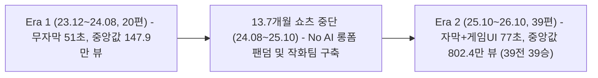

# `@HeyHistorically` (Historically) 쇼츠 성공 공식 심층 분석 보고서

> [!IMPORTANT]
> `@HeyHistorically`(운영자: **Youri Leerkotte**)는 단 **83편**의 총 업로드(공개 쇼츠 **59편** + 공개 롱폼 **23편** + 멤버십 전용 1편)만으로 **구독자 1,630,000명 · 누적 조회수 496,671,260회**를 기록했으며, 특히 13.7개월의 재정비 후 복귀한 **Era 2 쇼츠 39편 전수(100.0%)가 100만 뷰를 돌파(중앙값 802.4만 뷰)**한 초고타율 수작업 역사 애니메이션 채널입니다.

- **분석 대상**: https://www.youtube.com/@HeyHistorically/shorts (`Historically`, 채널 ID: `UCoZd78hRUdxxsuGiABuHF_A`, 네덜란드)
- **데이터 기준일**: `2026-11-05`
- **조사 및 검증 범위**:
  - 공개 **쇼츠 59편 전수(100%)** 및 공개 **롱폼 23편(+멤버십 전용 1편)** 메타데이터·일평균 조회 속도(`views/day`)·포맷 스펙 전수 검증
  - **쇼츠 59편 전수 `/shorts/<id>` HTML 오버레이 파싱**을 통한 `Related video` 롱폼 전환 퍼널 100% 매핑
  - **54편 `Most Replayed` 리텐션 히트맵** 수학적 돌출도(`prominence >= 0.05`) 재검증, 표본 11편 CV 프레임·자막·오디오 무음률 포렌식
  - 창립자 공개 인터뷰(`1of10 Podcast`), 자매 채널(`@OfficialArch`), 채용 공고(`jobs@heyhistorically.com`) 기반 제작·재무 파이프라인 실증

---

## 1. 채널 핵심 스펙 및 전수 성과 요약

| 지표 항목 | 공개 쇼츠 (`n=59`) | 공개 롱폼 (`n=23`) | 채널 합산 / 전략적 의미 |
|---|---|---|---|
| **구독자 / 총 조회수** | **420,513,431회** (`84.7%`) | **76,157,829회** (`15.3%`) | **구독자 163만 명 / 총 496,671,260회** |
| **평균 / 중앙값 조회수** | **7,127,346회** / **4,267,338회** | **3,311,210회** / **2,345,860회** | **Era 2 쇼츠(`n=39`) 중앙값 `8,023,838회`** |
| **최고 / 최저 조회수** | **28,385,839회** / **548,038회** | **10,413,137회** / **711,354회** | 채널 역사상 50만 뷰 미만 영상 **0편** |
| **100만 뷰 이상 타율** | **91.5% (`54/59편`)** | **91.3% (`21/23편`)** | **Era 2 쇼츠 39편 기준 100만 뷰 타율 `100.0%`** |
| **500만 / 1,000만 / 2,000만+ 뷰** | **26편 / 13편 / 6편** | 3편 / 1편 / 0편 | 쇼츠 5편 중 1편 이상이 천만 뷰 돌파 |
| **좋아요율 / 댓글률 (가중)** | **`3.54%`** (누적 1,490만 개) | — | 댓글률 **`0.0366%`** (`1,000뷰당 0.37개`, 총 15.4만 개) |

---

## 2. 성장 변곡점: 13.7개월 쇼츠 중단기와 Era 2의 `32.8배` 속도 점프



| 비교 항목 | Era 1: 초기 실험기 (`n=20`) | 13.7개월 중단기 (`24.08~25.10`) | Era 2: 포맷 완성기 (`n=39`) | 핵심 변화 |
|---|---|---|---|---|
| **평균 길이** | `51.5초` (`>60초` 0편) | 20~38분 대형 롱폼 집중 투자 | **`77.1초`** (`40~111초`, `>60초` `82.1%`) | 3분 쇼츠 개방 활용, 완결형 서사 구축 |
| **중앙값 조회수** | `1,479,000회` | `2025-05-09` `[No AI]` 브랜딩 도입 | **`8,023,838회` (`5.42배`)** | 천만 뷰 돌파율 `5.0%` → **`30.8%`** |
| **일평균 조회 속도(VPD)** | 중앙값 `1,706회/일` | 원격 애니메이터 분업 체계 확립 | 중앙값 **`56,039회/일` (`32.8배`)** | 피드 알고리즘 확산 속도 폭발 |
| **업로드 주기** | 중앙값 `6.9일` | 쇼츠 `0편` | 중앙값 **`7.0일` (주 1회 고정)** | 양산 대신 **주 1회 수작업 고타율** 고수 |
| **하단 자막 & 편집** | 번인 자막 없음, 평균 `2.82초/컷` | — | **`Y=74%` 번인 자막 100%, 평균 `2.12초/컷`** | 첫 3초 내 하드컷 `3~5회` + 게임 UI 도입 |

### Era 2 영상 길이별 정밀 검증 (`업력 통제` 및 `일평균 조회 속도` 기준)
단순 누적 뷰 착시를 제거하고 일평균 조회 속도(`VPD`)와 업력 30일 이상 성숙 표본으로 검증한 실제 스윗스팟입니다.

| Era 2 길이 구간 | 편수 | 누적 조회수 중앙값 | **일평균 조회수(VPD) 중앙값** | **업력 `>=30일` 성숙 중앙값** | 전략적 진단 |
|---|---:|---:|---:|---:|---|
| **`40~60초`** | 7편 | 385만 *(최신작 2편 포함)* | **`63,324회/일` (1위)** | 385만 (`59초` 2,116만·1,794만 포진) | 단발성 역설 소재에서 최고 확산 속도 발휘 |
| **`61~75초`** | 12편 | 620만 | `57,382회/일` | **`889만` (1위, `n=10`)** | *60s before NUKE*(`2,831만`) 등 최고 성숙 중앙값 |
| **`76~90초`** | 11편 | **859만** | `62,959회/일` (2위) | `863만` (2위, `n=10`) | 다단계 에스컬레이션 서사의 총시청시간 극대화 구간 |
| **`91~111초`** | 9편 | 823만 *(전원 구작)* | **`34,795회/일` (`-45%` 둔화)** | 823만 | **90초 초과 시 리텐션 부담으로 일간 확산 속도 반토막** |

---

## 3. 성공 공식 ①: 5대 주제 필러 & Zero-SEO 타이틀 엔지니어링

### 3.1 5대 주제 필러 성과 분포 (`59편 전수`)
1. **WW1·WW2·냉전 군사 역설 및 기밀 작전 (`20편`, 합산 `1.94억 뷰`, 중앙값 `807만`)**: *What if Germany won WW2*(`2,839만`), *60s before NUKE*(`2,831만`), *How did FRANCE keep their MASSIVE secret??*(`1,737만`).
2. **전근대 권력·생존법·고문·의례 (`15편`, 합산 `1.11억 뷰`, 중앙값 `465만`)**: *How to be POPE in 55 Years*(`2,096만`), *How KINGS survived POISON*(`2,085만`), *Why did Soldiers fight in Line Formations?*(`2,056만`).
3. **일상 음식·사물의 기괴한 기원 및 참사 (`5편`, 합산 `3,696만 뷰`, 중앙값 `434만`)**: *Why the 🇫🇷 hate Potatoes 🥔*(`2,116만`), *LOUDEST SOUND IN HISTORY*(`996만`).
4. **기이한 동물 영웅 및 기인 열전 (`14편`, 합산 `6,021만 뷰`, 중앙값 `293만`)**: *Pirate Lord Ching Shih*(`1,007만`), *Simon, the LEGENDARY war-cat*(`756만`).
5. **지정학·기묘한 국경선 (`5편`, 합산 `1,895만 뷰`, 논쟁 댓글 밀도 1위)**: *WEIRD borders of the USA*(`1,588만`), *Why dont the BALKANS unite? [NO AI]*.

### 3.2 Era 2 타이틀 구문 전수 성적표 (`n=39`, 평균 `30.6자 / 5.5단어`)
| 타이틀 구문 패턴 | 편수 | 평균 조회수 | **중앙값 조회수** | 대표 사례 및 작동 원리 |
|---|---:|---:|---:|---|
| **`How [극한 생존법/승진 비법]...`** | 5편 | **1,659만** | **1,737만** | *How to be POPE in 55 Years*, *How KINGS survived POISON* — 절차적 호기심 극대화 |
| **`What / Who [최상급/대체역사]?`** | 3편 | **1,378만** | **996만** | *What if Germany won WW2* — 거대 스케일 상상력 자극 |
| **`Why [반직관적 행동 역설]?`** | 6편 | **1,063만** | **831만** | *Why did Soldiers fight in Line Formations?* — 상식 파괴 (`The` 대비 `1.84배`) |
| **`When [황당한 역사적 조우]...`** | 6편 | 740만 | **704만** | *When Nazis and Americans TEAMED UP* — 즉각적 상황극 몰입 |
| **숫자 카운트다운·도발 서술형** | 9편 | 810만 | **602만** | *60s before NUKE...*(`2,831만`), *GOOD things EVIL people did...*(`976만`) |
| **`The [정적 명사구]`** | 10편 | 696만 | **451만** | 질문·역설 구조 부재 시 상대적 열세 |

> [!TIP]
> **역발상 메타데이터 3원칙**:
> 1. **숨김 태그 `0개`, 설명란 단 2줄(`Narration: Youri / Animation: William and Naomi`)**: 검색 SEO를 완전히 버리고 순수 피드 스와이프 방어율에 올인합니다.
> 2. **가짜 `#4k` 품질 시그널**: 실제 파일 해상도는 59편 전원 `1080×1920`(`60fps` 57편)이지만 `#4k #history`를 고정 부착해 고프레임 애니메이션 선호 군집을 타겟팅합니다.
> 3. **전략적 `[No AI]` 브랜딩**: 제작에서는 AI를 배제해 수작업 팬덤 충성도를 확보하면서, 비즈니스에서는 `[No AI]` 롱폼에 AI 플랫폼 스폰서십을 유치할 만큼 실용적으로 운영합니다.

---

## 4. 성공 공식 ②: 대본 아키텍처 & 오디오 포렌식

1. **`0~50ms` 무인트로 타격 + 첫 5초 `220 WPM` 과속 발화**:
   - 인트로 효과음 없이 첫 프레임부터 음성이 시작되며, 본문 평균 `189 WPM` 대비 **첫 5초 발화 속도를 평균 `220 WPM`(중앙값 `228 WPM`)으로 `+16%` 가속**해 스와이프 틈을 주지 않습니다.
2. **무음 비율 `0.31%` 밀착 편집 & 네덜란드 억양(Sonic Signature)**:
   - 호흡 공백을 칼같이 도려내 오디오 무음 구간(`-40dBFS` 이하)을 Era 1 `4.74%`에서 Era 2 **`0.31%`(중앙값 `0.14%`)**로 압축했습니다.
   - 미국식 AI TTS가 넘쳐나는 피드에서 운영자 Youri 특유의 **네덜란드 영어 억양**과 냉소적 구어체(`"well, hear me out"`)가 0.5초 만에 채널을 각인시키는 청각 지문이 됩니다.
3. **4대 필승 대본 척추**:
   - **시각 지시어 콜드오픈**: *"Who were easier to hit, **these guys** or **these funny guys**?"*처럼 화면을 봐야만 이해되는 지시어로 시선을 고정합니다.
   - **`해결책 → 치명적 허점 → 더 극단적 해결책` 에스컬레이션**: 기미상궁 고용 → *"느리게 퍼지는 독이면?"* → 주방 요새화·연좌제 → 매일 소량의 독 복용처럼 15~20초마다 반론 사다리를 올립니다.
   - **카운트다운 / 인생 스피드런 공략 축**: 원폭 투하 전 `60초 → 1초` 카운트다운이나 `출생 → 신학교 → 추기경 → 교황` 55년 랭크업처럼 끝까지 봐야만 닫히는 숫자 축을 세웁니다.
   - **잔향 `0.05초`(`30~80ms`) 블랙코미디 칼컷**: 마지막 음절 직후 즉각 절단합니다 (프랑스 감자 보급 성공 직후 마지막 1.1초에 *"...and then the French Revolution started."* + 단두대 실루엣 칼컷).

---

## 5. 성공 공식 ③: 'Doodlie' 비주얼 시스템 & 게임 UI·Pause-Bait 편집

````carousel

<!-- slide -->

<!-- slide -->

<!-- slide -->

````

1. **초고밀도 시각 타격 (`평균 2.12초/컷` + `0.56초` 주기 마이크로 비트)**:
   - 첫 3초 내 하드컷 `3~5회`를 배치하고, 표정 변화·줌·소품 팝업·자막 갱신을 합쳐 **분당 108회(`0.56초`당 1회)** 시각 변화를 줍니다. 하단(`Y=74%`)에는 1~4단어 번인 자막과 레드(`#E52521`) 핵심어 강조를 고정합니다.
2. **검열·노란딱지를 우회하는 'Doodlie' 캐릭터 디자인**:
   - 하얗고 둥근 마시멜로형 두상에 고증 복식만 입히고, 잔혹한 역사적 사건을 유머러스한 시각 은유(초록 연기 나는 `'HATE MAIL'` 우편함 등)로 치환해 수익 제한과 혐오 이탈을 동시에 회피합니다.
3. **Gen-Z 게임 UI HUD & 1초 일시정지 유도(Pause-Bait) 이스터에그**:
   - 우측 상단 진행 카운터(`YEARS PASSED: 2 → 55 [RANK: POPE]`), GTA `MISSION PASSED!`, RPG 레벨업 창으로 시청 진척도를 시각화합니다.
   - 배경과 1초짜리 문서 소품 속에 서브컬처 카메오(*Pomni*, *아이작*, *델타룬*)와 메타 농담(`"I WONDER IF SOMEONE'S GONNA READ THIS STUFF."`)을 숨겨 **일시정지·되감기·타임스탬프 댓글 놀이**를 폭발시킵니다.

---

## 6. 성공 공식 ④: `Related video` 59편 전수 퍼널 & 연 `\$500K+` 수익화 구조

> [!NOTE]
> 쇼츠 59편 전수 파싱 결과, **59편 모두(100.0%) 쇼츠가 아닌 자사 장편 롱폼 다큐멘터리(`20~38분`)로만 `Related video` 링크가 연결**되어 있습니다. 쇼츠는 순수 모객 깔때기이며, 실제 수익은 롱폼 미드롤 광고·대형 게임 스폰서십·멤버십에서 회수합니다.

### 6.1 3가지 정밀 `Related video` 링크 운영 기법 (`59/59편` 전수 확인)
- **기본 최신작 직결 (`48/59편`, `81.4%`)**: 업로드 시점의 최신 `[No AI]` 롱폼으로 트래픽을 집중 수혈합니다.
- **구작 쇼츠의 인기 롱폼 사후 리타겟팅 (`8/59편`, `13.6%`)**: 2023~2024년 초기 쇼츠들을 방치하지 않고 후속 흥행 롱폼(*철학자 편*, *아랍 역사 편*)으로 수동 재연결해 에버그린 유입을 재활용합니다.
- **D-1 런칭 이브 티저 스왑 (`2/59편` + 전략 매칭 `1편`)**: 대형 롱폼 공개 **하루 전날(D-1)** 쇼츠를 먼저 발행해 알고리즘 열기를 점화한 뒤, **다음 날 신작 롱폼이 공개되는 즉시 해당 쇼츠의 `Related video` 링크를 신작으로 교체**해 초기 조회수를 폭격합니다.

### 6.2 창립자 분업 공정 및 재무 구조
- 창립자 Youri가 선행 게이밍 채널(`@OfficialArch`) 수익을 초기 작화비로 재투자해 콜드스타트를 넘겼으며, 현재 **Youri(기획·대본·녹음·1차 애니매틱 타이밍 편집) + 원격 애니메이터 팀(William, Naomi 및 월 `\$2,000+` 클린업 에디터, DaVinci Resolve 파이프라인)** 분업으로 **주 1회 쇼츠 + 월 1~2회 롱폼**을 가동해 연 `\$500K+`(월 `\$30K+`) 규모 수익 모델을 구축했습니다.

---

## 7. 벤치마킹 시 즉시 적용할 5대 핵심 공식 요약

1. **`How / Why` 생존·역설 타이틀 + `55~88초` 완결 호흡**: 정적 명사구(`The...`) 대신 극한 상황의 절차·역설(`How KINGS survived...`, `Why did...`)을 30자 내외로 던지고, 단발 역설은 `~60초`, 다단계 에스컬레이션은 `70~88초`로 맞추되 `90초` 초과는 피합니다.
2. **`0.00초` 시각 지시어 + `"해결책 → 허점 → 극단적 해결책"` 사다리**: 첫 문장에 화면을 봐야만 알 수 있는 지시어를 넣고, 15초마다 반론을 던져 끝까지 보게 만듭니다.
3. **고위험 소재의 귀여운 캐릭터 중화 + 상단 진행도 HUD**: 무거운 과학·의학·역사 주제를 둥근 단순 캐릭터와 우측 상단 단계/시간 카운터 UI로 포장해 진입장벽과 플랫폼 검열 리스크를 동시에 낮춥니다.
4. **Pause-Bait 소품 텍스트 & 미완성 트리비아 댓글 점화**: 1초 지나가는 배경 소품에 위트 있는 영문 문구를 심고, 본문에서 인물 실명이나 후일담 반쪽을 비워두어 시청자 해설 댓글을 자동 유도합니다.
5. **D-1 쇼츠 티저 → 익일 신작 롱폼 `Related video` 스왑**: 롱폼 공개 하루 전 쇼츠를 먼저 띄운 뒤 다음 날 신작 롱폼으로 하단 연결 링크를 스위칭해 쇼츠 조회수를 롱폼 초기 부스트로 직결합니다.
