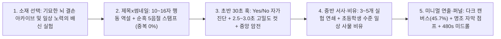

# `@심리학고양이` (`UCaJkv4faBajjsDGq2YPJN0A`) 전방위 심층 벤치마크 해부 보고서

---

## 0. `심리학고양이 성공 공식 (The Winning Formula)` — 1페이지 핵심 공식화

> [!IMPORTANT]
> **`@심리학고양이` 핵심 요약 (`2026-11-11` 실측 기준)**: 쇼츠(`/shorts`)를 **단 1편도 운영하지 않고**, 오직 **주 1회(목요일 밤 20~22시 KST) `8~10분` 16:9 롱폼 단일 포맷**만으로 **구독자 `404,000명` · 공개 168편 누적 조회수 `48,092,022회` (평균 `286,262회`, 중앙값 `103,537회`, 최다 `5,050,568회`)**를 달성한 뇌과학·심리학 스토리텔링 채널입니다.
> 초기 5개월(`Era 1`, 33편) 동안 교과서적 상담심리·애착유형 수필로 중앙값 `3,495회`의 암흑기를 겪었으나, **① 기묘한 뇌손상·분리뇌 실화 아카이브**와 **② 다크 미니멀 '역설(`~할수록 손해보는/해야 하는 이유` × `OO의 역설/배신`)' 패키징**을 결합한 후 월평균 조회수가 **`108.6만 회`(`2026-10`)**까지 폭발했습니다.



| 공식 축 | 핵심 메커니즘 (정식화) | 실측 증거 및 타율 격차 (`190편 전수 + 6편 MP4/오디오 실측`) |
|---|---|---|
| **① 소재/케이스 선택 공식**<br>*(Counter-Intuitive Exoneration)* | **"내가 겪는 일상적 고통이 내 의지 박약 때문이 아니라, 뇌의 구조적 분열/진화적 착각 때문이었다"**는 **면죄부(Exoneration)**를 주는 실증 실험·임상 케이스만 채택. 추상적 상담론·에세이는 철저히 배제. | - **역설·뇌결손 케이스**: 최고 `5,050,568회` (`#147` 분리뇌)<br>- **초기 상담·애착 수필(`Era 1`, 33편)**: 중앙값 **`3,495회`** (`#169` 심리상담 후기 `858회` 대비 **5,886배 격차**) |
| **② 제목×썸네일 호기심 갭 공식**<br>*(Zero-Redundancy Paradox Gap)* | **제목(`10~16자`)**은 `[2인칭 행동 역설: ~할수록 손해보는 / ~해야 하는 이유]`로 짓고, **썸네일**은 `순흑(#000000) 배경 + 단일 사물 은유 + 5음절 스탬프(OO의 역설 / OO의 배신)` 또는 `무텍스트 충격 실사`로 설계. **제목과 썸네일이 단 한 단어도 겹치지 않음.** | - **역설적 당위/금지형 제목(`n=24`)**: 평균 **`581,347회`**, 중앙값 **`369,856회`** (50만+ 타율 **`41.7%`**)<br>- **일반 방법론(`~하는 법`, `n=8`)**: 중앙값 **`5,668회`** (**65.2배 격차**)<br>- 동일 수면 주제: `생각을 끄고 잠드는 법`(`3.1만`) vs `빨리 자려고 할수록 손해보는 이유`×`수면의 역설`(`248만`, **78.8배**) |
| **③ 초반 30초 훅 공식**<br>*(2nd-Person Lab Immersion)* | 인사말 `0초`. `0.0초`부터 **유형 A(Yes/No 자가진단 → *"하나라도 예라면 당신도 실험 참가자입니다"*)**, **유형 B(2인칭 `'당신'` 실험실 착석 POV)**, **유형 C(기괴한 임상 환자 대사 + 8.3초 다큐 침묵)** 중 하나로 직행. 초반 30초 컷을 **`2.50~3.00초`(본편 대비 1.5~1.87배 고속)**로 압축. | - `#147`(`505만`), `#039`(`246만`): `0:00~0:09` 구간이 유튜브 **`Most Replayed` 1위(`val=1.00`)** 기록<br>- `#002`(`248만`): 초반 30초 11회 컷 전환(평균 **`2.50초`**, 본편 `3.89초`), `0:19`에 실제 행진곡 음원 `2.63초` 삽입 |
| **④ 중반 빌드업·비유 공식**<br>*(4-Lab Chain + Elementary Analogy)* | 단일 논문만 설명하지 않고 **`3~5개의 독립된 실험`을 징검다리처럼 연쇄 배치**해 통념을 부순 뒤, 중반(`50~65%`, 4분~6분)에 **초등학생도 1초 만에 이해하는 일상 사물 비유**로 치환하고 후반(`65~85%`)에 `3가지 행동 프로토콜` 제시. | - **핵심 치환 비유**: 반구 과각성 → **`침실의 보초병 3명`** (`#002`), 투명성 착각 → **`내 머릿속 감독판 vs 남이 보는 극장판`** (`#004`), 좌뇌 해석기 → **`가림막 뒤 스피드퀴즈 / 이야기꾼`** (`#147`, `#043`), 신경 가소성 → **`정글짐 놀이터의 아이들`** (`#151`) |
| **⑤ 미니멀 연출·몰입 편집 공식**<br>*(Dark Canvas + Center Subtitle Jump)* | 2026 '역설' 시리즈 기준 전체 화면의 **`45.7%`를 다크 캔버스(순흑 암전 `16.3%` + 다크 미니멀 도해 `29.4%`)**로 구성. 핵심 질문마다 **배경을 순흑(`#000000`)으로 끄고 하단(`y=86%`) 명조 자막을 화면 정중앙(`y=50%`)으로 점프**시켜 시선을 강제 리셋함. 러닝타임은 미드롤 광고 기준인 **`480초(8분 00초)` 직후(`중앙값 482초`)**에 정밀 고정. | - **`8~10분(480~599s)` 미드롤 구간(`n=66`)**: 평균 **`506,916회`**, 중앙값 **`224,880회`** (5분 미만 평균 `20,238회` 대비 **25.0배**)<br>- `#004`(`219만`): 내레이션이 `7:32.5`(`452.5s`)에 끝나자 **미드롤 기준(`480s`)을 맞추기 위해 엔딩 BGM을 정확히 `27.5초` 패딩**하여 `8:00` 완성 |

````carousel

<!-- slide -->

<!-- slide -->

````

---

## 1. 채널 전체 정량 프로파일 & 히트작 분포 분석 (`190편 전수 실측`)

### 1.1 채널 전체 정량 스펙 요약
| 지표 항목 | 실측 수치 (`2026-11-11` 기준) | 구조적·전략적 진단 |
|---|---|---|
| **총 업로드 영상 수** | **총 190편** (공개 **168편** + 멤버십 전용 **22편**) / **쇼츠 0편** | 쇼츠 유입 없이 순수 16:9 롱폼 홈 브라우즈·추천 알고리즘만으로 성장 |
| **구독자 / 공개 누적 조회수** | **404,000명** / **48,092,022회** | 공개 영상 1편당 평균 **`286,262회`**, 중앙값 **`103,537회`**, 표준편차 `562,468회` |
| **참여도 (좋아요 / 댓글)** | 누적 좋아요 **1,025,346개** / 댓글 **63,124개** | 평균 조회수 대비 좋아요율 **`2.13%`**, 1만 뷰당 댓글 **`13.1개`** (고관여 자기고백 댓글창) |
| **업로드 주기 및 요일·시간** | 전체 중앙값 **`7.01일`** (최근 40편 중앙값 **`7.02일`**) | **주 1회 목요일(`106/168편, 63.1%`) 밤 `20:00~22:59 KST`(`116/168편, 69.0%`)** 고정 |
| **영상 길이 분포** | 평균 **`499.7초` (`8분 20초`)** / 중앙값 **`482.0초` (`8분 02초`)** | 유튜브 미드롤 광고 최소 기준인 **`480초(8분 00초)` 직후(`480~599초`)에 39.3%(66편)** 집중 배치 |
| **4중 수익화 퍼널** | ① `8분+` 미드롤 AdSense + 브랜드 협찬(`베스트슬립` 바른수면연구소 등)<br>② 자체 유료 문답 다이어리 (`psykitty.kr/diary`, 61편 삽입)<br>③ 무료 뉴스레터 (`psykitty.kr/letter`, 167편) + 오픈카톡 (`116편`)<br>④ 채널 멤버십 전용 영상 (`22편`, 남녀 진화심리/성 본능 심화편) | 대중적 뇌과학·심리학 역설로 무료 트래픽을 모으고, 자극적이거나 사적인 남녀 본능 주제는 멤버십(`subscriber_only`)으로 분리하여 채널 권위 유지 |

### 1.2 조회수 구간별 · 영상 길이별 · 시대별(`Era 1~4`) 분포
| 구분 | 세부 구간 | 영상 수 (비중) | 합산 조회수 (점유율) | 구간 평균 조회수 | 구간 중앙값 | 핵심 진단 |
|---|---|---:|---:|---:|---:|---|
| **조회수 구간** | **100만 뷰 이상 (Mega-Hit)** | **10편** (`6.0%`) | **20,578,497회** (`42.8%`) | 2,057,850회 | 1,694,745회 | 상위 6% 영상이 채널 전체 조회수의 **42.8%** 견인 |
| | **50만 ~ 100만 뷰 (Big Hit)** | **15편** (`8.9%`) | **9,989,468회** (`20.8%`) | 665,965회 | 643,547회 | 상위 14.9%(25편)가 전체 조회수의 **63.6%** 차지 |
| | **10만 ~ 50만 뷰 (Solid Hit)** | **61편** (`36.3%`) | **15,567,665회** (`32.4%`) | 255,208회 | 231,144회 | 전체 공개 영상의 **51.2%(86편)가 10만 뷰 돌파** |
| | **3만 ~ 10만 뷰 (Average)** | **25편** (`14.9%`) | **1,462,731회** (`3.0%`) | 58,509회 | 54,938회 | 과도기 실험작 또는 좁은 타겟 소재 |
| | **3만 뷰 미만 (Early/Low)** | **57편** (`33.9%`) | **493,661회** (`1.0%`) | 8,661회 | 5,627회 | 대부분 `2023.06~10` 초기 암흑기(`Era 1`) 상담심리 강의 |
| **길이 구간** | **5분 미만 (`<300s`)** | 19편 (`11.3%`) | 384,522회 (`0.8%`) | 20,238회 | **7,786회** | 서사 빌드업 부족 및 미드롤 불가로 알고리즘 소외 |
| | **5 ~ 8분 (`300~479s`)** | 55편 (`32.7%`) | 6,616,005회 (`13.8%`) | 120,291회 | **32,805회** | 8분 미달 시 평균 조회수가 8~10분 대비 `-76.3%` 급감 |
| | **`8 ~ 10분 (480~599s)`** | **66편 (`39.3%`)** | **33,456,456회 (`69.6%`)** | **`506,916회`** | **`224,880회`** | **절대 스위트스팟**: TOP 5 메가히트 전편이 `480~579s`에 포진 |
| | **10분 이상 (`>=600s`)** | 28편 (`16.7%`) | 7,635,012회 (`15.9%`) | 272,679회 | **225,840회** | 다중 실험 연쇄 및 특집(`#095` `15:03`, `124.5만 뷰`) |
| **4대 시대** | **Era 1 (`2023.06~10`, `#190~#152`)** | 33편 | 217,008회 (`0.5%`) | 6,576회 | **3,495회** | 학술 용어 나열 + 상담 에세이 톤으로 철저히 외면받음 |
| | **Era 2 (`2023.11~2024.12`, `#151~#098`)** | 44편 | 15,089,272회 (`31.4%`) | 342,938회 | **164,326회** | `#151`(`200.8만`), `#147`(`505.0만`) 뇌손상·분리뇌 실화로 폭발 |
| | **Era 3 (`2025.01~12`, `#097~#045`)** | 47편 | 12,127,128회 (`25.2%`) | 258,024회 | **153,033회** | 하버드/실화 권위 후킹 + 연애 진화심리 22편 멤버십 분리 |
| | **Era 4 (`2026.01~11`, `#044~#001`)** | 44편 | **22,568,700회 (`46.9%`)** | **`512,925회`** | **`276,430회`** | **`10~16자 역설 제목` × `순흑 5음절 스탬프 썸네일`** 완성기 |

### 1.3 상위 TOP 16 메가히트작 실측 일람표
| 순위 | 번호 (`ID`) | 업로드일 | 정확 조회수 | 좋아요 (비율) | 댓글 (만뷰당) | 길이 | 한국어 원제 (글자수) | 썸네일 카피 및 시각 오브젝트 (실측 검증) |
|---:|---|---|---:|---:|---:|---:|---|---|
| **1** | `#147` (`aRiFY2Nm9Ng`) | `2024-01-01` | **5,050,568** | 75,451 (`1.49%`) | 2,800 (`5.5`) | `8:13` | 당신이 사실 2명인 이유 (feat. 노벨상) | **[무텍스트]** 가림막 상자 뒤에서 양손으로 다른 도형 그리는 분리뇌 환자 실사 |
| **2** | `#002` (`1Y1UTkjMG00`) | `2026-10-29` | **2,482,642** | 13,688 (`0.55%`) | 1,600 (`6.4`) | `9:39` | 빨리 자려고 할수록 손해보는 이유 (`16자`) | **`수면의 역설`** (순흑 배경 + 빨간 20분 시계 vs 파란 5분 시계) |
| **3** | `#039` (`X71gvsqMk4k`) | `2026-02-05` | **2,464,458** | 57,180 (`2.32%`) | 2,400 (`9.7`) | `8:02` | 손해보며 살아야 하는 이유 (`12자`) | **`손해의 역설`** (순흑 배경 + 반으로 찢어진 5만 원권 지폐) |
| **4** | `#004` (`6skfikfyY_M`) | `2026-10-15` | **2,194,661** | 23,405 (`1.07%`) | 727 (`3.3`) | `8:00` | 당신이 생각보다 호감인 이유 (`14자`) | **`호감의 역설`** (순흑 배경 + 구겨진 흰 종이 한가운데 붉은 하트) |
| **5** | `#151` (`mDPZwjqlsmk`) | `2023-11-27` | **2,008,694** | 35,416 (`1.76%`) | 1,500 (`7.5`) | `8:59` | 하버드대 뇌과학자의 깨달음 (`13자`) | **[무텍스트]** 파란 수술 장갑 끼고 실제 인간 뇌와 척수를 든 질 볼트 테일러 TED 실사 |
| **6** | `#082` (`q7txH0EJW-M`) | `2025-04-17` | **1,380,796** | 20,100 (`1.46%`) | 559 (`4.0`) | `8:09` | (실화) 1분마다 새로 태어나는 남자 (`19자`) | **`(실제 일기)`** (`I DO LIVE!!!!` 수십 줄이 지워진 클라이브 웨어링 실제 수기 스캔본) |
| **7** | `#040` (`_XJy5FqDrTs`) | `2026-01-29` | **1,354,836** | 31,350 (`2.31%`) | 1,100 (`8.1`) | `9:35` | 99%가 인생을 낭비하는 이유 (`15자`) | **`익숙한 지옥`** (어두운 배경 + 거대한 바위를 밀어 올리는 시시포스) |
| **8** | `#085` (`Lv3QwcAcDnA`) | `2025-03-27` | **1,333,906** | 37,306 (`2.80%`) | 975 (`7.3`) | `8:10` | 하버드대에서 밝힌 「삶에 여유가 없을수록 꼭 해야하는 1가지」 | **`결핍의 역설`** (`노력할수록 실패하는 이유` + 순흑 배경 흰색 고개 숙인 실루엣) |
| **9** | `#095` (`YkNReIcwlaI`) | `2025-01-13` | **1,245,391** | 40,062 (`3.22%`) | 1,200 (`9.6`) | `15:03` | 삶이라는 게임에서 승리하는 법 (`15자`) | **`전부 틀렸습니다`** (`뇌연구 30년` 학자 얼굴 + `성공에 집착? 욕망에 초연?`) |
| **10** | `#038` (`rojH_j1MgBI`) | `2026-02-12` | **1,062,545** | 28,416 (`2.67%`) | 1,200 (`11.3`) | `9:07` | 숏폼 중독이 무서운 진짜 이유 (`14자`) | **`숏폼의 배신`** (순흑 배경 + `학계의 정설` 녹색 뇌 스캔 vs `실제 모습` 적황색 뇌 스캔) |
| **11** | `#017` (`sdIpyH1N26s`) | `2026-07-09` | **912,251** | 17,421 (`1.91%`) | 953 (`10.4`) | `7:30` | 배트맨을 상상해야 하는 이유 (`13자`) | **`배트맨 효과`** (서울 지하철 2호선 만원 전철 손잡이를 잡고 서 있는 배트맨) |
| **12** | `#105` (`qnGl7bIrFHI`) | `2024-10-31` | **895,489** | 16,553 (`1.85%`) | 3,700 (`41.3`) | `8:16` | 동성애자는 동성애자로 태어나는 걸까?｜인류 진화의 최대 미스터리 | **`남아를 여아로 키우면 커서 어떤 성별에 끌릴까?`** (순흑 배경 + 남아→여아 흰 실루엣) |
| **13** | `#043` (`T9fp6gV6oB8`) | `2026-01-08` | **854,895** | 31,153 (`3.64%`) | 1,800 (`21.1`) | `10:14` | 생각이 많을수록 손해보는 이유 (`14자`) | **`비둘기는 답을 알고 있다`** (순흑 배경 + 정면을 응시하는 흰 비둘기 1마리) |
| **14** | `#032` (`pTnphfyRP9g`) | `2026-03-26` | **770,123** | 18,858 (`2.45%`) | 1,000 (`13.0`) | `8:00` | 영어로 생각해야 하는 이유 (`12자`) | **`국어의 배신`** (순흑 배경 + 태극 문양 자리에 성조기가 합성된 태극기; 5음절 고정) |
| **15** | `#136` (`MNnTEHv9jgw`) | `2024-03-28` | **753,426** | 22,379 (`2.97%`) | 463 (`6.1`) | `6:44` | 뇌과학이 말하는 「빨리 배우는 가장 게으른 방법」 | **`공부 후 바로 '이것' 하세요 / 공부시간이 50%로 단축됩니다`** (`뇌연구 45년` 교수) |
| **16** | `#015` (`7pkpKEMTVdA`) | `2026-07-27` | **729,294** | 13,689 (`1.88%`) | 421 (`5.8`) | `8:27` | 좋아하지도 않는 걸 원하면 생기는 일 (`17자`) | **`욕구의 배신`** (순흑 배경 + 아이폰을 건네는 손과 손바닥으로 밀어내는 손) |

### 1.4 동일 주제 '쌍둥이 A/B 비교'로 입증된 최대 `1,144배` 격차 원리
| 비교군 (동일 학술 소재) | 저성과 영상 (실패 프레이밍) | 메가히트 영상 (성공 프레이밍) | 조회수 배율 | 결정적 차이점 (Why It Exploded) |
|---|---|---|---:|---|
| **쌍둥이 A** *(타인의 시선·호감 착각)* | `#176` *인포자도 1등급 만드는 '이것'* (`1,918회`) | `#004` *당신이 생각보다 호감인 이유* (`호감의 역설`, **`2,194,661회`**) | **`1,144.2배`** | 시청자를 '인간관계 포기자'로 비하하는 자기계발 클리셰 → **'상대는 이미 당신을 좋아한다(Liking Gap)'는 면죄부 + 1인칭 거짓말 게임 훅** |
| **쌍둥이 B** *(만족자 vs 극대화자)* | `#128` *경쟁에 지친 뉴욕 명문대 교수가 병원의 황당한 실수로...* (`5,095회`) | `#039` *손해보며 살아야 하는 이유* (`손해의 역설`, **`2,464,458회`**) | **`483.7배`** | 둘 다 배리 슈워츠(`Maximizer vs Satisficer`) 연구를 다뤘으나, **42자 3인칭 서술형(`5,095회`) vs 12자 2인칭 역설형(`246.4만`)**에서 483.7배 격차 |
| **쌍둥이 C** *(애착이론: 불안·회피)* | `#180` *회피형과 불안형은 대체 무슨 장점이 있을까?* (`2,557회`) | `#042` *불안형이 절대 이길 수 없는 이유* (`연애는 도박이다`, **`517,380회`**) | **`202.3배`** | 교과서적인 애착유형 강의 → **포커 카드(`A♦ A♠`) 도박 메타포 + '절대 이길 수 없는 이유'라는 손실 회피 자극** |
| **쌍둥이 D** *(불면증·수면 강박)* | `#045` *생각을 끄고 잠드는 법* (`31,515회`) | `#002` *빨리 자려고 할수록 손해보는 이유* (`수면의 역설`, **`2,482,642회`**) | **`78.8배`** | 흔한 방법론(`~하는 법`)을 버리고 **'빨리 자려 할수록 더 못 잔다(행진곡 실험)'는 역설적 손해 프레이밍**으로 전환 |
| **쌍둥이 E** *(분리뇌·다중 자아)* | `#009` *당신 안에 N명이 사는 이유* (`165,144회`) | `#147` *당신이 사실 2명인 이유 (feat. 노벨상)* (**`5,050,568회`**) | **`30.6배`** | 추상적 미지수(`N명`)보다 **물리적인 좌·우뇌 `2명` + `노벨상` 실증 권위 + 무텍스트 실험실 실사**가 30.6배 클릭 견인 |

---

## 2. 소재 & 케이스 선정 공식 (`Case Curation Formula`) & 차기 에피소드 후보 TOP 10

### 2.1 메가히트작의 2대 소재 아키타입
1. **아키타입 A — 기묘한 신경학적 결손·분리뇌 실화 아카이브형 (`#147` `505만`, `#151` `201만`, `#082` `138만`, `#095` `125만`)**:
   - 정상인의 상식으로는 이해할 수 없는 **신체·언어 부조리(Bizarre Dissociation)** 장면(예: 누드 사진을 보고 웃으면서 *"교수님 넥타이가 웃겨서요"*라고 작화하는 분리뇌 환자, 마비된 왼손으로 쟁반의 물잔을 쏟고도 *"제 왼팔은 멀쩡해요"*라고 우기는 질병불각증 환자, 1분마다 일기장에 *"지금 난생처음 깨어났다"*를 적는 클라이브 웨어링)을 실제 다큐 증거물로 제시한 뒤, **"정상인인 당신이 밤마다 자책하는 내면의 목소리 역시 좌뇌 해석기가 지어낸 가짜 소설일 뿐"**이라며 시청자의 불안을 해방시킵니다.
2. **아키타입 B — 일상 노력의 배신을 폭로하는 '행동 역설 실험 연쇄형' (`#002` `248만`, `#039` `246만`, `#004` `219만`, `#040` `135만`, `#085` `133만`)**:
   - 시청자가 더 잘 살기 위해 매일 애쓰는 노력(일찍 자려고 누워있기, 최저가 끝까지 비교하기, 대화 후 내 실수 복기하기)이 **뇌과학적으로는 오히려 우울증·불면증·IQ 폭락을 유발하는 주범**임을 `3~5개의 연쇄 실험`으로 증명합니다.

### 2.2 `@AllAboutBrainOfficial` 기존 도시에(`110개 폴더`) 및 프로젝트(`44개`) 대조 후 도출한 미개척 후보 TOP 10 (`100% Crossref 검증 완료`)
- **기존 보유(제외 완료)**: 분리뇌 가자니가(`split_brain_dual_consciousness`), 클라이브 웨어링(`clive_wearing_seven_second_mind`), 첫날밤 효과 좌뇌 보초(`v2_sleep_first_night_hemisphere_watch`), 흰곰 억제(`wegner_white_bear_suppression`), 자이가르닉(`zeigarnik_uncompleted_task_loop`), 크로스 3인칭 자기대화(`kross_distanced_self_talk_chatter`), 맹시(`blindsight_subcortical_vision`), 코타르 증후군(`cotard_walking_corpse_syndrome`), 슐츠 도파민 예측오류(`schultz_dopamine_prediction_error`), 다마지오 신체표지(`damasio_somatic_marker_decision`).

| 순위 | 추천 도시에 슬러그 (`Slug`) | 실제 연구자 · 연도 · 저널 · **Crossref 검증 DOI** | 핵심 과학적 역설 & `R70 Data Stamp` 즉시 호환 수치 | `@심리학고양이` 검증 성과 | `v8` US English 쇼츠 Cold-Open Hook 각도 (`R68-H` `case_stamp` `10~22w`) |
|---:|---|---|---|---|---|
| **1** | `gilbert_reversible_choice_paradox` | **Daniel T. Gilbert & Jane E. J. Ebert (2002)**<br>*J. Pers. Soc. Psychol.*, 82(4), 503–514.<br>DOI: **`10.1037/0022-3514.82.4.503`** | **[환불 보장의 역설]** 하버드 사진 수업에서 66%가 '5일 내 사진 교환 가능' 조건을 원했지만, 실제 만족도는 **교환 불가 그룹이 압도적 우위** (`번복 가능 68점 vs 번복 불가 90점`). 퇴로가 열려 있으면 전두엽의 '심리적 면역계(합리화 회로)'가 꺼져 영원히 후회함. | `#039` **2,464,458회**<br>(`손해보며 살아야 하는 이유`) | *"Harvard gave photography students five days to swap their final print! Yet that single refund policy secretly ruined their happiness."* |
| **2** | `scullin_bedtime_todo_list_sleep` | **Michael K. Scullin et al. (2018)**<br>*J. Exp. Psychol. Gen.*, 147(1), 139–146.<br>DOI: **`10.1037/xge0000374`**<br>*(+ Ansfield, Wegner, & Bowser 1996, DOI: **`10.1016/0005-7967(96)00031-9`**)* | **[수면 메모 & 입면 노력의 역설]** 잠들기 전 5분간 '오늘 끝낸 일'을 적은 그룹은 입면에 **`24.9분`**이 걸렸지만, **'내일 해야 할 일(To-Do)'을 구체적으로 적은 그룹은 `15.5분`(`9.4분 단축`)** 만에 입면. 미완성 과제를 종이에 외주화해야 해마-전두엽 각성 루프가 꺼짐. | `#002` **2,482,642회**<br>(`빨리 자려고 할수록 손해보는 이유`) | *"Baylor doctors asked insomniacs to list tomorrow's stressful chores before bed! Yet writing that list put them to sleep faster."* |
| **3** | `boothby_liking_gap_illusion` | **Erica J. Boothby et al. (2018)**<br>*Psychological Science*, 29(11), 1742–1756.<br>DOI: **`10.1177/0956797618783714`**<br>*(+ Gilovich et al. 1998, DOI: **`10.1037/0022-3514.75.2.332`**)* | **[호감 격차 & 투명성 착각]** 낯선 사람과 5분 대화 후 내 예상 호감도(`4.92/7`)보다 **상대의 실제 호감도(`5.49/7`)가 일관되게 높음**. 거짓말 게임에서도 거짓말쟁이는 4명 중 **2명(`48.8%`)**이 내 떨림을 눈치챘다고 믿지만 실제 적중률은 **1명(`25.6%`, 찍기 확률)**. | `#004` **2,194,661회**<br>(`당신이 생각보다 호감인 이유`) | *"Yale strangers rated each other after a five-minute chat! Nearly everyone thought they bombed, yet their partner secretly liked them."* |
| **4** | `thaler_blind_echolocation_visual_cortex` | **Lore Thaler, Stephen R. Arnott & Melvyn A. Goodale (2011)**<br>*PLOS ONE*, 6(5), e20162.<br>DOI: **`10.1371/journal.pone.0020162`** | **[시각장애인 음파탐지의 시각피질 점화]** 안구가 없는 전맹 시각장애인(`Daniel Kish` 등)이 혀를 차는 반향음(Click echo)만으로 자전거를 탈 때, 청각피질이 아니라 **1차 시각피질(Calcarine cortex `V1`)이 정안인처럼 강하게 점화**됨. | `#151` **2,008,694회**<br>(`하버드대 뇌과학자의 깨달음` 내 **`Most Replayed` 1위 구간**) | *"A blind man rode a bicycle through traffic by clicking his tongue! Inside the scanner, his dead visual cortex lit up."* |
| **5** | `mani_mullainathan_scarcity_iq_drop` | **Anandi Mani, Sendhil Mullainathan, Eldar Shafir & Jiaying Zhao (2013)**<br>*Science*, 341(6149), 976–980.<br>DOI: **`10.1126/science.1238041`** | **[결핍의 뇌 대역폭 납치]** 운전자에게 **자동차 수리비 `\$1,500`(`400만 원`) 청구서 시나리오**만 읽게 해도 직후 유동성 지능(IQ) 점수가 **`13~14점` 폭락**함 — 이는 **하룻밤을 꼬박 새웠을 때의 지능 저하(`-13점`)**와 맞먹는 전두엽 마비 현상. | `#085` **1,333,906회**<br>(`삶에 여유가 없을수록 꼭 해야하는 1가지`) | *"Princeton researchers showed drivers a fifteen-hundred-dollar car repair bill! That single money worry instantly dropped their IQ by thirteen points."* |
| **6** | `ramachandran_anosognosia_caloric_vestibular` | **V. S. Ramachandran (1995)**<br>*Consciousness and Cognition*, 4(1), 22–51.<br>DOI: **`10.1006/ccog.1995.1002`** | **[마비를 부정하는 좌뇌와 얼음물 실험]** 우뇌 뇌졸중으로 왼팔이 완전 마비된 환자가 *"제 왼손은 멀쩡해요"*라며 쟁반의 오른쪽 끝만 잡다 물잔을 쏟고도 작화증 변명을 함. 그런데 **왼쪽 귀에 얼음물 10ml**를 붓자(전정기관→우뇌 각성) 10분간 마비를 즉시 인정함! | `#095` **1,245,391회**<br>(`삶이라는 게임에서 승리하는 법`) | *"A stroke patient swore her paralyzed left arm was moving fine! Until a neurologist poured ice water into her ear."* |
| **7** | `wilson_solitude_electric_shock_dmn` | **Timothy D. Wilson et al. (2014)**<br>*Science*, 345(6192), 75–77.<br>DOI: **`10.1126/science.1250830`** | **[15분 고독 vs 전기충격의 역설]** 실험 전 *"절대 안 누르겠다"*고 선언한 참가자들을 스마트폰 없이 빈방에 **15분간 혼자 두자, 남성의 `67%`·여성의 `25%`가 지루함을 못 견뎌 스스로에게 고통스러운 전기충격**을 가함(기본모드네트워크 `DMN` 반추 회피). | `#038` **1,062,545회**<br>(`숏폼 중독이 무서운 진짜 이유`) | *"Virginia volunteers sat alone in an empty room for fifteen minutes! Two-thirds of the men voluntarily shocked themselves with electricity."* |
| **8** | `white_carlson_batman_alter_ego_cape` | **Rachel E. White, Emily O. Prager, Catherine Schaefer, Ethan Kross, Angela L. Duckworth & Stephanie M. Carlson (2017)**<br>*Child Development*, 88(5), 1563–1571.<br>DOI: **`10.1111/cdev.12695`** | **[배트맨 망토 알터에고 효과]** *(주의: 기존 `kross` 도시에와 겹치지 않도록 2017 아동 아이패드 유혹 실험만 단독 구성)* 옆에 게임 아이패드를 두고 지루한 과제를 시켰을 때, 1인칭 그룹은 **`28.5%`**만 버텼으나, 망토를 걸치고 **`"배트맨은 열심히 일하고 있나?"`**라고 자문한 그룹은 **`55.2%`(`2배`)** 집중 시간을 기록. | `#017` **912,251회**<br>(`배트맨을 상상해야 하는 이유`) | *"Scientists placed a tempting iPad beside six-year-olds doing a boring chore! Wearing a Batman cape doubled their willpower."* |
| **9** | `wolford_gazzaniga_pigeon_overthinking` | **George Wolford, Michael B. Miller & Michael Gazzaniga (2000)**<br>*J. Neuroscience*, 20(6), RC64.<br>DOI: **`10.1523/JNEUROSCI.20-06-j0003.2000`** | **[비둘기에게 진 인간의 좌뇌]** 위쪽 `80%`·아래쪽 `20%` 확률로 무작위 점등되는 불빛 예측 게임에서, **비둘기와 쥐는 무조건 위쪽만 찍어 `80%` 정답률**을 기록한 반면, **인간 성인은 없는 규칙을 찾으려다 `68%`**로 참패함(분리뇌 환자의 우뇌는 `80%+` 달성). | `#043` **854,895회**<br>(`생각이 많을수록 손해보는 이유`) | *"Dartmouth neuroscientists pitted college students against pigeons in a simple guessing game! The pigeons crushed the humans every single time."* |
| **10** | `costa_keysar_foreign_language_dilemma` | **Albert Costa, Alice Foucart, Sayuri Hayakawa, Melina Aparici, Jose Apesteguia, Joy Heafner & Boaz Keysar (2014)**<br>*PLOS ONE*, 9(4), e94842.<br>DOI: **`10.1371/journal.pone.0094842`**<br>*(+ Berridge & Robinson 1998, DOI: **`10.1016/S0165-0173(98)00019-8`**)* | **[외국어 사고의 편도체 우회 효과]** 모국어로 육교 트롤리 딜레마를 물으면 공리주의적 선택이 **`18%`**에 불과하지만, **외국어(제2언어)로 물으면 `44%`(`2.4배`)**로 급증함. 모국어는 편도체 감정 기억을 즉각 점화하지만, 외국어는 배외측 전전두엽(`dlPFC`) 이성 회로를 먼저 가동함. | `#032` **770,123회**<br>(`영어로 생각해야 하는 이유`) | *"Psychologists asked bilinguals the exact same life-or-death moral dilemma twice! Switching to a second language doubled their cold logic."* |

---

## 3. 상위 대표 히트작 실제 대본/자막(`Transcript`) & `Most Replayed` 서사 구조 해부

### 3.1 초반 `0~30초` Cold-Open Hook 3대 공식
1. **공식 1 — `[Yes/No 3~4문항 강제 자가진단 → 실험실 강제 입소]` (`#002` `248만`, `#039` `246만`)**:
   - **`0.0s ~ 2.2s` [정중앙 암전 명령]**: *"지금부터 솔직하게 예, 아니오로 대답해 보세요."* (`#002`, `#039` 토씨 하나 안 틀리고 동일한 첫 문장!)
   - **`2.2s ~ 14.5s` [일상 팩폭 3~4연타 → 강제 입소]**: *"소파에서는 나도 모르게 잠드는데 침대에만 누우면 이상하게 잠이 안 온다... 하나라도 예라고 답하셨다면, 지금부터 당신도 이 실험의 참가자입니다."* (`#002`) / `#039`에서는 이 구간(`0:04~0:09`)이 **유튜브 `Most Replayed` 전체 1위(`val=1.00`)** 기록!
   - **`14.5s ~ 42.5s` [대조 실험 & 2단 수치 반전]**: `#039`에서는 극대화자가 만족자보다 연봉을 **`20%(\$85K vs \$70K)` 더 번다**고 먼저 안심시킨 직후, ***"하지만 우울증 위험도는 만족자 6% vs 극대화자 44%(7.3배)"***로 뒤통수를 치는 **2단 카운터펀치(Double-Turn Hook)**를 구사합니다.
2. **공식 2 — `[2인칭('당신') 즉각 실험실 착석 POV]` (`#004` `219만`)**:
   - **`0.0s ~ 19.1s`**: *"당신은 처음 보는 학생 네 명과 동그랗게 둘러앉아 있습니다... 당신 차례가 되어 카드를 뒤집습니다. 그런데 질문 아래 당신 눈에만 보이는 작은 글씨가 있습니다. '거짓말로 대답하세요.'"* → 내 예상 적중자 **`2명(48.8%)` vs 실제 적중자 `1명(25.6%, 찍기 확률)`** 대조로 직행.
3. **공식 3 — `[기괴한 임상 현장의 부조리한 대사 + 다큐 원음 여백]` (`#147` `505만`, `#151` `201만`, `#082` `138만`)**:
   - **`#147` (`0:00 ~ 0:25`, `Most Replayed` 1위 `0:00~0:05 val=1.00`)**: 왼쪽 시야에 누드 사진을 본 분리뇌 여성 환자가 웃자 가자니가가 이유를 묻고, 환자가 ***"교수님 넥타이가 좀 웃기게 생겨서요"***라고 답한 직후, **`17.0s ~ 25.3s`(`8.3초`) 동안 내레이션을 완전히 끄고** 환자가 양손으로 네모와 원을 동시에 그리는 실제 흑백 실험 영상을 보여줍니다.

### 3.2 어려운 뇌과학을 초등학생도 이해하게 푸는 '6대 일상 치환 비유 사전 (Elementary Analogy Engine)'
전문 용어를 설명한 직후 **반드시 일상 사물·공간 비유로 1:1 치환**하고, 영상 끝까지 전문 용어 대신 **그 비유 단어(`보초병`, `감독판/극장판`, `가림막`, `스피드퀴즈`, `놀이터`, `기억 서커스`)로만 서사를 끌고 가는 것**이 핵심입니다.

| 영상 (`조회수`) | 원래의 어려운 학술 개념 | `@심리학고양이`의 초등학생 수준 치환 비유 | 실제 대본 문장 인용 (`.ko.json3` 검증) |
|---|---|---|---|
| **`#002` 수면의 역설**<br>(`248만 뷰`) | **편도체 과각성 & 반구 비대칭 수면 (First-Night Effect / Hyperarousal)** | **"내 침실 성벽에 내가 직접 고용한 3명의 보초병(`8시간`, `착각`, `점수`)"** | *"낯설고 위험할지 모르는 곳에서는 뇌 한쪽이 **보초**를 섭니다... 현대인의 뇌에는 세 명의 보초병이 있습니다. 첫 번째 보초병의 이름은 `8시간`, 두 번째는 `착각`, 마지막은 `점수`입니다. 오늘 밤 짐은 자지 않겠다! 왕이 이렇게 선언하면 성벽의 보초병도 할 게 없어지니까요."* |
| **`#004` 호감의 역설**<br>(`219만 뷰`) | **투명성 착각 (Illusion of Transparency) & 자기초점적 주의** | **"NG 장면까지 다 들어있는 내 머릿속 `감독판` vs 편집본만 보는 상대 눈의 `극장판`"** | *"영화엔 감독판과 극장판이 있죠. 대화할 때 나는 내 **감독판**을 봅니다. 떨리던 손, 하려다 삼킨 말, 속으로 망했다 했던 순간까지 다 들어있죠. 하지만 상대가 보는 건 나의 **극장판**입니다. 결국 나는 상대는 본 적도 없는 NG 장면들로 나라는 영화의 점수를 깎고 있는 셈입니다."* |
| **`#147` 분리뇌**<br>(`505만 뷰`) | **반측 시야 분리 제시 (Tachistoscopic Presentation) & 좌뇌 작화증** | **"코 가운데 설치한 `가림막` + 말 못 하는 우뇌와 말 잘하는 좌뇌의 `스피드퀴즈`"** | *(설명란 및 `168s` 챕터)*: *"시청의 편의를 위해 눈앞에 **가림막**을 설치했다고 각색했습니다... 우뇌는 말은 못 하지만 왼손으로 글씨를 쓰고, 눈을 가린 좌뇌는 왼손의 움직임만 느끼며 **스피드퀴즈**를 맞춥니다."* |
| **`#151` 뇌과학자 깨달음**<br>(`201만 뷰`) | **신경 가소성 (Neuroplasticity) & 교차 감각 피질 재조직화 (`V1`)** | **"정글짐이 부서져도 사라지지 않고 옆 공놀이에 합류하는 `놀이터의 꼬마들`"** | `[275.3s]` *"테일러는 뇌가 꼬마들이 여러 뛰어노는 **놀이터**라고 표현합니다. 정글짐을 못 쓴다고 거기서 놀던 아이들이 그냥 사라지는 건 아니에요. 다른 아이들과 섞여서 또 다른 놀이를 하겠죠. 뉴런도 마찬가지입니다."* |
| **`#039` 손해의 역설**<br>(`246만 뷰`) | **반사실적 사고 (Counterfactual Thinking) & 전두엽 심리적 면역계** | **"가지 않은 길의 문고리를 계속 흔들어보는 사람 vs 문이 잠겨 방을 꾸미는 사람"** | `[161.0s]` *"행복은 발견하는 게 아니라 만들어내는 것입니다. 언제든 사진을 바꿀 수 있다고 생각한 학생들은 마음의 결정을 내리지 못한 채 '저 사진이 더 나았을까?' 의심하느라 정작 내 손에 있는 사진의 아름다움을 보지 못했죠."* |
| **`#082` 1분마다 태어나는 남자**<br>(`138만 뷰`) | **해마 외현기억 소실 vs 편도체 암묵적 공포 조건화 보존** | **"단장(해마)이 사라져도 맹수 조련사(편도체) 혼자 돌아가는 `기억 서커스` & `폭주 기관차`"** | `[340.0s, Most Replayed 1위 val=1.00]` *"해마가 손상되어 방금 본 사람도 잊어버리는 환자들에게 **폭주하는 기관차** 영상을 보여주면 맥박이 뛰고 땀을 흘립니다. 의식은 잊었어도 편도체는 그 공포와 사랑을 영원히 기억하고 있는 것입니다."* |

### 3.3 `8분(480초)` 표준 5막 타임라인 & `Most Replayed` 리텐션 스파이크 구조
| 막(Act) | 시간대 (`비율`) | 서사 역할 및 설계 규칙 | 실제 영상 챕터 및 `Most Replayed` 피크 검증 |
|---|---|---|---|
| **Act 1: Cold-Open & Lab Entry** | `0:00 ~ 0:45`<br>(`0 ~ 9%`) | Yes/No 자가진단 또는 기묘한 환자 대사 → **1차 실험 결과 반전 투하** | `#147` (`0:00~0:09 val=1.00`), `#039` (`0:00~0:09 val=1.00`, 극대화자 우울증 `44% vs 6%`) |
| **Act 2: Multi-Lab Escalation** | `0:45 ~ 3:30`<br>(`9 ~ 44%`) | **독립된 실험 2~3개를 징검다리처럼 연쇄 배치**하여 통념의 퇴로를 완전 차단 | `#039`: 잼 실험(`0:43`) → 데이트 실험(`1:22`) → 하버드 사진 실험(`1:53`)<br>`#147`: 가림막 실험(`0:50`) → **스피드퀴즈 뇌(`3:07`, `Most Replayed` 3위 `val=0.78`)** |
| **Act 3: Core Brain Twist & Analogy** | `3:30 ~ 5:30`<br>(`44 ~ 68%`) | **[중반 최대 반전 & 일상 비유 치환]** 왜 뇌가 이런 짓을 하는지 진화적·해부학적 원인을 밝히고 일상 비유로 명명 | `#151`: **시각장애인 음파탐지 자전거(`5:07`, `Most Replayed` 1위 `val=1.00`)**<br>`#082`: **기억 서커스 폭주 기관차 실험(`5:57`, `Most Replayed` 1위 `val=1.00`)**<br>`#004`: 아름다운 엉망 효과(`2:17`) → **감독판과 극장판(`3:04`)** |
| **Act 4: 3 Actionable Protocols** | `5:30 ~ 7:15`<br>(`68 ~ 90%`) | 추상적 조언 금지! **오늘 밤 당장 따라 할 수 있는 구체적 행동 규칙 3가지** 제시 | `#039`: **물리적 제약(`4:49`, `Most Replayed` 3위 `val=0.83`)** → 배수의 진 → Good Enough<br>`#002`: 침대 5시간 제한(`4:45`) → ① 할 일 적기(`5:42`) → ② 풍경 떠올리기 → ③ 안 자고 버티기<br>`#151`: 좌뇌 푸념 스케줄링(`오전 9:00~9:30 딱 30분만 손으로 적으며 걱정하기`, `7:47`) |
| **Act 5: Exoneration & Poetic Outro** | `7:15 ~ 8:00+`<br>(`90 ~ 100%`) | **[자기투영 면죄부 + 시적 여운]** 시청자의 자책을 뇌의 사랑/생존 본능으로 감싸 안으며 마무리 (+ 필요시 `480s` 미드롤 BGM 패딩) | `#002`(`7:42`): *"불안은 나를 괴롭히려는 적이 아니라 나를 지키려던 서툰 보초병입니다. '마음아, 알려줘서 고마워'라고 다독여 주세요."*<br>`#082`(`7:50`, `Most Replayed` 2위 `val=0.92`): 7초마다 기억이 리셋되어도 아내 데보라만은 영원히 기억하는 클라이브 웨어링의 순애보. |

---

## 4. 실제 상위 히트 영상 6편(`MP4+Audio`) 시각 연출 · 편집 · 사운드 · 제목×썸네일 실측 해부

### 4.1 대표 히트작 6편 실제 MP4 프레임(`87,811 frames`) & 오디오 전수 실측 비교표
| 실측 항목 | `#147` 분리뇌<br>(`aRiFY2Nm9Ng`, `505만`) | `#002` 수면의 역설<br>(`1Y1UTkjMG00`, `248만`) | `#039` 손해의 역설<br>(`X71gvsqMk4k`, `246만`) | `#004` 호감의 역설<br>(`6skfikfyY_M`, `219만`) | `#151` 뇌과학자<br>(`mDPZwjqlsmk`, `201만`) | `#082` 클라이브 웨어링<br>(`q7txH0EJW-M`, `138만`) |
|---|---:|---:|---:|---:|---:|---:|
| **포맷 유형 및 연도** | 아카이브형 (`2024.01`) | 다크 역설형 (`2026.10`) | 다크 역설형 (`2026.02`) | 다크 역설형 (`2026.10`) | 실화 환자형 (`2023.11`) | 실화 아카이브형 (`2025.04`) |
| **총 길이 / FPS / 총 프레임** | `492.7s` / `30` / `14,781f` | `578.9s` / `30` / `17,368f` | `481.4s` / `29.97` / `14,429f` | `480.0s` / `30` / `14,400f` | `538.7s` / `30` / `16,161f` | `489.1s` / `30` / `14,672f` |
| **초반 30초 컷 수 (`평균 컷 길이`)** | `9 cuts` (**`3.00s`**) | `11 cuts` (**`2.50s`**) | `7 cuts` (**`3.75s`**) | `10 cuts` (**`2.73s`**) | `7 cuts` (**`3.75s`**) | `6 cuts` (**`4.29s`**) |
| **전체 컷 수 (`본편 평균 컷 길이`)** | `87 cuts` (`5.60s`) | `148 cuts` (`3.89s`) | `155 cuts` (**`3.09s`**) | `117 cuts` (`4.07s`) | `114 cuts` (`4.68s`) | `102 cuts` (`4.75s`) |
| **① 순흑 암전 텍스트 화면 (`>=85% Black`)** | `9.8%` | `12.8%` | **`18.1%`** | **`18.0%`** | `9.1%` | **`24.6%`** |
| └─ *그중 정중앙(`y=50%`) 명조 점프 프레임* | *`7.8%`* | *`11.0%`* | *`10.9%`* | *`12.5%`* | *`5.4%`* | *`13.9%`* |
| **② 다크 미니멀 도해/UI (`50~85% Black`)** | `22.6%` | `28.6%` | **`31.3%`** | `28.3%` | `20.1%` | **`34.0%`** |
| **다크 캔버스 합계 (`① + ②`)** | `32.4%` | **`41.4%`** | **`49.4%`** | **`46.3%`** | `29.2%` | **`58.6%`** |
| **③ 실제 다큐/흑백 아카이브/일기 스캔** | **`26.9%`** | `7.0%` | `14.3%` | `9.5%` | `12.1%` | `12.9%` |
| **④ 컬러 실사 B-Roll / 일러스트** | `40.7%` | `51.6%` | `36.3%` | `44.2%` | `58.7%` | `28.5%` |
| **하단(`y≈86%`) 자막 활성 프레임 비율** | `86.2%` | `83.2%` | `79.5%` | `84.9%` | `84.0%` | `79.9%` |
| **통합 음량 (`Integrated LUFS`)** | `-22.5 LUFS` | **`-19.9 LUFS`** | **`-20.1 LUFS`** | **`-20.5 LUFS`** | `-19.5 LUFS` | `-20.6 LUFS` |
| **내레이션 공백 (`>=0.75s`) 횟수 (최대 길이)** | **`15회` (`11.73s`)** | `1회` (`2.63s` 행진곡) | `1회` (`1.15s` 전환) | `0회` *(엔딩 `27.5s` 패딩)* | `3회` (`6.55s` 음파탐지) | **`6회` (`7.28s` 일기장)** |

### 4.2 화면 연출 & 자막 · 사운드 4대 핵심 법칙
1. **법칙 1 — '암전 구두점 & 자막 정중앙 점프 (`Black-Frame Eye-Tracking Reset`)'**:
   - 일반 장면(`79.5~86.2%`)에서는 화면 하단(`y ≈ 86%`)에 **불투명/반투명 검정 직사각형 박스(`rgba(0,0,0,0.85)`) + 흰색 명조체(`나눔명조/본명조` 계열) 1~2줄 자막**을 깔아 가독성을 확보합니다.
   - 그러다 **질문을 던지거나 실험 결과를 뒤집는 핵심 문장(전체 러닝타임의 `5.4% ~ 13.9%`)**이 나오면, **배경 영상을 즉시 100% 순흑(`#000000`)으로 끄고 하단에 있던 명조체 자막을 화면 정중앙(`y = 50%`, 박스 없음)으로 순간이동**시킵니다(예: `1Y1UTkjMG00 1s` *"예, 아니요로 대답해보세요"*, `13s` *"하나라도 '예'라고 답하셨다면"*, `95s` *"연구진은 이렇게 설명합니다"*). 하단에 고정되어 있던 시청자의 동공이 정중앙으로 강제 도약(`Saccade`)하면서 뇌가 깨어납니다.
2. **법칙 2 — 3색 제한 다크 미니멀 실험 도해 (`Pure Black + White/Red/Blue`)**:
   - 복잡한 3D 그래픽 대신, 순흑(`#000000`) 바탕 위에 **흰색 사람 실루엣 4개(`6skfikfyY_M 38s`), 빨간색/회색 막대그래프 2개(`q7txH0EJW-M 90s`), 민트색 포스트잇 1장(`q7txH0EJW-M 210s` `"아버지는 돌아가셨다"`)**만 띄웁니다. 시각 정보량을 극단적으로 줄여 내레이션 청각 이해도를 극대화합니다.
3. **법칙 3 — 아카이브 무음 여백(`(괄호 해설)`) vs 역설 시리즈 무휴지 고밀도 내레이션**:
   - `#147`(`aRiFY2Nm9Ng 20s`)이나 `#151`(`mDPZwjqlsmk 312s`)처럼 충격적인 실제 환자/실험 영상이 나올 때는 **내레이션을 `6~11초`간 완전히 끄고**, 하단 명조 자막에 **`(왼손으로는 네모를 오른손으로는 원을)`**, **`(딱딱거리는 소리를 내서 물질에 반사되는 / 소리를 들으며 자전거를 타고 있습니다)`**처럼 **소괄호 `( ... )` 무음 해설 자막**만 띄웁니다.
   - 반면 2026년 '역설' 시리즈(`#002`, `#039`, `#004`)는 아카이브 영상이 적은 대신 **본편 내내 `>=0.75s` 침묵을 0~1회로 없애고 컷 전환을 `3.09~4.07초`로 당겨** 지루할 틈을 주지 않습니다.
4. **법칙 4 — 제목 × 썸네일 `Zero-Redundancy Paradox Gap` 구문 공식**:
   - 전체 168편의 제목 구문 분석 결과, **`[~할수록 손해보는 / ~해야 하는 이유]` 역설적 당위·금지형(`n=24`, 평균 `581,347회`, 중앙값 `369,856회`)**이 일반 방법론(`~하는 법`, 중앙값 `5,668회`)보다 **중앙값 기준 `65.2배`** 높은 조회수를 기록했습니다.
   - 이때 **제목(`12~16자`)은 '일상 행동의 역설적 결과'**를 말하고, **썸네일은 `순흑(#000000) 배경 + 단일 은유 오브젝트 + 5음절 한자어 스탬프(수면의 역설 / 손해의 역설 / 호감의 역설 / 결핍의 역설 / 숏폼의 배신 / 국어의 배신 / 욕구의 배신 / 완벽의 배신)`**로 '현상의 이름'만 찍어줍니다. **제목과 썸네일 사이에 겹치는 단어가 `0개`**이기 때문에 두 정보가 결합될 때 폭발적인 호기심 갭(Curiosity Gap)이 발생합니다.

---

## 5. `@AllAboutBrainOfficial` (`US English` `v8` 쇼츠 & 중장기 롱폼) 즉시 적용 전략 (코드베이스 1:1 매핑)

현재 우리 파이프라인([`pipeline/config.py`](file:///home/canadaofbin/gdrive/Kyubin_Yun_Workspace/07_Youtube/pipeline/config.py), [`pipeline/thumbnail_studio.py`](file:///home/canadaofbin/gdrive/Kyubin_Yun_Workspace/07_Youtube/pipeline/thumbnail_studio.py), [`pipeline/flow_prompt_builder.py`](file:///home/canadaofbin/gdrive/Kyubin_Yun_Workspace/07_Youtube/pipeline/flow_prompt_builder.py))에 **오늘 당장 에피소드 JSON(`script.json`, `visual_plan.json`) 수준에서 즉시 이식할 수 있는 5대 실전 전략**입니다.

### 5.1 [썸네일 이식] `R65 v4` 내 `dark_void_paradox_v4` (Mode B) 활성화 및 `Zero-Redundancy` 카피 분리
- **코드베이스 확인**: [`pipeline/config.py`](file:///home/canadaofbin/gdrive/Kyubin_Yun_Workspace/07_Youtube/pipeline/config.py#L2026-L2028) 및 [`pipeline/thumbnail_studio.py`](file:///home/canadaofbin/gdrive/Kyubin_Yun_Workspace/07_Youtube/pipeline/thumbnail_studio.py#L761-L869)에 이미 **`R65_V4_DARK_PARADOX_PROFILE = "dark_void_paradox_v4"`**가 구현되어 있으며, [`TQ3` 게이트](file:///home/canadaofbin/gdrive/Kyubin_Yun_Workspace/07_Youtube/pipeline/thumbnail_studio.py#L1998-L2003)에서도 `dark_paradox_mode = is_dark_void_paradox_v4(thumb_spec)`일 때 `THUMB_V4_MIN_MEAN_LUMA (105.0)` 하한을 자동 면제하도록 설계되어 있습니다.
- **즉시 적용 규칙**:
  1. 행동 역설·사물 은유형 에피소드(`gilbert_reversible_choice_paradox`, `scullin_bedtime_todo_list_sleep` 등) 제작 시 `visual_plan.json`의 `thumbnail.thumbnail_profile`을 **`"dark_void_paradox_v4"`**로 설정하여 `@심리학고양이`의 다크 보이드 대비감을 `R65 v4` 50/50 인스컬 유리 뇌 절개 구조와 결합합니다.
  2. **제목(`R68_TITLE_WORD_RANGE = (4, 8)`, `<=55자`) × 썸네일 라벨(`top_split_label` / `bottom_split_label`) 단어 중복 0% 법칙**:
     - 나쁜 예(중복): Title `"Why Refunds Ruin Your Happiness"` × Thumbnail `"REFUND POLICY / RUINS HAPPINESS"`
     - **`@심리학고양이` 이식 표준(Zero-Redundancy)**:
       - **Title (`R68` 6~8w 행동 역설)**: `"Why Keeping Your Receipt Secretly Ruins Happiness"` (또는 `"Why Trying to Sleep Faster Backfires"`)
       - **Thumbnail (`R65 v4` 2~3w 스탬프)**: Top `"NO REFUND: CALM"` / Bottom `"5-DAY REFUND: PANIC!"` (수면 편: Top `"20-MIN TRYING: AWAKE"` / Bottom `"5-MIN LIST: ASLEEP!"`)

### 5.2 [대본 훅 이식] `R68-H` (`case_stamp` `10~22w`) + S2 `Double-Turn Counter-Punch` 결합
- [`pipeline/config.py`](file:///home/canadaofbin/gdrive/Kyubin_Yun_Workspace/07_Youtube/pipeline/config.py#L728-L761)의 `EXPRESSIVE_V8_DEFAULT_OPENING_MODE = "case_stamp"`(`10~22w`, 첫 9단어 내 연도/기관/장소 앵커 필수)를 유지하되, `@심리학고양이` `#039`(`246만`)·`#002`(`248만`)의 **'통념 미끼 → 수치 카운터펀치(Double-Turn)'**와 **2인칭 실험실 소환(`"You..."`)**을 S1~S3(첫 `12~15초`, `<= EXPRESSIVE_V8_HOOK_PROMISE_MAX_SEC = 16.0s`)에 결합합니다:
  - **S1 (`case_stamp` `!`, `10~18w`, `rush` gear `+14%`)**: `"[Institution/Year] researchers gave volunteers [intuitive advantage / everyday habit]!"`
  - **S2 (`Yet/But` 수치 역전, `brisk` gear `+10%`)**: `"Yet that exact [advantage] triggered a [X-fold] spike in [brain backfire]—and you do it every night."`
  - **S3 (`stamp` gear `+4%`, `gap_before: 0.45s`)**: `"Here is why your [brain region] treats [everyday effort] as an emergency."`

### 5.3 [비유 & 시각 연출 이식] `expressive_literal_analogy` 물리적 비유 토템 고정 + `R70 Data Stamp` 2단 연쇄
- **1에피소드 1물리적 비유 토템(`Physical Analogy Totem`) 고정**:
  - `@심리학고양이`가 편도체 과각성을 `'보초병'`으로, 투명성 착각을 `'감독판 vs 극장판'`으로 치환해 끝까지 밀고 가듯, 우리 `v8` 대본에서도 Act 3(`55~85%` `EXPRESSIVE_V8_CORE_REVEAL_FRAC_RANGE`)에서 해부학 라벨([`R71` `anatomy_label_overlay.py`](file:///home/canadaofbin/gdrive/Kyubin_Yun_Workspace/07_Youtube/pipeline/anatomy_label_overlay.py))을 찍은 직후 반드시 [`expressive_literal_analogy`](file:///home/canadaofbin/gdrive/Kyubin_Yun_Workspace/07_Youtube/pipeline/config.py#L873) 문법 클립으로 **구체적 3D 소품 비유(예: `director's cut film reel vs theater screen`, `night-watchman sentinel tower`, `locked refund cage`)**를 물리적으로 시각화합니다.
- **2-Study Mini-Chain + `R70 Data Stamp` (`DATA_STAMP_MAX_PER_EPISODE = 2`) 완벽 동기화**:
  - 62~118초 쇼츠 안에서 실험 1개만 쓰면 중반이 늘어집니다. `@심리학고양이`의 다중 실험 연쇄 공식을 쇼츠용 **`2-Study Micro-Chain`**으로 압축하여, **Act 2(`15~35s`)에 첫 번째 행동 실험 차트(`Chart 1: bar_compare`)**를 터뜨리고, **Act 4(`55~75s`)에 신경학적/해결책 실험 차트(`Chart 2: bar_compare / line`)**를 배치하면 [`DATA_STAMP_MIN_GAP_SEC = 18.0s`](file:///home/canadaofbin/gdrive/Kyubin_Yun_Workspace/07_Youtube/pipeline/config.py#L782) 규칙과 100% 맞물립니다.
  - 또한 `Chart 1`·`Chart 2`가 뜨는 순간 [`DATA_STAMP_HERO_MODE = True`](file:///home/canadaofbin/gdrive/Kyubin_Yun_Workspace/07_Youtube/pipeline/config.py#L787)(`DATA_STAMP_BG_BLUR_SIGMA = 14`, `DATA_STAMP_BG_DIM = 0.35`)가 작동하여 `@심리학고양이`의 **다크 미니멀 도해 + 시선 정중앙 집중 효과**를 쇼츠 화면에서 그대로 구현합니다.

### 5.4 [엔딩 이식] Act 6 `Exoneration Flip (면죄부 반전)` + `3-Stage Debate Ignition`
- [`EXPRESSIVE_V8_FORBID_SPOKEN_OUTRO_QUESTION = True`](file:///home/canadaofbin/gdrive/Kyubin_Yun_Workspace/07_Youtube/pipeline/config.py#L768) 및 `R57` 3-Stage Debate Ignition 규칙에 맞춰, 마지막 2문장(Act 6)을 단순 요약이 아니라 **시청자의 죄책감을 뇌의 서툰 보호 본능으로 뒤집는 면죄부 문장(S_penultimate) + 양자택일 행동 선언(S_final)**으로 고정합니다:
  - *예 (`scullin_bedtime_todo_list_sleep`)*: `"Your racing midnight thoughts aren't a broken mind, just an unpaid night watchman begging for a checklist. Tonight, dump tomorrow's tasks onto paper for five minutes and let that guard finally clock out."`

### 5.5 차기 즉시 제작 추천 TOP 3 도시에 슬러그 (우선순위 큐)
1. **1순위**: **`scullin_bedtime_todo_list_sleep`** (`Scullin et al., 2018` DOI `10.1037/xge0000374` + `Ansfield et al., 1996` DOI `10.1016/0005-7967(96)00031-9`) — `@심리학고양이` 최신 248만 뷰(`#002`) 검증 소재. `Chart 1`(행진곡 입면 노력 역설) + `Chart 2`(취침 전 완료 목록 `24.9분` vs 할 일 목록 `15.5분` 입면) 2단 `R70` 데이터 스탬프 구성이 완벽함.
2. **2순위**: **`gilbert_reversible_choice_paradox`** (`Gilbert & Ebert, 2002` DOI `10.1037/0022-3514.82.4.503` + `Iyengar & Lepper, 2000` DOI `10.1037/0022-3514.79.6.995`) — `@심리학고양이` 246만 뷰(`#039`) 검증 소재. `Chart 1`(잼 24종 구매율 `3%` vs 6종 `30%`) + `Chart 2`(하버드 사진 교환 가능 만족도 `68` vs 교환 불가 `90`) 조합.
3. **3순위**: **`boothby_liking_gap_illusion`** (`Boothby et al., 2018` DOI `10.1177/0956797618783714` + `Gilovich et al., 1998` DOI `10.1037/0022-3514.75.2.332`) — `@심리학고양이` 219만 뷰(`#004`) 검증 소재. `Chart 1`(거짓말 탄로 예상 `48.8%` vs 실제 `25.6%`) + `Chart 2`(대화 후 예상 호감도 `4.92` vs 실제 호감도 `5.49`) + `감독판 vs 극장판` 물리적 비유 클립 조합.
