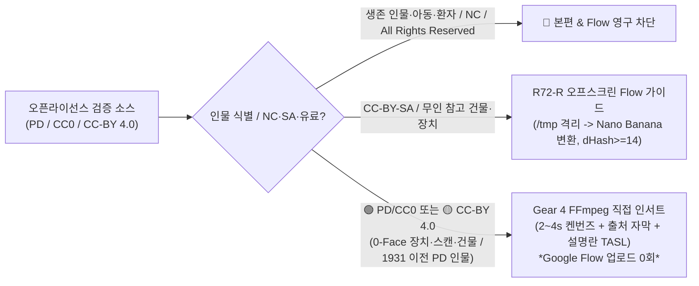

# `@Deep_Research` 규정·저작권·수익화 심층 검증 리포트: 실제 실험·장치·아카이브 사진의 본편 직접 삽입 가능 범위 및 내부 파이프라인 개정 청사진

- **작성 주체**: [`@Deep_Research`](conversation://8c666be9-5bad-43d9-b91a-e7ba2b936c62) (Deep Research & Strategy VP)
- **수신 보고 대상**: [`@YouTube_CEO`](conversation://b57c97a8-6324-4c31-a2bb-16b25e28dd55)
- **작업 일시**: `2026-11-21 UTC` (`코드·규칙 수정 0건 · Google Flow/브라우저 호출 0건`)
- **적용 대상**: 상업적 YPP 수익화 US YouTube Shorts (+ IG/TikTok 크로스포스팅) `ALL ABOUT BRAIN` 리브랜딩 파이프라인

> [!IMPORTANT]
> **면책 고지**: 본 보고서는 1차 공식 법률·플랫폼 정책 원문 및 워크스페이스 코드 대조에 기반한 기술·정책 리서치이며, 개별 저작물의 최종 법적 분쟁 시 법률 자문(변호사 검토)을 대체하지 않습니다.

---

## Executive Summary & 실전 신호등 판정표 (🟢 / 🟡 / 🔴)

**핵심 결론**: 2D 만화 얼굴 캐릭터 폐기 리브랜딩에서, **Google Flow AI 생성물과 물리적으로 분리된 Gear 4 FFmpeg 편집 단계**를 통해 **무인(0-Face) 실제 실험 장치·뇌 스캔·대학 건물** 및 **저작권 만료/오픈라이선스 작고 인물 사진**을 `2~4초` 증빙 인서트로 본편에 직접 넣는 것은 저작권·초상권·YouTube 수익화 정책 모두에 합법적이며, 오히려 **YouTube 2025년 7월 `Inauthentic Content` 규정에 대한 강력한 '다큐멘터리 진정성 방어막'**이 된다. 반면 **생존 피험자·임상 환자·미성년 아동 얼굴 사진, `CC-BY-NC`, `CC-BY-SA`, 유료 저널(*Nature/Cell/Science/Elsevier/APA*) 사진**은 본편 직접 삽입을 영구 차단해야 한다.

| 실물 사진 유형 | 판정 | 허용 라이선스 / 법적 요건 | 필수 안전장치 & 금지선 |
|---|:---:|---|---|
| **① 무인(`0-Face`) 실제 실험 장치 · fMRI/MRI 스캔 · 대학 캠퍼스 건물 · 역사적 실험 기록지** | **🟢 / 🟡** | • **🟢 즉시 허용**: `Public Domain` (미 연방정부 `17 U.S.C. § 105` NIH/NIMH/NASA, `1930-12-31` 이전 공표 저작물) & `CC0 1.0` • **🟡 조건부 허용**: `CC-BY 4.0 / 3.0` (Wikimedia Commons, **PubMed Central Open Access Subset 중 `CC-BY` 명시 논문 Figure**) | • `CC-BY`는 **화면 내 미니 크레딧 + 설명란 `Image credit` (`TASL` + URI)** 필수 (`CC-BY 4.0 § 3(a)`). • **함정**: PMC OA Subset 안에도 **`CC-BY-NC` / `CC-BY-ND` / 일반 저작권 논문**이 섞여 있으므로 논문별 `Copyright & License` 원문 확인 필수. • `CC-BY` 이미지 위 `2–4초` 팬/줌은 개작 시 변경 표기(`modified`) 포함. |
| **② 역사적(작고) 과학자·역사적 공개 사례 인물 사진** *(예: 피니어스 게이지 `1860` 사망 PD 다게레오타입, 브로카, 파블로프 등)* | **🟡** | • 사진 **저작권 자체**가 `PD` (`1931년 이전` 등) / `CC0` / `CC-BY`로 확인될 것 • 사망 완료 인물 + 순수 교육·다큐 보도 맥락(미국 **Editorial/Informational Exemption**) | • **사망 또는 중상 순간** 묘사 금지 (`answer/2801895`). • 캘리포니아 등 사후 퍼블리시티권(`~70년`)·유족 프라이버시 요청 리스크를 피하려면 **가급적 1931년 이전 PD 역사 인물**만 제한 사용. • **주의**: `2008`년 사망한 H.M.(Henry Molaison)처럼 현대 언론사·연구기관이 찍은 사진은 `All Rights Reserved`이므로 🔴 금지. |
| **③ `CC-BY-SA` 사진 · `CC-BY-NC` · 유료 저널(*Nature/Cell/Science/Elsevier/APA*) · 언론사(Getty/AP)/대학 홍보 사진** | **🔴** | • `CC-BY-NC`: 상업적 YPP 수익화 명백 위반 • `CC-BY-SA`: 크롭·콜아웃·영상 결합 시 **`Adapted Material` 전염**으로 쇼츠 전체 `CC-BY-SA` 공개 의무 발생 위험 • 유료 저널/언론 사진: `Fair Use (17 U.S.C. § 107)` 자동 판정 불가 | • **본편 픽셀 직접 삽입 영구 금지**. • `CC-BY-SA` 이미지는 기존 **`R72-R` 오프스크린 구조 가이드(`dHash >= 14`, Google Flow 3D 미니어처 번역)** 경로로만 사용. • 단순 시각 보조용 `B-roll`에 유료 논문 사진을 `Fair Use`로 넣는 것은 상업 채널 + 대체 가능성 때문에 DMCA 스트라이크 고위험. |
| **④ 생존 일반 피험자 · 임상/신경과/정신과 환자 · 미성년 아동(마시멜로·애착 실험 등) 얼굴 식별 사진** | **🔴** | • **예외 없음 영구 금지** (`CC-BY` 태그가 달려 있어도 불가) | • 사진작가의 `CC` 라이선스는 **피사체의 초상권·프라이버시권·의료 비밀을 면제하지 않음** (`CC FAQ`, `Wikimedia COM:PEOPLE`). • `YouTube Privacy` (`answer/2801895`), `Child Safety` (`answer/2801999`), 미국 **HIPAA Safe Harbor** (`45 CFR § 164.514(b)(2)(i)(Q)`: 전면 얼굴 사진 = 직접 식별자 PHI) 정면 저촉. |

---

## 1. 4대 외부 규정 1차 공식 원문 정밀 검증

### 1.1 저작권 · 라이선스 · Shorts `CC-BY 4.0` 출처 표기(`Attribution`) 의무

1. **Public Domain (`17 U.S.C. § 105` & 2026년 기준 `1931년 이전` 공표작)**:
   - [미국 저작권법 17 U.S.C. § 105](https://www.copyright.gov/title17/92chap1.html)는 연방정부 직원 직무 저작물(NIH·NIMH·NASA 사진/스캔 등)에 저작권을 부여하지 않는다(단, 정부 외부 계약자·양수 저작물은 예외 있으므로 크레딧 확인 필수).
   - 2026년 `Public Domain Day` 기준 **1930년 12월 31일 이전(`pre-1931`) 미국 내 공표 작품**은 저작권이 완전히 소멸되어 상업 이용·편집·무출처(권장은 함) 활용이 자유롭다.
   - [`CC0 1.0 Universal`](https://creativecommons.org/publicdomain/zero/1.0/deed.en) 역시 법적 출처 표기 의무가 면제된다.
2. **`CC-BY 4.0` (상업적 YPP 허용 + 출처 표기 필수)**:
   - [`CC-BY 4.0 Deed`](https://creativecommons.org/licenses/by/4.0/deed.en)는 상업적 목적 공유 및 변형(`Adapt`)을 명시적으로 허용한다.
   - **세로 Shorts에서 [`CC-BY 4.0 Legal Code Section 3(a)(1)–(2)`](https://creativecommons.org/licenses/by/4.0/legalcode.en) 충족 방법**:
     - 필수 포함 5요소(`TASL` + 변경표시): ① 저작자/권리자 성명, ② 저작권 고지(존재 시), ③ 본 라이선스 고지 및 보증부인 고지 참조, ④ 합리적으로 가능한 범위 내 원저작물 `URI/하이퍼링크`, ⑤ 수정/크롭 시 변경 여부 표시.
     - **매체 유연성 조항 (`Section 3(a)(2)`)**: *"You may satisfy the conditions in Section 3(a)(1) in any reasonable manner based on the medium, means, and context in which You Share the Licensed Material. For example, it may be reasonable to satisfy the conditions by providing a URI or hyperlink to a resource that includes the required information."*
     - **권장 실무 구현**: ① 화면 우상단/안전영역 내 미세 스탬프(`Source: <Author/Inst> · CC BY 4.0 (cropped)`), ② YouTube/IG/TikTok 설명란 하단 `Image credit: <Title>, <Author>, <Original URI>, CC BY 4.0 (<License URI>), cropped/animated.` 병기.
3. **PubMed Central (PMC) Open Access 주의점**:
   - [`PMC Copyright Notice`](https://pmc.ncbi.nlm.nih.gov/about/copyright/) 및 [`PMC Open Access Subset`](https://pmc.ncbi.nlm.nih.gov/tools/openftlist/) 원문 경고: PMC에서 무료 열람된다고 해서 모두 오픈라이선스가 아니며, OA Subset 내부에서도 논문마다 **`CC BY`, `CC BY-NC`, `CC BY-ND`, `CC0`** 등 조건이 다르다(*"Within the PMC Open Access Subset articles are available for reuse, but license terms vary"*). **반드시 기사별 XML/페이지의 `License` 태그가 `CC BY` 또는 `CC0`인지 확인한 논문 Figure만 사용해야 한다.**
4. **`CC-BY-NC` · `CC-BY-SA` · `Fair Use (17 U.S.C. § 107)` 판단**:
   - [`CC-BY-NC 4.0`](https://creativecommons.org/licenses/by-nc/4.0/deed.en) & [`CC FAQ`](https://creativecommons.org/faq/): 광고 수익화(YPP)가 붙은 채널은 *"primarily intended for or directed toward commercial advantage or monetary compensation"*에 해당해 상업 이용 금지 위반.
   - [`CC-BY-SA 4.0`](https://creativecommons.org/licenses/by-sa/4.0/deed.en) & [`CC FAQ`](https://creativecommons.org/faq/): 단순 모음(`Collection`)은 전염되지 않으나, 사진을 크롭·줌인·콜아웃·내레이션과 결합해 단일 영상 서사로 편집하면 **`Adapted Material`**로 해석되어 **Shorts 전체를 `CC-BY-SA`로 배포해야 할 법적 전염 위험**이 발생한다. 따라서 `SA` 사진은 본편 픽셀 삽입에서 배제한다.
   - [`U.S. Copyright Office Fair Use (17 U.S.C. § 107)`](https://www.copyright.gov/fair-use/) & [`YouTube Fair Use Help (answer/9783148)`](https://support.google.com/youtube/answer/9783148?hl=en): 유료 저널(*Nature/Science/Cell/Elsevier/APA*)이나 언론사 사진을 비평 대상 자체가 아닌 **"단순 설명용 시각 배경(`B-roll`)"**으로 쓰면 변형적 이용(`transformativeness`) 인정이 약하고 상업 채널 특성상 권리자의 DMCA 게시중단(Copyright Strike) 시 자동 방어가 불가능하다. 출처 표기(`Give credit`)만으로는 Fair Use가 성립하지 않는다(`answer/9783148`).

### 1.2 초상권 · 프라이버시 · 아동 및 의료 환자 보호 (YouTube + 미국 법제)

1. **저작권과 초상권의 완전한 분리**:
   - [`Wikimedia Commons: Photographs of identifiable people`](https://commons.wikimedia.org/wiki/Commons:Photographs_of_identifiable_people): *"A Creative Commons licence or public domain status... means that the copyright owner (usually the photographer) has waived or lost certain rights... However, this does not affect any rights belonging to the subject of the photograph."* 상업적 맥락에서는 피사체 동의가 요구되는 국가가 많음.
   - [`CC FAQ`](https://creativecommons.org/faq/): 제3자의 퍼블리시티·프라이버시·인격권은 사진작가의 CC 라이선스로 소멸되지 않으며 재이용자가 별도 허락을 구해야 함.
2. **YouTube 프라이버시 & 아동 안전 정책**:
   - [`YouTube Privacy Guidelines (answer/2801895)`](https://support.google.com/youtube/answer/2801895?hl=en) & [`answer/7671399`](https://support.google.com/youtube/answer/7671399?hl=en): 영상/음성/성명/개인정보 조합으로 **고유 식별 가능(`uniquely identifiable`)**한 생존 개인은 동의 없는 게시 시 삭제 신고 가능(심지어 합성/AI 모방도 신고 대상). 사망자의 경우에도 직계 유족/법정대리인이 사망 증빙과 함께 삭제 요청 가능하며 사망/중상 순간 묘사는 차단 대상.
   - [`YouTube Child Safety Policy (answer/2801999)`](https://support.google.com/youtube/answer/2801999?hl=en): 18세 미만 미성년자 보호 최우선; 교육·다큐(EDSA) 예외가 존재하더라도 생존 아동 피험자 식별 사진은 법적 동의 확인이 불가능하므로 채널 리스크 `0%` 유지를 위해 전면 배제.
3. **의료 환자 사진 (`HIPAA Safe Harbor`) & 퍼블리시티권**:
   - 미국 HIPAA 프라이버시 규칙 **`45 CFR § 164.514(b)(2)(i)(Q)`**: 비식별화(Safe Harbor) 시 반드시 제거해야 하는 18개 직접 식별자에 **"Full-face photographs and any comparable images"**가 명시됨. 뇌 MRI/fMRI 슬라이스(2D 단면·3D 안면 재구성 미포함 이미지)는 안전하나, **환자 얼굴 사진이나 안면 윤곽이 드러난 3D 두부 렌더링**은 사용 금지.
   - 미국 퍼블리시티권(`Right of Publicity`): 순수 뉴스·교육·다큐멘터리 보도(`Editorial/Informational Exemption`)에는 넓은 수정헌법 제1조 보호가 적용되나, 썸네일/광고성 후킹이나 문맥 왜곡(`False Light` / 명예훼손) 시 소송 위험이 남는다. **가장 안전한 전략은 아예 "0-Face 무인 실물 사진(장치·스캔·건물)"을 기본으로 하고, 인물 사진이 꼭 필요할 때는 1931년 이전 작고 역사 인물의 PD 사진만 예외 허용하는 것이다.**

### 1.3 YouTube `Inauthentic / Reused Content` (`answer/1311392`) 판정

- [`YouTube Channel Monetization Policies (answer/1311392)`](https://support.google.com/youtube/answer/1311392?hl=en):
  - **2025-07-15 `Inauthentic Content` 정책**: 대량 생산형 AI 템플릿에 반대해 **"창작자 고유의 통찰·관점"**을 요구.
  - **Reused Content 정책**: 외부 소스를 그대로 짜깁기한 슬라이드쇼는 금지되지만, 독창적 해설·스크립트·분석이 결합된 교육/다큐멘터리 포맷은 명시적 허용 대상.
- **우리 포맷(`65–85초` Shorts 중 `2~4초`, 비중 `~3–8%`) 적용 결과**:
  - 본편의 `92%+`가 `100%` 오리지널 단일 DOI 내레이션(`Siren`) + `Ep #31` 3D 뇌 + 2.5D 미니어처 + `1x1` 데이터 스탬프로 구성되고, 그 안에서 `2~4초` 분량의 정식 오픈라이선스 실험실 장치·뇌 스캔·역사 사진이 **시각적 근거(Documentary Evidence B-roll)**로 줌/콜아웃과 함께 제시되는 구조는:
    1. `Reused Content` 위험 **`0%`** (변형적 다큐 교육 해설).
    2. `Inauthentic Content` 위험을 **오히려 낮추는 긍정 신호** (편당 고유한 실제 과학 사료를 제시해 "일반적 AI 템플릿 대량생산" 오인을 원천 차단).

### 1.4 Google Flow 안전 필터(`support.google.com/flow/answer/16353333`)와의 물리적 분리

- [`Google Flow Help (answer/16353333)`](https://support.google.com/flow/answer/16353333?hl=en) 원문:
  > *"For example, Google Flow features precautions to protect minors and uploaded photos of people, and certain queries might not be generated."*
- **아키텍처 분리 원칙**:
  - **Gear 3 (Google Flow)**: `0%` 실제 인물·아동 사진 업로드 (계정 보호 + 안전 필터 차단 `0`건 유지). Flow에는 기존처럼 `Canonical` 비닐/뇌 앵커와 무인(0-Face) 건축·소품 가이드만 투입.
  - **Gear 4 (FFmpeg/OpenCV 어셈블러)**: 정식 검증된 `PD / CC0 / CC-BY 4.0` 실물 사진(`03_visuals/archival_inserts/`)을 **Google Flow를 거치지 않고** FFmpeg가 직접 `1080x1920 @ 30fps` 켄번즈(`1.00→1.10x` 줌/팬 + 다크 아카이브 매트 + 출처 마이크로 캡션) 클립으로 렌더링하여 타임라인에 합성.

---

## 2. 내부 파이프라인·규칙(`R67`, `R72-R`, `DQ8`, `DQ7`, `diorama_assembler.py`, `R68-D`) 충돌 지점 `6`곳 & 개정 청사진

실제 워크스페이스 코드를 전수 대조한 결과, **현재 파이프라인은 아카이브 사진의 본편 직접 합성을 6중으로 차단하고 있으며**, 특히 `real_world_reference_builder.py`에서 **중대한 라이선스 필터 버그(`CC-BY-NC` 통과 위험)**가 발견되었다.

| # | 충돌 지점 (실측 파일·라인) | 현재 동작 (충돌 내용) | 필요한 개정 명세 (`@Operator` 구현 시 적용) |
|---|---|---|---|
| **1** | **치명적 라이선스 부분문자열 버그** [`real_world_reference_builder.py:1772`](file:///home/canadaofbin/gdrive/Kyubin_Yun_Workspace/07_Youtube/pipeline/real_world_reference_builder.py#L1772) + `config.py:2322` | `any(k in lic_raw for k in R85_OPEN_LICENSE_KEYWORDS)`가 부분문자열(`"cc-by" in lic_raw`)로 매칭되어 **`"cc-by-nc"`, `"cc-by-nc-sa"`, `"cc-by-nd"`가 전부 `True`로 통과하는 버그** 존재! | **즉시 패치 필수**: `nc`, `noncommercial`, `nd`, `noderiv` 명시 차단 정규식 추가 + 본편 인서트 전용 상수 `ON_SCREEN_SAFE_LICENSES` 분리(`PD / CC0 / USGov / CC-BY 3.0·4.0`만 허용, **`CC-BY-SA`는 본편 인서트에서 제외**). |
| **2** | **`R72-R` & `R67` 픽셀 반입 금지** [`real_world_reference_builder.py:16-27,1225-1262,1633`](file:///home/canadaofbin/gdrive/Kyubin_Yun_Workspace/07_Youtube/pipeline/real_world_reference_builder.py#L1225-L1262) · [`source_reenactment.py:2075-2144`](file:///home/canadaofbin/gdrive/Kyubin_Yun_Workspace/07_Youtube/pipeline/source_reenactment.py#L2075-L2144) | `verify_zero_raw_leak_in_workspace`와 `RQ1/RQ2`가 프로젝트 디렉터리 내 모든 원본 이미지(`dHash < 14/18`)와 `screen_exposure_forbidden`을 전면 차단. | `R67`·`R72-R` Flow 가이드 격리(`/tmp`)는 그대로 유지하되, 정식 인증된 `03_visuals/archival_inserts/` + `archival_insert_manifest.json` (`license_verified`, `attribution_text`, `has_human_face`) 화이트리스트 예외 경로 신설. |
| **3** | **`Tier-1 #2` & `DQ8` 실사 얼굴/피부 차단기** [`dynamic_episode_qa.py:2049-2177`](file:///home/canadaofbin/gdrive/Kyubin_Yun_Workspace/07_Youtube/pipeline/dynamic_episode_qa.py#L2049-L2177) · [`dq8_suspect_classifier.py:189-439`](file:///home/canadaofbin/gdrive/Kyubin_Yun_Workspace/07_Youtube/pipeline/dq8_suspect_classifier.py#L189-L439) | `DQ8`은 비-뇌 컷을 스캔해 YuNet 얼굴/피부 감지 시 `HIGH_SUSPECT` 자동 실패(또는 `MODERATE_SUSPECT` → Gate 2 `zero_human_skin_or_hair_leak` 차단). | **리브랜딩 정책 선택지**: • **안 A (강력 권장 — `0-Face` 실물 인서트 원칙)**: 본편 실물 사진은 **무인 실험 장치·뇌 MRI/fMRI·대학 건물·실험 노트**로만 제한 → **`DQ8` 충돌 `0`건 · 초상권/HIPAA 리스크 `0%`**! • **안 B (역사적 작고 인물 예외 허용 시)**: `cut_source == "verified_archival_insert"` AND `deceased_public_figure == True` AND `pd_verified == True`인 컷에 한해 `DQ8`·Gate 2 예외 플래그 신설. |
| **4** | **정지 이미지 금지 & 동결 컷 차단 (`DQ7` / `DQ_Smooth`)** [`config.py:3349`](file:///home/canadaofbin/gdrive/Kyubin_Yun_Workspace/07_Youtube/pipeline/config.py#L3349) (`ALLOW_STATIC_IMAGE_VIDEO_FALLBACK=False`) · [`dynamic_episode_qa.py:1994,2573`](file:///home/canadaofbin/gdrive/Kyubin_Yun_Workspace/07_Youtube/pipeline/dynamic_episode_qa.py#L1994) | 정지 사진 그대로 넣으면 `DQ7` · `DQ_Smooth` · `posthoc_semantic_qa` (`moving_camera_stalled` 등)에 전멸. | `ALLOW_STATIC_IMAGE_VIDEO_FALLBACK=False`는 AI 클립용으로 유지하되, Gear 4 FFmpeg가 인서트 이미지를 **`1080x1920 @ 30fps` 연속 Ken Burns(`1.00→1.10x`) + 미세 하이라이트 + 출처 오버레이 `.mp4`**로 렌더해 `DQ7`/`DQ_Smooth` 자연 통과 (`<= 2`컷, 편당 `<= 8%`). |
| **5** | **어셈블러 & `DQ6` 출처 영수증 연동** [`diorama_assembler.py:1234-1247`](file:///home/canadaofbin/gdrive/Kyubin_Yun_Workspace/07_Youtube/pipeline/diorama_assembler.py#L1234-L1247) · [`dynamic_episode_qa.py:1801-1851`](file:///home/canadaofbin/gdrive/Kyubin_Yun_Workspace/07_Youtube/pipeline/dynamic_episode_qa.py#L1801-L1851) | `_resolve_diorama_clip_files`가 `flow_native_clips/`·`brain_simulator_clips/`만 인식하고, `DQ6`가 Flow `reference_attached`를 요구. | `03_visuals/archival_insert_clips/clip_*.mp4` 인식 및 `archival_insert_manifest.json` 기반 `DQ6` 검증 분기 추가. |
| **6** | **`R68-D` 설명란 URL 금지 규칙과의 조화** [`.agents/rules/metadata_contract_rules.md:14`](file:///home/canadaofbin/gdrive/Kyubin_Yun_Workspace/07_Youtube/.agents/rules/metadata_contract_rules.md#L14) | `Schema v8` `viewer_description`은 URL·DOI 삽입 금지. 반면 `CC-BY 4.0 § 3(a)`는 합리적 URI/크레딧 제공 요구. | **`PD / CC0 / US Gov` 인서트 시 규칙 변경 `0`건**. `CC-BY 4.0` 사진 사용 시에만 `Research:` 줄 아래에 `Image credit: <Author>, CC BY 4.0 (<URL>).` 1줄 허용 예외 추가. |

---

## Verification & Primary-Source Receipts (`R83-7` · `R83-8-V`)

1. **검증된 1차 공식 URL (`HTTP 200` 직접 확인)**:
   - Creative Commons 4.0: `https://creativecommons.org/licenses/by/4.0/deed.en`, `https://creativecommons.org/licenses/by/4.0/legalcode.en`, `https://creativecommons.org/licenses/by-nc/4.0/deed.en`, `https://creativecommons.org/licenses/by-sa/4.0/deed.en`, `https://creativecommons.org/publicdomain/zero/1.0/deed.en`, `https://creativecommons.org/faq/`
   - US Copyright & PMC: `https://www.copyright.gov/title17/92chap1.html`, `https://www.copyright.gov/fair-use/`, `https://pmc.ncbi.nlm.nih.gov/about/copyright/`, `https://pmc.ncbi.nlm.nih.gov/tools/openftlist/`
   - YouTube Policies: `https://support.google.com/youtube/answer/2801895?hl=en`, `https://support.google.com/youtube/answer/7671399?hl=en`, `https://support.google.com/youtube/answer/2801999?hl=en`, `https://support.google.com/youtube/answer/1311392?hl=en`, `https://support.google.com/youtube/answer/9783148?hl=en`
   - Google Flow & Privacy/Medical: `https://support.google.com/flow/answer/16353333?hl=en`, `https://commons.wikimedia.org/wiki/Commons:Photographs_of_identifiable_people`, HIPAA `45 CFR § 164.514(b)(2)(i)(Q)` (eCFR via search verification)
2. **서브에이전트 & VP 1차 검수 (`R83-8`, `R83-8-V`)**:
   - `flash` 감사 서브에이전트(`93d23bdb-3b1b-422c-a4cb-1c2dd959f2bd`) 1회 실행 후 종료(`kill`) → VP가 `pipeline/real_world_reference_builder.py`, `pipeline/source_reenactment.py`, `pipeline/dq8_suspect_classifier.py`, `pipeline/dynamic_episode_qa.py`, `pipeline/diorama_assembler.py`, `pipeline/config.py`, `archival_reenactment_rules.md`, `real_world_drone_refs_rules.md` 직접 대조 검증 및 `L1772` `"cc-by"` 부분문자열 버그 추가 발견 완료.
