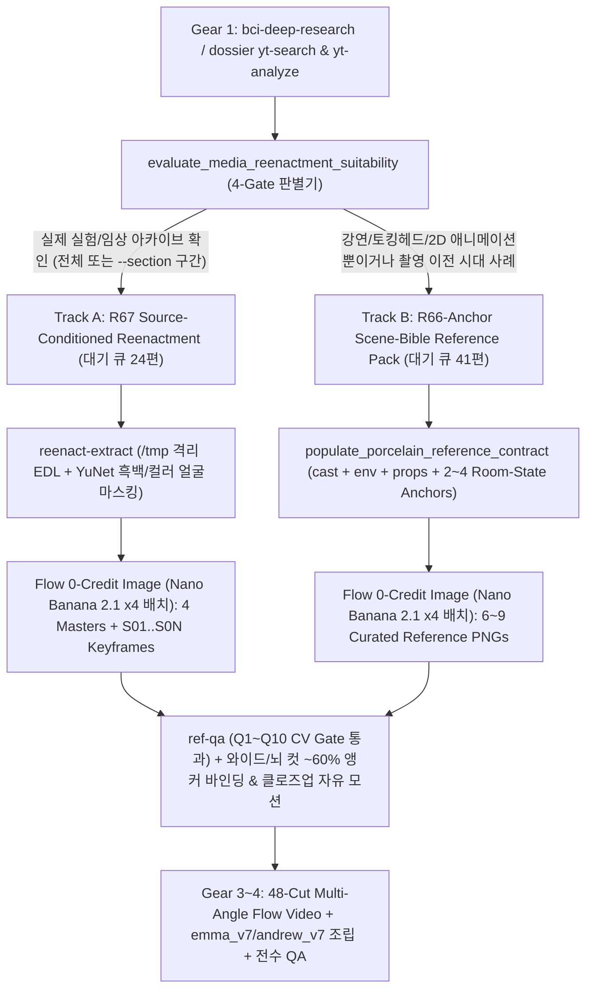

# 리서치 원본 영상 선별 & Dual-Track(`R67` / `R66-Anchor`) 자동 레퍼런스 연결 구현 계획서

## 목표 및 배경 (Goal Description)

승인된 파일럿 영상([reenact_01_strange_situation_test_1080x1920.mp4](file:///home/canadaofbin/gdrive/Kyubin_Yun_Workspace/07_Youtube/reenact_01_strange_situation_test_1080x1920.mp4), `48`컷, 평균 `3.07초`, `emma_v7`)이 높은 시각적 완성도를 달성한 핵심 비결은 다음 **2가지 결합**이었습니다:
1. **스윗스팟 멀티앵글 편집 호흡 (`48`컷, `2.17s ~ 4.50s`)**: 이미 전사 파이프라인 및 `65`개 대기 큐에 100% 반영 완료.
2. **사전 확정된 `9:16` 포슬린 레퍼런스 이미지 조건화 (`63.3%` 클립 앵커링)**: 전체 `49`개 클립 중 와이드 공간 컷의 `86.4%`(`19/22`)와 3D 뇌 컷의 `76.9%`(`10/13`)가 사전 생성된 `14`장의 기준 이미지(`ref_env_master.png`, `ref_brain_master.png`, `ref_s01..s09.png`)를 시작 프레임으로 물고 렌더링되었고, 손 클로즈업/POV 컷(`12/14`)은 프레이밍 잠금을 피하기 위해 의도적으로 자유 렌더링(`scene_state` 및 의상 텍스트로만 결속)되었습니다.

반면, 현재 대기 중인 `65`개 에피소드([porcelain_rebalanced_queue.json](file:///home/canadaofbin/gdrive/Kyubin_Yun_Workspace/07_Youtube/BCI_Shorts_Channel/porcelain_rebalanced_queue.json))와 리서치 모듈([research_dossier.py](file:///home/canadaofbin/gdrive/Kyubin_Yun_Workspace/07_Youtube/pipeline/research_dossier.py))을 전수 조사한 결과 다음 **구조적 단절**이 확인되었습니다:
- **`04_media_refs.json` 내 원본 실험 영상 vs 강연/애니메이션 미분리**: `65`개 도시에의 미디어 `194`건을 실측 분류한 결과, **실제 실험·임상 아카이브 영상이 존재하는 주제는 `24편 (36.9%, Track A)`**(`6편` 키프레임 보유, `9편` 원본 URL 보유·추출 대기, `9편` 다큐 내 구간 `--section` 분리 필요)이고, 나머지 **`41편 (63.1%, Track B)`**은 19세기 문헌 사례(`Cotard`, `Ebbinghaus`) 또는 현대 fMRI/인지 논문으로 유튜브에 TED 강연·대학 강의·2D 애니메이션만 존재합니다.
- **대기 큐 레퍼런스 바인딩 `0 / 65` (`0%`)**: 현재 `65`개 도시에 초안 모두 `cast`, `real_environment`, `environment_props`, `reference_anchors`, `clip.reference_image`가 비어 있어(`0 / 3,141` 클립), 그대로 배치 제작을 돌리면 텍스트 전용으로 렌더링되어 컷마다 방·소품·인물이 달라집니다.
- **재연 및 QA 코드의 숨은 결함 6건**:
  1. `03_visual_reference.json`의 소품 키가 디스크상 `381/381`건 모두 `"name"`인데 [`plan_seed_from_dossier`](file:///home/canadaofbin/gdrive/Kyubin_Yun_Workspace/07_Youtube/pipeline/research_dossier.py#L554-L563)는 `"item"`만 읽어 소품을 100% 누락함.
  2. [`cast_lock_entries`](file:///home/canadaofbin/gdrive/Kyubin_Yun_Workspace/07_Youtube/pipeline/scene_blueprint.py#L148-L157)가 평탄한 `cast` 딕셔너리에서 `subject` 외 조연(`mother`, `researcher`, `clinician`)을 누락함.
  3. [`source_reenactment.py`](file:///home/canadaofbin/gdrive/Kyubin_Yun_Workspace/07_Youtube/pipeline/source_reenactment.py)에 Ainsworth 전용 상수(`["lisa", "lizbeth"]`, `"qtsewnrhuhu"`, 4개 구역명, 상단 모서리 무조건 회색 마스킹)가 하드코딩되어 있고, 1920~60년대 흑백 아카이브 필름(`Pavlov`, `Little Albert`, `Thorndike`)에서 HSV 피부색 마스킹이 작동하지 않음(`med_skin = 0.000`).
  4. [`reference_image_qa.py`](file:///home/canadaofbin/gdrive/Kyubin_Yun_Workspace/07_Youtube/pipeline/reference_image_qa.py)가 수동 리뷰 파일(`Q11`) 미작성 시 무인 배치를 `pre_generation_ready=False`로 영구 차단하며, `reference_anchors`가 비어 있으면 레거시 49개 스펙으로 폭증하거나 `Q10`이 실패함.
  5. [`generate_flow_image_batch`](file:///home/canadaofbin/gdrive/Kyubin_Yun_Workspace/07_Youtube/pipeline/flow_ingredients.py#L820-L824)가 `inspect_single_reference_image`의 실제 반환 키(`laplacian_sharpness`, `failed_axes`) 대신 구버전 키를 참조함.
  6. [`write_flow_prompts_json`](file:///home/canadaofbin/gdrive/Kyubin_Yun_Workspace/07_Youtube/pipeline/flow_prompt_builder.py#L1539-L1542)이 이미 하위 폴더인 경로에도 `/03_visuals`를 중복 부착해 `65`개 도시에 모두 중첩 경로(`diorama_v7_porcelain/03_visuals/`)가 생성됨.

본 계획은 **Gear 1 리서치에서 모든 주제를 자동으로 `Track A (R67 1:1 원본 영상 재연)` 또는 `Track B (R66-Anchor 고증 마스터 공간 레퍼런스 고정)`로 판별·분류**하고, 두 트랙 모두 Google Flow `0-credit` 이미지(`Nano Banana 2.1` 4장 배치 자동 선별)로 기준 이미지를 먼저 확정한 뒤 `48`컷 멀티앵글 비디오를 생성하도록 전 구간을 자동화합니다.

---

## 사용자 검토 및 확인 사항 (User Review Required)

> [!IMPORTANT]
> **Dual-Track (`Track A` + `Track B`) 무손실 퀄리티 통일 전략**
> - **Track A (`24/65`편 — 실제 실험/임상 아카이브 영상 보유 주제)**: 리서치 모듈이 아카이브 적합성을 검증하고 핵심 구간(`start_sec ~ end_sec`)만 격리 추출(`/tmp/aab_reenact`)하여 **원본 방 배치·의자·동선을 1:1로 반영한 포슬린 레퍼런스(`R67`)**를 생성합니다.
> - **Track B (`41/65`편 — 촬영 영상이 없는 고전 문헌·현대 fMRI 논문 주제)**: 억지로 TED 강연장이나 타 채널 애니메이션 구도를 베끼지 않고, 도시에의 시대·공간·실험 기구 명세(`03_visual_reference.json`)로부터 **Flow 무료 이미지(`Nano Banana 2.1`)로 `6~8장`의 마스터 방·인물·기구·3D 뇌·상황별 룸 앵커(`R66-Anchor`)를 먼저 생성·검증**한 뒤 `48`컷 멀티앵글 비디오를 생성합니다. 따라서 **원본 영상 유무와 무관하게 100% 모든 에피소드가 이번 파일럿 영상과 동일한 공간 고정력·시각 퀄리티를 갖게 됩니다.**

> [!NOTE]
> **착수 전 GitHub 안전 백업 커밋 포함**
> 구현 착수 직전, 현재 검증 완료된 `48`컷 스윗스팟 파이프라인 상태를 먼저 로컬 Git 커밋 및 `origin/main`에 안전하게 백업한 뒤 본 업그레이드를 적용합니다(루트 미리보기 `.mp4` 파일은 `.gitignore`에 의해 자동 제외 확인 완료).

---

## 아키텍처 워크플로우 (Dual-Track Research → Reference → Flow Video)



---

## 세부 변경 계획 (Proposed Changes)

### 1. Gear 1 리서치 원본 영상 적합성 판별기 & 스키마 보강

#### [MODIFY] [config.py](file:///home/canadaofbin/gdrive/Kyubin_Yun_Workspace/07_Youtube/pipeline/config.py)
- Dual-Track 및 아카이브 적합성 판별 상수 추가:
  - `REENACTMENT_TRACKS = ("track_a", "track_b")`
  - `MEDIA_SUITABILITY_CLASSES = ("suitable_track_a", "needs_section_window", "reject_track_b_only")`
  - `MEDIA_REJECT_CHANNEL_PATTERNS` (`TED`, `TEDx`, `TED-Ed`, `Big Think`, `SciShow`, `CrashCourse`, `Sprouts`, `Khan Academy`, `BrainFacts`, `YaleCourses`, `MIT OpenCourseWare`, `Veritasium` 등)
  - `MEDIA_MAX_DARK_VOID_RATIO = 0.72`, `MEDIA_MAX_FLAT_SLIDE_RATIO = 0.62`, `MEDIA_MAX_UNWINDOWED_DURATION_SEC = 600.0`

#### [MODIFY] [research_dossier.py](file:///home/canadaofbin/gdrive/Kyubin_Yun_Workspace/07_Youtube/pipeline/research_dossier.py)
1. **4-Gate 원본 영상 적합성 자동 판별기 [`evaluate_media_reenactment_suitability`](file:///home/canadaofbin/gdrive/Kyubin_Yun_Workspace/07_Youtube/pipeline/research_dossier.py) 신설**:
   - **Gate 1 (메타데이터/채널/종류 필터)**: `kind in {"lecture", "interview", "photo", "still", "museum_artefact", "podcast", "animation"}`(단, `reenactment_section`이 명시된 다큐 발췌본 제외) 및 강연·해설·애니메이션 채널/제목 패턴 즉시 제외.
   - **Gate 2 (무대 암전 필터)**: 키프레임 중앙값 암부 비율 `med_dark (Y < 35) > 0.72` 제외(TED 무대 `0.872` 정확히 차단).
   - **Gate 3 (흑백 아카이브 보존형 슬라이드/2D 카툰 필터)**: 채도가 있는 컬러 영상(`med_gray < 0.70`)에 한해 `flat_lap_ratio > 0.62` 및 배경 단색도 `> 0.75`인 슬라이드/스튜디오 배경과 2D 벡터 카툰을 차단(`Pavlov` 등 1930~60년대 흑백 16mm 필름은 `med_gray >= 0.70`으로 오탐 없이 통과).
   - **Gate 4 (단독 토킹헤드 + 연속 독백 필터)**: `cv2.FaceDetectorYN`(YuNet)과 `transcript.txt` 발화 밀도를 결합해, 구간 지정 없이 `600초`를 초과하거나 정면 단일 발표자 얼굴이 프레임 중앙에 고정된 채 연속 독백(`> 2.1 words/sec`)만 이어지는 강연 영상을 차단하고, 아카이브 B-roll이 섞인 다큐는 `"needs_section_window"`로 분류해 타임코드 구간(`--section mm:ss-mm:ss`)을 제안.
2. **[`search_youtube`](file:///home/canadaofbin/gdrive/Kyubin_Yun_Workspace/07_Youtube/pipeline/research_dossier.py#L753-L771) 아카이브 우선 랭킹**: 검색 결과에 `archival_score`(원본 실험/대학 아카이브 가산점, 강연/애니메이션 감점)를 부여해 상위 정렬.
3. **[`analyze_reference_video`](file:///home/canadaofbin/gdrive/Kyubin_Yun_Workspace/07_Youtube/pipeline/research_dossier.py#L774-L895) → `04_media_refs.json` 자동 기록**: 분석 완료 시 `analysis.json`뿐 아니라 해당 도시에의 `04_media_refs.json` 항목에 `reenactment_suitability`, `recommended_section`, `keyframe_count`를 자동 반영.
4. **소품 키 정규화 & 깊이 리포트 버그 수정**:
   - [`validate_dossier`](file:///home/canadaofbin/gdrive/Kyubin_Yun_Workspace/07_Youtube/pipeline/research_dossier.py#L310-L318), [`plan_seed_from_dossier`](file:///home/canadaofbin/gdrive/Kyubin_Yun_Workspace/07_Youtube/pipeline/research_dossier.py#L554-L563), [`diorama_seed_from_dossier`](file:///home/canadaofbin/gdrive/Kyubin_Yun_Workspace/07_Youtube/pipeline/research_dossier.py#L579-L659)에서 `(p.get("name") or p.get("item") or "").strip()`를 모두 수용.
   - [`research_depth_report`](file:///home/canadaofbin/gdrive/Kyubin_Yun_Workspace/07_Youtube/pipeline/research_dossier.py#L454-L463)에서 `08_reenactment_edl.json` 검사를 미디어 루프 밖으로 분리하고 짧은 아카이브 클립(`shot_count >= 3`)도 정상 인정.
   - [`diorama_seed_from_dossier`](file:///home/canadaofbin/gdrive/Kyubin_Yun_Workspace/07_Youtube/pipeline/research_dossier.py#L579-L659)가 초기 시드 단계부터 `reenactment_track`, `cast`, `real_environment`, `environment_props`, `default_location_id`, `strict_room_continuity: True`, `require_scene_state_ledger: True`를 자동 채우도록 확장(`__all__` 누락 심볼 포함).

```python
# pipeline/research_dossier.py 핵심 추가 시그니처 예시
def evaluate_media_reenactment_suitability(
    media_entry: dict[str, Any],
    analysis_dir: Path | None = None,
    primary_year: int | None = None,
) -> dict[str, Any]:
    """Classify a 04_media_refs entry into suitable_track_a / needs_section_window / reject_track_b_only."""
```

---

### 2. Track A (`R67`) 범용화: Ainsworth 하드코딩 제거 & 흑백 아카이브 얼굴 마스킹

#### [MODIFY] [source_reenactment.py](file:///home/canadaofbin/gdrive/Kyubin_Yun_Workspace/07_Youtube/pipeline/source_reenactment.py)
1. **Ainsworth 전용 상수 전면 범용화**:
   - [`_classify_camera_and_zones`](file:///home/canadaofbin/gdrive/Kyubin_Yun_Workspace/07_Youtube/pipeline/source_reenactment.py#L146-L155) 및 [`render_reenactment_comparison_sheet`](file:///home/canadaofbin/gdrive/Kyubin_Yun_Workspace/07_Youtube/pipeline/source_reenactment.py#L618-L623)의 하드코딩 구역명(`upper_observation_mirror` 등)을 범용 구역(`upper_background_zone`, `left_foreground_zone`, `right_foreground_zone`, `center_action_zone`)으로 일반화(기존 Ainsworth EDL 하위호환 별칭 유지).
   - [`extract_source_edl`](file:///home/canadaofbin/gdrive/Kyubin_Yun_Workspace/07_Youtube/pipeline/source_reenactment.py#L166-L174)에 `--section`(`start_sec ~ end_sec` 부분 다운로드/트림), `scene_corr_threshold`, `min_shot_sec`, `sub_event_min_sec` 인자를 추가하고, 기본 인명 `["lisa", "lizbeth"]`(`line 353`)를 제거해 도시에/인자 기반으로만 동작하도록 수정.
   - [`validate_reenactment_non_infringement`](file:///home/canadaofbin/gdrive/Kyubin_Yun_Workspace/07_Youtube/pipeline/source_reenactment.py#L1013)의 `"qtsewnrhuhu"` 문자열을 `edl_doc.get("source_video_id")` 동적 추출로 교체.
2. **흑백(B&W) & 컬러 겸용 정밀 얼굴/포스터 마스킹 ([`sanitize_structural_frame_bgr`](file:///home/canadaofbin/gdrive/Kyubin_Yun_Workspace/07_Youtube/pipeline/source_reenactment.py#L397-L510))**:
   - 포스터 박스(`poster_boxes_norm`)가 없거나 고채도 벽면 데칼이 감지되지 않으면 상단 모서리 무조건 회색 박스(`lines 466-472`)를 그리지 않도록 수정.
   - 컬러 프레임의 HSV+YCrCb 피부 마스크에 더해, `cv2.FaceDetectorYN`(경량 오픈소스 Apache-2.0 `face_detection_yunet_2023mar.onnx` `230KB` 모델을 `pipeline/assets/models/`에 번들) 및 무채색 상체 실루엣 헤드 오벌 폴백을 추가하여 1920~60년대 흑백 실험 영상에서도 실제 사람 얼굴 픽셀이 100% 매끄러운 백색 포슬린 마네킹 두상으로 치환되도록 보장.
   - [`translate_porcelain_keyframes_async`](file:///home/canadaofbin/gdrive/Kyubin_Yun_Workspace/07_Youtube/pipeline/source_reenactment.py#L904)의 로그 키 오타(`issues` → `failed_axes`) 수정.

---

### 3. Track B (`R66-Anchor`) 마스터 & 룸 상태 레퍼런스 팩 컴파일러 + 무인 QA 게이트 연동

#### [NEW] [porcelain_anchor_pack.py](file:///home/canadaofbin/gdrive/Kyubin_Yun_Workspace/07_Youtube/pipeline/porcelain_anchor_pack.py)
- **`populate_porcelain_reference_contract(plan, dossier_dir)`**:
  - 도시에의 `03_visual_reference.json`, `dossier.json`, 그리고 `visual_plan.clips`의 `location_id` + `scene_state`를 읽어 `plan["cast"]`, `plan["real_environment"]`, `plan["environment_props"]`, `plan["default_location_id"]`를 결정론적으로 채움.
  - **Track B 전용 `reference_anchors` 자동 설계 (`2~4장`)**: 반복 등장하는 `(location_id, present_cast_start)` 조합마다 `clip_keyframe_anchor`(`ref_loc_01_state_a.png` 등, `conditioned_on: ["ref_env_master"]`)를 생성하여, `4~5장`의 `master_anchors`와 합쳐 총 **`6~9장`의 `9:16` PNG 스펙**을 구성(`MIN_REF_IMAGES_PER_PROJECT = 6` 충족 및 `Q8/Q9/Q10` 연속성 게이트 활성화).
  - **클립별 스윗스팟 레퍼런스 바인딩 (`reenact_01` 황금 비율 재현)**:
    - `porcelain_fullbleed_world` 컷: 동일 `(location_id, present_cast_start)` 룸 상태 앵커 자동 바인딩(`validate_scene_state_continuity` 100% 일치 보장).
    - `porcelain_living_brain` 컷(전뇌/투시 모드): `03_visuals/reference_images/ref_brain_master.png` 자동 바인딩.
    - `porcelain_hands_closeup` / `porcelain_pov_hands` / `porcelain_cutaway_section` 컷: 와이드 프레이밍 잠금 방지를 위해 시작 프레임 이미지를 비워두고 `scene_state` 및 의상/소품 묘사로 결속(전체 클립의 약 `55~65%` 앵커링).
- **`ensure_porcelain_reference_pack(project_dir, dossier_dir, cdp_port=9222, backend="flow")`**:
  - Track A면 `source_edl.json` 기반 `translate_porcelain_keyframes` 실행 후 `/tmp/aab_reenact` 즉시 퍼지; Track B면 `Nano Banana 2.1`(`0-credit` `x4` 배치)로 `6~9장`의 레퍼런스 PNG를 순서(`generation_order: 1 -> 2 -> 3`)대로 자동 생성 및 `ref-qa` 검증.

#### [MODIFY] [scene_blueprint.py](file:///home/canadaofbin/gdrive/Kyubin_Yun_Workspace/07_Youtube/pipeline/scene_blueprint.py) & [reference_image_qa.py](file:///home/canadaofbin/gdrive/Kyubin_Yun_Workspace/07_Youtube/pipeline/reference_image_qa.py) & [flow_ingredients.py](file:///home/canadaofbin/gdrive/Kyubin_Yun_Workspace/07_Youtube/pipeline/flow_ingredients.py)
- [`cast_lock_entries`](file:///home/canadaofbin/gdrive/Kyubin_Yun_Workspace/07_Youtube/pipeline/scene_blueprint.py#L148-L157): 평탄한 `plan["cast"]` 내 모든 인물 역할 키(`subject`, `researcher`, `clinician`, `mother` 등, 메타 키 `style`/`notes`/`wardrobe` 제외)를 빠짐없이 추출.
- [`inspect_reference_image_pack`](file:///home/canadaofbin/gdrive/Kyubin_Yun_Workspace/07_Youtube/pipeline/reference_image_qa.py#L1076-L1125): 무인 배치 시 데드락을 일으키던 `Q11` 수동 리뷰 체크를 [posthoc_semantic_qa.py](file:///home/canadaofbin/gdrive/Kyubin_Yun_Workspace/07_Youtube/pipeline/posthoc_semantic_qa.py)와 동일하게 `cv_pre_generation_ready`(`Q1~Q10` + `provenance` + `sufficient_count_ok`)와 `semantic_review_complete`(`Q11`, `--require-review` 시 강제, `--auto-populate-review` 지원)로 분리.
- [`generate_flow_image_batch`](file:///home/canadaofbin/gdrive/Kyubin_Yun_Workspace/07_Youtube/pipeline/flow_ingredients.py#L820-L824): `rep.get("laplacian_sharpness", 0.0)` 및 `rep.get("failed_axes", [])`를 정확히 읽어 4장 중 최고 화질 후보를 선별하도록 수정.

#### [MODIFY] [flow_prompt_builder.py](file:///home/canadaofbin/gdrive/Kyubin_Yun_Workspace/07_Youtube/pipeline/flow_prompt_builder.py) & [diorama_batch_orchestrator.py](file:///home/canadaofbin/gdrive/Kyubin_Yun_Workspace/07_Youtube/pipeline/diorama_batch_orchestrator.py) & [diorama_pipeline_runner.py](file:///home/canadaofbin/gdrive/Kyubin_Yun_Workspace/07_Youtube/pipeline/diorama_pipeline_runner.py) & [cli.py](file:///home/canadaofbin/gdrive/Kyubin_Yun_Workspace/07_Youtube/pipeline/cli.py)
- [`write_flow_prompts_json`](file:///home/canadaofbin/gdrive/Kyubin_Yun_Workspace/07_Youtube/pipeline/flow_prompt_builder.py#L1539-L1542): 대상 경로가 이미 `03_visuals`이거나 `visual_plan.json`을 직접 품은 드래프트 폴더(`diorama_v7_porcelain` 등)이면 하위 `/03_visuals`를 중복 생성하지 않고 직하위에 저장.
- `diorama-episode`, `diorama-batch`, `reenact-produce` 실행 시 비디오 샤드 생성 직전에 `ensure_porcelain_reference_pack()`이 자동으로 먼저 돌도록 연결하고, 신규 CLI 서브커맨드 `main.py dossier audit-media [--slug <slug> | --all-queued]` 및 `main.py porcelain-refs --project <id>`를 추가.

---

### 4. 대기 중인 `65`개 에피소드 전수 분류·계약 동기화 & 문서/스킬 업데이트

#### [NEW] [upgrade_queue_dual_track_refs.py](file:///home/canadaofbin/gdrive/Kyubin_Yun_Workspace/07_Youtube/scripts/upgrade_queue_dual_track_refs.py) & [MODIFY] [rebalance_porcelain_queue_pacing.py](file:///home/canadaofbin/gdrive/Kyubin_Yun_Workspace/07_Youtube/scripts/rebalance_porcelain_queue_pacing.py)
- `65`개 대기 도시에 전수에 대해:
  1. `04_media_refs.json`의 모든 미디어를 `evaluate_media_reenactment_suitability()`로 전수 스캔하여 **`Track A` (`24편`: `A1a` 즉시 추출 가능 `6편` + `A1b` 아카이브 URL 추출 대상 `9편` + `A2` 타임코드 구간 분리 대상 `9편`)**와 **`Track B` (`41편`: `R66-Anchor` 고증 마스터 팩 대상)**를 `dossier.json`, `diorama_v7_porcelain/visual_plan.json`, [porcelain_rebalanced_queue.json](file:///home/canadaofbin/gdrive/Kyubin_Yun_Workspace/07_Youtube/BCI_Shorts_Channel/porcelain_rebalanced_queue.json)에 명시 태깅.
  2. `65/65` 전 드래프트 및 미제작 `projects/diorama_27..91`에 `populate_porcelain_reference_contract()`를 적용해 `cast`, `real_environment`, `environment_props`, `reference_anchors`, 클립별 `reference_image` 바인딩을 100% 채우고, 잘못 생성되어 있던 중첩 `03_visuals/flow_all_in_one_prompts.json` 잔여 파일을 정리.

#### [MODIFY] 룰 & 스킬 문서 동기화 (`9`개 문서)
- [AGENTS.md](file:///home/canadaofbin/gdrive/Kyubin_Yun_Workspace/07_Youtube/.agents/AGENTS.md), [production_constants.md](file:///home/canadaofbin/gdrive/Kyubin_Yun_Workspace/07_Youtube/.agents/rules/production_constants.md), [reference_depiction_rules.md](file:///home/canadaofbin/gdrive/Kyubin_Yun_Workspace/07_Youtube/.agents/rules/reference_depiction_rules.md), [research_dossier_rules.md](file:///home/canadaofbin/gdrive/Kyubin_Yun_Workspace/07_Youtube/.agents/rules/research_dossier_rules.md), [neuro_diorama_rules.md](file:///home/canadaofbin/gdrive/Kyubin_Yun_Workspace/07_Youtube/.agents/rules/neuro_diorama_rules.md), [visual_prompt_spec.md](file:///home/canadaofbin/gdrive/Kyubin_Yun_Workspace/07_Youtube/.agents/rules/visual_prompt_spec.md) 및 스킬 5종([bci-deep-research](file:///home/canadaofbin/gdrive/Kyubin_Yun_Workspace/07_Youtube/.agents/skills/bci-deep-research/SKILL.md), [bci-episode-production](file:///home/canadaofbin/gdrive/Kyubin_Yun_Workspace/07_Youtube/.agents/skills/bci-episode-production/SKILL.md), [bci-script-gen](file:///home/canadaofbin/gdrive/Kyubin_Yun_Workspace/07_Youtube/.agents/skills/bci-script-gen/SKILL.md), [bci-video-pipeline](file:///home/canadaofbin/gdrive/Kyubin_Yun_Workspace/07_Youtube/.agents/skills/bci-video-pipeline/SKILL.md), [bci-weekly-batch](file:///home/canadaofbin/gdrive/Kyubin_Yun_Workspace/07_Youtube/.agents/skills/bci-weekly-batch/SKILL.md))을 Dual-Track `porcelain_cinematic_v7` + `48`컷 스윗스팟 기준으로 일괄 현행화.

---

## 검증 계획 (Verification Plan)

### Automated Tests
1. **단위 및 회귀 테스트 신설 (`tests/test_dual_track_research_and_refs.py`) 및 전체 스위트 실행**:
   ```bash
   /home/canadaofbin/hermes-venv/bin/python -u -X utf8 -m pytest tests/test_dual_track_research_and_refs.py -v
   /home/canadaofbin/hermes-venv/bin/python -u -X utf8 -m pytest -q
   ```
   - 검증 항목: (a) 실제 아카이브 키프레임(`Pavlov` 흑백, `BrainGate`, `Bobo doll` 고정 삼각대)은 `suitable_track_a`로 통과하고 `TED`/`YaleCourses`/`SciShow`/`BrainFacts 2D 카툰`은 100% 차단되는지 검증; (b) 흑백 실험 프레임 YuNet 얼굴 마스킹 동작 검증; (c) `"name"`/`"item"` 소품 정규화 및 복수 출연진 `cast_lock_entries` 검증; (d) Track B `6~9장` 레퍼런스 스펙 컴파일 + `cv_pre_generation_ready` 무인 통과 검증; (e) `write_flow_prompts_json` 비중첩 저장 검증.
2. **65개 대기 큐 전수 정합성 & `prompt-gate` 검증**:
   ```bash
   /home/canadaofbin/hermes-venv/bin/python -u -X utf8 main.py dossier audit-media --all-queued
   /home/canadaofbin/hermes-venv/bin/python -u -X utf8 scripts/upgrade_queue_dual_track_refs.py --check-only
   ```
   - `65/65` 에피소드 모두 `prompt-gate` 통과(`failed=0`), `cast`/`real_environment`/`reference_anchors` 누락 `0건`, 중첩 `03_visuals/03_visuals` `0건`, 그리고 기존 완성본 `reenact_01_ainsworth_strange_situation`의 모든 QA 게이트(`reenact-qa`, `ref-qa`, `episode-qa`, `posthoc-qa`) 100% 무회귀 통과 확인.
3. **실제 스모크 테스트 (Track A 1건 + Track B 1건 레퍼런스 시트 생성 검증)**:
   - Track A 대표 1건(예: `pavlov_dogs_conditioning` 흑백 아카이브 또는 `hochberg_braingate_robotic_coffee`)에서 `reenact-extract` 실행 → `/tmp/aab_reenact` 격리 가이드의 얼굴/텍스트 마스킹 확인 후 퍼지.
   - Track B 대표 1건(예: `cotard_walking_corpse_syndrome`)에서 `porcelain-refs`(`0-credit` Google Flow `Nano Banana 2.1`)로 `6~8장` 마스터/룸 레퍼런스 PNG 실제 생성 및 `ref-qa` 100점 통과 검증.

### Manual Verification
- 생성된 Track A 아카이브 적합성 분류 리포트(`24` Track A / `41` Track B 목록)와 Track B 스모크 테스트 레퍼런스 시트를 [walkthrough.md](./walkthrough.md)에서 육안 확인 후 차기 에피소드 제작 착수 여부를 승인해 주시면 됩니다.
