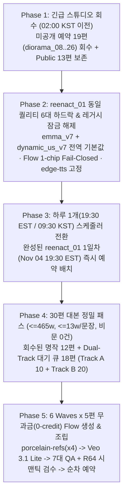

# 예약 영상(`19편`) 전수 내리기 · `reenact_01` 동일 퀄리티 하드락 · `30편` 생성 및 `하루 1개` 쇼츠 마스터 플랜

## Goal Description

현재 유튜브 스튜디오에 예약(`Scheduled`) 대기 중인 구형 `lowpoly_pastel_v7`(`andrew_v7` `+14Hz` + 과속 `dynamic_rush_v7`) 쇼츠 **`19편`(`diorama_08` ~ `diorama_26`)**을 공개 전에 전수 회수하고, 승인된 파일럿 골든 기준선([reenact_01_strange_situation_test_1080x1920.mp4](file:///home/canadaofbin/gdrive/Kyubin_Yun_Workspace/07_Youtube/reenact_01_strange_situation_test_1080x1920.mp4): `1080x1920 @ 24fps`, `porcelain_cinematic_v7`, `emma_v7` + `dynamic_us_v7`, `48컷 / 평균 ~3.0s`, Dual-Track `Track A/B` 레퍼런스 고정, 명패·시계 필러 `0건`, 머리 비가림 커버, `3단 댓글 점화`)이 **단 한 건의 누수나 구형 폴백 없이 100% 동일하게 재현**되도록 파이프라인 하드락을 적용한 뒤, **`30편`의 신규/재생성 포슬린 쇼츠**를 제작하여 **미국 프라임타임 `하루 1개` (`19:30 EST` = 한국시간 매일 오전 `09:30 KST`) 한 달(`30~31일`) 자동 송출 버퍼**를 구축합니다.



---

## User Review Required

> [!CAUTION]
> **긴급 마감 시한 알림 (`오늘 밤 02:00 KST`, 약 `13시간` 남음)**
> 현재 미공개 예약(`Scheduled`) 상태인 구형 `lowpoly_pastel_v7` 영상 **`19편`(`diorama_08` ~ `diorama_26`)** 중 1순위인 **`diorama_08_maguire_london_taxi_hippocampus` (`4jNxwVMMxQo`)**가 **`2026-11-04 12:00 EST` (`2026-11-05 02:00 KST`)**에 자동 공개됩니다(이어 `diorama_09`는 내일 오전 `10:00 KST`). 컨펌 즉시 Phase 1 스튜디오 회수부터 최우선 실행합니다. *(시스템 크론/워치독은 모두 비활성 상태이며, 이미 공개된 `Public` `13편`은 `R34` 원칙에 따라 건드리지 않습니다.)*

전수 조사로 확인된 현재 유튜브 스튜디오 `Scheduled` 회수 대상 **`19편` 전체 명단**:

| # | 남은 시간 | `project_id` | `video_id` | 현재 예약 시각 (`EST` / `KST`) | 현재 스타일 (회수 사유) |
| :---: | :---: | :--- | :---: | :---: | :---: |
| 1 | **13h** | `diorama_08_maguire_london_taxi_hippocampus` | `4jNxwVMMxQo` | `11-04 12:00` / `11-05 02:00` | `lowpoly_pastel_v7` (`andrew_v7`) |
| 2 | **21h** | `diorama_09_broca_patient_tan_speech_loss` | `SpOCgvOojuk` | `11-04 20:00` / `11-05 10:00` | `lowpoly_pastel_v7` (`andrew_v7`) |
| 3 | **37h** | `diorama_10_olds_milner_pleasure_center` | `BkWoHoGVV_c` | `11-05 12:00` / `11-06 02:00` | `lowpoly_pastel_v7` (`andrew_v7`) |
| 4 | **45h** | `diorama_11_blindsight_subcortical_vision` | `XvskvBLMqzg` | `11-05 20:00` / `11-06 10:00` | `lowpoly_pastel_v7` (`andrew_v7`) |
| 5–19 | `2.6d~9.6d` | `diorama_12` ~ `diorama_26` (`15편`: `RYeASKxFDnk`, `SAtSICgNPh4`, `6rDiJhK0Nl4`, `f1BATCCY1Vs`, `Ky3iCjdSJd0`, `7QM6ZSwrM68`, `U1JJjr_2EF8`, `219ze8JUb7c`, `KqRu_BXLeRc`, `CUS_CD1UvFw`, `kDBafW58J0Q`, `aNpoZUC_As8`, `B4lcuLzuEgQ`, `yp5Qlf0Fo34`, `whXcmzZygN8`) | 위 `15개` ID | `11-06 12:00` ~ `11-13 12:00 EST` (`2편/일`) | 전량 `lowpoly_pastel_v7` (`andrew_v7`) |

> [!IMPORTANT]
> **왜 `비공개(Private)` 보류보다 미공개 예약본 `영구 삭제(Delete forever)`가 유리한가?**
> 유튜브는 이미 업로드된 `video_id`의 `.mp4` 원본 파일 교체를 지원하지 않아 재생성본은 새 `video_id`로 업로드됩니다. 이때 구형 미공개본 `19개`를 `Private`으로 남겨두면 `13(기존 공개) + 19(구형 비공개) + 31(신규 예약) = 63행`이 되어, 스튜디오 1페이지(`30행`)만 읽는 [reporter.py](file:///home/canadaofbin/gdrive/Kyubin_Yun_Workspace/07_Youtube/pipeline/studio/reporter.py#L1015-L1065)에서 실제 공개 영상들이 페이지 밖으로 밀려나고 [short_linker.py](file:///home/canadaofbin/gdrive/Kyubin_Yun_Workspace/07_Youtube/pipeline/studio/short_linker.py#L975-L1035)의 `Related video` 검색 모달에 동명의 폐기 영상이 섞이게 됩니다. 아직 조회수 `0`인 **미공개 예약 드래프트 `19개`만 스튜디오에서 깔끔히 삭제(`Delete forever`)**하면 채널 알고리즘 패널티 `0%`로 목록이 깨끗하게 유지됩니다.

---

## Open Questions

> [!WARNING]
> **컨펌 전 결정이 필요한 4가지 확인 사항 (기본 권장안 표시)**
> 1. **미공개 예약 `19편`(`diorama_08..26`) 내리기 방식**: **(권장) 스튜디오에서 미공개 예약 드래프트 `19편` 영구 삭제(`Delete forever`)** vs 일단 `비공개(Private)` 전환 보류 중 어떤 방식으로 진행할까요? *(방금 3시간 전 자동 공개된 `diorama_07` `t8Z_Q8oB9MY` [`9뷰`]를 포함한 기존 `Public` `13편`은 `R34`에 따라 그대로 유지하고 `diorama_07`의 누락된 `Related video` 링크만 보강합니다.)*
> 2. **완성본 `reenact_01` 포함 기준 (`1 + 30 = 31일치` vs `1 + 29 = 30일치`)**: **(권장) 오늘 밤 Day 1(`11-04 19:30 EST` / 내일 아침 `09:30 KST`)에 이미 완성·검증된 `reenact_01`을 즉시 예약 배치하고 + 추가로 `30편`을 새로 생성(`총 31일치`, `12월 4일`까지)**할까요, 아니면 `reenact_01`을 포함한 총 `30일치`(`신규 생성 29편`)로 맞출까요?
> 3. **쇼츠 시그니처 보이스 고정**: **(권장) `30편` 전편 모두 파일럿과 동일한 `emma_v7` (`+0Hz`) + `dynamic_us_v7`로 100% 통일**할까요?
> 4. **`하루 1개` 업로드 시각**: 우리 채널에서 시드 성공률 `100%`(`3/3`) 및 정오 대비 조회수 `2.0배`를 기록한 미국 저녁 골든타임인 **매일 `19:30 EST` (`한국시간 오전 09:30 KST`) 하루 1편 고정** *(+ 일요일 오전 `09:30 EST` `16:9` 롱폼)*으로 확정할까요?

---

## Proposed Changes

### 1. 스튜디오 미공개 예약 `19편` 회수 CLI & 레거시 잠금 해제 (`Gear 5` / 상태 정화)

#### [NEW] [unschedule_retired_shorts.py](file:///home/canadaofbin/gdrive/Kyubin_Yun_Workspace/07_Youtube/pipeline/studio/unschedule_retired_shorts.py) & [MODIFY] [cli.py](file:///home/canadaofbin/gdrive/Kyubin_Yun_Workspace/07_Youtube/pipeline/cli.py)
- `main.py studio-unschedule --projects diorama_08..26 [--mode delete|private] [--dry-run]` 신설:
  - 화이트리스트 검증: 대상 `video_id`가 정확히 미공개 `19개` ID 집합에 속하고 현재 스튜디오 행 상태가 `"Scheduled"`(`"예약됨"`, 절대 `"Public"` 아님)일 때만 동작하도록 이중 안전장치 적용.
  - `1번 영상(4jNxwVMMxQo)` 단일 드라이런 검증 후 `19편` 순차 회수(`R36-B` 3건당 탭 리사이클 준수) 및 `BCI_Shorts_Channel/reports/retired_scheduled_takedown_receipt.json` 영수증 기록.
- 로컬 상태 정화 스크립트 내장:
  - 이미 자동 공개된 `diorama_04..07`의 로컬 `upload_receipt.json`을 `"public"`으로 동기화하고 [staging_queue.json](file:///home/canadaofbin/gdrive/Kyubin_Yun_Workspace/07_Youtube/BCI_Shorts_Channel/staging_queue.json) `history`로 이동, `diorama_07`(`t8Z_Q8oB9MY`)에 `Related video` 링 연결.
  - 회수된 `diorama_08..26`의 Stage-5 영수증 4종(`upload_receipt.json`, `community_receipt.json`, `related_video_receipt.json`, `studio_publish_receipt.json`)을 `*.retired_lowpoly.json`으로 백업 이동하고 `00_project_manifest.json["youtube_upload"]` 및 구형 `lowpoly` 산출물(`03_visuals/flow_native_clips`, `04_audio`, `05_assembly`, `Completed_Psychology_100_Shorts/final_shorts_diorama_08..26*.mp4`)을 정리해 **약 `5.5 GB` 디스크 확보** 및 재생성 잠금 완전 해제.

#### [MODIFY] [studio_watchdog.py](file:///home/canadaofbin/gdrive/Kyubin_Yun_Workspace/07_Youtube/pipeline/studio/studio_watchdog.py)
- `line 107`: `scheduled_at_utc` 외 `uploader.py`가 기록하는 `scheduled_time_et` 파싱 호환 수정.
- `lines 114-126`: `community_receipt.json` / `related_video_receipt.json` 검사 시 **현재 `upload_receipt.json["video_id"]` 일치 여부**를 함께 확인해 재생성 후 새 `video_id`에서 고정댓글·관련영상 연결이 누락되지 않도록 수정.

---

### 2. `reenact_01` 동일 퀄리티 영구 보장을 위한 6대 파이프라인 하드락 (`Step 0` 품질 잠금)

#### [MODIFY] [config.py](file:///home/canadaofbin/gdrive/Kyubin_Yun_Workspace/07_Youtube/pipeline/config.py) & [MODIFY] [production_constants.md](file:///home/canadaofbin/gdrive/Kyubin_Yun_Workspace/07_Youtube/.agents/rules/production_constants.md)
- 전역 쇼츠 기본 보이스·프로소디를 구형 `andrew_v7` / `dynamic_rush_v7`에서 파일럿 기준선으로 승격하고, 재생성 대상 `08..26`의 동결 예외를 해제:
```python
DEFAULT_DIORAMA_VOICE_PRESET = "emma_v7"
DIORAMA_V7_PROSODY_MODE = "dynamic_us_v7"
PRE_R66_FROZEN_PROJECT_PREFIXES: tuple[str, ...] = tuple(f"diorama_{i:02d}_" for i in range(1, 8))
```
- `SLOT_TIMETABLE` 및 일일 업로드 간격을 `1 Short / Day` (`19:30 EST` = `09:30 KST`) 기준으로 정렬.

#### [MODIFY] [flow_diorama_sharded_worker.py](file:///home/canadaofbin/gdrive/Kyubin_Yun_Workspace/07_Youtube/pipeline/flow_diorama_sharded_worker.py)
- **레퍼런스 칩 조용한 탈락(Silent Drop) 3대 경로 완전 차단 (Fail-Closed)**:
  1. `lines 1121-1166`: 일반 단일 칩(`use_dual_end == False`)에서도 `prompt-warning-button` 감지 시 `lite_supports_ref = False`로 강등하지 않고, `_configure_zero_credit_veo_lite(client, force=True, output_count=zc_out)`를 호출해 `Ingredients + Veo 3.1 - Lite [Lower Priority] (0 credits)` 상태를 즉시 복구.
  2. `lines 1185-1309`: `_attempt` 재시도 루프 내부에서 매 시도 직전 `count_chips >= expected_chips`를 검증하고 누락 시 레퍼런스 이미지를 재부착한 뒤에만 생성 트리거.
  3. `lines 1986-2003, 2503-2528`: 레퍼런스 PNG 디스크 누락 시 조용한 스킵 대신 즉시 에러 발생, `flow_provenance_receipt.json`에 `reference_image` 및 `reference_attached: true` 기록 후 `DQ6`에서 검증.

#### [MODIFY] [voice_fallback.py](file:///home/canadaofbin/gdrive/Kyubin_Yun_Workspace/07_Youtube/pipeline/voice_fallback.py) & [MODIFY] [prosody.py](file:///home/canadaofbin/gdrive/Kyubin_Yun_Workspace/07_Youtube/pipeline/prosody.py)
- `edge-tts` 일시 네트워크 오류 시 지수 백오프 재시도(`5회`) 후에도 실패하면 로봇 톤 `kokoro-onnx`로 조용히 폴백하지 않고 즉시 중단(`allow_kokoro_fallback=False` 프로덕션 기본값), `prosody-qa`에 `engine == "edge_tts"` 및 실제 단어/음절 기반 발화 속도 검증(`P3_gear_tempo` 동어반복 수정) 추가.

#### [MODIFY] [source_reenactment.py](file:///home/canadaofbin/gdrive/Kyubin_Yun_Workspace/07_Youtube/pipeline/source_reenactment.py), [MODIFY] [porcelain_anchor_pack.py](file:///home/canadaofbin/gdrive/Kyubin_Yun_Workspace/07_Youtube/pipeline/porcelain_anchor_pack.py), [MODIFY] [reference_image_qa.py](file:///home/canadaofbin/gdrive/Kyubin_Yun_Workspace/07_Youtube/pipeline/reference_image_qa.py), [MODIFY] [dynamic_episode_qa.py](file:///home/canadaofbin/gdrive/Kyubin_Yun_Workspace/07_Youtube/pipeline/dynamic_episode_qa.py)
- `Track A` 키프레임 번역 시 `cond_paths[:2]`가 `[guide_png, ref_cast_*]`(구도 가이드 + 인물 의상 고정)를 함께 물리도록 수정하고, `Track A` 실패 시 조용한 `Track B` 폴백 차단.
- 생성된 레퍼런스 PNG(`Q4`)와 비디오 클립(`DQ8`) 모두에 `detect_human_faces_yunet`을 실행해 실제 사람 이목구비가 1건이라도 검출되면 즉시 탈락·재생성 처리.
- `finalize_and_verify_diorama_project` 및 `_is_already_completed`에 `RQ1–RQ5`(`reenact-qa`), `prosody-qa`, `thumbnail_report` 검증 통합.

#### [MODIFY] [thumbnail_studio.py](file:///home/canadaofbin/gdrive/Kyubin_Yun_Workspace/07_Youtube/pipeline/thumbnail_studio.py) & [MODIFY] [community.py](file:///home/canadaofbin/gdrive/Kyubin_Yun_Workspace/07_Youtube/pipeline/studio/community.py)
- `thumbnail_studio.py`: 2줄 훅 밴드(`y=265..555`) 머리 가림을 감점이 아닌 **하드 탈락 게이트(`TQ8`)**로 격상, 쇼츠 피드 실제 노출 커버인 `cover_frame_sec` 선택 시 상단 헤드라인(`y=180..324`) 비가림 프레임 탐색, `< 1.95 MB` 용량 보장, `recut_diorama_cuts` 후 자동 썸네일 갱신.
- `community.py`: 도시에 원문의 마크다운(`**`, `*`, `` ` ``) 및 내부 출처 태그(`(SRC2)`) 완전 정화, `offcenter_creator_bet`을 도시에 원본(`diorama_v7_porcelain/metadata.json`)에 영구 저장해 동기화 덮어쓰기 방지.

#### [MODIFY] [prompt_quality_v5.py](file:///home/canadaofbin/gdrive/Kyubin_Yun_Workspace/07_Youtube/pipeline/prompt_quality_v5.py), [MODIFY] [research_dossier.py](file:///home/canadaofbin/gdrive/Kyubin_Yun_Workspace/07_Youtube/pipeline/research_dossier.py), [MODIFY] [diorama_batch_orchestrator.py](file:///home/canadaofbin/gdrive/Kyubin_Yun_Workspace/07_Youtube/pipeline/diorama_batch_orchestrator.py), [MODIFY] [diorama_pipeline_runner.py](file:///home/canadaofbin/gdrive/Kyubin_Yun_Workspace/07_Youtube/pipeline/diorama_pipeline_runner.py)
- `_PRE_R65_ASSEMBLED_DOSSIERS`에서 미공개 `08..16` 슬러그 제거, `diorama_14/20/21` 슬러그 매핑 연결, `diorama_seed_from_dossier` 및 `sync_project_from_dossier_diorama`에 `voice_preset="emma_v7"` / `prosody_mode="dynamic_us_v7"` / `us_anti_clone_v7=True` 기본 주입, `--prosody-mode` CLI 인자 및 테이크어웨이 브릿지 접합 비문 검사기 추가.

---

### 3. `하루 1개` (`19:30 EST` / `09:30 KST`) 스케줄러 & `30편` 제작 큐 (`6 Waves × 5편`)

#### [MODIFY] [studio/config.py](file:///home/canadaofbin/gdrive/Kyubin_Yun_Workspace/07_Youtube/pipeline/studio/config.py), [MODIFY] [queue_manager.py](file:///home/canadaofbin/gdrive/Kyubin_Yun_Workspace/07_Youtube/pipeline/studio/queue_manager.py), [MODIFY] [us_diorama_timetable.py](file:///home/canadaofbin/gdrive/Kyubin_Yun_Workspace/07_Youtube/pipeline/studio/us_diorama_timetable.py)
- 기존 하루 `2편`(`12:00` + `20:00 EST`) 다중 슬롯을 폐기하고, 시드 앵커 전환율 `100%`를 기록한 **미국 동부 저녁 프라임타임 `19:30 EST` (`한국시간 오전 09:30 KST`) 하루 1편 단독 슬롯**으로 일원화(`active_slots = (4,)`, `SLOT_TIMETABLE[4]["time_et"] = "19:30"`, `min_interval_hours = 20.0`, 일요일 `09:30 EST` 주간 `16:9` 롱폼과 `10시간` 이격).

#### 확정 후보 `30편` 라인업 (`Day 1 Anchor` + `6 Waves × 5편` = `31일` 연속 송출 버퍼)
- **구성 비율**: 회수된 검증 클래식 재생성 **`12편`** + Dual-Track 신규 큐 **`18편`** (`Track A` 실제 아카이브 재연 `10편` + `Track B` 마스터 앵커 `20편`), **5대 일상 도메인(`수면/휴식 · 습관 · 기억력 · 불안 · 인간관계`)** 및 **7대 필러 균형 배분**, 기존 `Public` `13편`과 DOI·사례 중복 **`0%`**.
- Flow 생성 착수 전 `30편` 전수(비문 발견 `diorama_27, 75` 포함 대기 큐 전체 `7건` 수선 병행)에 대해 **`dynamic_us_v7` 맞춤 대본 패스(`435~465단어`, 문장당 `<= 13단어`, `FK <= 5.5`, 케이스별 고유 `15°~30°` 고정댓글 베팅)**를 먼저 완료합니다.

| Wave | 예약 송출일 (`19:30 EST` / 익일 `09:30 KST`) | `project_id` | 출처 | 레퍼런스 트랙 | 핵심 일상/뇌 도메인 |
| :---: | :---: | :--- | :---: | :---: | :--- |
| **Day 1** | **11월 04일** *(즉시 예약 가능)* | **`reenact_01_ainsworth_strange_situation`** | **완성본 v3** | **`Track A`** | **인간관계 · 애착 회로** |
| **Wave 1** | 11월 05일 ~ 11월 09일 (`5편`) | `diorama_08_maguire_london_taxi_hippocampus`<br/>`diorama_91_hochberg_braingate_robotic_coffee`<br/>`diorama_30_little_albert_fear_conditioning`<br/>`diorama_31_darley_latane_bystander_effect`<br/>`diorama_28_csikszentmihalyi_flow_hypofrontality` | 재생성 `#08`<br/>신규 큐<br/>신규 큐<br/>신규 큐<br/>신규 큐 | `Track A/B`<br/>**`Track A`**<br/>**`Track A`**<br/>**`Track A`**<br/>`Track B` | **기억력 (해마 공간지도)**<br/>BCI 로봇팔 제어<br/>**불안 (공포 조건화)**<br/>**인간관계 (방관자 효과)**<br/>**습관·몰입 (전두엽 이완)** |
| **Wave 2** | 11월 10일 ~ 11월 14일 (`5편`) | `diorama_29_cotard_walking_corpse_syndrome` *(Ref `8/8` 완료)*<br/>`diorama_16_rizzolatti_mirror_neuron_empathy`<br/>`diorama_27_baddeley_working_memory_architecture`<br/>`diorama_09_broca_patient_tan_speech_loss`<br/>`diorama_38_harlow_cloth_mother_attachment` | 신규 큐<br/>재생성 `#16`<br/>신규 큐<br/>재생성 `#09`<br/>신규 큐 | `Track B`<br/>`Track A/B`<br/>`Track B`<br/>`Track B`<br/>**`Track A`** | 자아 인식 네트워크<br/>**인간관계 (거울신경 공감)**<br/>**기억력 (작업기억 4방)**<br/>언어 발화 회로<br/>**인간관계 (애착 접촉)** |
| **Wave 3** | 11월 15일 ~ 11월 19일 (`5편`) | `diorama_13_asch_conformity_pressure`<br/>`diorama_11_blindsight_subcortical_vision`<br/>`diorama_21_delgado_stimoceiver_bull`<br/>`diorama_48_raichle_default_mode_network`<br/>`diorama_32_bandura_bobo_doll_mirroring` | 재생성 `#13`<br/>재생성 `#11`<br/>재생성 `#21`<br/>신규 큐<br/>신규 큐 | `Track A/B`<br/>`Track B`<br/>**`Track A`**<br/>`Track B`<br/>**`Track A`** | **인간관계 (동조 압력)**<br/>무의식 시각 경로<br/>무선 뇌자극 임플란트<br/>**수면·휴식 (`DMN` 과열)**<br/>**습관 (모방 학습)** |
| **Wave 4** | 11월 20일 ~ 11월 24일 (`5편`) | `diorama_25_false_memory_elizabeth_loftus`<br/>`diorama_43_kross_distanced_self_talk_chatter`<br/>`diorama_14_libet_readiness_potential`<br/>`diorama_20_dutton_aron_capilano_bridge`<br/>`diorama_39_dehaene_conscious_brain_ignition` | 재생성 `#25`<br/>신규 큐<br/>재생성 `#14`<br/>재생성 `#20`<br/>신규 큐 | `Track A/B`<br/>`Track B`<br/>`Track B`<br/>`Track B`<br/>`Track B` | **기억력 (기억 왜곡)**<br/>**불안 (거리두기 혼잣말)**<br/>**습관·의지 (`350ms` 선행)**<br/>**불안·관계 (흔들다리 착각)**<br/>의식 점화 임계점 |
| **Wave 5** | 11월 25일 ~ 11월 29일 (`5편`) | `diorama_75_mischel_marshmallow_self_control`<br/>`diorama_62_zihl_akinetopsia_motion_blindness`<br/>`diorama_15_draganski_juggling_gray_matter`<br/>`diorama_36_rosenhan_sane_in_insane_places`<br/>`diorama_60_ebbinghaus_forgetting_curve` | 신규 큐<br/>신규 큐<br/>재생성 `#15`<br/>신규 큐<br/>신규 큐 | `Track B`<br/>**`Track A`**<br/>`Track B`<br/>`Track B`<br/>`Track B` | **습관 (유혹 단서 차단)**<br/>동작 맹시 회로<br/>**습관 (성인 뇌 회백질 성장)**<br/>진단 확증 편향<br/>**기억력 (망각 곡선)** |
| **Wave 6** | 11월 30일 ~ 12월 04일 (`5편`) | `diorama_58_shapiro_emdr_trauma_saccades`<br/>`diorama_56_skinner_operant_superstition`<br/>`diorama_10_olds_milner_pleasure_center`<br/>`diorama_80_rubber_hand_body_plasticity`<br/>`diorama_24_bodamer_prosopagnosia_face_blindness` | 신규 큐<br/>신규 큐<br/>재생성 `#10`<br/>신규 큐<br/>재생성 `#24` | `Track B`<br/>**`Track A`**<br/>`Track B`<br/>**`Track A`**<br/>`Track B` | **수면·불안 (`REM` 안구운동)**<br/>**습관 (미신적 강화)**<br/>**습관 (`7,500회` 보상 레버)**<br/>신체 지도 착각<br/>**인간관계 (안면인식 실인증)** |

#### 리소스·소요시간·디스크 예산 (`\$0` 완전 무과금)
- **생성 속도**: 1웨이브(`5편`)당 한국 주간(`09:00~21:00 KST` 미국 심야 오프피크) 약 **`3.5~4.5시간`**, 24시간 평균 약 **`6시간`** 소요 → **첫날 Wave 1 완료 즉시 `6일치` 송출 버퍼 확보**, 전체 `6 Waves`(`30편`) 약 `30~36시간` 내 순차 완주 및 웨이브별 즉시 스튜디오 예약.
- **로컬 SSD(`96 GB`, 현재 여유 `35 GB`) 안전성**: 구형 `08..26` 정리로 `~5.5 GB` 회수 후 `30편` 생성(`~7.2 GB`) 시 순증가량은 **`+1.7 GB`**에 불과하며, 웨이브마다 `/tmp/aab_reenact` 및 재시도 임시 클립을 즉시 청소해 `rclone` 캐시(`30 GB` 상한) 최대 확장 시에도 루트 SSD 여유 공간 **`16 GB+` 상시 유지**.

---

## Verification Plan

### Automated Tests
1. **스튜디오 회수 드라이런 & 회수 후 라이브 검증**:
   ```bash
   /home/canadaofbin/hermes-venv/bin/python -u -X utf8 main.py studio-unschedule --projects diorama_08_maguire_london_taxi_hippocampus --dry-run
   ```
   - `19편` 회수 직후 스튜디오 `/videos/short` 목록에 미공개 `Scheduled` 구형 영상이 `0건`이고 기존 `Public` `13편`이 `100%` 보존되었는지 자동 대조.
2. **쇼츠 6대 하드락 & `30편` 사전 게이트 전수 테스트**:
   ```bash
   /home/canadaofbin/hermes-venv/bin/python -u -X utf8 -m pytest tests/test_shorts_quality_locks.py tests/test_dual_track_research_and_refs.py -v
   ```
   - `30/30` 에피소드 모두 `voice_preset == "emma_v7"`, `prosody_mode == "dynamic_us_v7"`, `<= 470w`, `<= 13w/sent`, 비문 `0건`, 고정댓글 마크다운 잔재 `0건`, `prompt-gate` `0 issues` 통과 검증.
3. **에피소드별 출고 전 8중 하드 게이트 (`1편도 예외 없음`)**:
   - `ref-qa`(`Q1–Q11` + `YuNet` 얼굴 `0건`), Flow 영수증 `reference_attached == True`, `verify`, `autopsy`(`100.0`), `episode-qa`(`DQ1–DQ12`), `prosody-qa`(`P1–P10`, `engine == "edge_tts"`), `reenact-qa`(`RQ1–RQ5`), `posthoc-qa` 시맨틱 리뷰(`posthoc_semantic_review.json` 48컷 전수 검증) 및 `TQ1–TQ8` 썸네일 통과분만 `studio-upload` 실행.

### Manual Verification
- Wave 1 첫 재생성 에피소드(`diorama_08_maguire_london_taxi_hippocampus`) 완성 즉시 `posthoc_viewer_strips` 컨택트 시트와 `thumbnail_contact_sheet.png`를 [walkthrough.md](./walkthrough.md)에 첨부해 `reenact_01`과 동일한 포슬린 미장센·보이스·컷 호흡을 먼저 눈으로 확인하실 수 있게 보고합니다.
