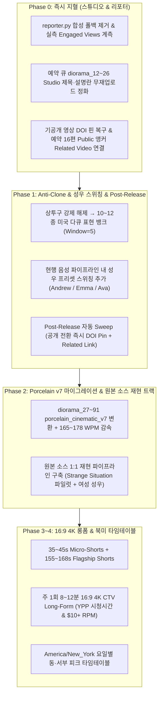

# 🇺🇸 ALL ABOUT BRAIN 미국 시장 성공 공식 마스터 플랜 (HQ 통합본)

원본 분석 채팅방: [유튜브 성공 공식 분석방](conversation://e07a753a-3b74-4500-bd6d-29b6c52a8666) · 72건 레퍼런스 원문: [youtube_success_formula_report.md](file:///home/canadaofbin/.gemini/antigravity-cli/brain/e07a753a-3b74-4500-bd6d-29b6c52a8666/youtube_success_formula_report.md)

> [!IMPORTANT]
> **HQ 최신 동기화 반영 사항 (2026-11-02):**
> 1. **포슬린 엔진 반영 완료:** [포슬린 업그레이드 채팅방](conversation://0ce03eda-1031-46a0-8c8b-743f31e88be4)에서 기본 시각 프로파일 `porcelain_cinematic_v7` (`Rule R66`) 엔진 업그레이드 및 회귀 검증이 완료되었습니다 (미렌더링 초안 `diorama_27~91` 65편의 마이그레이션만 남음).
> 2. **신규 트랙 추가 (CEO 지시):** 텍스트 프롬프트 창작 외에 **이미 흥행이 검증된 실제 실험·다큐 영상(`The Strange Situation` 등)의 컷·구도·동선·호흡을 소스로 재현하는 ‘검증 소스 재현 트랙(Source-Conditioned Reenactment)’**을 결합합니다.
> 3. **음성 방침 확정 (CEO 지시):** 보이스 클로닝을 쓰지 않고 **현재 음성 파이프라인(`dynamic_rush_v7` + Silk Clean EQ)을 그대로 유지한 채, 필요시 성우 모델만 미국 여성 내레이터(`en-US-EmmaMultilingualNeural` / `en-US-AvaMultilingualNeural`)로 교체(`--voice`)**합니다.

---

## 1. 미국(`US`) 유튜브 시장 12대 구조적 특수성 (`[US-01]` ~ `[US-12]`)

| 코드 | 핵심 영역 | 미국 시장 1차 검증 지표 및 출처 | `ALL ABOUT BRAIN` 반영 원칙 |
|---|---|---|---|
| **`[US-01]`** | **50세+ 중장년·시니어 골든 코호트** | **Pew Research Center**: 미국 성인 유튜브 도달률 **84~85%**(1위). `50–64세 85%`, `65세+ 65%` 상시 시청. | 본 채널 실측 연령(**`45세+ 63.0%~72.5%`**)은 미국 내 체류시간·광고단가가 가장 높은 다큐 핵심 소비층에 정확히 안착한 결과임. |
| **`[US-02]`** | **거실 TV(CTV)의 모바일 추월 (미국 1위 기기)** | **Nielsen *The Gauge* (2026)**: 미국 TV 점유율 유튜브 **15.8%(전체 1위, Netflix의 2배+)**. 최다 시청 기기가 모바일에서 **거실 스마트TV(CTV)**로 역전. | 대화면 CTV에 최적화된 **포토리얼 하이키 도자기(`porcelain_cinematic_v7`) + 4K 썸네일 + 명료한 발화 속도**가 필수임. |
| **`[US-03]`** | **모바일 숏폼 3분할 vs 심층 다큐 독점** | **Edison Research**: 미국 숏폼은 TikTok·Reels·Shorts 3분할이나, **심층 비디오 다큐 1위는 유튜브**이며 가구 **75%**가 Smart TV 보유. | 쇼츠 단일 포맷으로는 재방문 락인이 불가(현재 재방문자 `0.2%`). **`Shorts(탐색) → Related Video → 8~12분 16:9 롱폼(정착)`** 결합 필수. |
| **`[US-04]`** | **미국 과학/교육 RPM 격차 (`50x~250x`)** | 미국 Shorts RPM **`\$0.04~\$0.15`** vs **미국 Science & Education 8분+ 롱폼 RPM `\$5.00~\$15.00+`**(중앙값 `\$10.22`). | **미국 과학 롱폼 1만 뷰(`~\$102`) = 미국 쇼츠 100만 뷰 수익.** 도시에 내 `07_longform_outline.json`의 16:9 롱폼 전환이 수익화 핵심 레버리지임. |
| **`[US-05]`** | **`Engaged Views` 개편 & YPP 시청시간 허들** | YPP 심사는 `Engaged Views`만 인정하며, **Shorts 피드 시청 시간은 YPP 공개 시청 시간(`3,000h` / `4,000h`)에 `0.0시간`으로 반영됨.** | 주 1회 16:9 롱폼 병행으로 **`3,000h`(구독 500명) → `4,000h`(구독 1,000명)** 트랙을 밟는 것이 진입 확률과 직후 RPM 모두 압도적으로 유리함. |
| **`[US-06]`** | **YPP ‘비진정성 콘텐츠(Inauthentic Content)’ 단속** | **2025-07-15 발효**: 수십 개 영상에 **동일한 제목 패턴·동일한 대본 전환 상투구·동일한 설명란 복붙**이 반복되는 AI 배치 채널 집중 타격. | 94편 `100%` 동일 상투구 강제 삽입(`GAP-1`), 연속 `"You Think..., Yet..."` 제목, 설명란 대본 복붙(`GAP-2`)을 최우선 해체해야 함. |
| **`[US-07]`** | **미국 소비자 AI Slop 반감(`31%` 신뢰) vs 학술 검증** | 일반 AI 생성물 신뢰도 **`31%`**, 획일적 AI 어투 감지 시 **`32~40%`** 이탈, **`74%`** 투명한 AI 공시 요구. | **검증된 실제 실험 영상 구도 재현 + 동료심사 DOI 고정 댓글(`R35` `100%` 복구) + 투명한 AI 공시(`R4`)**가 최고의 신뢰 해자임. |
| **`[US-08]`** | **미국 대중 과학 흥행 공식 (`Personal Stake` & 실존 실험)** | 강단식 개념어보다 **① 내 몸·수면·노화의 생물학적 위기** 또는 **② 검증된 실존 임상·심리 실험 역설**에 즉각 반응. | 채널 1위 `Sleepless Night`(`2,000뷰`, **`12.0 subs/1K`**) 및 검증된 고전 실험 영상(*Strange Situation* 426만 뷰 등) 재현 전략과 직결됨. |
| **`[US-09]`** | **단척(`35~45s`) vs 장척(`150~175s`) 쇼츠 이원화** | `35~45초`는 `Viewed >= 82%` 초광역 시드 개척에 유리, `150~175초` 장척은 절대 체류시간(`AVD 100~147초`)과 구독 설득력에 강함. | **`35~45s Micro-Shorts`(탐색) + `155~168s Flagship Diorama / 실험 재현`(설득)** 이원화 운영. |
| **`[US-10]`** | **미국 영어 청취 가독성(`FK <= 5.0`) & 중장년 속도(`165~178 WPM`)** | 미국 `45세+`가 자막 피로 없이 청취하는 다큐 최적 속도는 **`165~178 WPM`**(콜드오픈만 `~180 WPM`), 가독성 `FK <= 5.0~5.5`. | 신규 빌드(`diorama_12~26`)의 `183~205.7 WPM` 과속(`brisk +15%`)을 `brisk +7%`로 감속·평이화하여 중반 이탈 방어. |
| **`[US-11]`** | **북미 동·서부(`ET`~`PT`) 요일별 피크 타임** | **Buffer 180만 영상 연구**: 쇼츠는 **목·금·토 오후~저녁(`15:30~21:15 EST`)**, 롱폼은 **일·화 오전(`09:00~11:00 EST`)** 최고 효율. | 365일 고정 `12:00 / 20:00 ET`를 요일별·포맷별 북미 타임테이블(`America/New_York` DST 자동 반영)로 개편. |
| **`[US-12]`** | **한·미 조세조약(`W-8BEN 10%`) & `en-US` 고정** | 한국(`KR`) 거주국 유지 + `en-US` 메타데이터 고정 시 **원천징수 `30% → 10%` 감면**과 미국 피드 배정(`62~66%`) 동시 달성. | 현행 `KR` 거주 + `en-US` 메타데이터 + `R4` 공시 구조 **100% 유지**. |

---

## 2. 채널 포렌식 감사 베이스라인 & 9대 구조적 병목 (`GAP-1` ~ `GAP-9`)

### 비주얼 스타일 × 포맷별 실측 성과 대조 (`합성 폴백 제거 기준`)

| 프로젝트 (비주얼 프로필) | 길이 | 공개 조회수 | 실측 `Viewed %` | **실측 `AVD` (`APV`)** | 구독 전환 (`subs / 1K`) | 핵심 진단 |
|---|---|---|---|---|---|---|
| **`psych_06`** (*Sleepless Night*, 하이키 포슬린 + 입체 뇌) | `84.4s` | **`2,000`** | **`80.4%`** | **`82.0s` (`97.2%`)** | **`+24명` (`12.0 / 1K`)** | **미국 PMF 1위**: 일상 신체 위기 + 밝은 하이키 포슬린 = 최상위 완주·구독 전환 |
| **`psych_01`** (*Habit Loops*, 하이키 포슬린 + 입체 뇌) | `84.0s` | **`1,589`** | **`84.5%`** | **`52.0s` (`61.9%`)** | **`+8명` (`5.0 / 1K`)** | 직관적 `Why...` 일상 습관 제목이 초반 스와이프 이탈(`15.5%`) 방어 |
| **`gage_diorama_v6`** (*Phineas Gage*, 다크오크 세라믹 v6) | `172.6s` | **`903`** | `66.9%` | **`147.0s` (`85.2%`)** | **`+7명` (`7.8 / 1K`)** | 3분 장척임에도 **평균 2분 27초 체류(`85.2%`)** 달성 |
| **`diorama_02`** (*Mirror Box*, `lowpoly_pastel_v7` + `"Imagine"`) | `174.4s` | **`1,185`** | `72.8%` | **`103.0s` (`59.1%`)** | `+5명` (`4.2 / 1K`) | `"Imagine..."` 약한 훅 + 평면적 로우폴리 비주얼로 구독 전환 하락 |
| **`diorama_01`** (*Patient H.M.*, `lowpoly_pastel_v7`) | `176.3s` | `380` | `74.3%` | **`134.0s` (`76.0%`)** | `+1명` (`2.6 / 1K`) | 로우폴리 파스텔 톤의 다큐 권위감 부족(`3.6 subs/1K` vs 포슬린 `8.9 subs/1K`) |

### 해결해야 할 9대 병목 (`GAP-1` ~ `GAP-9`)
1. **`GAP-1` (YPP 클론 대본·제목):** [`prompt_quality_v5.py`](file:///home/canadaofbin/gdrive/Kyubin_Yun_Workspace/07_Youtube/pipeline/prompt_quality_v5.py) 등이 94편 전수에 `"here is what went wrong"`, `"total nightmare"`, `"completely stunned"`, `"which proves"`를 강제 삽입했고, 예약분 제목이 `"You Think..., Yet..."`으로 편중됨.
2. **`GAP-2` (예약 큐 설명란 대본 복붙):** [`diorama_batch_orchestrator.py`](file:///home/canadaofbin/gdrive/Kyubin_Yun_Workspace/07_Youtube/pipeline/diorama_batch_orchestrator.py)가 대본 첫 4문장을 그대로 설명란(`description`)에 복붙함 (`diorama_12~26` 업로드분 및 `27~91` 초안).
3. **`GAP-3` (`R35` DOI 고정 댓글 `90.6%` 실종 & `Related Video` `16/23편` 미연결):** 예약 영상이 공개로 전환된 후 핀을 꽂는 Post-Release 크론 부재(`3/32편`만 작동), [`short_linker.py`](file:///home/canadaofbin/gdrive/Kyubin_Yun_Workspace/07_Youtube/pipeline/studio/short_linker.py)의 `Scheduled → Scheduled` 타겟팅 버그.
4. **`GAP-4` (예약 23편 세대 분절):** `diorama_04~06`(구형 `"Imagine"`), `07~11`(`+8%`), `12~26`(`183~205.7 WPM` 과속 + 클론 메타데이터).
5. **`GAP-5` (미렌더링 초안 65편 `diorama_27~91` 로우폴리 잔존):** 엔진(`R66`)은 업그레이드 완료되었으나 기존 초안 65편은 아직 `lowpoly_*` 문법 상태임.
6. **`GAP-6` (16:9 롱폼 & 마이크로 쇼츠 `0편`):** YPP 시청시간 `0.0h`, 미국 과학 롱폼 RPM(`\$5~\$15+`) 미수혜.
7. **`GAP-7` (운율 과속 & 가독성 초과):** `brisk +15%`(`~200 WPM`) 및 `FK > 5.0`(`89.1%`) → 기어 속도(`brisk +7%`)와 단어 예산(`435~470w`) 동시 보정 필요.
8. **`GAP-8` (필러 편중 & 고정 시간대):** 교과서형 `brain_basics`(`38%`) 과편성 → 미국 흥행 필러(`brain_health 35%`, `mysteries 25%`) 우선 배치 필요.
9. **`GAP-9` (`reporter.py` 합성 폴백 왜곡):** [`reporter.py`](file:///home/canadaofbin/gdrive/Kyubin_Yun_Workspace/07_Youtube/pipeline/studio/reporter.py) 내 `engaged_now = views * apv` 역산 및 하드코딩 상수 제거 필요.

---

## 3. 단계별 실행 로드맵 (원본 소스 재현 & 여성 성우 옵션 통합)

> [!CAUTION]
> **작업 시 필수 안전 수칙:**
> - **영상 삭제·재업로드 금지(`R34`):** 이미 예약된 `diorama_12~26`은 재업로드 없이 Studio 메타데이터(제목·설명란) 편집만으로 정화합니다.
> - **구형 스케줄러 실행 금지:** [`studio_batch_100_scheduler.py`](file:///home/canadaofbin/gdrive/Kyubin_Yun_Workspace/07_Youtube/pipeline/studio_batch_100_scheduler.py)는 구형 `psych_*` 전용이므로 절대 호출하지 않습니다.
> - **운율·단어 수 동시 보정:** `brisk` 감속(`+15% → +7%`)과 단어 예산(`435~470w`)을 반드시 함께 적용해야 `P8` 최소 길이(`140s`) 게이트가 유지됩니다.

---

## 4. CEO 컨펌 대기 의사결정 항목 (결정 1 ~ 결정 6)

| 번호 | 안건 | **(권장) 옵션 A** | 대안 옵션 B |
|---|---|---|---|
| **결정 1** | **기예약 큐(`diorama_04~26`) 조치** | **무재업로드 스마트 정화:** Studio Edit만으로 `diorama_12~26`(15편) 클론 제목·설명란 교체 + 미연결 16편 `Related Video` 연결 | `11/03` 공개 예정 `diorama_05~06`까지 재조립·교체 업로드 |
| **결정 2** | **YPP `Anti-Clone` 범위** | **전면 도입:** 고정 상투구 5종 강제 해제 → 10~12종 미국 다큐 회전 뱅크(`Window=5`) + 독립 3문단 학술 설명란 생성기 | `"This is the true story of..."`만 유지하고 4개 전환구만 회전 |
| **결정 3** | **미렌더링 `diorama_27~91` 전환** | **6편 파일럿 후 확장:** `porcelain_cinematic_v7` + 감속(`165~178 WPM`)으로 흥행 필러 6편 우선 검증 후 59편 확장 | 파일럿 없이 65편 일괄 변환 |
| **결정 4** | **`16:9 4K 롱폼` 착수 시점** | **즉시 병행 준비:** `Phase 0~2` 직후 최고 검증 주제(`Sleepless Night`)로 첫 `8~10분` 16:9 4K 롱폼 어셈블러 구축 | 구독자 500명 도달 이후로 보류 |
| **결정 5** | **북미 요일별 타임테이블 적용** | **미업로드 큐(`diorama_27~`)부터 적용:** 기존 예약 시간은 보호하고 `27번` 이후부터 동·서부 요일별 피크 적용 | 기존 예약분(`12~26`) 시간까지 변경 |
| **결정 6** | **신규 ‘검증 원본 소스 재현’ 파일럿** | ***The Strange Situation* (`QTsewNrHUHU`) 1호 파일럿 착수:** 원본 컷/프레임 구도 추출 → `porcelain_cinematic_v7` 시작/끝 프레임 변환 → Flow `Frames to Video` 생성 + 현행 파이프라인 여성 성우(`Emma`/`Ava`) 적용 | 기존 텍스트 기반 에피소드 정화(`Phase 0~1`) 완료 후 착수 |
