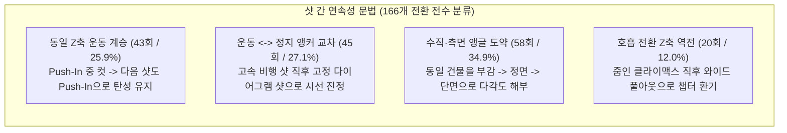

# `_73R9pQF5oM` (신비한 건축사전) 장면 무빙 · 장면 전환 전수 추출 보고서

- **대상 영상**: `서울 한복판에 42년 동안 가짜 광화문이 서 있었습니다` (`https://youtu.be/_73R9pQF5oM`, 채널: `신비한 건축사전`)
- **분석 범위**: 전 구간 `343.33s` (`10,300프레임 @ 30.00fps`, `167개 클린 샷` · `166개 전환점`) 1프레임(`33.3ms`) 광류(Optical Flow) 벡터 분해 및 선형 블렌딩·히스토그램 포렌식
- **원시 추출 데이터셋(JSON, 전 167샷 수록)**: [_73R9pQF5oM_scene_motion_and_transitions.json](./_73R9pQF5oM_scene_motion_and_transitions.json)

> [!IMPORTANT]
> **제작 엔진 및 편집 파이프라인 포렌식 결론**: 이 영상은 순수 Blender 수작업 렌더링이 아니라 **`24.00fps` 네이티브 `8.0s`급 AI 비디오 엔진(`Google Veo 3 / 3.1 · Flow` 계열 `Start+End` 키프레임 보간)** 클립들을 생성한 뒤, **`30.00fps` NLE 타임라인에서 평균 `2.06s`(중앙값 `1.73s`) 단위로 핵심 운동 구간만 발췌 편집**한 하이브리드 파이프라인입니다.
> 1. **`24 → 30fps` 풀다운 지문**: 전체 `10,300`프레임 중 중복 프레임(`MAE < 0.45`)이 정확히 **`22.74%`(`2,342f`)**이며 `f % 5 == 1` 위상에 **`1,158f`**가 집중(`3:2:2:2:2` 풀다운)되어 원본 클립이 `24.00fps`임을 수학적으로 입증합니다.
> 2. **`8.00s` 최대 클립 상한**: `167`개 전체 샷 중 단일 무컷 최장 길이가 정확히 **`8.00s`**(`#148`, `299.33~307.33s`)에서 멈춥니다.
> 3. **영문 인씬 타이포그래피 & 프롬프트 흔적**: 한글 깨짐을 피하려고 본편은 한국어 내레이션이면서 화면 속 3D 입체 텍스트는 전부 영문(`"The Palace Axis"`, `"Concrete Core Revealed"`, `"3.75°"`)으로 생성했으며, `00:06s`(`f=180`)에는 프롬프트 지시어 `"in Title Case"`가 `"Title Casefe"`로 함께 렌더링된 AI 디퓨전 물증이 포착됩니다.

---

## 1. 전 구간 정량 요약 및 타임라인 리듬 대시보드

| 핵심 측정 지표 | 실측 수치 | 연출적 의미 |
|---|---|---|
| **총 클린 샷 / 전환 수** | **`167샷` / `166회`** | `343.33s`(5분 43초) 동안 쉼 없이 시각 정보를 교체 |
| **샷 길이 분포** | 평균 **`2.06s`** · 중앙값 **`1.73s`** (`p10=0.79s`, `p90=4.04s`, 최장 `8.00s`) | `8s` 원본 AI 클립을 그대로 쓰지 않고 **가장 역동적인 `1.5~2.5s` 알짜 구간만 과감히 재단** |
| **3D 입체 시차(Parallax) 비율** | **`89.2%`** (`149 / 167샷`) | 단순 2D 이미지 줌/패닝(Ken Burns, `0.6%`)이 아닌 **전경·배경 원근이 살아 움직이는 3D 시차 영상** |
| **Z축(전후 깊이) 카메라 비중** | **`59.3%`** (`Push-In` 계열 `53샷` + `Pull-Out` 계열 `44샷` + 복합 `2샷`) | 좌우 패닝(`~9%`)보다 **앞으로 빨려 들어가거나(`Push-In`) 뒤로 빠지며 전모를 드러내는(`Pull-Out`) 깊이 축 무빙**이 압도적 주력 |
| **정적 삼각대 + 피사체 물리 애니메이션** | **`19.8%`** (`피사체 단독 모션 19샷` + `고정 앵커 14샷`) | 건물이 쪼개지거나 치수가 이동할 때는 **카메라를 흔들지 않고 고정해 정보 가독성을 확보** |
| **문장 끝 vs 문장 중간 키워드 컷 비율** | 문장 경계(`±0.45s`) **`9.0%`(`15회`)** vs 문장 중간 키워드 컷 **`91.0%`(`151회`)** | 마침표마다 자르는 기계적 편집이 아니라, **명사·숫자 키워드(`"42년"`, `"시멘트"`, `"11.2m"`, `"3.75도"`)가 발화되는 즉시 화면을 타격** |

### 6막(Act) 구조별 컷 템포 & 무빙 속도 변화

| 구간 (Act) | 시간대 | 샷 수 | 평균 샷 길이 | 중앙값 | 평균 광류 속도 | 템포 전략 |
|---|---|---:|---:|---:|---:|---|
| **Act 1. 콜드오픈 훅 (42년 가짜 광화문)** | `00:00–00:25` | `13` | **`1.88s`** | **`1.53s`** | `0.432` | `1.5s` 단타 컷 + 상하 분할 + 단면 박리로 초반 시선 결박 |
| **Act 2. 경복궁 직선 축 & 1926·1950 수난** | `00:25–01:10` | `18` | `2.52s` | `2.06s` | `0.533` | `90°` 직부감 → 3문 관통 롱플라이트(`4.87~6.33s`)로 공간감 각인 |
| **Act 3. 1968 콘크리트 복원 & `3.75°` 비틀림** | `01:10–02:30` | `36` | `2.22s` | `1.88s` | `0.581` | 차창 POV(`?`) + 붉은 축선·황금 유령 문 슬라이딩 다이어그램 |
| **Act 4. 1995 총독부 해체 노출 & 전면 철거** | `02:30–03:20` | `29` | **`1.75s`** | **`1.50s`** | `0.695` | 총독부 수직 리프트 리빌 + 목조 분해 vs 콘크리트 파쇄 고속 교차 |
| **Act 5. 유구 발굴 & 금강소나무 중건(2010)** | `03:20–04:02` | `19` | `2.23s` | `2.13s` | `0.617` | 지하 단면 적층 + 1925 도면 3D 홀로그램 융기 + 크레인 조립 |
| **Act 6. 현판 균열·묵질금자 고증 & 월대 완성** | `04:02–05:43` | `52` | `1.93s` | `1.58s` | **`0.845`** | 목재 세포 현미경 다이브 + 한일 지도 비행 + 홍예문 관통 피날레 |

---

## 2. 추출된 8대 핵심 장면 무빙 패턴 (`Camera + In-Scene Motion`)

단순히 카메라만 움직이는 것이 아니라 **① 카메라 궤적(Camera Rig)**과 **② 건축 디오라마 물리 모션(Staging Physics)**을 역할을 나누어 결합한 8가지 시그니처 무빙입니다.

| ID | 무빙 패턴명 | 대표 구간 (`실측 샷`) | 카메라 벡터 & 속도 곡선 | 인씬(In-Scene) 피사체 움직임 | Google Flow (`Start+End` / I2V) 재현 프롬프트 공식 |
|---|---|---|---|---|---|
| **M1** | **수직 부감 → 중심축 관통 비행** (`Bird's-Eye to Axial Dive`) | `00:29.5–00:36.5` (`#015–#017`, `flow=2.54`) | `90°` 직부감에서 지면 눈높이로 급강하 후 정면 고속 `Push-In` (`fast_flight`) | 근정전→근정문→흥례문→광화문 3개 문 홍예가 일직선으로 연달아 열리며 통과 | `Camera dives steeply from high top-down bird's-eye plan down to eye-level courtyard, flying straight forward through aligned open gateway arches.` |
| **M2** | **재질 박리 & 미시 구조 줌인** (`X-Ray Peel & Micro Dive`) | `00:13.0–00:14.8` (`#006`) `04:05.0–04:08.5` (`#116–#118`) | 느린 `Push-In` → 균열 틈새 속으로 초근접 매크로 다이브 | 붉은 목조 기둥 외피가 열리며 회색 철근 콘크리트 속살 노출 / 현판 균열 속 육각 목재 세포 내 물방울 증발·수축 | `Macro push-in onto wooden pillar as outer painted timber shell peels open in clean cutaway to reveal grey reinforced concrete core inside.` |
| **M3** | **3D 유령 모형 궤적 슬라이딩** (`Ghost Offset & Axis Diagram`) | `02:07.5–02:14.5` (`#059–#060`) | 아이소메트릭 `45°` 부감에서 미세 `Pull-Out` (`slow_creeping_drift`) | 반투명 황금색 유령 광화문이 바닥의 붉은 띠를 따라 북쪽 `11.2m`·동쪽 `13.5m` 미끄러진 뒤 `3.75°` 비틀림 | `Elevated isometric architectural model on white studio floor; a glowing golden translucent miniature gate slides along a red floor path and rotates slightly off-axis.` |
| **M4** | **거대 장애물 수직 리프트 리빌** (`Vertical Lid-Lift Reveal`) | `02:30.2–02:36.2` (`#068–#071`) | 정면 로우앵글 `Tilt-Up` → 하이앵글 `Pull-Out` | `1995` 조선총독부 돔과 외벽이 층별로 분해되며 하늘 위로 수직 상승해 사라지고, 바닥에 어긋난 붉은 축선 다각형 노출 | `Front architectural view as massive grey stone building deconstructs and lifts straight upward into the sky, revealing misaligned palace courtyard behind it.` |
| **M5** | **분해 조립도 vs 파쇄 물리 대비** (`Exploded Joinery vs Shatter`) | `02:48.0–02:55.0` (`#079–#083`) | 무채색 스튜디오 배경 고정(`static_cam_with_subject_animation`) | 목조 문루는 공포·보·기둥 부재가 무중력 상태로 깔끔히 분리 부유 ↔ 콘크리트 문은 붉은 거미줄 균열 후 덩어리째 파쇄 낙하 | `Dark studio background, locked tripod camera; traditional wooden roof structure smoothly separates vertically into floating timber beams in exploded view.` |
| **M6** | **2D 고도면 → 3D 홀로그램 융기** (`Blueprint to 3D Extrusion`) | `03:30.0–03:36.2` (`#102–#103`, `5.00s`) | 도면 클로즈업 `Pan` → 정면 고정 상태 입체 변환 | 책상 위 `1925` 실측 청사진에서 흰색 와이어프레임이 솟아오른 뒤 돌 육축 위 황금 반투명 목조 누각으로 충전 | `Vintage architectural blueprint on desk transitions into white 3D wireframe monument rising upward, filling with translucent golden timber pavilion over stone base.` |
| **M7** | **지하 지층 단면도 & 유구 적층** (`Subterranean Trench Cutaway`) | `03:19.5–03:26.5` (`#097–#100`) | 흙손 클로즈업 → `90°` 그리드 부감 → 정면 지층 단면 고정(`static_cam`) | 땅 아래 흙 단면이 직사각형으로 잘려 보이며 조선 초기 기초석 유구 위에 보존토와 새 석재가 차곡차곡 적층 | `Clean side cross-section cutaway of underground brown soil trench; ancient stone foundation blocks rest at bottom while new cut stone layers stack neatly above.` |
| **M8** | **개구부 포털 관통 & 골든아워 풀백** (`Archway Portal & Sunset Reveal`) | `05:36.0–05:42.5` (`#162–#166`, `flow=2.85`) | 홍예문 어두운 아치 내부로 최고속 `Push-In` → 완공 정면 `Pull-Out` | 굳게 닫힌 붉은 문짝이 양옆으로 활짝 열리며 정중앙에 흥례문이 정확히 정렬된 뒤 석양빛 전경으로 마무리 | `Fast forward camera flight through stone archway as heavy red wooden double doors swing wide open, revealing aligned inner palace gate dead-center.` |

---

## 3. 추출된 7대 장면 전환(`Scene Transitions`) 메커니즘 및 연속성 문법

평균 `2.06s`마다 컷이 바뀌는데도 눈이 피로하지 않고 한 편의 다큐멘터리처럼 매끄럽게 이어지는 이유는 **단순 하드컷이 아니라 아래 4가지 연속성 문법 + 7가지 전환 기법이 맞물려 있기 때문**입니다.

### 7대 장면 전환 기법 프레임 단위 분해

1. **`T1` 상하 분할 비교 와이프 (`Split-Screen Stack Wipe`, `00:07.8–00:10.1`)**
   - **작동 방식**: 단일 전경 샷 위에 가로 분할선이 생기며 상단(`2010` 목조 광화문)과 하단(`1968` 콘크리트 광화문)을 동시에 미세 `Pull-Out` 시켜 "겉모습이 똑같다"는 명제를 2초 만에 직관화합니다.
2. **`T2` 동일 앵글 재질·상태 스왑 매치컷 (`Same-Angle State Swap Cut`, `4회` 핵심 전환 + 다수 변주)**
   - **작동 방식**: 카메라 화각·건물 크기를 맞춰 둔 채(`hist_corr = 0.89~0.998`), 발화 키워드(`"철근 콘크리트였습니다"` `10.10s`, `"환장할 노릇이죠"` `176.9s` 진홍색 상태 변화)에 맞춰 건물의 **재질·색상만 즉시 스왑**합니다.
3. **`T3` 전경 차폐 프레임 POV 전환 (`Foreground Window Frame POV`, `01:18.5–01:21.5`)**
   - **작동 방식**: 광화문대로 외경 주행 샷(`78.5s`) → 검은 의전차 뒷좌석 어두운 창틀 프레임 속 총독부 + `?` 그래픽(`79.0~80.7s`) → 창밖 황금 가림막 광화문 외경(`81.5s`)으로 **어두운 전경 프레임을 징검다리 삼아 시점을 전환**합니다.
4. **`T4` 홍예문 개구부 포털 통과 전환 (`Archway Dark-Aperture Portal`, `00:34s`, `01:41s`, `02:21s`, `02:38s`, `05:36s`)**
   - **작동 방식**: 영상 전체에서 총 **5회 반복되는 시그니처 전환**입니다. 석조 홍예문 아치 안쪽의 그늘진 벽면이 화면 좌우를 채우는 순간을 포털로 삼아 문 앞 공간에서 문 뒤 공간(총독부 또는 근정전 축)으로 자연스럽게 관통합니다.
5. **`T5` 동일 앵글 시대 타임라인 연쇄 변모 (`Same-Camera Era Morph Sequence`, `05:03–05:16`)**
   - **작동 방식**: 광화문 정면 부감 앵글을 고정한 채 `조선 고종 월대` → `일제 전차 선로 부설` → `2022년 아스팔트 차도 우회` → `중장비 굴착 및 녹슨 선로 노출` → `48.7m × 29.7m 황금 월대 복원`까지 **공간은 고정하고 시간만 흘려보내는 연속 전환**입니다.
6. **`T6` 스캐너 플레인 & 조립 완성 매치 리빌 (`Scanner Wipe & Assembly Match Reveal`, `03:51.5–03:54.5`)**
   - **작동 방식**: 맨살 목조 가구식 뼈대 위로 반투명 붉은 스캔 평면이 쓸고 지나가며 기와가 하늘에서 내려앉고, `233.40s`(`f=7002`, `hist_corr=0.973`) 동일 앵글 매치컷으로 비계가 걷히며 단청이 입혀진 완공 광화문이 드러납니다.
7. **`T7` 선형 크로스 디졸브 & AI 데이지체인 (`12f~20f Cross-Dissolve 17회` + `Daisy-Chain Seam 4회` + `Fade-out 1회`)**
   - **크로스 디졸브(`17회`)**: 무분별하게 쓰지 않고 **시대 점프·도면 오버레이·현판 흑백 전환 구간(`22.5s`, `24.4s`, `146.6~147.4s`, `175.5~180.6s`, `208.8~218.4s`, `264.3~264.7s`, `342.0s`)**에만 정확히 **`12프레임(0.40s)` 또는 `20프레임(0.67s)` 선형 블렌딩**을 걸어 하단 자막 간섭 없이 부드럽게 넘깁니다.
   - **데이지체인 이음매(`4회`, `193.4s`, `196.0s`, `256.7s`, `257.7s`)**: `Start+End` 공유 키프레임으로 두 AI 클립을 직접 물려 카메라 무빙이나 표면 수선 애니메이션을 끊김 없이 연장합니다.

---

## 4. 오프닝~초반 핵심 시퀀스(`00:00–00:55`, `#001~#022`) 정밀 추출 테이블 샘플

> [!TIP]
> 전체 `00:00~05:43` 구간 **`167`개 모든 샷의 프레임·초 단위 타임스탬프, 광류 속도(`pan_x`, `tilt_y`, `zoom_div`, `parallax_ratio`), 가감속 프로파일(`ease_in`/`ease_out`/`steady`), 전환 타입, 매칭 대본**은 [_73R9pQF5oM_scene_motion_and_transitions.json](./_73R9pQF5oM_scene_motion_and_transitions.json)에 완비되어 있습니다.

| 샷 | 구간 (`s`) | 길이 | 카메라 무빙 & 속도 프로파일 | 전환 (`Out`) | 화면 연출 및 대본 타격 지점 |
|---:|---|---:|---|---|---|
| `#001` | `0.00–1.50` | `1.50s` | `Push-In` (중속 가속 `ease_in`) | `hard_cut` | 백색 스튜디오 배경, 광화문 처마 로우앵글 전진 (`0.04s` 즉시 발화 시작) |
| `#002` | `1.50–3.67` | `2.17s` | `Static + 피사체 모션` | `hard_cut` | `"나무처럼 생긴 콘크리트가"` — 처마 공포 클로즈업에서 정면 전경 점프 |
| `#003` | `3.67–5.20` | `1.53s` | `Pull-Out + Tilt-Up` (고속 감속 `ease_out`) | `hard_cut` | `"42년 동안 서 있던"` — 석조 육축까지 드러내며 빠르게 후진 |
| `#004` | `5.20–10.10` | `4.90s` | `Pull-Out` (저속 크리핑) | `hard_cut` (`T2`) | `"42 Years"` → `"Gwanghwamun"` 3D 타이틀 → **`T1` 상하 분할 비교(`08~10s`)** |
| `#005` | `10.10–12.23` | `2.13s` | `Pan-Right + Push-In` (저속) | `hard_cut` | `"철근 콘크리트였습니다"` — **동일 건물 회색 무채색 콘크리트 모형 스왑** |
| `#006` | `12.23–15.00` | `2.77s` | `Push-In` (중속 감속 `ease_out`) | `hard_cut` | **`M2` 단면 박리**: `"겉은 나무... 속은 시멘트"` 붉은 기둥 속 회색 시멘트 코어 노출 |
| `#007` | `15.00–16.87` | `1.87s` | `Pull-Out` (저속) | `hard_cut` | `"재료만 틀린 게 아니었습니다"` — 정면 대칭 와이드 뷰 복귀 |
| `#008` | `16.87–18.23` | `1.37s` | `Tilt-Up` (저속) | `match_cut` | `"서 있는 자리도"` — 백색 바닥 위 아이소메트릭 미니어처 + 붉은 어긋남 화살표 |
| `#009` | `18.23–21.87` | `3.63s` | `Pull-Out` (중속 일정) | `hard_cut` | `"걸린 글씨도 죄다 원래 것이 아니었거든요"` — 처마 현판 클로즈업 후진 |
| `#010–#013` | `21.87–24.43` | `2.56s` | `Pull-Out` 연속 3단 리듬 | `cross_dissolve` (`20f`) | `"세 가지가 한꺼번에 어긋난 문을..."` — `20f(0.67s)` 선형 디졸브로 1막 마무리 |
| `#014` | `24.43–28.87` | `4.43s` | `Push-In + Tilt-Up` (고속 비행) | `hard_cut` | `"광화문은 경복궁의 정문입니다"` — 정문에서 궁 안쪽 상공으로 솟구치며 비행 |
| `#015` | `28.87–30.87` | `2.00s` | `Pull-Out + Tilt-Down` (중속) | `hard_cut` | `"근정전, 근정문, 흥례문, 광화문을 한 줄로"` — `90°` 직부감 4전각 직선 배치도 |
| `#016` | `30.87–35.73` | `4.87s` | `Push-In` (**최고속 관통 비행 `flow=2.54`**) | `hard_cut` (`T4`) | **`M1` 축선 관통**: 근정전 어좌 시점에서 문 3개를 일직선으로 뚫고 돌진 |
| `#017` | `35.73–37.40` | `1.67s` | `Push-In` (고속 감속 `ease_out`) | `hard_cut` | 홍예문 통과 직후 육조거리 대로변 전진 (`"시선이 쫙 뻗도록"`) |
| `#018–#020` | `37.40–45.10` | `7.70s` | `Static + 피사체 모션` | `hard_cut` | 중심축 부감 → 어긋난 붉은 유령 문 → `1926` 조선총독부가 축 한가운데 낙하 차단 |
| `#021–#022` | `45.10–53.33` | `8.23s` | `Tilt-Down + Push-In` (`6.33s` 롱플라이트) | `hard_cut` | `"경복궁 축과 다르게 각도를 살짝 틀어 앉혔고"` — 황금 축선 vs 회색 축선 분기 다이어그램 |

---

## 5. 우리 파이프라인(`@AllAboutBrainOfficial` `v8`) 즉시 이식 포인트 4가지

1. **대사 마침표가 아닌 '핵심 명사·숫자 타격점'에 맞춘 `1.7~2.1s` 알짜 트림**: `8.0s` Google Flow 생성 클립 전체를 늘어지게 쓰지 않고, 속도감이 가장 좋은 `1.5~2.8s` 구간만 잘라 **발화 속 숫자·반전 명사(`91%` 문장 내부 컷)**에 맞춰 전환하면 몰입도가 극대화됩니다.
2. **Z축(`Push-In`/`Pull-Out` `60%`) + 정적 디오라마 물리(`20%`)의 황금 분업**: 카메라가 날아다닐 때(`M1`, `M8`)는 과감히 관통 비행시키고, 반대로 복잡한 인과관계·수치·내부 구조(`M3`, `M5`, `M7`)를 보여줄 때는 **카메라를 고정(`locked_static`)한 채 피사체만 분해·적층**시켜 시선 분산을 막습니다.
3. **사물 개구부 포털(`T4`) & 동일 앵글 상태 스왑(`T2`)**: 우리 뇌과학/심리학 디오라마에서도 **실험실 문·관찰창·두개골 절개창을 `T4` 홍예문처럼 카메라 관통 포털로 활용**하고, 실험 전후 조건 변화를 **`T2` 동일 앵글 색상/재질 스왑**으로 처리하면 점프컷 이질감 없이 압도적인 정보량을 전달할 수 있습니다.
4. **`12f(0.40s)` 선형 크로스 디졸브의 절제된 사용(`~10%`)**: 모든 컷에 디졸브를 남발하지 않고, **시대·장소가 크게 도약할 때만 `12~20프레임` 디졸브**를 Track-V1(배경)에만 걸고 자막은 상위 레이어에서 선명하게 고정합니다.
