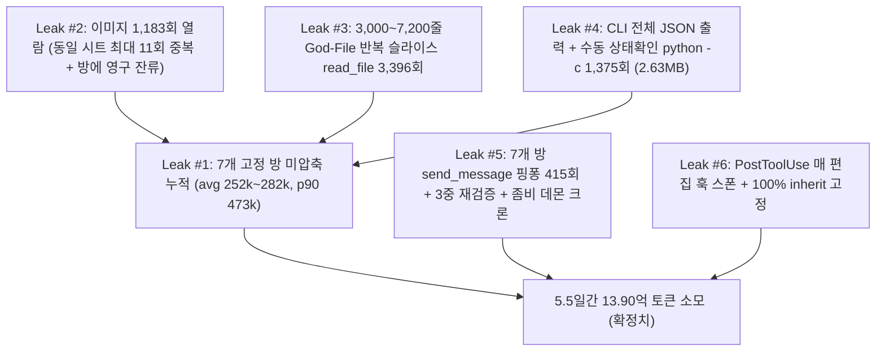

# `07_Youtube` 전체 슬림화 · QA 통폐합 · 토큰 누수 차단 마스터 계획 (검증 완료판)

## Goal Description

`07_Youtube` 워크스페이스의 코드(`226,145 LOC`), QA(`14개 모듈 / 29,023 LOC`), 스토리지(`~24.2 GB`), 에이전트 운영 구조(`5.5일간 13.90억 토큰`)를 전수 조사하고, **실행 전 코드·테스트·시스템 설정과의 교차 검증(Red-Team Fact-Check)**을 거쳐 회귀 위험 없는 최종 최적화·업그레이드 계획을 수립합니다.

현행 유일 제작 엔진인 **`expressive_25d_v8` (100% Google Flow `Ep #31` 뇌 + ElevenLabs v4 Solo `Siren` + R85–R89 + 5-Gear Studio)**, 기공개(`Public`) **24편**, 현행 작업분(`v8_ep09~ep14`), `Canonical Assets` 99슬롯 패리티를 **100% 무결하게 보존**하면서 불필요한 레거시와 토큰·속도 병목을 단계적으로 제거합니다.

### 핵심 정량 목표 (검증 후 확정치)

| 영역 | 현재 실측 (`2026-11-23` 검증치) | 최적화 목표 | 예상 효과 |
|---|---:|---:|---:|
| **전체 Python 코드** | `226,145 LOC` | `~115,000 LOC` 이하 | **-45% ~ -50%** (`~11만 줄` 감축) |
| **QA 모듈 / 코드량** | `14개` 모듈 / `29,023 LOC` (`VideoCapture` 38곳 분산) | `6개` 핵심 모듈 / `~11,000 LOC` + 단일 패스 스캔 | **코드 -60%**, QA 중복 디코딩 제거 |
| **CLI 서브커맨드** | `67개` (`cli.py` 3,634 LOC) | `~27개` (`main.py ep` 상태머신 포함) | **-60%** + 수동 12단계 → 1커맨드 |
| **디스크 용량 (`07_Youtube`)** | `~24.2 GB` (`BCI_Shorts_Channel` 22GB + `artifacts_archive` 1.4GB 등) | `~11–12.5 GB` | **-11.5 ~ -13 GB 안전 회수** |
| **에이전트 토큰 소비 (5.5일 기준)** | **13.90억 토큰** (`step_index` 중복 제거 확정치: 입력 `153.54M` + 캐시 `1,228.73M` + 출력 `7.26M`) | **~2.0~3.0억 토큰** (`Fresh-Room` `0k` 시작) | **-75% ~ -85% 절감** |

---

## 자가 검증(Red-Team Fact-Check) 결과: 확정 사실 vs 정정된 6가지 예외

실제 코드·패리티 테스트·디스크 바이트 대조를 통해 초기 가설 중 **그대로 실행했으면 테스트 깨짐이나 자산 손실을 유발했을 6가지 중요 사실**을 사전에 잡아내어 계획에 반영했습니다.

> [!IMPORTANT]
> **교차 검증으로 바로잡은 6가지 핵심 사항**
> 1. **`/dev/shm` RAM 디스크 현황 정정**: 리터럴 문자열 `'/dev/shm'` 검색만으로는 `0`이었으나, 실제로는 `pipeline/media_cache.py`의 `ram_tempdir()` / `stage_local_file()`이 이미 `/dev/shm/aab_scratch`(`25 GB` 여유)를 사용하고 있었습니다(`diorama_assembler` 11곳, `dynamic_episode_qa` 4곳 등). 따라서 `/dev/shm` 래퍼를 중복 재개발하지 않고 `media_cache.py`를 보존하되, **최종 MP4를 `assembler → autopsy → episode_qa → posthoc_qa`에서 38개 `cv2.VideoCapture`로 여러 번 다시 여는 다중 디코딩 병목**을 단일 패스 스캐너로 통합합니다.
> 2. **`.agents/rules/` 구조 정정**: `tests/test_rules_mapping_and_token_budget.py` 검증 결과, 현행 규칙은 이미 `always_on` 1개(`governance_roles.md`, 3.3KB) + `<= 3,800B` 조건부(`model_decision`) 24개 + 프론트매터 없는 `production_constants.md`(시스템 프롬프트 주입 **0 토큰**)로 고도화되어 있었습니다. 이를 6개 대형 파일로 합치면 오히려 조건부 로딩 시 토큰이 증가하므로, **`<=3.8KB` 원자적 구조는 유지**하고 `governance_roles.md`의 Fresh-Room 전환 + 사문화된 v7 `archival_reenactment_rules.md` 아카이브 이동 + `production_constants.md` v4~v7 상수 슬림화만 수행합니다.
> 3. **`canonical_assets/` (`v1`, `v1_1`, `v1_2`) 무결성 보존**: `test_master_docs_and_assets_bible_parity.py` 및 `build_locked_assets_bible.py --check`가 3개 버전 폴더의 `84` 활성 + `15` 퇴역(`retired_r88_cartoon_face`) = `99` 슬롯 SHA-256 및 시트 15장을 엄격 검증합니다. 이미 코드상 `B01–B15` 선택이 차단되어 있고 용량도 `90.7 MB`뿐이므로 **`canonical_assets/` 폴더 구조는 건드리지 않고 100% 보존**합니다.
> 4. **`v8_ep09_..._r82` 및 `v8_ep14` 절대 보호 확인**: 파일 바이트 정밀 대조 결과, 루트의 `final_shorts_v8_ep09_maguire_london_taxi_hippocampus_r85.mp4`(`75,652,570 B`) 원본은 `upload_receipt`가 없는 `v8_ep09_maguire_london_taxi_hippocampus_r82` 폴더에 있었습니다. 또한 `v8_ep14_sleep_pupil_arousal`은 진행 중인 R89 신규 에피소드임이 확인되어 **두 폴더 모두 절대 보호 목록(Allowlist)에 명시 등록**했습니다.
> 5. **`scripts/build_brand_identity_pack.py` (7,224 LOC) 의존성 분리**: `test_r88_faceless_cast_and_archival_insert.py`가 이 스크립트의 `--check` 모드(이미 생성된 로고·배너 PNG 해상도/안전영역 검사)를 호출하고 있었습니다. 따라서 **7,160줄의 드로잉 생성 코드는 삭제**하되, 60줄짜리 경량 검증 로직만 남기거나 `test_r88`로 이관해 테스트 깨짐을 방지합니다.
> 6. **CLI Compact 출력 하위호환 & OS `crontab` 확인**:
>    - `test_master_docs_and_assets_bible_parity.py`가 `main.py prompt-gate` stdout에서 `issues == []`, `warnings == []` 키와 `--summary` 옵션 존재를 검사하므로, 기본 Compact 출력에서도 핵심 키(`passed`, `issues`, `warnings`, `failed_gates`, `suspect_clips`)와 `--summary` 호환 플래그를 그대로 유지합니다.
>    - 서버의 실제 OS `crontab`은 현재 비어 있으며(`no crontab for canadaofbin`), 일일 리포트·스케줄러 크론이 전부 고비용 채팅방 `IsDaemon` 스케줄로 돌고 있었음이 확정되었습니다.

---

## 실측 검증된 6대 토큰 누수 구조 (`2026-11-18 ~ 2026-11-23`, `5,093` 고유 턴)



---

## User Review Required & Open Questions

> [!WARNING]
> **실행 전 최종 확인 사항 (별도 수정 말씀 없이 `Proceed` 승인 시 아래 `(추천)` 기준으로 즉시 실행합니다)**
> 1. **작업 방식 전환 (`Fresh-Room` 아키텍처)**: **(추천)** 7개 고정 채팅방(`chatrooms.json`, `chatroom_mention.py`, 전역 규칙의 7-방 강제 문구, `qa_scheduler.py`의 `CEO_CONVERSATION_ID` 체크)을 해체하고 **"1작업/1에피소드 = 1새 채팅방 (`0k` 시작)"** + **단발성 독립 비전 서브에이전트(Gate 1/2)** + **Zero-Token OS `crontab` 일일 리포트**로 전환합니다. *(전환 후 기존 4개 크론 방의 `IsDaemon` 태스크도 해제 안내드립니다.)*
> 2. **16:9 롱폼 파이프라인 (`longform_*.py` 6,061 LOC + `projects_longform/` 2.3 GB)**: **(추천)** 코드·테스트·데이터 모두 삭제 (Git 스냅샷으로 언제든 복원 가능)
> 3. **디스크 안전 정리 (`~11.5 ~ 13 GB` 회수)**: **(추천)** 기공개 `Public` 24편 + `v8_ep09`·`v8_ep09_r82`·`v8_ep10~ep14` + `canonical_assets/`는 절대 보존하고, 미공개 레거시/파일럿 폴더·임시 클립 백업·`artifacts_archive/` 중복 MP4/중복 번호 폴더·구형 `database/`·오타 폴더만 제거합니다.
> 4. **실행 범위**:
>    - **(추천) Phase 0 ~ Phase 6 전체 실행** (핵심 정리 + 토큰 차단 + QA 통폐합/단일패스 스캔 + God-File 분할 + `main.py ep` 상태머신 + 디스크 정리; Google Flow 7파일 리팩터링은 라이브 브라우저 안정성을 위해 죽은 v4/v5 코드만 안전 제거)

---

## Proposed Changes

모든 단계는 **`pytest` 무결성 확인 → 다음 단계 진입**의 원자적 순서로 진행합니다.

---

### Phase 0: 안전 스냅샷 고정

- 현재 워킹트리의 미커밋 변경분(`AGENTS.md`, `rules`, `skills`, `reports` 등) 유실 방지를 위해 로컬 백업 브랜치/스냅샷 태그(`pre-slim-snapshot-2026-11-23`) 생성 (외부 원격 push 없음).
- 기준선 기록: 현재 `pytest` 통과 수, `v8_ep13` `prompt-gate` / `qa-summary` 결과, 24개 `Public` 영수증 목록 해시 저장.

---

### Phase 1: `Fresh-Room` 아키텍처 전환 & 토큰 누수 즉시 차단

#### [MODIFY] `.agents/rules/governance_roles.md`, `.agents/AGENTS.md` & `~/.gemini/config/rules/post_compaction_context_recovery_rule.md`
- **7개 고정 채팅방(`R83 v2`) 폐지 → `Fresh-Room` 단일 오너 헌장(`R83 v3`) 적용**:
  - 작업·에피소드마다 새 채팅방(`0k` 컨텍스트)에서 시작하고 완료 시 종료(장기 작업 시 `120k` 도달 전 `/compact`).
  - 전역 규칙(`/home/canadaofbin/.gemini/config/rules/post_compaction_context_recovery_rule.md`) 1번 조항의 7-방 강제 문구 동시 갱신.
  - **독립 시각 검수(Gate 1/2)**: 메인 방의 자가 서명(`auto-signoff`) 금지 유지. Gate 1 / Gate 2 시점에만 대화 이력이 없는 **단발성 비전 서브에이전트(`invoke_subagent`)**에 `12-up` 시트(`1536×1536` JPEG) + `<=384px` 의심 크롭만 전달해 `Wrong / Exact Where / What Instead` 검수를 받고 즉시 `kill` → 메인 방 이미지 누적 **0장**.
  - 단순 파일 탐색·로그 집계·기계적 확인 서브에이전트는 `flash` 허용, 시각 VLM·대본·핵심 설계는 `inherit` 사용.
  - CDP `9222` 단일 직렬 브라우저 락(`cdp_tab_manager.py`), `Public` 영상 불변 보호, `UNMANNED_QA_SIGNOFF_DEFAULT = False` 100% 유지.

#### [DELETE] 7-방 레지스트리 및 라우터
- `.agents/chatrooms.json`
- `scripts/chatroom_mention.py`
- `tests/test_chatroom_mention.py`

#### [MODIFY] `pipeline/studio/qa_scheduler.py` & `@Research` 문자열 참조 중립화
- `qa_scheduler.py`의 `CEO_CONVERSATION_ID` / `written_by == "@QA_Scheduler"` 메시지 의존성을 제거하고, 로컬 무결성 영수증(`verify` INTACT + `episode-qa` Tier-1 PASS + SHA-256 일치 `posthoc_semantic_review.json` + 승인 플래그) 검증으로 단순화 (`tests/test_qa_scheduler*.py` 동기화).
- 파이프라인 내 `@Research` 안내 문자열을 `"Independent Visual Reviewer (Gate 1/2)"`로 정리.

#### [MODIFY] `pipeline/cli.py`, `pytest.ini`, `.agents/hooks.json`, `scripts/sync_artifacts_archive.py`
- **`cli.py` 기본 Compact 출력 전환 (하위호환 100% 유지)**:
  - `prompt-gate`, `ref-qa`, `episode-qa`, `posthoc-qa`, `prosody-qa`, `autopsy`, `dossier validate`, `thumbnail`, `diorama-assemble`, `qa-scheduler`가 기본적으로 `<= 1,800 B` Compact JSON(`passed`, `issues` 상위 10건, `warnings` 요약, `failed_gates`, `suspect_clips`, `report_path`)을 출력하고, 전체 덤프는 `--verbose-json`일 때만 출력 (`--summary` 플래그는 호환 별칭으로 유지).
- **`pytest.ini`**: `-q --tb=short --no-header` 기본 적용.
- **`.agents/hooks.json` & `sync_artifacts_archive.py`**: 매 파일 수정마다 실행되던 `PostToolUse` 훅 제거, 아카이브 시 `.mp4`/`.wav` 등 `> 2 MB` 미디어 복사 차단 및 중복 번호 폴더 생성 방지 (`test_artifacts_archive_sync.py` 동기화).
- **일일 리포트 Zero-Token 스크립트**: 원하는 경우 1줄로 등록 가능한 OS `crontab` 템플릿(`scripts/run_daily_ops_headless.sh` — `studio-report` + `studio-watchdog` 실행, LLM 토큰 `0`) 제공.

---

### Phase 2: 레거시 엔진 · 수동 Blender · 죽은 모듈/스크립트 제거 (테스트 결합도 100% 매핑)

> [!NOTE]
> 이름에 레거시 단어가 들어있지만 현행 `v8` 핵심인 모듈(`porcelain_anchor_pack.py`, `source_reenactment.py`, `prompt_quality_v5.py`, `diorama_assembler.py`, `diorama_batch_orchestrator.py`)은 **절대 삭제하지 않고 내부 v4~v7 죽은 분기만 슬림화**합니다.

#### Step 2-1: 활성 코드·테스트가 참조하는 소수 유틸 선행 이관
1. `brain_simulator_blender.py` 중 오프스크린 해부 매핑에 쓰이는 `ATLAS_MANIFEST_PATH`, `ATLAS_NPZ_PATH`, `normalize_atlas_region_key`, `load_atlas_manifest` (~80줄) → `pipeline/anatomy_map.py`로 이관
2. `previs_blender.py` 중 `is_outdoor_or_architectural_clip`, `hex_to_rgb` (~35줄) → `pipeline/depiction_rules.py`로 이관
3. `clip_qa_contract.py`의 `compute_sha256` → `pipeline/storage.py`로 이관
4. `voice_fallback.py`(1,681 LOC) 중 현행 `eleven_v4` 조립 및 `test_hardware_ramdisk_and_guards.py`가 실제로 쓰는 핵심 오디오 유틸(`_ffmpeg`, `_clip_duration`, `_write_mono_wav`, `_whisper_model`, `_trim_waveform_silences_and_breaths`, `resolve_diorama_voice_preset`, `synthesize_continuous_diorama_track`의 `eleven_v4` 경로, ~320 LOC) → `pipeline/audio_utils.py`로 추출 (Edge TTS / Kokoro / 멀티성우 레거시 1,350줄 제거)
5. `topics_catalog.py`(17,086 LOC) 중 기공개 레거시 영상 리포팅 조회용 최소 메타데이터 → `BCI_Shorts_Channel/database/published_legacy_topics.json` (~4 KB)으로 치환
6. `scripts/build_brand_identity_pack.py`(7,224 LOC) 중 `test_r88`이 호출하는 `--check` 검증부(~65줄)만 남기고 7,150줄의 렌더링/드로잉 코드 삭제

#### Step 2-2: [DELETE] 죽은 파이프라인 모듈 (`~39,000 LOC`)
- **Blender (`5,420 LOC`)**: `pipeline/previs_blender.py`, `pipeline/brain_simulator_blender.py`
- **거대 정적 토픽 DB (`18,148 LOC`)**: `pipeline/topics_catalog.py`, `pipeline/prompts_db.py`, `pipeline/expand_topics_to_1500.py`
- **v4/v5/미사용 워커 (`9,486 LOC`)**: `produce_psychology_batch.py`, `pipeline/gemini_web_worker.py`, `pipeline/scene_blueprint.py`, `pipeline/search_seo_autocomplete.py`, `pipeline/scripting.py`, `pipeline/generator.py`, `pipeline/orchestrator.py`, `pipeline/studio_batch_100_scheduler.py`, `pipeline/wave_orchestrator.py`, `pipeline/ideation.py`, `pipeline/voice_fallback.py`(`audio_utils.py`로 대체), `pipeline/studio/ab_tester.py`, `pipeline/studio/sanitize_scheduled_metadata.py`, `pipeline/studio/unschedule_retired_shorts.py`, `pipeline/studio/us_diorama_timetable.py`
- **16:9 롱폼 8개 모듈 (`6,061 LOC`)**: `pipeline/longform_flow_worker.py`, `longform_refs.py`, `longform_prompt_builder.py`, `longform_audio.py`, `longform_qa.py`, `longform_subtitles.py`, `longform_assembler.py`, `longform_publish.py`

#### Step 2-3: [DELETE] `scripts/` 내 1회성 과거 스크립트 15개 (`~15,300 LOC` 절감)
- 삭제: `upgrade_all_dossiers_v2_and_stats.py`, `rebalance_porcelain_queue_pacing.py`, `build_ep09_r82_remake.py`, `build_neuro_atlas_3d.py`, `migrate_dossiers_porcelain_v7.py`, `harvest_phase2_candidates.py`, `prepare_ep09_r80_18cut.py`, `upgrade_queue_dual_track_refs.py`, `enrich_r80_spatial_contrast_30.py`, `triage_dossiers_phase1.py`, `swap_ep09_scheduled_draft.py`, `apply_post_verify_studio_fixes.py`, `run_ig_card_pilot.py`, `signoff_and_run_all_ep09_gates.py`, `finalize_ep09_18cut_qa_and_proof.py` (+ `build_brand_identity_pack.py`는 65줄 `--check` 검증기로 축소).

#### Step 2-4: [DELETE] 퇴역 테스트 21개 파일 삭제 & 공유 테스트 12개 내 죽은 import 정리
- **전체 삭제 (21개 파일, `~11,880 LOC`)**: `test_porcelain_cinematic_v7.py`, `test_neuro_diorama_v7.py`, `test_neuro_diorama_v6.py`, `test_pacing_and_continuity_v7.py`, `test_prompt_system_v5.py`, `test_cold_open_gate.py`, `test_source_to_prompt_r52.py`, `test_depiction_rules_r53_r54.py`, `test_psychology_batch.py`, `test_blender_parallel_and_overlap.py`, `test_previs_workflow.py`, `test_previs_v2_upgrade.py`, `test_r74_neural_fpv_dive_relay.py`, `test_r74b_neuro_pathway_and_states.py`, `test_r76_brain_simulator_and_pacing.py`, `test_r77_stutter_drone_and_brain_sim_v2.py`, `test_r84_mni152_pbr_cutaway_and_volume_compare.py`, `test_r65_v2_cutaway_thumbnail_studio.py`, `test_standalone_longform_pipeline.py`, `test_clip_qa_and_overwatch.py`, `test_search_seo_autocomplete.py`.
- **공유 테스트 내 레거시 참조 업데이트**: `test_expressive_25d_v8.py`, `test_hardware_ramdisk_and_guards.py`, `test_r85_r86_qa_honesty_and_semantic_beat.py`, `test_r87_hook_and_conditional_arrow.py`, `test_r82_dual_speed_pacing_and_harmony.py`, `test_r78_dual_material_and_siren_5tone.py`, `test_r72_drone_and_real_landmarks.py`, `test_credit_safe_pipeline.py`, `test_v8_3_omni12_master_upgrade.py`, `test_pillars.py`, `test_shorts_quality_locks.py`, `test_pipeline_hardening_audit.py`에서 이관된 `audio_utils`/`anatomy_map`/`storage` 경로로 import 갱신 및 퇴역 Blender/v4 전용 서브테스트만 외과적으로 정리.

---

### Phase 3: 과잉 QA 레이어 통폐합 & 단일-패스(Single-Pass) 영상 스캔

1. **[DELETE] 레거시 QA 3종 (`4,140 LOC`)**: `pipeline/qa_gates.py`, `pipeline/clip_qa_contract.py`, `pipeline/deliverable_overwatch.py`.
2. **[MODIFY] `pipeline/prompt_quality_v5.py` (`4,314 → ~1,500 LOC`)**:
   - 퇴역한 `validate_cold_open_v7`, `validate_thumbnail_block_v7`, `validate_production_diorama_v6`, `validate_production_v5`, `validate_r74b_*`, `validate_r76_*`, `score_project` 제거 → 현행 `v8` R85–R89 + DOI/종/금지어 검증만 유지.
3. **[MODIFY] `pipeline/dynamic_episode_qa.py` + `posthoc_semantic_qa.py` + `video_autopsy.py` (통합 & 단일 패스 디코딩)**:
   - `dynamic_episode_qa.py`에서 **Tier-3 퇴역 5개 게이트(`DQ1`, `DQ12`, `DQ_CAMEO`, `DQ_R76_brain_simulator_sq`, `DQ_R76_anti_noise_pacing`) 완전 삭제** 및 2,197줄 단일 함수를 게이트별 모듈 함수로 분해.
   - Tier-2 어드바이저리(`DQ2/4/5/R76_share/R79`)는 기본 비차단 및 경량 계산으로 전환.
   - **`media_cache.py` 64GB Max-RAM 풀 활용 업그레이드 (`SharedMp4DecodeSession` 인메모리 버퍼링 + `MemAvailable` 동적 상한)**:
     - 이 서버는 `62 GiB RAM`(`51 GiB` 여유)이지만 `Swap: 0B`이므로, 고정 `22 GiB` 제한을 제거하고 **`MemAvailable >= 12 GiB` OOM 안전 마진**만 남긴 채 가용 RAM을 최대치(`~45~48 GiB`)까지 활용하도록 `hardware_profile.py` / `media_cache.py`를 업그레이드합니다.
     - `/dev/shm`(`32 GiB` tmpfs 제한) 파일 캐시에만 의존하지 않고, 80초 완성 MP4 전체 프레임(또는 전 구간 타깃 프레임 배치)을 **Python 프로세스 메모리(`51 GiB` 여유 풀)에 단 1회 `cv2.VideoCapture` 순차 디코딩으로 적재**한 뒤, 8코어 병렬로 `DQ7(정지)`·`DQ9(플라크)`·`DQ10(자막)`·`DQ_Border(렌즈 테두리)`·`R64(4×3 인트라컷 플리커)`·`12-up 시트 대표 프레임`을 인메모리에서 한 번에 스캔하고 즉시 해제합니다.
     - `/dev/shm` 내 방치된 구버전 수동 파일(`review_ep09_r82*`, `aab_ep10_pre_r82_backup` 등)도 정리하고, `/dev/shm` 파일 캐시 상한도 가용 tmpfs의 `88%`(단 `MemAvailable - 12 GiB` 이하)까지 동적 확장합니다.
   - `video_autopsy.py`(2,651 LOC)는 v4/v5 클립 검수 레거시를 덜어내고 경량 FFprobe/LUFS/스트림 무결성 프로브(~450 LOC)로 축소.
4. **[MODIFY] `pipeline/reference_image_qa.py` & `thumbnail_studio.py`**:
   - `reference_image_qa.py`에서 `previs` 의존성 및 v4~v7 분기 제거, Gate 1 Tier-1 핵심(`Q1`, `Q4`, `Q7`, `Q_R85`, `Q11`) 집중.
   - `thumbnail_studio.py`에서 퇴역한 `R65 v2` 대각선 3종 A/B 비교(`TQ5`) 제거 → `R65 v4` 인스컬 50/50 단일 커버 전용화.

---

### Phase 4: God-File 모듈 분할 & `main.py ep` 상태머신 업그레이드

1. **`pipeline/config.py` (`3,742 LOC`) → 도메인 4분할 + 100% 호환 파사드**:
   - 퇴역 v4~v7/Blender 상수 제거 후 `config_paths.py`, `config_flow.py`, `config_v8.py`, `config_qa.py`로 분할하고 `config.py`에서 re-export하여 기존 모든 import 호환 보장 + 에이전트 `read_file` 시 필요한 300~500줄 파일만 읽도록 개선.
2. **`pipeline/diorama_assembler.py` (`6,668 LOC`) & `pipeline/studio/reporter.py` (`6,431 LOC`) 슬림화·분할**:
   - `diorama_assembler.py` 내 v6/v7 `lowpoly_pastel_v7` / 3분 롱쇼츠 죽은 분기 제거 및 오디오·자막·EDL 서브모듈 분리(`diorama_assembler.py` public 함수 시그니처 100% 유지 — `test_hardware_ramdisk_and_guards.py` 시그니처 가드 통과 보장).
   - `studio/reporter.py`를 수집(`reporter_scrape.py`)·지표(`reporter_analytics.py`)·차트(`reporter_charts.py`)·마크다운(`reporter.py`)으로 분리.
3. **[NEW] `pipeline/episode_runner.py` & CLI `main.py ep` 상태머신 + `workflows/produce_episode.py`**:
   - `main.py ep status <project_id>`: `<= 1 KB` JSON으로 에피소드 현재 단계·클립/레퍼런스 준비율·QA 통과/실패 컷 요약 출력 (`1,375회` 인라인 `python -c` 대체).
   - `main.py ep run <project_id> --until gate1|gate2|ready`: 결정론적 단계들을 1커맨드로 자동 실행하고 **Gate 1 / Gate 2 시각 리뷰 지점에서만** `12-up` 시트 경로와 함께 깔끔하게 일시정지.
   - `workflows/produce_episode.py`: Antigravity `run_workflow`용 파이썬 오케스트레이션 스크립트 제공 (결정론적 CLI 실행 + Gate 1/2 시점에만 깨끗한 비전 서브에이전트 자동 호출).
4. **`pipeline/cli.py` 슬림화 (`67개 → ~27개` 현행 커맨드) & 직관적 별칭 정렬**:
   - v4/v5/롱폼/Blender/A-B테스트 등 죽은 서브커맨드 40개 제거.
   - 직관적 신규 기본 커맨드(`refs`, `flow`, `assemble`, `recut`, `ep`)를 도입하되 기존 스크립트·문서 호환을 위해 `porcelain-refs`, `diorama-flow`, `diorama-assemble`, `diorama-recut`, `video-autopsy` 별칭도 함께 수용.

---

### Phase 5: 전체 파일명 깔끔한 일괄 정비 (`git mv` + `1:1` CLI-파일명 대칭화)

과거 세대 흔적(`_v5`, `porcelain_`, `diorama_`, `dq8_`, `elevenlabs_`, `whale_`, `studio_studio_` 등)이 붙어 직관성이 떨어지는 파일명을 **역할과 CLI 커맨드에 1:1 대응하는 간결한 이름**으로 일괄 변경합니다.
*(레거시 shim 파일을 남기지 않고, AST/정규식 리팩터러로 `pipeline/`, `scripts/`, `tests/`, `.agents/`, `docs/`의 모든 import·경로 문자열을 한 번에 갱신합니다.)*

#### `pipeline/` 핵심 모듈 리네이밍 매핑표

| 영역 | 현재 파일명 (레거시/장황한 이름) | **변경 후 깔끔한 파일명** | 대응 CLI / 역할 |
|---|---|---|---|
| **프롬프트·레퍼런스** | `pipeline/prompt_quality_v5.py` | **`pipeline/prompt_gate.py`** | `main.py prompt-gate` |
| | `pipeline/flow_prompt_builder.py` | **`pipeline/prompt_builder.py`** | Flow 프롬프트 빌더 |
| | `pipeline/porcelain_anchor_pack.py` | **`pipeline/reference_pack.py`** | `main.py refs` (`porcelain-refs`) |
| | `pipeline/real_world_reference_builder.py` | **`pipeline/real_world_refs.py`** | 실세계/위키미디어 레퍼런스 |
| | `pipeline/source_reenactment.py` | **`pipeline/archival_media.py`** | 아카이벌 미디어 감사/추출 |
| | `pipeline/archival_insert_builder.py` | **`pipeline/archival_insert.py`** | R88-A 아카이벌 인서트 |
| | `pipeline/archival_video_builder.py` | **`pipeline/archival_video.py`** | R89 Split-Sync 비디오 |
| **Flow 자동화** | `pipeline/flow_diorama_sharded_worker.py` | **`pipeline/flow_worker.py`** | `main.py flow` (`diorama-flow`) |
| | `pipeline/flow_live_single_worker.py` | **`pipeline/flow_single_worker.py`** | 단일 탭 Flow 보조 워커 |
| **오디오·조립·오버레이** | `pipeline/elevenlabs_tts.py` | **`pipeline/tts.py`** | ElevenLabs v4 Solo Siren |
| | `pipeline/elevenlabs_music.py` | **`pipeline/bgm.py`** | BGM 생성/처리 |
| | `pipeline/voice_fallback.py` *(슬림화)* | **`pipeline/audio_utils.py`** | FFmpeg/Whisper/WAV 공용 유틸 |
| | `pipeline/diorama_assembler.py` | **`pipeline/assembler.py`** *(+ `assembler_audio/subtitles/edl.py`)* | `main.py assemble` |
| | `pipeline/diorama_batch_orchestrator.py` | **`pipeline/batch_runner.py`** | 배치 오케스트레이션 |
| | `pipeline/diorama_pipeline_runner.py` | **`pipeline/episode_runner.py`** | `main.py ep` 상태머신 |
| | `pipeline/anatomy_label_overlay.py` | **`pipeline/anatomy_overlay.py`** | 해부 콜아웃 리더라인 |
| | `pipeline/data_stamp_overlay.py` | **`pipeline/stamp_overlay.py`** | 1×1 논문 Data Stamp |
| | `pipeline/spatial_arrow_guide.py` | **`pipeline/arrow_guide.py`** | R80/R87 `#FF2525` 3D 화살표 |
| | `pipeline/thumbnail_studio.py` | **`pipeline/thumbnail.py`** | `main.py thumbnail` (R65 v4) |
| | `pipeline/instagram_card_builder.py` | **`pipeline/instagram_cards.py`** | IG 카드뉴스 빌더 |
| **QA 레이어** | `pipeline/reference_image_qa.py` | **`pipeline/ref_qa.py`** | `main.py ref-qa` (Gate 1) |
| | `pipeline/prosody.py` | **`pipeline/prosody_qa.py`** | `main.py prosody-qa` |
| | `pipeline/dynamic_episode_qa.py` | **`pipeline/episode_qa.py`** | `main.py episode-qa` |
| | `pipeline/dq8_suspect_classifier.py` | **`pipeline/skin_qa.py`** | DQ8 YuNet 실사피부 분류기 |
| | `pipeline/posthoc_semantic_qa.py` | **`pipeline/posthoc_qa.py`** | `main.py posthoc-qa` (Gate 2) |
| | `pipeline/video_autopsy.py` *(슬림화)* | **`pipeline/media_probe.py`** | `main.py autopsy` (FFprobe/LUFS) |
| **Studio (`pipeline/studio/`)** | `pipeline/studio/whale_session.py` | **`pipeline/studio/browser_session.py`** | 공용 CDP 브라우저 세션 |
| | `pipeline/studio/studio_watchdog.py` | **`pipeline/studio/watchdog.py`** | `main.py studio-watchdog` |
| | `pipeline/studio/qa_scheduler.py` | **`pipeline/studio/scheduler.py`** | `main.py qa-scheduler` |

#### `scripts/` & 루트 상태파일 리네이밍·정리

| 현재 파일명 | **변경 / 처리** |
|---|---|
| `scripts/build_brand_identity_pack.py` *(65줄 검증부만 유지)* | **`scripts/verify_brand_assets.py`** (`test_r88` 경로 동시 갱신) |
| `scripts/build_locked_assets_bible.py` | **`scripts/verify_assets_bible.py`** (`test_master_docs` 경로 동시 갱신) |
| `scripts/render_vlm_triage_sheets.py` | **`scripts/render_qa_sheets.py`** |
| `scripts/sync_artifacts_archive.py` | **`scripts/sync_archive.py`** (`.agents/hooks.json` 동시 갱신) |
| `scripts/weekly_topic_research_runner.py` | **`scripts/run_topic_radar.py`** |
| `scripts/build_golden_slate_and_verify_30.py` | **`scripts/verify_topic_slate.py`** |
| `BCI_Shorts_Channel/porcelain_rebalanced_queue.json`, `diorama_batch_20_status.json`, `wave_production_status.json` | **[DELETE]** (v4~v7 구형 큐 상태 파일 제거) |
| `tests/test_shorts90s_cdp_lease_and_flow_workspace.py` 등 구형 접두 테스트 | `test_cdp_lease_and_flow_workspace.py`, `test_v8_pipeline.py` 등 현행 모듈명에 맞춰 직관화 |

---

### Phase 6: 안전 허용목록(Allowlist) 기반 스토리지 정리 (`-11.5 ~ -13 GB`) & 규칙/문서 동기화

#### 절대 보존(Allowlist) 검증 후 삭제 수행
- **100% 보존 대상**:
  - 기공개 `Public` 24개 프로젝트 전체(`v8_ep04~08_r77`, `v8_ep09~12`, `v8_pilot_03`, `reenact_01`, `diorama_01~07`, `gage_diorama_v6_dynamic`, `psych_01~03,05,06`)의 최종 MP4·`00_project_manifest.json`·`01_*`·`02_script`·`06_publish`
  - 미업로드 현행 에피소드 **`v8_ep09_maguire_london_taxi_hippocampus_r82`**(루트 `ep09_r85.mp4` 원본), **`v8_ep13_snack_reward_rewiring`**, **`v8_ep14_sleep_pupil_arousal`** 전체
  - 루트 `final_shorts_v8_ep09~13*.mp4` 5개, `BCI_Shorts_Channel/canonical_assets/` 전체(`v1`, `v1_1`, `v1_2`), `reference_style_anchors/`, `brand_assets/`, `knowledge_base/`
- **안전 삭제 대상 (`~11.5 ~ 13 GB` 회수)**:
  1. `Completed_Psychology_100_Shorts/` (`193 MB`, 중복 복사본) & `Hermes youtube worklplace/` (`22 MB`, 오타 폴더)
  2. `BCI_Shorts_Channel/projects_longform/` (`2.3 GB`) & `BCI_Shorts_Channel/database/` 내 구형 3,000프롬프트 DB 3개 파일 (`227 MB`)
  3. `BCI_Shorts_Channel/projects/` 내 **미공개 레거시 24개**(`4.57 GB`) + **폐기된 실험/삭제 폴더 8개**(`v8_pilot_01`, `v8_pilot_02`, `v8_ep07_siren_voice_test`, `v8_ep08_capgras_imposter_delusion`(private 구본), `v8_ep08_capgras_imposter_delusion_r76`, `v8_brain_only_capgras_showcase_r77`, `v8_r78m_capgras_brain`, `psych_04_phineas_gage_frontal_lobe`(deleted) — `~2.2 GB`)
  4. 기공개 프로젝트 내부의 **재생성 불필요 임시 백업 하위폴더만** 선별 정리(`03_visuals/flow_downloads`, `legacy_clips_backup`, `clips_backup_pre_r85_*`, `flow_native_clips_sparse20_backup`, `previs_guides`, `brain_simulator_clips`, `flow_screenshots`, `04_audio/tts_fallback`, `04_audio/tts_diorama*` — `~2.5–3.5 GB`)
  5. `artifacts_archive/` (`1.4 GB → ~150 MB`): 중복 대용량 `.mp4` 9개(`711 MB`)·`.wav`(`13 MB`) 삭제 및 중복 번호 폴더 병합 (모든 `.md` 보고서 100% 유지)
  6. `research_dossiers/` 내 구형 `*/diorama_v7_*`, `*/diorama_v6*`, `*/shorts_v5`, `*/_scratch` 하위폴더 정리 (`*/media` 및 Schema v2 JSON 100% 보존)
- **규칙·문서·린트 마무리**:
  - `.agents/profiles/` 삭제, `.agents/rules/archival_reenactment_rules.md` → `_archive/` 이동, `.agents/AGENTS.md` 및 `docs/ALL_ABOUT_BRAIN_MASTER_PIPELINE.md` 갱신 (`test_rules_mapping_and_token_budget.py` 및 `test_master_docs_and_assets_bible_parity.py` 100% 통과 확인).
  - `pyproject.toml` (`ruff` 미사용 import / 금지 레거시 모듈 재유입 차단 규칙) 추가 및 전체 `__pycache__` 정리.

---

## Verification Plan

### Automated Tests
1. **전체 Pytest 스위트 통과 확인**:
   ```bash
   /home/canadaofbin/hermes-venv/bin/python -X utf8 -m pytest
   ```
   - 특히 패리티·핵심 테스트(`test_rules_mapping_and_token_budget.py`, `test_master_docs_and_assets_bible_parity.py`, `test_hardware_ramdisk_and_guards.py`, `test_expressive_25d_v8.py`, `test_r85_r86_qa_honesty_and_semantic_beat.py`, `test_r87_anti_recurrence_redteam.py`, `test_r87_hook_and_conditional_arrow.py`, `test_r88_faceless_cast_and_archival_insert.py`, `test_r89_archival_video_split_sync.py`) **0 failed** 필수.
2. **바이블·브랜드·CLI·토큰 예산 스모크 검증**:
   ```bash
   /home/canadaofbin/hermes-venv/bin/python -X utf8 scripts/verify_assets_bible.py --check
   /home/canadaofbin/hermes-venv/bin/python -X utf8 scripts/verify_brand_assets.py --check
   /home/canadaofbin/hermes-venv/bin/python -X utf8 main.py ep status v8_ep13_snack_reward_rewiring
   /home/canadaofbin/hermes-venv/bin/python -X utf8 main.py prompt-gate --dir BCI_Shorts_Channel/projects/v8_ep13_snack_reward_rewiring
   /home/canadaofbin/hermes-venv/bin/python -X utf8 main.py qa-summary --project v8_ep13_snack_reward_rewiring
   ```
   - 모든 잔존 `pipeline/*.py` 모듈 전수 import 테스트(`0 ImportError`) 및 CLI 기본 출력 `<= 1,800 B` 단언.
3. **기공개 24편 & `v8_ep09~14` 무결성 대조**:
   - Phase 0 기준선 대비 24개 `Public` 영수증·최종 MP4·루트 `final_shorts_v8_ep09~13*.mp4` 5개·`v8_ep14` 작업 파일이 1바이트 손실 없이 그대로인지 자동 검증.

### Manual Verification
- 최종 `walkthrough.md`에서 코드 줄 수(LOC), QA 모듈 수, CLI 커맨드 수, 회수된 디스크 용량(GB), CLI 출력 바이트 감소율을 전후 실측 표로 확인.
- 기존 `@Research`·`@Daily_Report`·`@QA_Scheduler`·`@Topic_Radar` 4개 방에서 백그라운드 `IsDaemon` 스케줄 해제(안내 명령어 제공) 후 새 작업부터 `Fresh-Room` 체제로 쾌적하게 운영.
