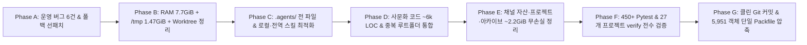

# `07_Youtube` Wave 2 전 폴더·전 파일 전수 감사 및 통합 최적화 계획

## Goal Description

1차 최적화(`Wave 1`: 코드 `-73,265 LOC`, 스토리지 `-13.9 GB`) 이후에도 남아 있는 **`07_Youtube` 하위 모든 개별 폴더·파일**과 연결된 시스템 영역(`/dev/shm/aab_scratch`, `/tmp`, `.git/`, `~/.gemini/config/{hooks.json,skills}`)을 100% 읽기 전용으로 전수 스캔·교차 검증했습니다.

이번 2차 계획(`Wave 2`)은 다음 4가지를 한 번에 완결합니다:
1. **`.agents/` 전 파일(`53개 / 1.10 MB`) 및 로컬·전역 스킬(`SKILL.md`) 슬림화·모순 제거** (`-72%` 감량, 깨진 플래그·`R88` 충돌·전역 중복 링크/훅 `0건`화)
2. **임시파일 전량 청소 및 누수 버그 원천 패치** (`RAM /dev/shm` **`7.70 GiB`** + `/tmp` 유튜브 임시물 **`1.47 GiB`** 즉시 회수 & 재발 차단)
3. **중복 폴더·중복 파일·사문화 코드 완전 통합** (루트 `reports/`, `.rgignore`, `workflows/`, 중복 `video_clean.mp4` `1.00 GiB`, 아카이브 중복 `124`그룹, 2차 죽은 코드 **`~5,000–7,500 LOC`** 정리)
4. **실시간 운영 버그·배선 공백 6건 선행 패치 & `.git/` FUSE 최적화** (`v8_ep14` `R88-A/R89` 자동 렌더 배선, `studio-watchdog --apply` 누락 수정, `5,951`개 비압축 Git 객체 단일 Packfile화)

---

## 정량 요약표 (Wave 2 폴더·영역별 실측치 → 목표치)

| 대상 영역 | 현재 실측 상태 | 핵심 정리 · 통합 내용 | 예상 절감 / 개선 효과 |
|---|---:|---|---|
| **RAM (`/dev/shm/aab_scratch`)** | **`7.70 GiB`** 상시 점유 | `speed_cache/`(`staged` `5.20G` + `segments` `2.12G` + `posthoc_cv` `378M`) + 고아 `aab_oflow_*.mp4` 27개 + `aab_sim_clip_*` 비우기 & 종료 시 자동 해제 | **`7.70 GiB` RAM 즉시 복구** (`Swap: 0B` 안정성 확보) |
| **`/tmp` (유튜브 임시물만 선별)** | **`~1.47 GiB`** | `pytest-of-canadaofbin`(`753M`), `ep09~13*` 59개(`442M`), 구 `3000_prompts_ro_cache.db`(`107M`), `rf_*` 237개, `fimg_*` 116개, `.lock` 209개, `playwright-artifacts-*` 269개 *(타 프로젝트 `/tmp` 파일 100% 보존)* | **`~1.47 GiB` 로컬 SSD 회수** + `rf_min_age=600s` 누수 수정 |
| **`.agents/` + 전역 Hook/Skills** | **`1.10 MB`** (`53`개 파일) | `.agents/research/` 15개 미참조(`763 KB`) 제거 + 런타임 JSON 1개 `pipeline/assets/` 이관, `production_constants.md` 원시 상수 덤프 제거(`-84%`), 6개 `SKILL.md`·25개 규칙 모순/오류 플래그 교정, 전역 중복 `Stop` 훅 및 `youtube-*` 심볼릭 링크 5종 제거 | **`.agents/` `-72%` (`~790 KB` 감량)** + 매 턴 2중 훅 스폰 차단 |
| **`BCI_Shorts_Channel/assets/`** | **`297.6 MiB`** (`72`개 파일) | 미참조 `_flow_clip_pool/`(`283.8M`), `voice_samples/`(`6.7M`), `base_clips/`(`3.8M`), 디버그 `flow_*.png` 4장(`2.1M`) 제거 *(잠금 `fonts/` + `expression_acting_lexicon.json` 보존)* | **`-296.5 MiB` (`-99.6%`) 회수** |
| **`BCI_Shorts_Channel/projects/` (`27`개)** | **`8.00 GB`** | [폴백 선패치 후] 11개 Public 바이트 동일 `video_clean.mp4`(`1,003.3M`), 원시 `flow_downloads`+`flow_screenshots`(`511.8M`), 백업/오타 폴더 4곳(`23.8M`), 빈 폴더 43개 + *(선택)* Public 24편 구 검수 이미지(`231.9M`) | **`1.50 GiB` (선택 시 `1.73 GiB`) 무손실 회수** (`27/27 verify INTACT`) |
| **`artifacts_archive/` · `reports/` · 도시에** | **`736 MiB`** 합계 | 아카이브 SHA-256 완전 중복 `124`그룹(`69.2M`) + `>2MB` 구 시안(`80.4M`), 4개 도시에 중복 `reference_images/`(`62.1M`) + 구 `diorama_v7_*`(`6.4M`), 루트 `reports/` 통합 + 10월 아카이브(`11.5M`), JSONL 고아 `1,355`행 정리 | **`~230 MiB` 회수** + 루트 폴더 단일화 & 인덱스 100% 정합 |
| **`pipeline/` · `scripts/` · `workflows/` · `tests/`** | `152,880 LOC` (`153`개 파일) | **운영 버그·배선 공백 6건 패치** + 죽은 `researcher.py`(`1,137L`), `StagingQueueManager`(`765L`), `episode_runner.py` 구 배치(`569L`), `workflows/` 중복 래퍼, 고아 `.pyc`(`355KB`), 0-참조 함수·중복 테스트 정리 | **버그 `0건`화** + **`~5,000–7,500 LOC` 추가 감축** |
| **`.git/` & 고아 Worktrees** | `64 MB` (`5,951` loose) + `22 MB` | 잠금 고아 워크트리 2개(`find_video_youtube`, `find_youtube_video`) 제거 + 클린 커밋 + `git gc` 단일 Packfile 압축 | **`~55–65 MB` 회수** + FUSE `git status/diff` 대폭 가속 |

---

## 교차 검증으로 사전 차단한 핵심 위험 · 발견된 운영 버그 (`Highlights`)

> [!IMPORTANT]
> **단순 삭제 시 크래시·데이터 유실을 일으킬 뻔한 지점과 숨은 런타임 버그를 사전에 모두 잡아냈습니다:**
> 1. **`v8_ep14_sleep_pupil_arousal/01_research_dossier/` 보호 확정**: 정본 도시에와 비교 결과 `r89_archival_video`, `r72_r_real_world_targets` 등 **`ep14` 전용 고유 키 12개**가 들어 있어 임시 폴더가 아닌 핵심 설계본임을 확인하고 100% 보호합니다.
> 2. **`v8_ep14` `R88-A` / `R89` 로컬 렌더러 미배선 발견**: `render_archival_insert_clips()`(`R88-A`)와 `render_archival_video_clips()`(`R89`)가 `episode_runner.py`에 연결되지 않아 `main.py ep run v8_ep14...` 실행 시 아카이벌 클립 렌더링이 건너뛰어지는 공백을 발견해 `Phase A`에서 자동 배선합니다.
> 3. **`video_clean.mp4`(`1.00 GiB`) 폴백 선행 필수**: `cli.py`(`ig-publish`, `tiktok-publish`)와 `scheduler.py`(`qa-scheduler`)가 `video_clean.mp4` 존재를 하드코딩 요구하므로, **`05_assembly/final_shorts_1080x1920.mp4` 자동 폴백 코드를 먼저 패치한 뒤** 11개 중복 복사본을 제거합니다.
> 4. **스킬/운영 스크립트 실제 실행 버그 4건 발견**:
>    - `youtube-produce/SKILL.md`: 존재하지 않는 `--slug` 인자를 `main.py ep run`에 적어 실행 즉시 에러 발생 → 교정.
>    - `run_daily_ops_headless.sh`: `main.py studio-watchdog`에 `--apply`가 빠져 매일 `dry-run`만 도는 버그 → 교정.
>    - `studio/scheduler.py:537`: `watchdog.py`가 쓰는 `studio_watchdog_latest.json` 대신 구형 `ceo_watchdog_latest.json`을 읽는 불일치 → 교정.
>    - `~/.gemini/config/hooks.json` + `.agents/hooks.json`: 매 턴 종료마다 동일한 `sync_archive.py --hook stop`이 **2번 중복 실행**되던 현상 → 전역 중복 훅 제거로 1회화.

---

## User Review Required & Open Questions

> [!WARNING]
> 아래 3가지 선택 사항만 확인해 주세요. 별도 변경 말씀 없이 **Proceed**를 눌러주시면 **(추천)** 옵션으로 `Phase A ~ Phase G`를 순차 실행합니다.

1. **기공개(`Public`) 완료된 24편 내부의 과거 중간 검수 이미지(`231.90 MiB`) 정리 여부**
   - **(추천) A (정리)**: 이미 YouTube 공개가 끝난 24편에 한해서만 구형 `frame_preview_A/B/C.png`(`98.3M`), `keyart_candidates/`(`46.1M`), `carousel_source_frames/`(`32.6M`), `voice_dry_mono.wav`(`32.2M`), `zero_plaque_contact_sheet.png`(`22.7M`)를 정리합니다. *(완성 MP4·썸네일 본본·JSON 리포트·영수증 및 미공개 `ep09_r82`·`ep13`·`ep14`는 100% 보존)*
   - B (보존): 위 `231.90 MiB` 검수 이미지는 그대로 둡니다 (`1.50 GiB` 확정분만 정리).
2. **Zero-Token 일일 자동 운영(`run_daily_ops_headless.sh`) OS `crontab` 실제 등록 여부**
   - **(추천) A (스크립트만 완벽 패치 후 수동 유지)**: `--apply` 버그만 고쳐두고 `crontab` 자동 등록은 하지 않음 (원하실 때 직접 등록).
   - B (즉시 등록): `07:00 UTC` 리포트 / `08:00 UTC` 스케줄러 / 매 30분 워치독을 서버 `crontab`에 바로 등록.
3. **`.agents/rules/_archive/` (`3개 파일, 170 KB`) 처리 방식**
   - **(추천) A (깨진 링크 12건만 수리 후 보존)**: `test_rules_mapping_and_token_budget.py`의 Zero-Deletion 아카이브 원칙을 그대로 유지(프론트매터가 없어 시스템 프롬프트 토큰 소모는 `0`).
   - B (완전 삭제): Git 태그에 이미 백업되어 있으므로 `_archive/` 폴더까지 완전 삭제 (`AGENTS.md` 및 패리티 테스트 동시 갱신).

---

## Proposed Changes (의존성 안전 보장 순서 `Phases A → G`)



---

### Phase A: 실시간 운영 버그 · 배선 공백 · 폴백 선행 패치 (삭제 전 안전망 구축)

#### [MODIFY] [scheduler.py](file:///home/canadaofbin/gdrive/Kyubin_Yun_Workspace/07_Youtube/pipeline/studio/scheduler.py) & [cli.py](file:///home/canadaofbin/gdrive/Kyubin_Yun_Workspace/07_Youtube/pipeline/cli.py) & [publish.py](file:///home/canadaofbin/gdrive/Kyubin_Yun_Workspace/07_Youtube/pipeline/publish.py) & [batch_runner.py](file:///home/canadaofbin/gdrive/Kyubin_Yun_Workspace/07_Youtube/pipeline/batch_runner.py)
- `scheduler.py:537`: `studio_watchdog_latest.json`을 우선 로드(구 `ceo_watchdog_latest.json` 폴백).
- `cli.py:1991,2055` (`ig-publish`, `tiktok-publish`) 및 `scheduler.py:648,1969,2019`: `multi_platform_bundle/video_clean.mp4`가 없을 때 `bundle_manifest.json`(`source_video_relpath`) 또는 `05_assembly/final_shorts_1080x1920.mp4`로 자동 폴백.
- `publish.py:1879` & `batch_runner.py:1775`: `export_multi_platform_bundle(..., copy_video=False)` 기본화로 향후 편당 `60~95 MB` 중복 MP4 생성 원천 차단.

#### [MODIFY] [episode_runner.py](file:///home/canadaofbin/gdrive/Kyubin_Yun_Workspace/07_Youtube/pipeline/episode_runner.py)
- `run_episode_until()`의 조립(Step 4) 직전에 `03_visuals/archival_inserts_manifest.json`(`R88-A`) 및 `03_visuals/archival_videos_manifest.json`(`R89`) 존재 시 `render_archival_insert_clips()` / `render_archival_video_clips()`를 자동 호출해 `v8_ep14` 등 아카이벌 컷이 단일 커맨드로 완주되게 배선.

#### [MODIFY] [run_daily_ops_headless.sh](file:///home/canadaofbin/gdrive/Kyubin_Yun_Workspace/07_Youtube/scripts/run_daily_ops_headless.sh)
- `watchdog` 및 `all` 모드의 `main.py studio-watchdog` 호출에 `--apply` 추가.

#### [MODIFY] [storage.py](file:///home/canadaofbin/gdrive/Kyubin_Yun_Workspace/07_Youtube/pipeline/storage.py), [flow_workspace.py](file:///home/canadaofbin/gdrive/Kyubin_Yun_Workspace/07_Youtube/pipeline/flow_workspace.py), [media_cache.py](file:///home/canadaofbin/gdrive/Kyubin_Yun_Workspace/07_Youtube/pipeline/media_cache.py), [sync_archive.py](file:///home/canadaofbin/gdrive/Kyubin_Yun_Workspace/07_Youtube/scripts/sync_archive.py), [hooks.json](file:///home/canadaofbin/.gemini/config/hooks.json)
- `storage.py`: 빈 `01_ideation/` 자동 생성을 지연 생성(`lazy mkdir`)으로 바꾸고, `sync_existing_manifest_from_disk()`에서 `flow_downloads/`, `flow_screenshots/`, `_tmp_*`, `*_backup/` 제외.
- `flow_workspace.py:652`: 활성 탭 리스가 없을 때 `rf_min_age=0.0` 즉시 청소 및 `/dev/shm/aab_scratch/{aab_oflow_*,aab_sim_clip_*}` 청소 포함.
- `media_cache.py`: 어셈블리/QA 세션 종료 후 불필요한 `speed_cache/{staged,segments}` 정리 헬퍼 추가.
- `sync_archive.py:594`: 해시별 `/tmp/aab_artifacts_archive_<hash>.lock` 증식을 막고 단일 락 파일 사용.
- `~/.gemini/config/hooks.json`: 로컬 `.agents/hooks.json`과 중복 실행되는 `youtube-artifact-auto-archive` 항목 제거 (`herdr` 훅은 그대로 보존).

---

### Phase B: 시스템 RAM (`/dev/shm`), `/tmp`, 고아 Git Worktree 즉시 회수 (`~9.19 GiB`)

1. **`/dev/shm/aab_scratch/` 비우기 (`+7.70 GiB` RAM 복구)**: `speed_cache/*`, `aab_oflow_*.mp4` 27개, `aab_sim_clip_*` 2개 일괄 제거.
2. **`/tmp` 내 `07_Youtube` 전용 임시물만 정밀 삭제 (`+1.47 GiB` 회수)**:
   - `pytest-of-canadaofbin`, `ep09*`~`ep13*` 59개, `aab_3000_prompts_ro_cache.*`, `r89_ep14_probe`, `r87_hook_audit`, `rf_*` 237개, `31_O2CmlKOk_orig.*`, `fimg_*` 116개, `dq8_audit`, `canon_zoom`, `aab_verify`, `v1_1_zoom`, `ep31_genuine_anchors`, `banner_bench`, `aab_real_refs`, `flow_cand_win_1_3.png`, `test_c10_zoompan.mp4`, `aab_artifacts_archive_*.lock` 209개, `playwright-artifacts-*` 269개 제거 *(타 프로젝트 `pyheif`, `ish_upload_pdfs`, `shining_dust_*`, `user_screenshot_*` 등 절대 보호)*.
3. **잠금 고아 Git Worktree 2종 정리 (`+22 MB`)**:
   - `git worktree unlock` → `git worktree remove` / `git worktree prune`으로 `find_video_youtube`·`find_youtube_video` 및 고아 로컬 브랜치 정리.

---

### Phase C: `.agents/` 전체 파일(`53개`) + 로컬/전역 `SKILL.md` + `docs/` 정합화 (`-72%` 감량)

#### 1. `.agents/research/` (`16개 파일, 805.3 KB`) 완전 정리
- **[MOVE]** `r85_verified_data_and_reference_audit.json` (`42.4 KB`) → `pipeline/assets/r85_verified_data_and_reference_audit.json` (`pipeline/real_world_refs.py:1814` 경로 갱신).
- **[DELETE]** 코드/테스트/규칙 참조 `0건`인 과거 1회성 리서치 덤프 15개 파일(`762.8 KB`) 및 `.agents/research/` 디렉터리 삭제.

#### 2. 로컬 `.agents/skills/` (`6종`) 슬림화·오류 교정 & 전역 중복 심볼릭 링크 제거
- **[DELETE]** `/home/canadaofbin/.gemini/config/skills/youtube-{produce,report,research,script,studio}` 전역 중복 심볼릭 링크 5개 삭제 (`07_Youtube` 밖 타 워크스페이스 프롬프트 오염 차단, `07_Youtube` 안에서는 `.agents/skills/`가 네이티브로 자동 로드됨).
- **[DELETE]** `.agents/skills/youtube-script/references/legacy_v7.md` (`2.4 KB`, `test_rules_mapping_and_token_budget.py` 내 해당 체크 동시 갱신).
- **[MODIFY] 6개 `SKILL.md` 현행화 및 중복 설명 압축**:
  - [youtube-script/SKILL.md](file:///home/canadaofbin/gdrive/Kyubin_Yun_Workspace/07_Youtube/.agents/skills/youtube-script/SKILL.md): 구형 `2D ink step-snap` 만화 얼굴 문구 → **`R88` 무안면 도자기(`r88_faceless_porcelain`) + 손 클로즈업/실루엣**으로 전면 교체; 퇴역 문법(`brain_simulator_3d`, `expressive_cameo_world`) 제거; `84`개 활성 슬롯(`B01–B15` 퇴역) 및 `R88-A`/`R89` 반영 (`4-Stage Emotional Curve`, `1 Core Fact per 15s`, `<= 6,500 B` 패리티 유지).
  - [youtube-produce/SKILL.md](file:///home/canadaofbin/gdrive/Kyubin_Yun_Workspace/07_Youtube/.agents/skills/youtube-produce/SKILL.md): 에러를 내던 `ep run --slug <slug>` 잘못된 플래그 제거; 삭제된 `reenact-produce`/`diorama-batch`/퇴역 `DQ1·DQ12`/미정의 `P_R87` 제거 및 규칙 중복 문단 압축.
  - [qa-scheduler/SKILL.md](file:///home/canadaofbin/gdrive/Kyubin_Yun_Workspace/07_Youtube/.agents/skills/qa-scheduler/SKILL.md): `102pt` → `82pt` ASS 정정; 기공개 완료된 `ep10~12` Hold 문구 및 퇴역 7-방 `[CEO_VERIFY_PASS]` `send_message` 문단 제거 → `Fresh-Room` 로컬 검증 영수증 체계로 일치.
  - [youtube-research/SKILL.md](file:///home/canadaofbin/gdrive/Kyubin_Yun_Workspace/07_Youtube/.agents/skills/youtube-research/SKILL.md): 죽은 `researcher.py` 링크 및 삭제된 CLI(`main.py research`, `main.py reenact-extract`) 제거.
  - [youtube-studio/SKILL.md](file:///home/canadaofbin/gdrive/Kyubin_Yun_Workspace/07_Youtube/.agents/skills/youtube-studio/SKILL.md): 삭제된 `main.py studio-queue` 제거.
  - [youtube-report/SKILL.md](file:///home/canadaofbin/gdrive/Kyubin_Yun_Workspace/07_Youtube/.agents/skills/youtube-report/SKILL.md): `main.py studio-report` 표기 통일 및 `Fresh-Room` 아카이브 경로 반영.

#### 3. `.agents/rules/` (`25개`) & `docs/` 정밀 정합화
- **[MODIFY] [production_constants.md](file:///home/canadaofbin/gdrive/Kyubin_Yun_Workspace/07_Youtube/.agents/rules/production_constants.md)** (`15.8 KB → ~2.5 KB`, `-84%`): 하단 452개 구형 심볼 원시 나열 블록을 제거하고 핵심 잠금 표 + `pipeline/config_{paths,flow,qa,v8}.py` 도메인 인덱스만 유지.
- **[MODIFY] 규칙 내 `R88` 모순·죽은 CLI·미정의 심볼 일괄 교정**:
  - `diorama_assembly_subtitles_rules.md` & `arrows_callouts_motion_rules.md`: `2D black ink` 설명을 `Ep #01–#12` 동결본 한정으로 명시하고 `Ep #13+` `R88` 무안면 기준 병기, 미정의 `DQ_R79` 제거.
  - `knowledge_hub_asset_manifest_rules.md`(`main.py asset-manifest` 죽은 CLI 제거), `project_storage_rules.md`(`PipelineOrchestrator.resume_project` → `main.py ep run` 교체), `cast_depiction_rules.md`(`R88_HUMAN_IDENTITY_LOCK_SUFFIX` → 실존 상수명 정정), `scene_depiction_rules.md`, `research_dossier_v2_rules.md`, `reference_depiction_rules.md`(`main.py refs`), `qa_gates_rules.md` 현행 CLI 이름으로 통일.
  - `_archive/retired_rules_2026-11-18.md` 내 삭제된 파일로의 깨진 `file:///` 링크 12건 수리 *(Open Question #3 옵션 B 선택 시 `_archive/` 폴더 삭제)*.
- **[MODIFY] [ALL_ABOUT_BRAIN_MASTER_PIPELINE.md](file:///home/canadaofbin/gdrive/Kyubin_Yun_Workspace/07_Youtube/docs/ALL_ABOUT_BRAIN_MASTER_PIPELINE.md)**: §3 삭제된 `research`/`studio-queue` 갱신 및 §4.3 `R89 Video credit:` 요약 보강.

---

### Phase D: 2차 사문화 코드 제거 & 루트 중복 폴더/설정 단일화 (`~5,000–7,500 LOC` 추가 감축)

1. **사문화 파이프라인 모듈·대형 클래스·전이 사문화 코드 제거**:
   - **[DELETE]** [pipeline/researcher.py](file:///home/canadaofbin/gdrive/Kyubin_Yun_Workspace/07_Youtube/pipeline/researcher.py) (`1,137 LOC`, 프로덕션 참조 `0건`) + [pipeline/pillars.py](file:///home/canadaofbin/gdrive/Kyubin_Yun_Workspace/07_Youtube/pipeline/pillars.py) 경량화(7대 필러 정의만 유지).
   - **[MODIFY]** [pipeline/studio/queue_manager.py](file:///home/canadaofbin/gdrive/Kyubin_Yun_Workspace/07_Youtube/pipeline/studio/queue_manager.py): 미사용 `StagingQueueManager`(`765 LOC`) 제거 (`reporter_scrape.py`가 쓰는 `is_live_youtube_receipt`·`passes_v5_publish_gate` 74줄만 보존).
   - **[MODIFY]** [pipeline/episode_runner.py](file:///home/canadaofbin/gdrive/Kyubin_Yun_Workspace/07_Youtube/pipeline/episode_runner.py) (`926 → ~330 LOC`): 죽은 2-홉 배치 파이프라인(`run_diorama_pipeline`, `parse_pipeline_specs`, `_assembly_worker_entry`, `render_project_brain_simulator_clips_parallel` 등 `569 LOC`) 제거하고 순수 `Fresh-Room` 상태머신(`get_episode_status`, `run_episode_until`)만 유지.
   - **[MODIFY]** [pipeline/batch_runner.py](file:///home/canadaofbin/gdrive/Kyubin_Yun_Workspace/07_Youtube/pipeline/batch_runner.py): 죽은 `run_diorama_batch`, `DIORAMA_DAILY_30_SPECS`, `select_batch_specs`, `sim_needed` Blender 분기 제거.
   - **[MODIFY]** 기타 100% 검증된 `0`-참조 죽은 함수(`probe_flow_ui_capabilities`, `generate_landmark_drone_cutaway_demo_async`, `measure_harmonized_clip_f0_hz`, `refine_clip_via_flow_conversational_edit`, `upload_multi_ingredients_v83`, `sync_archive.py` 내 구 `PostToolUse`/`chatrooms.json`/`ensure_global_hooks_json` 코드, 테스트 전용 상수 `26`개) 정리 *(단, `config_*.py` 자기참조 상수 및 `archival_insert/video.py` 활성 헬퍼는 100% 보존)*.
2. **루트 중복 파일·폴더 완전 통합**:
   - **[DELETE] `workflows/produce_episode.py` (`workflows/` 폴더)**: `main.py ep`와 100% 중복 래퍼 제거 (`ALL_ABOUT_BRAIN_MASTER_PIPELINE.md`, `workspace_hygiene.py`, `test_hardware_ramdisk_and_guards.py` 동시 갱신).
   - **[DELETE] 루트 `reports/` 폴더**: 영수증 2개는 이미 `BCI_Shorts_Channel/reports/`에 동일하게 존재하므로 `uploader.py:1835` 이중 쓰기 제거 및 `test_studio_seed_hygiene_and_playlist_ban.py:120,127` 경로 갱신 후 루트 `reports/` 삭제.
   - **[DELETE] `.rgignore`**: 100% 동일한 `.ignore` 하나로 통합 (`ripgrep`은 `.ignore`를 기본 인식; `.gitignore` 최신화 및 `test_artifacts_archive_sync.py:118`, `workspace_hygiene.py` 동기화).
   - **[DELETE] `pipeline/__pycache__/`**: 삭제된 구 모듈 고아 `.pyc`(`355 KB`) 전량 제거.
   - **[MODIFY] `tests/`**: 미추적 픽스처 `tests/fixtures/gage_v65_golden/` 정식 관리 및 v1/v2 중복 테스트 쌍(`test_multi_platform_bundle[_v2]`, `test_qa_scheduler[_v2]`, `test_canonical_assets_v1_{1,2}`, `test_omni12_*`) 깔끔히 병합.

---

### Phase E: `BCI_Shorts_Channel/` & `artifacts_archive/` 무손실 정리·중복 통합 (`~2.06–2.29 GiB`)

1. **`BCI_Shorts_Channel/assets/` 미참조 더미 정리 (`-296.5 MiB`)**:
   - `_flow_clip_pool/`(`283.8M`), `voice_samples/`(`6.7M`), `base_clips/`(`3.8M`, 테스트/스크레이퍼의 상수 참조만 안전하게 정리 후), UI 디버그 스크린샷 `flow_*.png` 4장(`2.1M`) 삭제 (`rclone purge/delete` 사용).
2. **`BCI_Shorts_Channel/projects/` (`27`개 보호 프로젝트) 무손실 슬림화 (`-1.50 ~ 1.73 GiB`)**:
   - 11개 Public 프로젝트의 바이트 100% 동일 복사본 `06_publish/multi_platform_bundle/video_clean.mp4` 삭제 (`-1,003.3 MiB`, 미공개 `ep09_r82` 보존; 삭제 전 IG/TikTok 폴백 `--dry-run` 검증).
   - `ep09_r82`·`ep13`·`pilot_03`의 원시 브라우저 다운로드 `03_visuals/flow_downloads` & `flow_screenshots` 삭제 (`-511.8 MiB`, 정본 `flow_native_clips/` 100% 보존).
   - 임시/백업/중첩 오타 폴더 4곳(`reenact_01/.../_tmp_hires_audit`, `reenact_01/03_visuals/03_visuals`, `v8_pilot_03/.../flow_native_clips_v1_brain_backup`, `v8_pilot_03/.../_v3_attempt_backup` — `-23.8 MiB`) 및 빈 스테이지 폴더 43개 삭제 *(활성 `v8_ep14/01_research_dossier/`는 절대 보호!)*.
   - *(Open Question #1 옵션 A 시)* 기공개 Public 24편 한정 구 검수 이미지(`frame_preview_A/B/C.png`, `keyart_candidates/`, `carousel_source_frames/`, `voice_dry_mono.wav`, `zero_plaque_contact_sheet.png` — `-231.9 MiB`) 삭제.
   - 직후 `27`개 전 프로젝트 매니페스트 동기화(`sync_existing_manifest_from_disk`) 실행.
3. **도시에·리포트·JSONL 인덱스·아카이브 중복 통합 (`~230 MiB`)**:
   - `research_dossiers/`: 4개 도시에 내부 중복 `reference_images/`(`-62.1 MiB`) + 미참조 구형 초안 `diorama_v7_*` 19개(`-6.4 MiB`) 삭제; `BCI_Shorts_Channel/research/{_archive_scripts,news}` 빈/구형 폴더 정리.
   - 고아 인덱스 재구축: `asset_library/index.jsonl` 삭제 프로젝트 고아 `638`행 제거, `main.py kb sync --full-rescan`으로 `clip_clarity_ledger.jsonl`·`episodes_index.jsonl` 재동기화, `short_link_graph.json` 내 삭제된 2개 프로젝트 엣지/결과 정리.
   - `BCI_Shorts_Channel/reports/`: 미참조 구 파일(`ceo_watchdog_latest.json`, `prompt_v5_score_sheet.*`, `diorama_batch_20_*` 등) 및 `archive/2026-10/`(`-11.0 MiB`) 정리 (`golden_slate_30_master.*` 보존).
   - `artifacts_archive/`: SHA-256 완전 중복 파일 `124`그룹 중복본(`-69.2 MiB`) + `>2 MiB` 구 시안 24개(`-80.4 MiB`) + 구 스냅샷 인덱스 삭제 후 `sync_archive.py`로 `INDEX.md` 깔끔히 재생성.

---

### Phase F & G: 전수 검증 게이트 통과 → 클린 Git 커밋 & Packfile 최적화

#### Automated Tests (`Phase F`)
```bash
# 1. 전체 단위·통합·슬로우 테스트 스위트
PYTHONDONTWRITEBYTECODE=1 /home/canadaofbin/hermes-venv/bin/python -B -X utf8 -m pytest
PYTHONDONTWRITEBYTECODE=1 /home/canadaofbin/hermes-venv/bin/python -B -X utf8 -m pytest -m "integration or slow"

# 2. 워크스페이스 위생, 바이블, 브랜드 자산, 토픽 슬레이트 패리티 검증
PYTHONDONTWRITEBYTECODE=1 /home/canadaofbin/hermes-venv/bin/python -B -X utf8 scripts/workspace_hygiene.py --check
PYTHONDONTWRITEBYTECODE=1 /home/canadaofbin/hermes-venv/bin/python -B -X utf8 scripts/verify_assets_bible.py --check
PYTHONDONTWRITEBYTECODE=1 /home/canadaofbin/hermes-venv/bin/python -B -X utf8 scripts/verify_brand_assets.py --check
PYTHONDONTWRITEBYTECODE=1 /home/canadaofbin/hermes-venv/bin/python -B -X utf8 scripts/verify_topic_slate.py --check

# 3. 27개 보호 프로젝트 전체 main.py verify 100% INTACT 및 IG/TikTok 폴백 dry-run 검증
PYTHONDONTWRITEBYTECODE=1 /home/canadaofbin/hermes-venv/bin/python -B -X utf8 main.py ep status v8_ep13_snack_reward_rewiring
PYTHONDONTWRITEBYTECODE=1 /home/canadaofbin/hermes-venv/bin/python -B -X utf8 main.py ep status v8_ep14_sleep_pupil_arousal
PYTHONDONTWRITEBYTECODE=1 /home/canadaofbin/hermes-venv/bin/python -B -X utf8 main.py ig-publish --project v8_ep12_doorway_effect_memory --dry-run
PYTHONDONTWRITEBYTECODE=1 /home/canadaofbin/hermes-venv/bin/python -B -X utf8 main.py tiktok-publish --project v8_ep12_doorway_effect_memory --dry-run
```

#### Git Packfile 최적화 (`Phase G`)
- 전 항목 `PASS` 확인 후 로컬 클린 커밋 생성(외부 리모트 push 없음) 및 `git gc` 실행 → `.git/objects/`의 `5,951`개 비압축 loose object(`62.8 MiB`)를 단일 packfile로 압축해 FUSE 메타데이터 병목을 제거합니다.

#### Manual Verification
- 완료 후 업데이트된 `walkthrough.md`에서 루트/`pipeline`/`.agents`/`BCI_Shorts_Channel`/`/dev/shm`/`/tmp` 최종 파일 트리와 회수 용량을 확인합니다.
