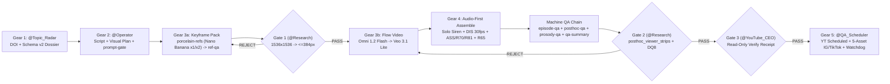

# ALL ABOUT BRAIN — Master Production & Governance Pipeline Blueprint

> [!NOTE]
> **Human + AI Master Operating Manual**: Governs `@AllAboutBrainOfficial` (`UC4FeioYYv9X04Di07_MfZ7g`) under workspace root `/home/canadaofbin/gdrive/Kyubin_Yun_Workspace/07_Youtube` (`fuse.rclone`). Live numeric constants reside in [`pipeline/config.py`](file:///home/canadaofbin/gdrive/Kyubin_Yun_Workspace/07_Youtube/pipeline/config.py); routing & rule pointers live in [`AGENTS.md`](file:///home/canadaofbin/gdrive/Kyubin_Yun_Workspace/07_Youtube/.agents/AGENTS.md); locked visual/audio/KB assets live in [`LOCKED_ASSETS_AND_REFERENCES_BIBLE.md`](file:///home/canadaofbin/gdrive/Kyubin_Yun_Workspace/07_Youtube/docs/LOCKED_ASSETS_AND_REFERENCES_BIBLE.md).

---

## §1. Channel Identity, 4 Core DNA Pillars & "Mute & Hide Name Test"

- **Channel Coordinates**: `ALL ABOUT BRAIN` (`@AllAboutBrainOfficial`), US English (`en-US`), Category `Education` (`Academic system = United States`), KR Tax/AdSense residence.
- **`Ep #31` Brand Identity Pack (`BCI_Shorts_Channel/brand_assets/v2_ep31_rebrand/`)**: Locked `800×800` circular-safe channel avatars (`logo_A_ep31_gypsum_cyan.png` #1, `logo_B_mode1_xray_skull.png`, `logo_C_split_cyan_crimson.png`) + `2560×1440` banner (`banner_youtube_2560x1440.png`, text locked inside `[507..2053, 508..931]` universal safe zone), generated & parity-verified via [`build_brand_identity_pack.py`](file:///home/canadaofbin/gdrive/Kyubin_Yun_Workspace/07_Youtube/scripts/build_brand_identity_pack.py).
- **Active Shorts Format (`expressive_25d_v8`)**: `1080×1920 @ 30fps`, **`61.5–88.0s`** (`SHORTS_EXPRESSIVE_V8_R75_MAX_SEC = 88.0s`), `18–28` unique `1:1` clips (`R82`), Solo `Siren` (`elevenlabs_v4`), **`100%` Google Flow native (`0` external paid video/image APIs)**. *(Legacy `porcelain_cinematic_v7` `24fps ~90s` & `16:9` longform deferred until Shorts KPIs scale.)*

### 1.1 The 4 Core DNA Pillars (Immutable Channel Identities)
1. **Case-Anchored Science (`R1`, `3-Layer Formula`)**: Every episode maps **1 everyday viewer domain** (`sleep`, `habits`, `memory`, `anxiety`, `relationships`) to **1 verified Behavioral Psychology DOI** and **1 `>= 2015` Neural Mechanism DOI**, preserving exact paper statistics and species fidelity (`mice`/`rats` never mislabeled as human patients).
2. **`R88` Faceless Architectural Porcelain Diorama (`R56`, `R68`, `R79-M`, `R85`, `R87-A`, `R88`)**: Clothed smooth featureless matte-white (`#F5F2EB`) architectural porcelain figures in tailored 3D woven attire — **zero eyes, zero mouth, zero eyebrows, zero 2D cartoon ink face, zero hair, zero photorealistic skin** (`R88_FACELESS_CAST_PROFILE = "r88_faceless_porcelain"`), framed via hands-only close-ups, back/three-quarter silhouettes, or translucent Mode 1 x-ray cranium (`B01–B15` cartoon-face slots permanently retired on `v8_ep13+`; `Ep #01–#12` frozen under `PRE_R88_FROZEN_V8_PROJECTS`). Paired with **Conditional Contrast (`R87-A`)** — tactile `Category K` prop comparisons + `K06/A12` dual-brain contrasts on non-spatial topics, or prop-anchored `#FF2525` `R80` 3D arrows ONLY when `spatial_arrow_eligible=True`.
3. **Ep #31 6-Scale Flow Brain (`R85`, `0%` Blender Screen Render)**: `100%` Google Flow native neuroanatomy conditioned on the `4` genuine `31_O2CmlKOk` originals across `6` shot scales (`xray_head_dive`, `split_cutaway`, `sulcal_cyan_dive`, `vessel_csf_macro`, `1p_tract_canyon`, `3p_shutdown_or_top_bottom`) — cool matte gypsum (`#9CA5AC–#C3C9CE` / `#DCDFE3–#ECEFF2`) + thick opaque `#27D8FF` sulcal vessels over flat `#040711` navy void, strictly `0%` neon glow/sparks/VFX.
4. **Audio-First Dual-Speed Pacing (`R58`, `R76`, `R82`)**: ElevenLabs `v4` Solo `Siren` (`-14.0 LUFS`) drives the master clock; crisp `1.90–4.25s` 2-beat human cuts (`Cut #1` `1.90–2.60s`) contrast against poised `4.20–6.80s` anti-spin brain cuts (`42–58%` episode share), anchored by a genuine `S01–S04` `120ft` real institution aerial drone shot (`D01–D02`).

### 1.2 The "Mute & Hide Name Test" & Semantic ID 5-Guard
- **"Mute & Hide Name Test"**: Play any episode with **sound muted** and **channel name hidden**:
  1. Can a viewer identify within **`0.5s`** that it is `ALL ABOUT BRAIN` (`R88` faceless architectural porcelain cast + `Ep #31` brain + `#FFE14A`/`#FFE600` condensed typography + `PatrickHand` overlays)?
  2. Can a muted mobile scroller understand the hook (`Cut #1` + `118pt HookTitle`), every core quantitative takeaway (`<= 2` `1×1` `study` Data Stamps), and the causal payoff purely visually? If *"No"*, Gate 1/2 rejects the cut.
- **Semantic ID 5-Guard (Anti-Cannibalization & YouTube `2025-07` `Inauthentic Content` Defense)**:
  1. **Ingredients-Only Canonical Anchors (`84` Active / `15` Retired `R88` = `99` SHA-256 Locked)**: Use the `84` active selectable Canonical slots (`27 v1 + 43 v1.1 + 14 v1.2`; `J04` deferred) ONLY as `Nano Banana 2.1` style/world/brain conditioning inputs (`0%` raw static frame re-broadcast; `15` cartoon-face slots `B01–B15` kept on disk via Zero-Deletion and banned on `v8_ep13+`, with `B01–B04` turnaround sheets also banned as direct `Start` frames on historical `Ep #01–#12`).
  2. **3 Mandatory Per-Episode Visual Deltas**: Every episode MUST inject unique (a) `R72-R` open-license institution/landmark (`120ft` drone), (b) study-specific vivid foreground prop(s), and (c) empirical `R70-M` DOI chart numbers.
  3. **Hook & Opening Rotation**: Never repeat the same `J01–J06` hook slot or `R87_OPENING_MODES` across consecutive episodes.
  4. **Intra-Episode Story Lighting Arc**: Shift tonal mood across Acts (`Act 1` crisp daylight → `Act 2` shadowed moody interior → `Act 3` `#040711` brain void → `Act 5–6` crisp golden rim) rather than flat uniform lighting.
  5. **Transparent Single-DOI Provenance (`R4` + `R68-D`)**: Studio AI disclosure (`ai_content_declaration=True`) + plain 2-paragraph story + `Research: <Author> et al., <Institution> (<Year>).`

---

## §2. 7-Chatroom `R83 v2` Domain VP Governance

All work operates strictly across **7 Web-UI Chatrooms** (`0` `agy -p` headless workers; dispatch only via `send_message` resolved by [`chatroom_mention.py`](file:///home/canadaofbin/gdrive/Kyubin_Yun_Workspace/07_Youtube/scripts/chatroom_mention.py)). SSOT: [`governance_roles.md`](file:///home/canadaofbin/gdrive/Kyubin_Yun_Workspace/07_Youtube/.agents/rules/governance_roles.md) & [`chatrooms.json`](file:///home/canadaofbin/gdrive/Kyubin_Yun_Workspace/07_Youtube/.agents/chatrooms.json).

| Chatroom | `conversation_id` | VP Scope & Subagent Tier (`R83-8`) | Hard Prohibitions (`Never`) |
|---|---|---|---|
| **`@YouTube_CEO`** | `b57c97a8-6324-4c31-a2bb-16b25e28dd55` | Group CEO: user intent, plans, approve/reject + **read-only** Gate 3 verify (`0` subagents) | Edit code/assets, render/upload, sign Gate 1/2 cuts, spawn subagents |
| **`@Operator`** | `1f9808d4-ebac-4b58-a570-45c8f1f00a85` | Eng & Prod VP: `pipeline/*.py`, Gears 2–4, Flow rendering, assembly, root MP4 (`inherit` only) | One-off episode hacks, parallel CDP writes, touch `Public` videos, `flash`/`flash_lite` |
| **`@Research`** | `ffbdfca1-9c07-48b3-9b1e-3e3045d67c0c` | Quality & Vision VP: Gate 1/2 VLM sign-off, Canonical screening, Lock 4/5 (`12–15` img `inherit` shards max `3`) | `flash`/`flash_lite`, code edits, Flow renders, Studio |
| **`@Deep_Research`** | `8c666be9-5bad-43d9-b91a-e7ba2b936c62` | Deep Research VP: external teardowns, algorithm/policy/prompt synthesis (`inherit` only) | `flash`/`flash_lite`, code edits, Flow renders, Studio, Gate 1/2 cut sign-off |
| **`@Daily_Report`** | `e3210c73-cc41-4432-87b1-c158efe9cadb` | Analytics VP: `07:00 UTC` read-only Studio KPI + `[RETENTION_REGRESSION_ALERT]` (VP serial; `inherit` only) | Any Studio mutation, `flash`/`flash_lite` |
| **`@QA_Scheduler`** | `ef8185bb-5afd-4859-b697-2fe07f1ecf1c` | Dist VP: `08:00 UTC` `HOLD/THROTTLE/GO` + Gear 5 upload & 5-Asset plan (VP serial; `inherit` only) | Upload without CEO verify receipt, parallel browser uploads, `flash`/`flash_lite` |
| **`@Topic_Radar`** | `0ffee83a-d9de-4520-a177-7d3b57dc01dc` | Discovery VP: Mon `09:30 UTC` DOI + Schema v2 dossier queue (`inherit` only) | Unverified/composite claims, renders, publishing, `flash`/`flash_lite` |

### `R83-5..8` Operational Protocol
- **`R83-5` (CEO Read-Only)**: CEO reads code/logs, re-runs `pytest`, inspects `/tmp` frames, replays QA, checks DOIs (writes only CEO governance docs when explicitly requested by user).
- **`R83-6` (Verify-Before-Relay)**: CEO independently verifies every `[*_DONE]` receipt (`PASS`/`REJECT` + evidence) before reporting upstream.
- **`R83-7` (`Delta Receipt <= 400 tok`)**: Concise structured handoffs (`STATUS`, `TARGET`, `CHANGED_FILES`, `VERIFY_CMD`, `ARTIFACT_PATH`, `subagents: <spawned>/<killed> (active=0)`; raw logs stay on disk; missing evidence triggers auto-`REJECT`).
- **`R83-8` (`G1–G5` & `R83-8-V`)**:
  - `G1`: Max **`1`** CDP `9222` browser worker at a time (serial tab lease via `cdp_tab_manager.py`).
  - `G2`: **`100%` `Model="inherit"` ONLY** across all 6 VP rooms (user selects each room's model directly; `flash`/`flash_lite`/`pro` overrides permanently retired).
  - `G3`: Disjoint file writes on `fuse.rclone` (zero overlapping edits).
  - `G4`: Strictly ephemeral subagents (`0` daemon/cron, **`0` `manage_subagents(list)` polling loops** — wait for reactive wakeup; **mandatory `manage_subagents(kill)`** immediately upon `R83-8-V` verify, confirmed `active=0` in `Delta Receipt`).
  - `G5`: Concurrency cap **max `2` concurrent `inherit` subagents per VP** (`@Research` read-only vision shards max `3`) to eliminate `429 RESOURCE_EXHAUSTED` quota spikes.
  - `R83-8-V`: VP verifies its own subagent outputs directly before upstream relay.

---

## §3. 5-Gear End-to-End Pipeline & CLI Map (`Gears 1–5`)

| Gear | Owner | Key Commands (`python -X utf8 main.py <cmd>` / Utility Scripts) | Primary Outputs |
|---|---|---|---|
| **1 Research** | `@Topic_Radar` | `news-radar`, `research`, `dossier init\|yt-search\|yt-analyze\|audit-media --write\|validate --require-v2\|seed` | `research_dossiers/<slug>/{01..08,dossier.json}` |
| **2 Script+Plan** | `@Operator` | `prompt-gate --dir <d>`, `chart-preview --project <id>`, `audit-prompts` | `{script.json, visual_plan.json, metadata.json, flow_all_in_one_prompts.json}` |
| **3 Flow Assets** | `@Operator` | `porcelain-refs --project <id> --slug <slug>`, `ref-qa --project <id>`, `diorama-flow --project <id> --engine auto` | `03_visuals/{reference_images, flow_native_clips}/`, `reference_provenance.json` |
| **4 Assembly+QA** | `@Operator` | `diorama-assemble --project <id> --posthoc-qa`, `verify`, `autopsy`, `episode-qa`, `posthoc-qa`, `prosody-qa`, `thumbnail`, `qa-summary --project <id> --summary` *(Phase-3 spec)*, `kb sync --project <id>` | `05_assembly/final_shorts_1080x1920.mp4`, root `final_shorts_<id>.mp4`, `thumbnail_selected.png` |
| **VLM, Brand & Bible Tools** | `@Research` / `@Operator` | `scripts/render_vlm_triage_sheets.py`, `scripts/build_locked_assets_bible.py [--check]`, `scripts/build_brand_identity_pack.py [--check]` | `1536×1536` triage sheets, `<=384×384` crops, Golden Style Sheet & Bible parity, `v2_ep31_rebrand/` logos & banner |
| **5 Studio & Dist** | `@QA_Scheduler` / `@Daily_Report` | `multi-bundle`, `studio-upload`, `studio-queue`, `studio-link`, `studio-pin`, `studio-quiz`, `studio-settings`, `studio-watchdog`, `studio-inbox`, `studio-report`, `qa-scheduler`, `ig-publish`, `tiktok-publish` | `06_publish/{upload_receipt.json, multi_platform_bundle/}`, `reports/daily/` |

---

## §4. Gear 2 Script & Hook Engineering

### 4.1 4-Stage Emotional Curve (`expressive_25d_v8`)
1. **Stage 1 — Immediate Intuition Shock (`0.0–3.5s`, `Act 1` `S01`)**: Shatter an everyday assumption on frame 0 (`Cut #1` + `118pt HookTitle` + `S01` declarative paradox/action).
2. **Stage 2 — Friction & Myth Breakdown (`Acts 1–2`, `S02–S08`)**: Ground the hook in the real institution (`S02–S04` `120ft` drone credibility bridge), demonstrate the experimental setup, and show why common intuition fails.
3. **Stage 3 — Counterintuitive Brain Mechanism (`Acts 3–4`, `S09–S16`)**: Present the matched control comparison (`R87-A` `Category K` or prop-anchored `R80`) + `<= 2` empirical `1×1` `study` Data Stamps + `Ep #31` 6-scale neuroanatomy reveal (`55–88%` reveal window alongside `t=0.0s` Mode 1/2 hook).
4. **Stage 4 — 1-Line Everyday Mirror Close (`Acts 5–6`, `S17–S22`)**: Anchor the takeaway in viewer daily life (`ending_mode: "mic_drop"` self-contained punchline with zero closing `?`, or `"seamless_loop"`).

### 4.2 `R87-H` 3-Second Hook Contract (`Ep #13+`)
- **`S01` Spoken Contract (`R87-H2`)**:
  - Default `opening_mode = "immediate_brain_shock"` (allowed `R87_OPENING_MODES`: `immediate_brain_shock`, `bizarre_experiment`, `paradox_action`).
  - **`6–12` words** (`R87_S01_MIN_WORDS..MAX_WORDS`), **`<= 3.50s`** spoken end (`P_R87_s01_duration`; warning `> 3.10s`).
  - **Hard-Banned on `S01`**: `"Why do "`, `"Why does "`, `"Why did "`, `"How come "`, `"Have you ever"`, `"Did you know"`, `"Do you ever"`, `"Ever wondered"`, `"Imagine "`, `"What if you "`, `"Picture this"`, AND trailing `"?"`.
- **`Cut #1` Visual Contract (`R87-H1`)**:
  - `hook_visual_mode ∈ {"mode1_daily_xray_shock", "mode2_instant_brain_shock", "bizarre_prop_interrupt"}`.
  - Duration **`1.90–2.60s`** (`R87_FIRST_CUT_MIN_SEC..MAX_SEC`), `Cut #1` static domestic sitting (`sitting on bed`, `rubs temples`, `pours tea`, `stares at frames`, `seated calmly`) is **Tier-1 BANNED**.
  - Must bind a Lock 3 canonical anchor (`J01–J06` or `A01–A19`) and visually match the `R65 v4` thumbnail referent on `t=0.0s`.
- **`HookTitle` (`R87-H3`)**: `0.00–2.20s` ASS overlay (`118pt` `AAB Condensed Black`, `MarginV=238`, `MarginL=85`, `MarginR=170`, `Y=250–415px`, `X=85–905px`, `<= 4w / 24c` target `2–3` ALL-CAPS words, `#FFFFFF` + `#FFE14A`, `{\fad(0,120)}`).

### 4.3 `1 Core Fact per 15s` Mute Check, `R73` US English, `R1` DOI Lock & `R68-D` Metadata
- **`1 Core Fact per 15s` Mute Check**: Pair concrete visual action with programmatic `R70-M` Data Stamps (`<= 2`/ep) and `R81` `PatrickHand` callouts so muted `2fps` storyboards convey `>= 1` concrete empirical fact every `~15s`.
- **`R73` Plain US English**: Target `FK <= 6.2–6.5`, `<= 22` words/sentence, `<= 2` hard anatomical terms (Plain-First glossed within `±8` words, e.g. *"your brain's threat alarm, the amygdala"*), zero AI clichés (`delve`, `pivotal`, `tapestry`, `furthermore`, `testament to`), zero pseudo-jargon caveman compounds (`BANNED_R77N_PSEUDO_JARGON_COMPOUNDS`). Normalize spoken vs visual numbers cleanly via `R49-T` (`to_expressive_tts_text` / `to_display_text`).
- **`R1` Single-Study DOI Lock**: All numbers in spoken narration, `DataStamp` charts, and captions must match verified `01_sources.json` DOIs (`0` rounding drift, `0` fake `"Concept"` badges on empirical claims, explicit species tagging for animal studies).
- **`R86` Semantic Beat Cards & `R68-D` Description**: Every cut declares `claim`, `viewer_must_understand`, `visual_proof_type` (`<= 2` consecutive same type, `<= 2` `reaction`/ep, `0` `decorative`), `visual_register` (`story` vs `diagram`), `concrete_referent`, `concept_id` + `state_delta`, and `anti_filler_check`. `viewer_description` (`55–135w`) uses **2 plain declarative paragraphs + `Research: <Author> et al., <Institution> (<Year>).`** (`0` em-dashes, semicolons, DOIs, hashtags, or AI clichés) + optional `Image credit:` lines strictly for `R88-A` `direct_insert_cc_by` archival inserts + `1`-sentence casual `?` `pinned_comment`; titles `4–8` words `<= 55` chars (`R68`).

---

## §5. Gear 3 Google Flow Native Visual Production

### 5.1 Unified Dual-Tier Google Flow Engines (`R5` — `0` External Paid APIs)
- **Primary Video (`credits > 0`, `--engine auto`)**: **`Omni 1.2 Flash`** (`macaron_cookie`, `gemini-omni-1.2-flash`) handles BOTH `Ingredients` (`3–15s`, `8s` with ingredient) AND `Start+End` drift-locked `VIDEO_FRAMES` (`3–10s`), `24` credits/clip, governed by `compute_dynamic_omni_episode_budget()` (`safety_margin = 20`, fallback episode cap `200`). *(Retired `2026-12-05`: `Omni 1.1 Flash`, `Omni 1.1 Quality`, `Veo 3.1 - Fast`, `Veo 3.1 - Quality`; `Veo 2` banned.)*
- **Zero-Credit Video Fallback (`credits == 0`)**: **`Veo 3.1 - Lite [Lower Priority]`** (`0` credits, `4s/6s/8s`, `Start+End` supported, `<= 2` parallel shard tabs `FLOW_ZERO_CREDIT_SAFE_PARALLEL_TABS`, `14–22s` submit jitter, `75s` quiet window on `"unusual activity"`). Never click `Add AI credits`.
- **Zero-Credit Keyframe Images**: **`Nano Banana 2.1`** (`beluga_display`) via Flow `Image` mode: **`x1`** 1st-pass (`FLOW_ZERO_CREDIT_IMAGE_BATCH_COUNT = 1`), **`x2`** CV retry / Gate 1 `--refs <id> --force` targeted regen (`FLOW_ZERO_CREDIT_IMAGE_RETRY_BATCH_COUNT = 2`), **`x2`** `R65 v4` thumbnail keyart (`FLOW_ZERO_CREDIT_IMAGE_THUMBNAIL_BATCH_COUNT = 2`), immediate `0`-retry fail-fast on `"unusual activity"`.
- **Flow Room & CDP Isolation**: One persistent Flow room `AAB_<project_id>` (`FLOW_AUTO_CLEANUP_ON_SUCCESS = False`), isolated CDP `targetId` tabs (`cdp_tab_manager.py`).

### 5.2 Prompt & Visual Execution Locks (`P0-1`, `P0-2`, `P1-4`, `R87-A`)
- **`P0-1` Audio & Lip-Sync Negative Guard**: Every Flow video prompt includes `"Silent voice track."` paired with negative audio/lip-sync guard (`"No voiceover, no narration, no background music, no lip movement."` in `FLOW_CAMERA_HARDWARE_NEGATIVE_GUARD`), preserving `(18, 64)` context-split word counts while blocking speaking-mouth hallucinations during narrator cuts (`expression_acting_lexicon.json` `narrator_mouth_clause`).
- **`P0-2` Selective Color Isolation & Story Lighting Arc**: On non-brain architectural porcelain story/lab cuts, keep surrounding architectural geometry in muted low-saturation neutrals while isolating hero experimental props and actions in crisp full color (avoiding full-frame monochrome `desaturated_grayscale_v7`), progressing through the episode's Act lighting arc (`daylight` → `shadowed tension` → `#040711` brain void → `warm golden resolution`).
- **`P1-4` Hero Low-Angle (`~35–45%`) & `push-in ↔ pull-back` Choreography**: Stage `2–3` hero moments per episode at low-angle framing where the faceless porcelain figure fills **`~35–45%`** (`~40%` target) vertical height with foreground depth props (`R79-M` 2-beat `[Body/Hand Verb + Prop -> Physical Consequence]`), alternating `disembodied push-in` ↔ `smooth pull-back`, strictly `1` camera move per clip and `0` physical camera/rig nouns (`"dolly"`, `"gimbal"`, `"drone"`, etc., banned by `R77`).
- **`R87-A` Conditional Spatial Arrows vs Category `K`**:
  - **`spatial_arrow_eligible = True`** (physical navigation, London streets, doorway/threshold boundaries, mazes): Use `C01b–C03b` prop-anchored `#FF2525` 3D arrows with `Start+End` frame lock; name exact study architecture (`0` empty gray alleys); forbid single-arrow `fixed_linear_corridor` on binary comparison narration.
  - **`spatial_arrow_eligible = False`** (pharmacology, sleep, diet, pain, breathing, emotion, cognitive bias): Hard-ban `spatial_3d_arrow_diorama` and route to **`Category K`** (`K01–K05` tactile prop contrast + `K06/A12` dual-brain `Start+End`).

---

## §6. Gear 4 Audio-First NLE Assembly

1. **Audio Master (`R58`, `R76`, `R78-V`)**: Synthesize narration first via `elevenlabs_v4` Solo `Siren` (`el_siren_v4`, `ELEVENLABS_VOICE_SIREN_ID = "eXpIbVcVbLo8ZJQDlDnl"`, `wsola = 1.0`, `STORYTELLER_VOCAL_FILTER_EXPRESSIVE_V8`, 5-tone `prosody_gears`), mixed with `curious_marimba_strings` 2ch stereo BGM (`-21.5 dB` duck / `-16.5 dB` breath), normalized to **`-14.0 LUFS`** & **`<= -1.5 dBTP`** via oversampled limiter + de-esser (`0` `asetrate`/`afftdn`/`agate`).
2. **30fps Optical Flow & Audio-First EDL (`R77`, `R82`)**: Upsample `24 -> 30fps` using bidirectional half-res `cv2.DISOpticalFlow` (`0%` frame-duplication judder); assemble `1:1` zero-reuse EDL (`18–28` cuts; `1.90–4.25s` human cuts / `4.20–6.80s` poised `<= 15°` brain cuts across `42–58%` share; `<= 13` styled transitions, `<= 15` overlap frames).
3. **ASS Subtitles & `HookTitle` (`R87-H3`)**: Render using `AABCondensed-Black.ttf` — `HookTitle` `118pt` (`0.00–2.20s`, `MarginV=238`, `#FFFFFF` + `#FFE14A`) + `Default` `82pt` (`Outline=5.5`, `Shadow=1.5`, `MarginV=510`, `MarginL=80`, `MarginR=165`, `<= 3w`, `#FFE600` keyword highlight).
4. **`R70-M` `1×1` `study` Charts (`pipeline/data_stamp_overlay.py`)**: `<= 2` Data Stamps per episode in `Y ∈ [12%, 62%]`, `X <= 910px`, across 6 clean presets (`bar_compare`, `arc_gauge`, `dot_array`, `line`, `curve_marker`, `scatter_fit`); `study` badge mandatory for verified DOIs (`0` fake `"Concept"` badges, `0px` digit/loop collision, `>= 2.0s` clearance from `R81` callouts).
5. **`R81` `PatrickHand` Callouts (`pipeline/anatomy_label_overlay.py`)**: `PatrickHand-Regular.ttf` (`72–84px` 1-line / `64–82px` 2-line stack), **`0px` strikethrough** (`+10px` underline gap), smoothed `DISOpticalFlow` + silhouette-clamped tracking (`Y ∈ [395, 1350]`).
6. **`R65 v4` 50/50 In-Skull Thumbnail (`pipeline/thumbnail_studio.py`)**: `in_skull_cutaway_split_v4` (`x2` Nano Banana `2.1`, `conditioning_paths=None`), horizontal 50/50 split (dormant top vs active bottom brain + `#FF2525` pointer), `<= 3w` micro-labels inside `2:3` shelf safe zone (`y = 150..1495`, `y >= 1520` title mask clear), `< 1.95 MB` (`TQ4/6/7/8/9`).
7. **`R88-A` Legal Archival Photo / B-Roll Inserts (`pipeline/archival_insert_builder.py`)**: Strictly `PD / CC0 / CC-BY` ONLY (`CC-BY-SA`, `CC-BY-NC`, `CC-BY-ND`, editorial/fair-use banned; `flow_upload_count = 0`), **`YuNet` `0-Face` privacy gate** (sole explicit opt-in: deceased `pre-1931` `PD/CC0` portrait), capped at **`<= 2` inserts/ep**, **`2.0–4.0s`** each, **`<= 8%`** total episode duration share; rendered locally (`1080×1920 @ 30fps` Ken Burns `1.00x -> 1.08x` over `#080C16` museum matte) with conditional `CC-BY` visual pill (`y=1140..1210`), SHA-256 tamper verification in `diorama_assembler` + `DQ8`, and trailing `Image credit:` line only for `direct_insert_cc_by`.
8. **`R89` Archival & Supplementary Experiment Video (`pipeline/archival_video_builder.py`)**: Zero Fair Use gambling; permits ONLY verified Tier 1 (`17 U.S.C. § 105` intramural federal work, `CC0 1.0`, verified `<= 1930` silent PD) and Tier 2 (`CC BY 4.0`/`3.0` journal supplementary movies passing carve-out caption scan), `0%` audio (`-an`), optional `crop_box`, **`5fps` `YuNet < 0.42`**, **`Cut >= 2` (`>= 2.20s`)**, combined **`R88-A + R89 <= 2` cuts & `<= 10%` share**; renders Mode 1 (`split_sync`: top video + synced bottom `Ep #31` brain) or Mode 2 (`viewfinder_locator`: `828×770` viewfinder + `200×200` `A01` porcelain badge) strictly inside `(80, 288, 908, 1218)` + conditional `Video credit:` attribution in `publish.py`.
9. **Single Deliverable (`R25`)**: `05_assembly/final_shorts_1080x1920.mp4` mirrored to root `07_Youtube/final_shorts_<project_id>.mp4`.

---

## §7. 3-Gate QA, Adversarial Reviews & Semantic ID 5-Guard

### 7.1 Automated QA Chain & 12 Tier-1 Hard Blockers
Run sequentially: `prompt-gate` → `ref-qa` (`Q1–Q11`) → `verify` → `autopsy` → `episode-qa` (`DQ1–DQ13`, `DQ_Smooth`, `DQ_Border`, `DQ_R85_*`, `DQ_R87_*`, `DQ8 HIGH_SUSPECT` crops) → `posthoc-qa` (`R64` clarity `>= 75.0` cut / `>= 82.0` episode mean + **`P1-6` 4×3 1-frame spike flicker check**) → `prosody-qa` (`P1–P11`, `P7/P9/P_R87` blockers) → `thumbnail` (`TQ1–TQ9`) → `qa-summary --summary` (`<= 1.5 KB` defect digest).

- **12 Tier-1 Hard Blockers (`0` Exemptions — Fix Source)**:
  1. Exact paper stats/species & `0` fake `"Concept"` badges (`R1`, `R70-M9`)
  2. `0%` photoreal skin/hair/beard leak & `0` `2D` cartoon-face regressions on `v8_ep13+` (`[r88_retired_cartoon_cast_ban]`, `DQ8 HIGH_SUSPECT`, `R88-A` `YuNet 0-Face` / SHA-256 archival insert gate + Gate 2)
  3. `0` disaster/ruin/signage/Rx contamination + open-license `real_world_refs_manifest.json` + `reference_provenance.json` (`R72-R`)
  4. Anatomy cutaway viewpoint & intra-episode color lock (`R85`)
  5. `0` decorative filler & `0` zero-delta brain repeats (`R86`)
  6. `claim <-> scene/concrete_referent` alignment (`R86`, `R64`)
  7. True `120ft` opening institution aerial drone (`R82-3`, `R85`)
  8. `R80` `#FF2525` contrast arrow geometry preserved to end frame when eligible (`R80`, `R87-A`)
  9. `0` AI gibberish text, lens borders, or ghost dissolves (`DQ9`, `DQ_Border`, `DQ13`, `Q7`)
  10. Playback & legibility integrity (`P7`, `P9`, `DQ7`, `DQ6`, `DQ10`, `R70-M8`, `R81`, `TQ4/6/7/8/9`)
  11. `0` machine auto-signoff, `0` prompt-copied reviews, `0` stale SHA-256 receipts (`R64`, `R85`)
  12. `Public` video safety, `R4` AI disclosure, `No-Draft` scheduled warmup, `0` creator self-bounce (`R30-B`, `R35`, `R37`, `R75`)

### 7.2 3-Gate Human/VLM Sign-Off & Coarse-to-Fine Vision Triage
- **`UNMANNED_QA_SIGNOFF_DEFAULT = False`**: Production halts at `REVIEW_PENDING` (`exit 2`) until:
  - **Gate 1 (`@Research`)**: Signs SHA-256-bound `reference_semantic_review.json` + `R87` Lock 2 booleans (`silent_3s_scroll_stop`, `narration_visual_logic_match`, `thumbnail_to_0s_promise_kept`).
  - **Gate 2 (`@Research`)**: Inspects `posthoc_viewer_strips/sheet_*.jpg` + `dq8_suspect_contact_sheet.jpg` and signs `posthoc_semantic_review.json` (`>= 20`-char unique `observed_visual_summary` per cut).
  - **Gate 3 (`@YouTube_CEO`)**: Independent read-only audit, sending `[CEO_VERIFY_PASS] <project_id>` to `@QA_Scheduler` (who records `05_assembly/ceo_verify_receipt.json`).
- **Coarse-to-Fine 2-Stage VLM Triage (`scripts/render_vlm_triage_sheets.py`, `-88~91%` Vision Tokens)**:
  1. **Stage 1 (`1536×1536` `12-up` Square Sheets)**: Tile-aligned contact sheets (`~1,032–1,120` tok/sheet) screened inside ephemeral `inherit` vision shards (`12–15` imgs/shard, max `3` shards, killed immediately after verdict).
  2. **Stage 2 (`<= 384×384` Detail Crops)**: Single-tile (`258` tok) high-res crops ONLY for flagged/rejected/`DQ8 HIGH_SUSPECT` cuts.
- **Adversarial Critique Protocol (Weakness-First)**: Zero generic praise; list biggest defect first using mandatory 3-tuple: **`Wrong`** (exact defect) / **`Exact Where`** (cut/second/word/px) / **`What Instead`** (concrete replacement), paired with the `"Mute & Hide Name Test"`.

---

## §8. Gear 5 YouTube Studio & Multi-Platform Staggered Distribution

### 8.1 YouTube Studio Guardrails (`R4`, `R30–R36-B`, `R75`)
- **Schedule & Warmup (`<10K` subs)**: Strict daily Prime Slot (`19:30 ET` Slot 4 or `12:00 ET` Slot 2, `>= 4.0h` gap), `>= 3.0h` (`180` min) warmup (`No-Draft` verification; instant `Public` hard-banned; `16:9` Longform on `HOLD`).
- **Metadata & Purity**: `en-US`, `Education` (`Academic system = United States`), `"Altered or synthetic content" = Yes` (`R4`), **`0` playlists (`R75`)**, `8–12` clean neuro/psych tags + `#shorts` (`0` off-topic tech tags when `pillar != "bci_tech"`), **`0` external `.srt/.vtt` CC files**, Auto-Dubbing `OFF`, `Public` videos inviolable (`Delete forever` superseded unpublished drafts, `0` Private dupes).
- **`R35` & `R35-B` Seed Protection**:
  - **`R35` Pin**: Blocked on non-`PUBLIC` Shorts; defers until `views >= 100` OR `elapsed >= 12.0h` with `PRE_DOCUMENT_AUTOPLAY_KILL_JS` (`0` playback frames → `0` creator self-bounce).
  - **`R35-B` Related Video Ring**: Links `Scheduled`/`<250`-view Shorts outbound exclusively to proven `Public` Anchors (`views >= 250`) before entering `3.0h` pre-release / `24.0h` post-release freeze.

### 8.2 1-Episode → 5-Asset Multi-Platform Stagger (`qa-scheduler v2`)
1. **YouTube Community Quiz** (`D-Day 16:00 ET`, Short `-3.5h` via `main.py studio-quiz`).
2. **YouTube Short** (`D-Day 19:30 ET`, `<= 88.0s`).
3. **TikTok `>61.5s` Original-Audio Video** (`D-Day 20:45 ET`, `>=20h` cooldown; **Original Audio ONLY** — TikTok Commercial Sound banned `>60s`, `AIGC ON`, `cover_9x16.png`, `4–5` niche tags, `0` `#fyp`/`#viral`, **NO VPN**, halt immediately on CAPTCHA).
4. **Instagram Clean Reel** (`D+1 13:30 ET`, `>= +18h` post-YouTube & cooldown; clean `video_clean.mp4`, `<= 90` char Line-1 hook, AI label ON, Graph API preferred; `<1,000` followers `Standard Reel`, `>=1,000` `Trial Reels`).
5. **Instagram `4:5` (`1080×1350`) 6-Slide Carousel** (non-Reel day `>= +18h` gap / `>= +24h` post-Reel, `2–3/wk` cap, center `3:4` safe zone; Instagram Notes, ManyChat DMs & Story Highlights excluded).
- **Daily Zero-Bounce Inbox Routine**: `main.py studio-inbox --scan-only`.

### 8.3 Daily Watchdogs & Lock 4 Retention Alert (`07:00` / `08:00 UTC`)
- **`07:00 UTC` `@Daily_Report` (`main.py studio-report`)**: Read-only Studio Analytics scrape (`ALLOW_WATCH_PAGE_FALLBACK = False`) generating traffic-light reports + charts and emitting **`[RETENTION_REGRESSION_ALERT]`** (`Lock 4`) whenever `>= 2` consecutive `+48h` qualifying videos drop below `Viewed < 70.0%` or `APV < 60.0%`.
- **`08:00 UTC` `@QA_Scheduler` (`main.py qa-scheduler`)**: Enforces all 6 permanent anti-trap guardrails + `R75` hygiene + `ceo_verify_receipt.json` gate, outputs `HOLD / THROTTLE / GO` + 5-Asset schedule, and `main.py studio-watchdog` promotes elapsed `Scheduled -> Public` and backfills eligible `R35` / `R35-B` tasks.
